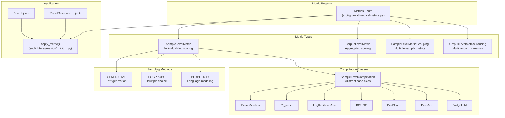
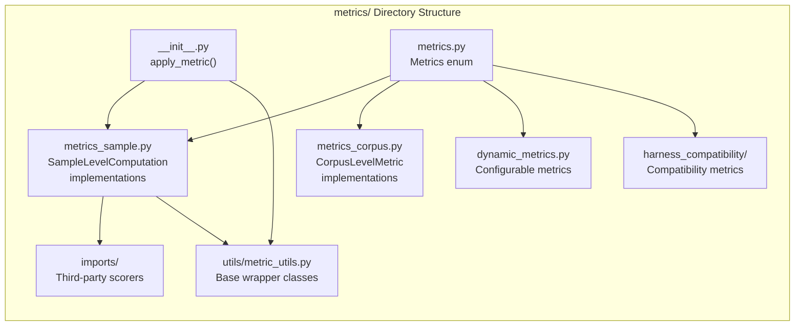

<!-- source: DeepWiki mcp.deepwiki.com · repo huggingface/lighteval · page 8 Metrics System · fetched 2026-10-26 -->

# Metrics System

<details>
<summary>Relevant source files</summary>

The following files were used as context for generating this wiki page:

- [src/lighteval/data.py](src/lighteval/data.py)
- [src/lighteval/metrics/__init__.py](src/lighteval/metrics/__init__.py)
- [src/lighteval/metrics/metrics.py](src/lighteval/metrics/metrics.py)
- [src/lighteval/metrics/metrics_sample.py](src/lighteval/metrics/metrics_sample.py)
- [tests/test_unit_harness_metrics.py](tests/test_unit_harness_metrics.py)

</details>


## Purpose and Scope

This page documents the metrics system architecture, which is responsible for scoring model outputs during evaluation. It covers the `Metrics` enum, the base classes for metric computation, sampling methods, and the metric application pipeline. For detailed information about individual metric implementations, see [Predefined Metrics](#8.1). For guidance on creating custom metrics, see [Creating Custom Metrics](#8.9).

The metrics system evaluates model performance by computing scores at two levels: **sample-level** metrics that score individual model responses, and **corpus-level** metrics that aggregate results across all samples in a task.

---

## System Architecture

The metrics system is organized around three core concepts:

1. **Metrics Enum**: A central registry in [src/lighteval/metrics/metrics.py:146-634]() that defines all available metrics
2. **Metric Computation Classes**: Base abstractions that implement scoring logic
3. **Application Pipeline**: The `apply_metric` function that orchestrates metric computation



**Sources**: [src/lighteval/metrics/metrics.py:1-634](), [src/lighteval/metrics/metrics_sample.py:64-80](), [src/lighteval/metrics/__init__.py:24-63]()

---

## Metric Categories by Sampling Method

Metrics are organized by `SamplingMethod`, which determines how the model is queried and what type of output is expected:

| Sampling Method | Purpose | Model Output | Example Metrics |
|----------------|---------|--------------|-----------------|
| `GENERATIVE` | Free-form text generation | Generated text strings | `exact_match`, `f1_score`, `rouge`, `bleu` |
| `LOGPROBS` | Multiple-choice selection | Log probabilities per choice | `loglikelihood_acc`, `mcc`, `recall_at_k` |
| `PERPLEXITY` | Language modeling | Per-token log probabilities | `word_perplexity`, `byte_perplexity` |

The sampling method is specified in each metric definition and determines how documents are batched and processed. See [src/lighteval/metrics/utils/metric_utils.py]() for the `SamplingMethod` enum definition.

**Sources**: [src/lighteval/metrics/metrics.py:146-634](), [src/lighteval/data.py:161-252]()

---

## Metric Computation Flow

```mermaid
sequenceDiagram
    participant Pipeline
    participant ApplyMetric["apply_metric()<br/>(__init__.py)"]
    participant BatchedMetrics["Batched Metrics"]
    participant NonBatchedMetrics["Non-Batched Metrics"]
    participant SampleComp["SampleLevelComputation"]
    participant CorpusAgg["Corpus Aggregation"]
    
    Pipeline->>ApplyMetric: responses, docs, metrics
    
    ApplyMetric->>ApplyMetric: Separate batched<br/>vs non-batched
    
    Note over ApplyMetric,BatchedMetrics: Process batched metrics first
    ApplyMetric->>BatchedMetrics: compute_sample(responses, docs)
    BatchedMetrics->>SampleComp: compute() for all samples
    SampleComp-->>BatchedMetrics: Scores for all samples
    BatchedMetrics-->>ApplyMetric: metric_outputs dict
    
    Note over ApplyMetric,NonBatchedMetrics: Process non-batched metrics
    loop For each doc/response pair
        ApplyMetric->>NonBatchedMetrics: compute_sample(doc, response)
        NonBatchedMetrics->>SampleComp: compute(doc, response)
        SampleComp-->>NonBatchedMetrics: Score
        NonBatchedMetrics-->>ApplyMetric: metric_output dict
    end
    
    ApplyMetric->>ApplyMetric: Combine all metric outputs
    ApplyMetric-->>Pipeline: List of output dicts (one per sample)
    
    Note over Pipeline,CorpusAgg: Later aggregation step
    Pipeline->>CorpusAgg: All sample-level scores
    CorpusAgg-->>Pipeline: Final aggregated metrics
```

The `apply_metric` function in [src/lighteval/metrics/__init__.py:29-62]() implements a two-phase computation:

1. **Batched metrics** (e.g., LLM-as-judge) are computed once for all samples together for efficiency
2. **Non-batched metrics** are computed individually for each doc/response pair

All metrics return sample-level scores, which are later aggregated at the corpus level using aggregation functions (mean, max, min, etc.).

**Sources**: [src/lighteval/metrics/__init__.py:29-62](), [src/lighteval/metrics/metrics_sample.py:64-80]()

---

## Core Abstractions

### SampleLevelComputation Base Class

The abstract base class for all metric computation logic:

```python
class SampleLevelComputation(ABC):
    @abstractmethod
    def compute(self, doc: Doc, model_response: ModelResponse, **kwargs):
        raise NotImplementedError
```

Located at [src/lighteval/metrics/metrics_sample.py:64-80](). Every concrete metric implementation extends this class and implements the `compute` method, which:
- Takes a `Doc` object (containing the prompt, choices, gold answer)
- Takes a `ModelResponse` object (containing model outputs)
- Returns a numeric score or dictionary of scores

**Sources**: [src/lighteval/metrics/metrics_sample.py:64-80]()

### Metric Wrapper Classes

Four wrapper classes package `SampleLevelComputation` implementations with metadata:

| Wrapper Class | Purpose | Corpus Aggregation |
|--------------|---------|-------------------|
| `SampleLevelMetric` | Single sample-level metric | Simple function (mean, max, etc.) |
| `CorpusLevelMetric` | Single corpus-level metric | Custom corpus computation class |
| `SampleLevelMetricGrouping` | Multiple sample-level metrics | Dict of functions per metric |
| `CorpusLevelMetricGrouping` | Multiple corpus-level metrics | Dict of corpus classes per metric |

Each wrapper specifies:
- `metric_name`: String identifier(s)
- `sample_level_fn`: The `SampleLevelComputation` instance
- `category`: The `SamplingMethod` (GENERATIVE/LOGPROBS/PERPLEXITY)
- `corpus_level_fn`: How to aggregate sample scores
- `higher_is_better`: Whether higher scores are better
- `batched_compute`: Whether to compute in batches (default: False)

**Sources**: [src/lighteval/metrics/utils/metric_utils.py]()

### Metrics Enum Structure

The `Metrics` enum in [src/lighteval/metrics/metrics.py:146-634]() serves as the central registry. Each entry maps a metric name to a wrapper instance:

```python
class Metrics(Enum):
    exact_match = SampleLevelMetric(
        metric_name="em",
        sample_level_fn=ExactMatches(strip_strings=True),
        category=SamplingMethod.GENERATIVE,
        corpus_level_fn=np.mean,
        higher_is_better=True,
    )
    
    loglikelihood_acc = SampleLevelMetric(
        metric_name="acc",
        sample_level_fn=LoglikelihoodAcc(logprob_normalization=None),
        category=SamplingMethod.LOGPROBS,
        corpus_level_fn=np.mean,
        higher_is_better=True,
    )
```

The enum provides:
- Standardized metric names accessible via `Metrics.exact_match`
- Type safety and autocomplete support
- Centralized configuration of all built-in metrics
- Support for metric parametrization via `__call__(sample_params)`

**Sources**: [src/lighteval/metrics/metrics.py:146-634]()

---

## Sample-Level Computation Patterns

### Pattern 1: Text Comparison Metrics

Metrics like `ExactMatches` and `F1_score` compare generated text to gold references:

**Location**: [src/lighteval/metrics/metrics_sample.py:81-241]()

Key features:
- Support multiple gold references per sample
- Configurable normalization functions for text preprocessing
- Aggregation across gold/prediction pairs (typically `max` or `mean`)
- Optional string stripping and prefix/suffix matching

### Pattern 2: Loglikelihood Metrics

Metrics like `LoglikelihoodAcc` and `Recall` evaluate multiple-choice questions:

**Location**: [src/lighteval/metrics/metrics_sample.py:243-436]()

Key features:
- Work with log probabilities of choices
- Support logprob normalization (by length, PMI, etc.)
- Select best choice using `np.argmax`
- Check if selected choice is in gold indices

### Pattern 3: Corpus-Level Preparators

Some metrics use preparator classes that collect data for corpus-level aggregation:

**Location**: [src/lighteval/metrics/sample_preparator.py]()

Examples:
- `GenerativePreparator`: Collects predictions and golds for BLEU/chrF
- `LoglikelihoodPreparator`: Prepares data for F1/MCC computation
- `PerplexityPreparator`: Tracks log probs and token counts

These preparators return data objects that are aggregated by corpus-level metric classes.

**Sources**: [src/lighteval/metrics/metrics_sample.py:81-436](), [src/lighteval/metrics/sample_preparator.py]()

---

## Metric Organization in Code



| File | Purpose | Key Contents |
|------|---------|--------------|
| `__init__.py` | Metric application | `apply_metric()` function |
| `metrics.py` | Metric registry | `Metrics` enum with 50+ predefined metrics |
| `metrics_sample.py` | Sample implementations | `ExactMatches`, `F1_score`, `ROUGE`, `BertScore`, etc. |
| `metrics_corpus.py` | Corpus implementations | `MatthewsCorrCoef`, `CorpusLevelF1Score`, perplexity, BLEU |
| `utils/metric_utils.py` | Base abstractions | Wrapper classes, `SamplingMethod` enum |
| `dynamic_metrics.py` | Configurable metrics | `MultilingualExtractiveMatchMetric` |
| `normalizations.py` | Text preprocessing | Normalization functions, logprob normalization |

**Sources**: [src/lighteval/metrics/]()

---

## Extending the Metrics Enum

Custom metrics can be added to the `Metrics` enum using the `extend_enum` function from the `aenum` library:

```python
from aenum import extend_enum
from lighteval.metrics.metrics import Metrics
from lighteval.metrics.utils.metric_utils import SampleLevelMetric

# Define your metric
my_metric = SampleLevelMetric(
    metric_name="my_score",
    sample_level_fn=MyCustomComputation(),
    category=SamplingMethod.GENERATIVE,
    corpus_level_fn=np.mean,
    higher_is_better=True,
)

# Extend the enum
extend_enum(Metrics, "my_custom_metric", my_metric)
```

After extension, the metric can be referenced in task configurations just like built-in metrics. For detailed guidance, see [Creating Custom Metrics](#8.9).

**Sources**: [src/lighteval/metrics/metrics.py:1-634]()

---

## Integration with Evaluation Pipeline

The metrics system integrates with the evaluation pipeline as follows:

1. **Task Configuration**: Tasks specify which metrics to use in [LightevalTaskConfig](#5.1)
2. **Document Grouping**: Documents are grouped by `SamplingMethod` in [DynamicBatchDataset](#6.3)
3. **Model Execution**: Models produce `ModelResponse` objects containing predictions/logprobs
4. **Metric Application**: `apply_metric` computes sample-level scores
5. **Corpus Aggregation**: The [EvaluationTracker](#9.1) aggregates sample scores using corpus-level functions
6. **Results Storage**: Final metrics are logged with standard errors via bootstrap

The `SamplingMethod` category ensures that only compatible metrics are applied to each type of model output.

**Sources**: [src/lighteval/metrics/__init__.py:29-62](), [src/lighteval/data.py:44-159]()

---

