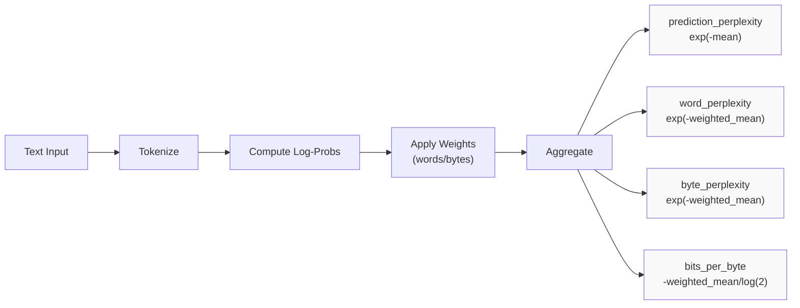
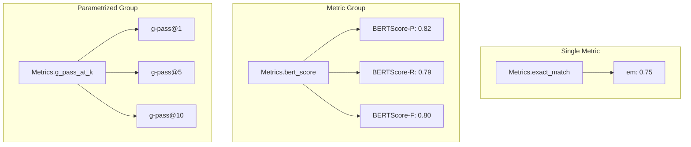
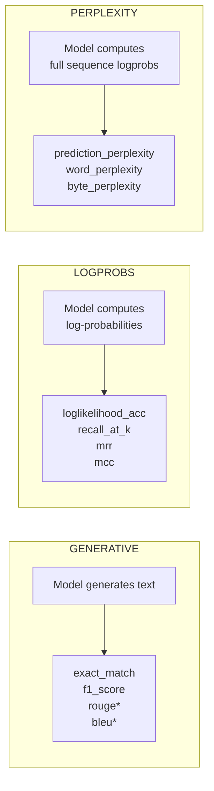

<!-- source: DeepWiki mcp.deepwiki.com · repo huggingface/lighteval · page 8.1 Predefined Metrics · fetched 2026-10-26 -->

# Predefined Metrics

<details>
<summary>Relevant source files</summary>

The following files were used as context for generating this wiki page:

- [src/lighteval/main_tasks.py](src/lighteval/main_tasks.py)
- [src/lighteval/metrics/metrics.py](src/lighteval/metrics/metrics.py)
- [src/lighteval/metrics/metrics_corpus.py](src/lighteval/metrics/metrics_corpus.py)
- [src/lighteval/metrics/metrics_sample.py](src/lighteval/metrics/metrics_sample.py)
- [src/lighteval/tasks/multilingual/tasks/global_mmlu.py](src/lighteval/tasks/multilingual/tasks/global_mmlu.py)
- [src/lighteval/tasks/registry.py](src/lighteval/tasks/registry.py)
- [src/lighteval/tasks/tasks/aimo.py](src/lighteval/tasks/tasks/aimo.py)
- [src/lighteval/tasks/tasks/ifbench/instructions.py](src/lighteval/tasks/tasks/ifbench/instructions.py)

</details>


This document catalogs the built-in metrics available in lighteval. These metrics are defined in the `Metrics` enum and can be directly referenced in task configurations. For information about implementing the computation logic behind these metrics, see [Sample-Level Metrics](#8.2) and [Corpus-Level Metrics](#8.3). For details on creating your own metrics, see [Creating Custom Metrics](#8.9).

## Overview

Lighteval provides 60+ predefined metrics organized into categories based on their evaluation purpose. Each metric is configured with:
- A `SampleLevelComputation` or `CorpusLevelComputation` implementation
- A `SamplingMethod` (GENERATIVE, LOGPROBS, or PERPLEXITY) that determines how the model is queried
- A corpus-level aggregation function (e.g., `np.mean`, `max`)
- A directionality indicator (`higher_is_better`)

All metrics are defined in the `Metrics` enum at [src/lighteval/metrics/metrics.py:146-624]().

**Sources:** [src/lighteval/metrics/metrics.py:146-624]()

## Metric Categories

```mermaid
graph TB
    subgraph "Metrics Enum"
        MetricsEnum["Metrics Enum<br/>(metrics.py:146-624)"]
    end
    
    subgraph "Accuracy Metrics"
        ExactMatch["exact_match<br/>ExactMatches"]
        LoglikelihoodAcc["loglikelihood_acc<br/>LoglikelihoodAcc"]
        AccGolds["acc_golds_likelihood<br/>AccGoldLikelihood"]
        Recall["recall_at_k<br/>Recall"]
        MRR["mrr<br/>MRR"]
    end
    
    subgraph "Text Similarity"
        F1["f1_score<br/>F1_score"]
        Rouge["rouge1, rouge2, rougeL<br/>ROUGE"]
        Bleu["bleu, bleu_1, bleu_4<br/>BLEU"]
        BertScore["bert_score<br/>BertScore"]
        Bleurt["bleurt<br/>BLEURT"]
    end
    
    subgraph "Perplexity"
        PPL["prediction_perplexity<br/>PerplexityPreparator"]
        WordPPL["word_perplexity<br/>PerplexityPreparator"]
        BytePPL["byte_perplexity<br/>PerplexityPreparator"]
        BitsPerByte["bits_per_byte<br/>PerplexityPreparator"]
        TargetPPL["target_perplexity<br/>TargetPerplexityPreparator"]
    end
    
    subgraph "Code Evaluation"
        PassAtK["pass_at_k<br/>PassAtK"]
        MajAtN["maj_at_n<br/>MajAtN"]
        AvgAtN["avg_at_n<br/>AvgAtN"]
        GPassAtK["g_pass_at_k<br/>GPassAtK"]
    end
    
    subgraph "Special Purpose"
        Extractiveness["extractiveness<br/>Extractiveness"]
        Faithfulness["faithfulness<br/>Faithfulness"]
        Copyright["copyright<br/>StringDistance"]
        Drop["drop<br/>DropMetrics"]
        MCC["mcc<br/>MatthewsCorrCoef"]
    end
    
    subgraph "LLM-as-Judge"
        SimpleQA["simpleqa_judge<br/>JudgeLLMSimpleQA"]
    end
    
    MetricsEnum --> ExactMatch
    MetricsEnum --> LoglikelihoodAcc
    MetricsEnum --> F1
    MetricsEnum --> Rouge
    MetricsEnum --> PPL
    MetricsEnum --> PassAtK
    MetricsEnum --> Extractiveness
    MetricsEnum --> SimpleQA
```



**Sources:** [src/lighteval/metrics/metrics.py:146-624]()

## Accuracy and Exact Match Metrics

These metrics evaluate whether model predictions exactly match reference answers or select correct choices.

| Metric Name | Description | Sampling Method | Implementation |
|------------|-------------|-----------------|----------------|
| `exact_match` | Exact string match between prediction and gold | GENERATIVE | [ExactMatches:81-168]() |
| `loglikelihood_acc` | Accuracy based on highest log-probability choice | LOGPROBS | [LoglikelihoodAcc:243-295]() |
| `acc_golds_likelihood` | Tests if argmax of logits equals gold | LOGPROBS | [AccGoldLikelihood:471-484]() |
| `recall_at_k` | Whether gold appears in top-k choices | LOGPROBS | [Recall:408-436]() |
| `mrr` | Mean reciprocal rank of gold choice | LOGPROBS | [MRR:438-469]() |

### Exact Match

The `exact_match` metric compares generated text to reference answers after optional normalization and stripping:

```python
# Usage in task config
metrics=[Metrics.exact_match]
```

Defined at [src/lighteval/metrics/metrics.py:255-261]():
- Uses `ExactMatches(strip_strings=True)` for sample-level computation
- Aggregates using `np.mean` across corpus
- Supports variants: prefix matching, suffix matching, full matching

### Loglikelihood Accuracy

The `loglikelihood_acc` metric evaluates multiple-choice questions by comparing log-probabilities of choices:

```python
# Usage in task config  
metrics=[Metrics.loglikelihood_acc]
```

Defined at [src/lighteval/metrics/metrics.py:420-426]():
- Selects choice with highest log-probability
- Supports optional normalization (token length, character length, PMI)
- Returns 1 if selected choice is in gold indices, 0 otherwise

**Sources:** [src/lighteval/metrics/metrics.py:146-624](), [src/lighteval/metrics/metrics_sample.py:81-295]()

## Text Generation and Similarity Metrics

These metrics evaluate the quality of generated text by comparing to reference texts using various similarity measures.

### F1 Score Metrics

| Metric Name | Description | Sampling Method | Aggregation |
|------------|-------------|-----------------|-------------|
| `f1_score` | Token-level F1 over bag of words | GENERATIVE | Sample mean |
| `f1_score_macro` | Macro-averaged F1 at corpus level | GENERATIVE | Corpus-level |
| `f1_score_micro` | Micro-averaged F1 at corpus level | GENERATIVE | Corpus-level |
| `loglikelihood_f1` | F1 for classification via logprobs | LOGPROBS | Corpus-level |
| `multi_f1_numeric` | Multi-class F1 for numeric labels | LOGPROBS | Corpus-level |

### ROUGE Metrics

ROUGE (Recall-Oriented Understudy for Gisting Evaluation) measures n-gram overlap:

| Metric Name | Description | N-gram Type |
|------------|-------------|-------------|
| `rouge1` | Unigram overlap | 1-gram |
| `rouge2` | Bigram overlap | 2-gram |
| `rougeL` | Longest common subsequence | LCS |
| `rougeLsum` | LCS at summary level | LCS-sum |
| `rouge_t5` | All ROUGE metrics with bootstrapping | All |

Defined at [src/lighteval/metrics/metrics.py:525-552](). The `ROUGE` class implementation is at [src/lighteval/metrics/metrics_sample.py:486-596]().

### BLEU Metrics

BLEU (Bilingual Evaluation Understudy) measures n-gram precision:

| Metric Name | Description | Implementation |
|------------|-------------|----------------|
| `bleu` | Corpus-level BLEU via sacrebleu | [CorpusLevelTranslationMetric:116-162]() |
| `bleu_1` | Sentence-level unigram BLEU | [BLEU:805-845]() |
| `bleu_4` | Sentence-level 4-gram BLEU | [BLEU:805-845]() |

### Semantic Similarity

| Metric Name | Description | Model |
|------------|-------------|-------|
| `bert_score` | Embedding-based similarity (P/R/F) | `microsoft/deberta-large-mnli` |
| `bleurt` | Learned metric for fluency/meaning | `Elron/bleurt-tiny-512` |

The `bert_score` metric returns three values at [src/lighteval/metrics/metrics.py:175-181]():
- `BERTScore-P`: Precision
- `BERTScore-R`: Recall  
- `BERTScore-F`: F1

**Sources:** [src/lighteval/metrics/metrics.py:189-217](), [src/lighteval/metrics/metrics_sample.py:486-845](), [src/lighteval/metrics/metrics_corpus.py:116-162]()

## Perplexity Metrics

Perplexity metrics measure how well a language model predicts a sequence. Lower perplexity indicates better prediction.



| Metric Name | Normalization | Sampling Method | Formula |
|------------|---------------|-----------------|---------|
| `prediction_perplexity` | Words | PERPLEXITY | exp(-mean(logprobs)) |
| `word_perplexity` | Word weights | PERPLEXITY | exp(-sum(logprobs)/sum(weights)) |
| `byte_perplexity` | Byte weights | PERPLEXITY | exp(-sum(logprobs)/sum(weights)) |
| `bits_per_byte` | Byte weights / log(2) | PERPLEXITY | -sum(logprobs)/sum(weights)/log(2) |
| `target_perplexity` | Words | LOGPROBS | exp(-mean(logprobs)) |

Defined at [src/lighteval/metrics/metrics.py:182-224]() and [src/lighteval/metrics/metrics.py:563-589](). Implementation at [src/lighteval/metrics/metrics_corpus.py:164-193]().

**Note:** `prediction_perplexity` uses the PERPLEXITY sampling method (full sequence), while `target_perplexity` uses LOGPROBS (target tokens only).

**Sources:** [src/lighteval/metrics/metrics.py:182-224](), [src/lighteval/metrics/metrics.py:499-505](), [src/lighteval/metrics/metrics.py:563-569](), [src/lighteval/metrics/metrics.py:584-590](), [src/lighteval/metrics/metrics_corpus.py:164-193]()

## Code Evaluation Metrics

These metrics evaluate code generation tasks by testing multiple samples per problem.

### Pass@K Family

Pass@K metrics estimate the probability that at least one of k generated samples passes the test cases:

| Metric Name | Variant | Sample Scoring | Use Case |
|------------|---------|----------------|----------|
| `pass_at_k` | Standard | Exact match | General code |
| `pass_at_k_math` | Math | Expression extraction | Math problems |
| `pass_at_k_letters` | Letters | Letter extraction | Multiple choice |
| `gpqa_instruct_pass_at_k` | GPQA | Letter extraction | GPQA benchmark |

Defined at [src/lighteval/metrics/metrics.py:462-498]() and [src/lighteval/metrics/metrics.py:607-624]().

### Majority and Average Voting

| Metric Name | Description | Implementation |
|------------|-------------|----------------|
| `maj_at_n` | Majority vote across n samples | [MajAtN]() |
| `avg_at_n` | Average score across n samples | [AvgAtN]() |
| `avg_at_n_math` | Average with math extraction | [AvgAtN + MultilingualExtractiveMatchMetric]() |

### Generative Pass@K

The `g_pass_at_k` family uses a different estimator than standard pass@k:

| Metric Name | Extraction | Use Case |
|------------|-----------|----------|
| `g_pass_at_k` | Exact match | General |
| `g_pass_at_k_math` | Math expressions | Math problems |
| `g_pass_at_k_latex` | LaTeX | LaTeX math |

Defined at [src/lighteval/metrics/metrics.py:375-419]().

**Sources:** [src/lighteval/metrics/metrics.py:154-174](), [src/lighteval/metrics/metrics.py:375-419](), [src/lighteval/metrics/metrics.py:434-440](), [src/lighteval/metrics/metrics.py:462-498](), [src/lighteval/metrics/metrics.py:607-624]()

## Mathematical Reasoning Metrics

These metrics handle mathematical expressions and multiple-choice questions with specialized extraction and normalization.

### Expression Matching

| Metric Name | Gold Format | Pred Format | Use Case |
|------------|-------------|-------------|----------|
| `expr_gold_metric` | Mathematical expressions | Math + LaTeX (boxed priority) | General math |
| `gpqa_instruct_metric` | Native letters | Native letters | GPQA multiple choice |

Both use `MultilingualExtractiveMatchMetric` for robust extraction with timeout protection (5 seconds) and fallback modes.

Defined at [src/lighteval/metrics/metrics.py:262-276]() and [src/lighteval/metrics/metrics.py:591-606]().

### Custom Scorers for inspect-ai Backend

For the inspect-ai backend, lighteval provides specialized scorers:

**Math Scorer** ([src/lighteval/metrics/metrics.py:84-111]()):
- Extracts expressions using `ExprExtractionConfig()` for gold
- Extracts using `ExprExtractionConfig()` and `LatexExtractionConfig()` for predictions
- Returns "C" (correct) or "I" (incorrect) for inspect-ai

**Multichoice Scorer** ([src/lighteval/metrics/metrics.py:113-144]()):
- Extracts letter indices from both gold and predictions
- Uses `IndicesExtractionConfig(prefix_for_extraction="NativeLetters")`
- Supports extraction without anchors

**Sources:** [src/lighteval/metrics/metrics.py:84-144](), [src/lighteval/metrics/metrics.py:262-276](), [src/lighteval/metrics/metrics.py:591-606]()

## Summarization and Faithfulness Metrics

These metrics evaluate the quality of generated summaries along multiple dimensions.

### Extractiveness

The `extractiveness` metric measures how much content is copied from the source:

| Metric Name | Language | Output Metrics |
|------------|----------|----------------|
| `extractiveness` | English | coverage, density, compression |
| `extractiveness_de` | German | coverage, density, compression |
| `extractiveness_fr` | French | coverage, density, compression |
| `extractiveness_it` | Italian | coverage, density, compression |

Defined at [src/lighteval/metrics/metrics.py:277-343](). Returns three scores:
- **coverage**: Fraction of source n-grams in summary
- **density**: Concentration of extractive fragments  
- **compression**: Ratio of summary to source length

Implementation at [src/lighteval/metrics/metrics_sample.py:661-715]().

### Faithfulness

| Metric Name | Model | Description |
|------------|-------|-------------|
| `faithfulness` | SummaCZS | Zero-shot consistency between summary and source |

Uses the SummaCZS model with sentence-level granularity to detect hallucinations. Defined at [src/lighteval/metrics/metrics.py:366-374](), implementation at [src/lighteval/metrics/metrics_sample.py:717-763]().

**Sources:** [src/lighteval/metrics/metrics.py:277-374](), [src/lighteval/metrics/metrics_sample.py:661-763]()

## Special Purpose Metrics

### Copyright Detection

The `copyright` metric group detects potential copyright issues by measuring string similarity:

```python
# Returns three metrics
copyright = {
    "longest_common_prefix_length": max,  # higher is worse
    "edit_distance": min,                  # lower is worse  
    "edit_similarity": max                 # higher is worse
}
```

Defined at [src/lighteval/metrics/metrics.py:239-247](). Implementation at [src/lighteval/metrics/metrics_sample.py:847-920]().

### Matthews Correlation Coefficient

The `mcc` metric computes a balanced measure for binary classification:

```python
# Usage for classification tasks
metrics=[Metrics.mcc]
```

Defined at [src/lighteval/metrics/metrics.py:441-447](). Corpus-level implementation at [src/lighteval/metrics/metrics_corpus.py:66-79]().

### DROP Metrics

Specialized metrics for the DROP reading comprehension benchmark:

```python
# Returns both EM and F1
drop = {
    "em": max,  # Exact match
    "f1": max   # Token F1
}
```

Defined at [src/lighteval/metrics/metrics.py:248-254]().

### TruthfulQA Metrics

Metrics for TruthfulQA multiple-choice evaluation:

```python
truthfulqa_mc_metrics = {
    "truthfulqa_mc1": np.mean,  # Single correct answer
    "truthfulqa_mc2": np.mean   # Multiple correct answers
}
```

Defined at [src/lighteval/metrics/metrics.py:577-583]().

### Translation Metrics

Corpus-level translation quality metrics:

| Metric Name | Description | Higher is Better |
|------------|-------------|------------------|
| `bleu` | BLEU score via sacrebleu | Yes |
| `chrf` | Character n-gram F-score | Yes |
| `chrf_plus` | ChrF with word order | Yes |
| `ter` | Translation Edit Rate | No |

Defined at [src/lighteval/metrics/metrics.py:189-238]() and [src/lighteval/metrics/metrics.py:570-576](). Implementation at [src/lighteval/metrics/metrics_corpus.py:116-162]().

**Sources:** [src/lighteval/metrics/metrics.py:189-254](), [src/lighteval/metrics/metrics.py:441-447](), [src/lighteval/metrics/metrics.py:570-583](), [src/lighteval/metrics/metrics_corpus.py:66-79](), [src/lighteval/metrics/metrics_corpus.py:116-162](), [src/lighteval/metrics/metrics_sample.py:847-920]()

## LLM-as-Judge Metrics

These metrics use language models to evaluate response quality.

### SimpleQA Judge

The `simpleqa_judge` metric uses an LLM to evaluate answer correctness:

```python
simpleqa_judge = {
    "simpleqa_judge": np.mean
}
```

Defined at [src/lighteval/metrics/metrics.py:553-562](). This is a batched metric (processes multiple samples at once for efficiency).

Configuration is provided via `JudgeLLMSimpleQA` class which:
- Formats prompts using `get_judge_prompt_simpleqa()`
- Processes responses using `process_judge_response_simpleqa()`
- Supports multiple judge backends (OpenAI, TGI, LiteLLM)

For more LLM-as-judge metrics, see [LLM-as-Judge Metrics](#8.5).

**Sources:** [src/lighteval/metrics/metrics.py:553-562](), [src/lighteval/metrics/utils/judge_utils.py:54](), [src/lighteval/metrics/utils/judge_utils.py:55]()

## Metric Grouping

Some metrics return multiple scores simultaneously using `SampleLevelMetricGrouping` or `CorpusLevelMetricGrouping`:



Examples of grouped metrics:
- `bert_score` → `BERTScore-P`, `BERTScore-R`, `BERTScore-F`
- `copyright` → `longest_common_prefix_length`, `edit_distance`, `edit_similarity`
- `extractiveness` → `summarization_coverage`, `summarization_density`, `summarization_compression`
- `drop` → `em`, `f1`
- `truthfulqa_mc_metrics` → `truthfulqa_mc1`, `truthfulqa_mc2`

**Sources:** [src/lighteval/metrics/metrics.py:175-181](), [src/lighteval/metrics/metrics.py:239-254](), [src/lighteval/metrics/metrics.py:277-293](), [src/lighteval/metrics/metrics.py:577-583]()

## Using Predefined Metrics

### In Task Configurations

Reference metrics directly by name from the `Metrics` enum:

```python
from lighteval.metrics.metrics import Metrics

task = LightevalTaskConfig(
    name="my_task",
    # ... other config ...
    metrics=[
        Metrics.exact_match,
        Metrics.f1_score,
        Metrics.rouge1,
    ]
)
```

### Parametrized Metrics

Some metrics accept parameters to customize their behavior:

```python
# Exact match with normalization
Metrics.exact_match(
    sample_params={
        "normalize_gold": math_normalizer,
        "normalize_pred": math_normalizer
    }
)

# Loglikelihood accuracy with normalization
Metrics.loglikelihood_acc(
    sample_params={
        "logprob_normalization": LogProbTokenNorm()
    }
)
```

When using parametrized metrics via CLI, use the `@` syntax:

```bash
# Task with parametrized metric
lighteval eval --tasks "my_task|5@normalize=True"
```

The task specification format at [src/lighteval/tasks/registry.py:196-214]() parses parameters after `@` and applies them to metric instances.

### Metric Normalization Options

For loglikelihood-based metrics, several normalization options are available:

| Normalization | Class | Effect |
|--------------|-------|--------|
| Token length | `LogProbTokenNorm` | Divides by number of tokens |
| Character length | `LogProbCharNorm` | Divides by number of characters |
| PMI | `LogProbPMINorm` | Pointwise mutual information normalization |
| None | `None` | Raw log-probabilities |

Example from [src/lighteval/tasks/multilingual/tasks/global_mmlu.py:129-136]():

```python
metrics=get_metrics_for_formulation(
    formulation,
    [
        LogLikelihoodAccMetric(normalization=LogProbTokenNorm()),
        LogLikelihoodAccMetric(normalization=LogProbCharNorm()),
        LogLikelihoodAccMetric(normalization=LogProbPMINorm()),
    ],
)
```

**Sources:** [src/lighteval/tasks/tasks/aimo.py:42-62](), [src/lighteval/tasks/multilingual/tasks/global_mmlu.py:104-179](), [src/lighteval/tasks/registry.py:196-214]()

## Sampling Methods

Each metric specifies a `SamplingMethod` that determines how the model is queried:



Defined in `SamplingMethod` enum at [src/lighteval/metrics/utils/metric_utils.py]():
- **GENERATIVE**: For open-ended text generation (uses `greedy_until()`)
- **LOGPROBS**: For multiple-choice and classification (uses `loglikelihood()`)  
- **PERPLEXITY**: For language modeling evaluation (uses `loglikelihood_rolling()`)

**Sources:** [src/lighteval/metrics/metrics.py:146-624](), [src/lighteval/metrics/utils/metric_utils.py]()

## Summary Table: All Predefined Metrics

| Metric | Sampling Method | Category | Corpus Aggregation |
|--------|----------------|----------|-------------------|
| `acc_golds_likelihood` | LOGPROBS | Accuracy | mean |
| `avg_at_n` | GENERATIVE | Code | mean |
| `avg_at_n_math` | GENERATIVE | Code | mean |
| `bert_score` | GENERATIVE | Similarity | mean (P/R/F) |
| `bits_per_byte` | PERPLEXITY | Perplexity | corpus-level |
| `bleu` | GENERATIVE | Translation | corpus-level |
| `bleu_1` | GENERATIVE | Similarity | mean |
| `bleu_4` | GENERATIVE | Similarity | mean |
| `bleurt` | GENERATIVE | Similarity | mean |
| `byte_perplexity` | PERPLEXITY | Perplexity | corpus-level |
| `chrf` | GENERATIVE | Translation | corpus-level |
| `chrf_plus` | GENERATIVE | Translation | corpus-level |
| `copyright` | GENERATIVE | Special | max/min/max |
| `drop` | GENERATIVE | QA | max (em/f1) |
| `exact_match` | GENERATIVE | Accuracy | mean |
| `expr_gold_metric` | GENERATIVE | Math | mean |
| `extractiveness` | GENERATIVE | Summarization | mean (3 metrics) |
| `f1_score` | GENERATIVE | Similarity | mean |
| `f1_score_macro` | GENERATIVE | Classification | corpus-level |
| `f1_score_micro` | GENERATIVE | Classification | corpus-level |
| `faithfulness` | GENERATIVE | Summarization | mean |
| `g_pass_at_k` | GENERATIVE | Code | mean |
| `g_pass_at_k_math` | GENERATIVE | Code | mean |
| `g_pass_at_k_latex` | GENERATIVE | Code | mean |
| `gpqa_instruct_metric` | GENERATIVE | Math | mean |
| `gpqa_instruct_pass_at_k` | GENERATIVE | Code | mean |
| `loglikelihood_acc` | LOGPROBS | Accuracy | mean |
| `loglikelihood_f1` | LOGPROBS | Classification | corpus-level |
| `maj_at_n` | GENERATIVE | Code | mean |
| `mcc` | LOGPROBS | Classification | corpus-level |
| `mrr` | LOGPROBS | Ranking | mean |
| `multi_f1_numeric` | LOGPROBS | Classification | corpus-level |
| `pass_at_k` | GENERATIVE | Code | mean |
| `pass_at_k_math` | GENERATIVE | Code | mean |
| `pass_at_k_letters` | GENERATIVE | Code | mean |
| `prediction_perplexity` | PERPLEXITY | Perplexity | corpus-level |
| `recall_at_k` | LOGPROBS | Ranking | mean |
| `rouge1` | GENERATIVE | Similarity | mean |
| `rouge2` | GENERATIVE | Similarity | mean |
| `rougeL` | GENERATIVE | Similarity | mean |
| `rougeLsum` | GENERATIVE | Similarity | mean |
| `rouge_t5` | GENERATIVE | Similarity | mean (4 metrics) |
| `simpleqa_judge` | GENERATIVE | LLM-as-Judge | mean |
| `target_perplexity` | LOGPROBS | Perplexity | corpus-level |
| `ter` | GENERATIVE | Translation | corpus-level |
| `truthfulqa_mc_metrics` | LOGPROBS | QA | mean (mc1/mc2) |
| `word_perplexity` | PERPLEXITY | Perplexity | corpus-level |

**Sources:** [src/lighteval/metrics/metrics.py:146-624]()

---

