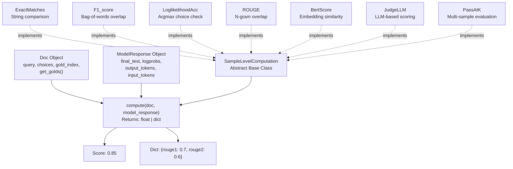
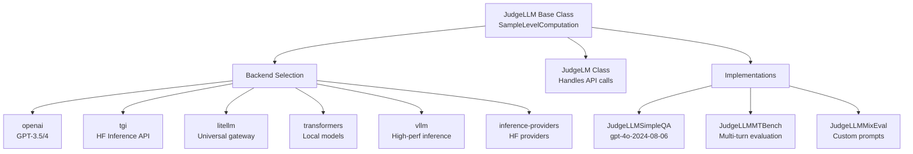
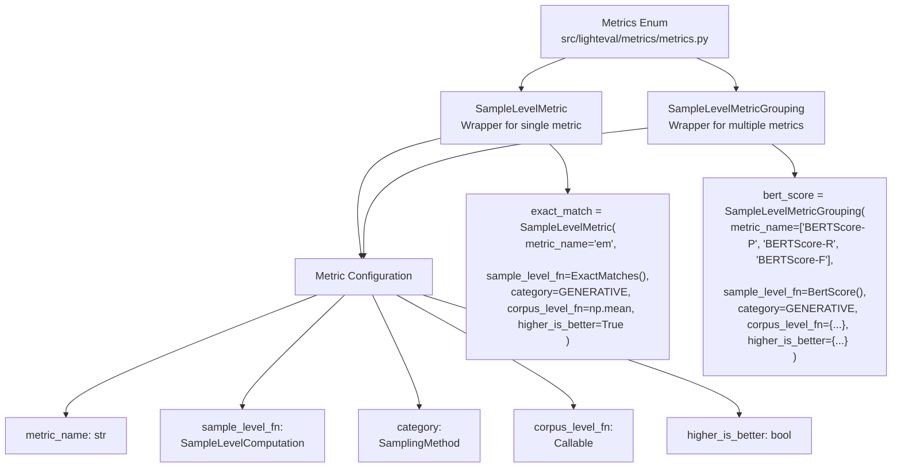
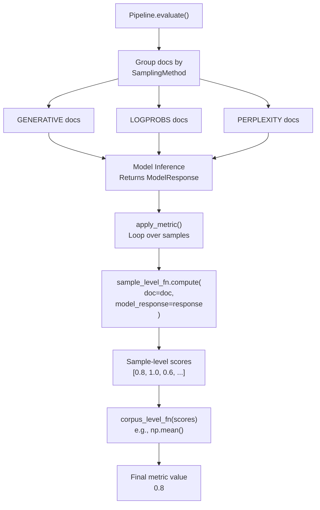

<!-- source: DeepWiki mcp.deepwiki.com · repo huggingface/lighteval · page 8.2 Sample-Level Metrics · fetched 2026-10-26 -->

# Sample-Level Metrics

<details>
<summary>Relevant source files</summary>

The following files were used as context for generating this wiki page:

- [src/lighteval/metrics/metrics.py](src/lighteval/metrics/metrics.py)
- [src/lighteval/metrics/metrics_sample.py](src/lighteval/metrics/metrics_sample.py)

</details>


Sample-level metrics compute scores individually for each evaluation example by comparing a single `Doc` object (containing the gold references) with a single `ModelResponse` object (containing the model's predictions). These per-sample scores are then aggregated at the corpus level using simple functions like `mean`, `max`, or `min`. Most evaluation metrics in lighteval fall into this category.

**Scope**: This page documents the `SampleLevelComputation` base class and its implementations. For information about corpus-level metrics that perform aggregation across all samples, see [Corpus-Level Metrics](#8.3). For details on how metrics are applied during evaluation, see [Metric Application](#8.8). For the complete catalog of available metrics, see [Predefined Metrics](#8.1).

---

## Architecture Overview

All sample-level metrics inherit from the `SampleLevelComputation` abstract base class, which defines a single required method:

```python
class SampleLevelComputation(ABC):
    @abstractmethod
    def compute(self, doc: Doc, model_response: ModelResponse, **kwargs):
        raise NotImplementedError
```

The `compute` method receives:
- `doc`: A `Doc` object containing the query, choices, gold references, and metadata
- `model_response`: A `ModelResponse` object containing the model's predictions, logprobs, and tokens
- `**kwargs`: Additional arguments for specialized metrics

The method returns either:
- A single numeric score (float or int)
- A dictionary mapping metric names to scores (for metrics that compute multiple values)

**Diagram: Sample-Level Computation Flow**



**Sources**: [src/lighteval/metrics/metrics_sample.py:64-78]()

---

## Exact Match and Accuracy Metrics

These metrics compare predictions directly against gold references, optionally applying normalization and supporting various matching strategies.

### ExactMatches

The `ExactMatches` class performs string-based exact matching with configurable normalization and matching types.

**Key Parameters**:
- `aggregation_function`: How to aggregate scores when multiple golds/predictions exist (default: `max`)
- `normalize_gold`/`normalize_pred`: Functions to normalize strings before comparison
- `strip_strings`: Whether to strip whitespace (default: `False`)
- `type_exact_match`: Type of match - `"full"` (exact), `"prefix"`, or `"suffix"` (default: `"full"`)

**Behavior**:
1. Retrieves all gold references using `doc.get_golds()`
2. Compares each gold against each prediction in `model_response.final_text`
3. Applies normalization if specified
4. Returns 1 for a match, 0 otherwise
5. Aggregates scores using `aggregation_function`

**Example Usage in Metrics Enum**:
```python
exact_match = SampleLevelMetric(
    metric_name="em",
    sample_level_fn=ExactMatches(strip_strings=True),
    category=SamplingMethod.GENERATIVE,
    corpus_level_fn=np.mean,
    higher_is_better=True,
)
```

**Sources**: [src/lighteval/metrics/metrics_sample.py:81-168](), [src/lighteval/metrics/metrics.py:255-261]()

### F1_score

Computes F1 score over the bag-of-words representation of predictions and gold references using NLTK.

**Key Parameters**:
- `aggregation_function`: Aggregation method (default: `max`)
- `normalize_gold`/`normalize_pred`: Normalization functions
- `strip_strings`: Strip whitespace (default: `False`)

**Computation**:
1. Splits gold and prediction into word sets
2. Computes F1 measure using `nltk.scores.f_measure`
3. Returns 0.0 if F1 is None

**Sources**: [src/lighteval/metrics/metrics_sample.py:170-241](), [src/lighteval/metrics/metrics.py:345-351]()

---

## Logprob-Based Metrics

These metrics operate on log probabilities from multiple-choice tasks, where the model computes probabilities for each choice.

### LoglikelihoodAcc

Tests whether the choice with the highest log probability matches the gold index.

**Key Parameter**:
- `logprob_normalization`: Optional `LogProbNormalization` to apply (e.g., length normalization)

**Computation Flow**:
1. Extracts choice logprobs from `model_response.logprobs[:n_choices]`
2. Optionally extracts unconditioned logprobs for normalization
3. Applies normalization if specified using `normalize_log_probs()`
4. Finds `best_choice = np.argmax(normalized_log_probs)`
5. Returns 1 if `best_choice in gold_ixs`, 0 otherwise

**Sources**: [src/lighteval/metrics/metrics_sample.py:243-295](), [src/lighteval/metrics/metrics.py:420-426]()

### Recall

Checks if any of the top-k choices (by log probability) match a gold index.

**Key Parameter**:
- `k`: Depth level for recall (Recall@1 is equivalent to accuracy)

**Computation**:
```python
if k == 1:
    return int(np.argmax(choices_logprobs) in gold_ixs)
return int(any(ix in gold_ixs for ix in np.argsort(choices_logprobs)[::-1][:k]))
```

**Sources**: [src/lighteval/metrics/metrics_sample.py:408-436](), [src/lighteval/metrics/metrics.py:506-512]()

### MRR (Mean Reciprocal Rank)

Computes the reciprocal rank of the first correct choice in the ranked list.

**Key Parameter**:
- `length_normalization`: Whether to normalize logprobs by choice length (default: `False`)

**Computation**:
1. Optionally normalizes logprobs by dividing by choice length
2. Ranks choices by logprob
3. Finds the minimum rank of any gold choice
4. Returns `1.0 / (min_rank + 1)`

**Sources**: [src/lighteval/metrics/metrics_sample.py:438-469](), [src/lighteval/metrics/metrics.py:448-454]()

### NormalizedMultiChoiceProbability

Returns the normalized probability of choosing a gold choice: `P(gold) / sum(P(all choices))`.

**Key Parameters**:
- `log_prob_normalization`: Normalization to apply to logprobs
- `aggregation_function`: How to aggregate multiple gold probabilities (default: `np.max`)

**Computation**:
1. Normalizes logprobs if specified
2. Converts to probabilities: `probs = np.exp(normalized_log_probs)`
3. Computes `normalized_probs = probs[gold_ixs] / np.sum(probs)`
4. Aggregates gold probabilities

**Sources**: [src/lighteval/metrics/metrics_sample.py:297-355]()

---

## Text Similarity Metrics

These metrics measure similarity between generated text and references using various algorithms.

### ROUGE

Wrapper around `rouge_scorer` for computing ROUGE-1, ROUGE-2, ROUGE-L, and ROUGE-Lsum.

**Key Parameters**:
- `methods`: List of ROUGE types (e.g., `["rouge1", "rouge2", "rougeL"]`)
- `multiple_golds`: Whether to compare against all golds simultaneously (default: `False`)
- `bootstrap`: Use bootstrapping for confidence intervals (default: `False`)
- `normalize_gold`/`normalize_pred`: Normalization functions
- `tokenizer`: Optional tokenizer object for ROUGE scorer

**Three Computation Modes**:
1. **Standard**: Compares each pred-gold pair, aggregates scores
2. **Multiple Golds**: Uses `scorer.score_multi(golds, pred)` for simultaneous comparison
3. **Bootstrap**: Uses `BootstrapAggregator` for statistical confidence

**Sources**: [src/lighteval/metrics/metrics_sample.py:486-596](), [src/lighteval/metrics/metrics.py:525-552]()

### BertScore

Computes precision, recall, and F1 using contextualized embeddings from `microsoft/deberta-large-mnli`.

**Computation Details**:
- Uses cosine similarity between token embeddings
- Computes IDF-weighted scores
- Returns dict: `{"BERTScore-P": float, "BERTScore-R": float, "BERTScore-F": float}`

**Initialization**: Model is downloaded on first computation.

**Sources**: [src/lighteval/metrics/metrics_sample.py:598-659](), [src/lighteval/metrics/metrics.py:175-181]()

### BLEU

Sentence-level BLEU score using NLTK's `sentence_bleu`.

**Key Parameter**:
- `n_gram`: N-gram level (1-4)

**Computation**:
```python
weights = [1 if ix == n_gram else 0 for ix in range(1, 5)]
score = sentence_bleu([word_tokenize(g) for g in golds], 
                      word_tokenize(pred), 
                      weights=weights)
```

**Sources**: [src/lighteval/metrics/metrics_sample.py:805-845](), [src/lighteval/metrics/metrics.py:196-209]()

### BLEURT

Uses the `Elron/bleurt-tiny-512` model for learned evaluation metrics.

**Implementation**: Wraps a sequence classification model that scores (gold, pred) pairs.

**Sources**: [src/lighteval/metrics/metrics_sample.py:765-803](), [src/lighteval/metrics/metrics.py:211-217]()

---

## String Distance Metrics

The `StringDistance` class computes edit-based metrics using NLTK.

**Supported Metrics**:
- `longest_common_prefix_length`: Length of longest matching prefix
- `edit_distance`: Token-level Levenshtein distance
- `edit_similarity`: `1 - edit_distance / max(len(s1), len(s2))`

**Key Parameter**:
- `metric_types`: List of metrics to compute
- `strip_prediction`: Strip predictions before comparison (default: `True`)

**Behavior**:
- Tokenizes using `TreebankWordTokenizer`
- Truncates reference to match prediction length
- Returns dict with requested metrics
- Aggregates multiple predictions using metric-specific functions

**Sources**: [src/lighteval/metrics/metrics_sample.py:847-940](), [src/lighteval/metrics/metrics.py:239-247]()

---

## Summarization Metrics

### Extractiveness

Measures how extractive a summary is compared to the source document.

**Key Parameters**:
- `normalize_input`/`normalize_pred`: Normalization functions (defaults: `remove_braces`, `remove_braces_and_strip`)
- `input_column`: Column name in `doc.specific` for source text (default: `"text"`)
- `language`: ISO language code (default: `"en"`)

**Returns**:
```python
{
    "summarization_coverage": float,  # Fraction of source in summary
    "summarization_density": float,    # Longest common subsequence density
    "summarization_compression": float # Compression ratio
}
```

**Implementation**: Uses `DataStatsMetric` for computation.

**Sources**: [src/lighteval/metrics/metrics_sample.py:661-715](), [src/lighteval/metrics/metrics.py:277-343]()

### Faithfulness

Measures factual consistency using SummaC (Summary Consistency) model.

**Key Parameters**:
- `normalize_input`/`normalize_pred`: Normalization functions
- `input_column`: Source text column (default: `"text"`)

**Implementation**: Uses `SummaCZS` (Summary Content Zero-Shot) with:
- `granularity="sentence"`
- `model_name="vitc"`

**Returns**: Consistency score between 0 and 1

**Sources**: [src/lighteval/metrics/metrics_sample.py:717-763](), [src/lighteval/metrics/metrics.py:366-374]()

---

## LLM-as-Judge Metrics

The `JudgeLLM` base class enables using language models as evaluators.

**Diagram: JudgeLLM Architecture**



**JudgeLLM Base Class Parameters**:
- `judge_model_name`: Model identifier (e.g., `"gpt-4o-2024-08-06"`)
- `template`: Callable that formats the judge prompt
- `process_judge_response`: Callable that parses the judge's response
- `judge_backend`: Backend type (see diagram)
- `short_judge_name`: Short identifier for output keys
- `response_format`: Optional Pydantic model for structured outputs
- `url`: API endpoint URL
- `hf_provider`: HuggingFace provider name
- `max_tokens`: Maximum tokens in response
- `backend_options`: Additional backend configuration

**Concrete Implementations**:

1. **JudgeLLMSimpleQA**: Uses GPT-4o to evaluate factual correctness
   - Implements batched evaluation via `evaluate_answer_batch()`
   - Returns: `{"simpleqa_judge": score, "user_prompt": str, "judgement": str}`

2. **JudgeLLMMTBench**: Evaluates multi-turn conversations
   - Handles up to 2 turns with context
   - Returns per-turn scores and judgements

3. **JudgeLLMMixEval**: Evaluates with custom prompting strategies
   - Configurable through template and process functions

**Sources**: [src/lighteval/metrics/metrics_sample.py:942-1107](), [src/lighteval/metrics/metrics.py:553-562]()

---

## Sampling Metrics

Sampling metrics evaluate models that generate multiple predictions per example. They inherit from both `SamplingMetric` and `SampleLevelComputation`.

### SamplingMetric Base Class

Provides shared normalization and scoring infrastructure.

**Key Parameters**:
- `normalize`: Normalization function (callable or string name)
- `strip_strings`: Strip whitespace (default: `False`)
- `sample_scoring_function`: Function or `SampleLevelComputation` to score individual samples

**Methods**:
- `preprocess(text)`: Applies normalization to text
- `default_sample_scoring(doc, model_response)`: Default exact match scoring with configurable match type

**Sources**: [src/lighteval/metrics/metrics_sample.py:1109-1174]()

### AvgAtN

Averages scores across `n` samples.

**Computation**:
```python
all_scores = [compute_score(doc, model_response[i]) for i in range(n)]
return np.mean(all_scores)
```

**Sources**: [src/lighteval/metrics/metrics_sample.py:1176-1210](), [src/lighteval/metrics/metrics.py:154-160]()

### MajAtN

Uses majority voting: selects the most frequent prediction from `n` samples.

**Computation**:
1. Generates `n` predictions
2. Preprocesses all predictions
3. Finds majority prediction: `max(all_answers, key=all_answers.count)`
4. Scores the majority prediction against gold

**Sources**: [src/lighteval/metrics/metrics_sample.py:1212-1262](), [src/lighteval/metrics/metrics.py:434-440]()

### PassAtK

Implements the pass@k estimator from Chen et al. (2021).

**Key Parameters**:
- `k`: Number of correct samples needed
- `n`: Total number of samples (if not specified, uses all predictions)

**Algorithm**:
```python
def pass_at_k(all_scores):
    c = all_scores.count(1)  # Number of correct samples
    if n - c < k:
        return 1.0
    return 1.0 - np.prod(1.0 - k / np.arange(n - c + 1, n + 1))
```

This is an unbiased estimator that doesn't require generating exactly `k` samples.

**Sources**: [src/lighteval/metrics/metrics_sample.py:1264-1329](), [src/lighteval/metrics/metrics.py:462-498]()

### GPassAtK

Implements G-Pass@k from "Beyond pass@k" (arxiv:2412.13147).

**Key Parameters**:
- `k`: Can be single int or list of ints
- `n`: Total samples
- `thresholds`: Success thresholds (default: `[0.0, 0.25, 0.5, 0.75, 1.0]`)
- `name_prefix`: Optional prefix for metric names

**Returns**: Dictionary with multiple metrics:
- `g-pass@{k}_{t}` for each k and threshold t
- `mg-pass@{k}` (mean G-Pass@k) for each k

**Computation**: Uses hypergeometric distribution to compute probabilities:
```python
hypergeom.sf(m - 1, n, c, k)
```
where `m = max(ceil(k * t), 1)` is the minimum number of successes required.

**Metric Names**: Generated dynamically, e.g., `["g-pass@5_0.0", "g-pass@5_0.25", ..., "mg-pass@5"]`

**Sources**: [src/lighteval/metrics/metrics_sample.py:1331-1458](), [src/lighteval/metrics/metrics.py:375-419]()

---

## Integration with Metrics Enum

Sample-level metrics are registered in the `Metrics` enum wrapped in `SampleLevelMetric` or `SampleLevelMetricGrouping` objects.

**Diagram: Metrics Enum Integration**



**Key Differences**:
- `SampleLevelMetric`: Single metric name, returns single score
- `SampleLevelMetricGrouping`: Multiple metric names, returns dict of scores

**Example Registration**:
```python
# Single metric
exact_match = SampleLevelMetric(
    metric_name="em",
    sample_level_fn=ExactMatches(strip_strings=True),
    category=SamplingMethod.GENERATIVE,
    corpus_level_fn=np.mean,
    higher_is_better=True,
)

# Multiple metrics
bert_score = SampleLevelMetricGrouping(
    metric_name=["BERTScore-P", "BERTScore-R", "BERTScore-F"],
    sample_level_fn=BertScore(),
    category=SamplingMethod.GENERATIVE,
    corpus_level_fn={"BERTScore-P": np.mean, "BERTScore-R": np.mean, "BERTScore-F": np.mean},
    higher_is_better={"BERTScore-P": True, "BERTScore-R": True, "BERTScore-F": True},
)
```

**Sources**: [src/lighteval/metrics/metrics.py:146-624]()

---

## Metric Computation Workflow

**Diagram: Sample-Level Metric Execution**



**Process**:
1. Pipeline groups docs by `SamplingMethod` (GENERATIVE, LOGPROBS, PERPLEXITY)
2. Model performs inference, returning `ModelResponse` for each doc
3. For each metric in the task:
   - `apply_metric()` calls `sample_level_fn.compute()` for each (doc, response) pair
   - Collects all sample-level scores
   - Applies `corpus_level_fn` to aggregate (e.g., `np.mean`, `max`, `min`)
4. Returns aggregated metric values with standard errors

**Batched vs Non-Batched**: Some metrics (like `JudgeLLM` implementations) support batched computation where `compute()` receives lists of docs and responses for efficiency.

**Sources**: [src/lighteval/metrics/metrics_sample.py:23-25](), [src/lighteval/metrics/metrics.py:146-624]()

---

## Common Metric Configuration Patterns

### Normalization

Many metrics support normalization functions to standardize text before comparison:

```python
from lighteval.metrics.normalizations import (
    remove_braces,
    remove_braces_and_strip,
    bigbench_normalizer
)

# Example
ROUGE(
    methods=["rouge1", "rouge2"],
    normalize_gold=bigbench_normalizer,
    normalize_pred=bigbench_normalizer
)
```

### Aggregation Functions

When multiple golds or predictions exist, aggregation functions determine the final score:
- `max`: Takes the best match (default for exact match)
- `min`: Takes the worst match (useful for edit distance)
- `np.mean`: Averages all comparisons
- Custom functions: Any callable that accepts a list and returns a scalar

### Sampling Method Categories

Each metric specifies its `category`:
- `SamplingMethod.GENERATIVE`: For text generation tasks
- `SamplingMethod.LOGPROBS`: For multiple-choice tasks using log probabilities
- `SamplingMethod.PERPLEXITY`: For language modeling perplexity

This determines which model method is called:
- GENERATIVE → `model.greedy_until()`
- LOGPROBS → `model.loglikelihood()`
- PERPLEXITY → `model.loglikelihood_rolling()`

**Sources**: [src/lighteval/metrics/metrics_sample.py:82-117](), [src/lighteval/metrics/normalizations.py]()

---

## Creating Custom Sample-Level Metrics

To create a custom sample-level metric:

1. **Define a class** inheriting from `SampleLevelComputation`:

```python
from lighteval.metrics.metrics_sample import SampleLevelComputation
from lighteval.tasks.requests import Doc
from lighteval.models.model_output import ModelResponse

class MyCustomMetric(SampleLevelComputation):
    def __init__(self, threshold: float = 0.5):
        self.threshold = threshold
    
    def compute(self, doc: Doc, model_response: ModelResponse, **kwargs) -> float:
        # Access gold references
        golds = doc.get_golds()
        
        # Access predictions
        predictions = model_response.final_text
        
        # Implement your scoring logic
        score = 0.0
        for pred in predictions:
            for gold in golds:
                if self.custom_similarity(pred, gold) > self.threshold:
                    score = 1.0
                    break
        
        return score
    
    def custom_similarity(self, text1: str, text2: str) -> float:
        # Your similarity computation
        return 0.0
```

2. **Register in Metrics enum**:

```python
from lighteval.metrics.metrics import Metrics
from lighteval.metrics.utils.metric_utils import SampleLevelMetric, SamplingMethod
import numpy as np

Metrics.my_custom = SampleLevelMetric(
    metric_name="custom_score",
    sample_level_fn=MyCustomMetric(threshold=0.7),
    category=SamplingMethod.GENERATIVE,
    corpus_level_fn=np.mean,
    higher_is_better=True,
)
```

3. **Use in task definitions**:

```python
LightevalTaskConfig(
    name="my_task",
    metrics=["my_custom"],
    # ... other config
)
```

For more details on extending metrics, see [Creating Custom Metrics](#8.9).

**Sources**: [src/lighteval/metrics/metrics_sample.py:64-78](), [src/lighteval/metrics/metrics.py:146-624]()

---

