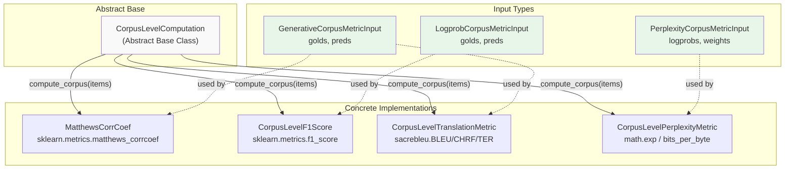
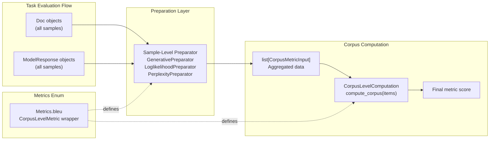
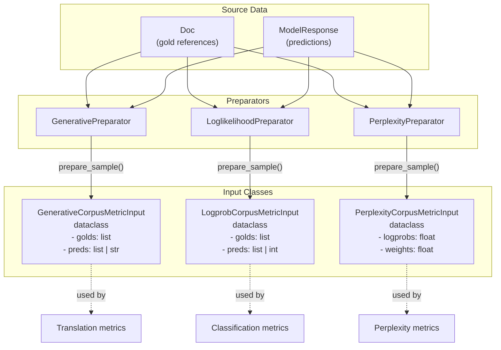
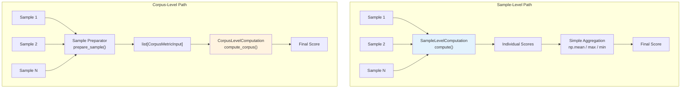

<!-- source: DeepWiki mcp.deepwiki.com · repo huggingface/lighteval · page 8.3 Corpus-Level Metrics · fetched 2026-10-26 -->

# Corpus-Level Metrics

<details>
<summary>Relevant source files</summary>

The following files were used as context for generating this wiki page:

- [src/lighteval/main_tasks.py](src/lighteval/main_tasks.py)
- [src/lighteval/metrics/metrics.py](src/lighteval/metrics/metrics.py)
- [src/lighteval/metrics/metrics_corpus.py](src/lighteval/metrics/metrics_corpus.py)
- [src/lighteval/metrics/metrics_sample.py](src/lighteval/metrics/metrics_sample.py)
- [src/lighteval/tasks/multilingual/tasks/global_mmlu.py](src/lighteval/tasks/multilingual/tasks/global_mmlu.py)
- [src/lighteval/tasks/registry.py](src/lighteval/tasks/registry.py)
- [src/lighteval/tasks/tasks/aimo.py](src/lighteval/tasks/tasks/aimo.py)
- [src/lighteval/tasks/tasks/ifbench/instructions.py](src/lighteval/tasks/tasks/ifbench/instructions.py)

</details>


Corpus-level metrics compute scores by aggregating information across all samples in an evaluation task, rather than computing scores per individual sample and averaging them. This is essential for metrics like BLEU, Matthews Correlation Coefficient, and perplexity where the computation requires access to the full distribution of predictions and gold references.

For information about sample-level metrics (which compute scores per document and then aggregate), see [Sample-Level Metrics](#8.2). For the complete catalog of available metrics, see [Predefined Metrics](#8.1).

## Overview

Unlike sample-level metrics that operate on individual `Doc`/`ModelResponse` pairs, corpus-level metrics receive all samples from a task at once. This enables computations that depend on corpus-wide statistics such as:

- **Classification metrics** requiring confusion matrices (Matthews Correlation Coefficient, macro/micro F1)
- **Translation metrics** using corpus-level statistics (BLEU, CHRF, TER)
- **Perplexity metrics** requiring weighted aggregation across sequences (word perplexity, bits per byte)

The evaluation pipeline first collects prepared data from all samples, then passes this corpus-level input to the metric's `compute_corpus` method.

**Sources:** [src/lighteval/metrics/metrics_corpus.py:1-193](), [src/lighteval/metrics/metrics.py:34-39]()

## Architecture

### Base Class and Input Types



**Diagram: Corpus-Level Metric Class Hierarchy**

All corpus-level metrics inherit from `CorpusLevelComputation` and implement the `compute_corpus` method. Different metric types receive different input structures prepared by their corresponding sample-level preparators.

**Sources:** [src/lighteval/metrics/metrics_corpus.py:48-63](), [src/lighteval/metrics/sample_preparator.py:36-98]()

### Integration with Metrics System



**Diagram: Corpus-Level Metric Evaluation Flow**

The `CorpusLevelMetric` wrapper in the `Metrics` enum specifies both a sample-level preparator (to extract relevant data from each sample) and a corpus-level computation function (to aggregate and compute the final score).

**Sources:** [src/lighteval/metrics/utils/metric_utils.py:75-87](), [src/lighteval/metrics/metrics.py:182-237]()

## Built-in Corpus-Level Metrics

### Matthews Correlation Coefficient

The `MatthewsCorrCoef` class computes the Matthews Correlation Coefficient for classification tasks using scikit-learn.

| Property | Value |
|----------|-------|
| **Class** | `MatthewsCorrCoef` |
| **Input Type** | `GenerativeCorpusMetricInput` or `LogprobCorpusMetricInput` |
| **Metric Name** | `mcc` |
| **Higher is Better** | Yes |
| **Backend** | `sklearn.metrics.matthews_corrcoef` |

**Implementation:**

```python
class MatthewsCorrCoef(CorpusLevelComputation):
    def compute_corpus(self, items: list[GenerativeCorpusMetricInput]) -> float:
        golds = [i.golds for i in items]
        preds = [i.preds for i in items]
        return sklearn.metrics.matthews_corrcoef(golds, preds)
```

**Usage in Metrics Enum:**

```python
mcc = CorpusLevelMetric(
    metric_name="mcc",
    sample_level_fn=LoglikelihoodPreparator(),
    category=SamplingMethod.LOGPROBS,
    corpus_level_fn=MatthewsCorrCoef(),
    higher_is_better=True,
)
```

**Sources:** [src/lighteval/metrics/metrics_corpus.py:66-78](), [src/lighteval/metrics/metrics.py:441-447]()

### Corpus-Level F1 Score

The `CorpusLevelF1Score` class supports multiple averaging strategies for F1 computation: `weighted`, `macro`, `micro`, or `None`.

| Property | Value |
|----------|-------|
| **Class** | `CorpusLevelF1Score` |
| **Input Type** | `LogprobCorpusMetricInput` or `GenerativeCorpusMetricInput` |
| **Parameters** | `average`: str, `num_classes`: int |
| **Backend** | `sklearn.metrics.f1_score` |

**Key Features:**

- **Binary F1**: When `num_classes=2`, computes standard F1 score
- **Multi-class F1**: When `num_classes>2`, computes F1 for each class and averages
- **Averaging modes**: `weighted` (by support), `macro` (unweighted mean), `micro` (global precision/recall), or `None` (per-class scores)

**Implementation:**

```python
class CorpusLevelF1Score(CorpusLevelComputation):
    def __init__(self, average: str, num_classes: int = 2):
        self.average = average
        self.num_classes = num_classes
    
    def compute_corpus(self, items: list[LogprobCorpusMetricInput]):
        golds = [i.golds for i in items]
        preds = [i.preds for i in items]
        
        if self.num_classes == 2:
            fscore = sklearn.metrics.f1_score(golds, preds, average=self.average)
            return np.max(fscore)
        
        # Multi-class: compute F1 for each class
        f1s = []
        for i in range(self.num_classes):
            f1s.append(sklearn.metrics.f1_score(
                y_true=[g == i for g in golds],
                y_pred=[p == i for p in preds],
                average=self.average
            ))
        return float(np.mean(f1s))
```

**Usage Examples:**

```python
# Macro F1 for generative tasks
f1_score_macro = CorpusLevelMetric(
    metric_name="f1",
    sample_level_fn=GenerativePreparator(),
    corpus_level_fn=CorpusLevelF1Score(average="macro"),
)

# Micro F1 for loglikelihood tasks
f1_score_micro = CorpusLevelMetric(
    metric_name="f1",
    sample_level_fn=GenerativePreparator(),
    corpus_level_fn=CorpusLevelF1Score(average="micro"),
)

# Multi-class F1 with 3 classes
multi_f1_numeric = CorpusLevelMetric(
    metric_name="mf1",
    sample_level_fn=LoglikelihoodPreparator(is_single_token=True),
    corpus_level_fn=CorpusLevelF1Score(average="micro", num_classes=3),
)
```

**Sources:** [src/lighteval/metrics/metrics_corpus.py:81-113](), [src/lighteval/metrics/metrics.py:352-365](), [src/lighteval/metrics/metrics.py:455-461]()

### Translation Metrics

The `CorpusLevelTranslationMetric` class provides access to standard machine translation metrics via `sacrebleu`.

| Property | Value |
|----------|-------|
| **Class** | `CorpusLevelTranslationMetric` |
| **Input Type** | `GenerativeCorpusMetricInput` |
| **Supported Metrics** | `bleu`, `chrf`, `chrf++`, `ter` |
| **Parameters** | `metric_type`: str, `lang`: Literal["zh", "ja", "ko", ""] |
| **Backend** | `sacrebleu` |

**Supported Metrics:**

- **BLEU**: Bilingual Evaluation Understudy, measures n-gram overlap
- **CHRF**: Character n-gram F-score
- **CHRF++**: CHRF with word bigrams (word_order=2)
- **TER**: Translation Error Rate, measures edit distance

**Implementation:**

```python
class CorpusLevelTranslationMetric(CorpusLevelComputation):
    def __init__(self, metric_type: str, lang: Literal["zh", "ja", "ko", ""] = ""):
        self.metric_type = metric_type
        self.lang = lang
    
    def get_metric(self):
        if self.metric_type == "bleu":
            return sacrebleu.BLEU(trg_lang=self.lang)
        elif self.metric_type == "chrf":
            return sacrebleu.CHRF()
        elif self.metric_type == "chrf++":
            return sacrebleu.CHRF(word_order=2)
        elif self.metric_type == "ter":
            return sacrebleu.TER(asian_support=True if self.lang != "" else False)
    
    def compute_corpus(self, items: list[GenerativeCorpusMetricInput]) -> float:
        metric = self.get_metric()
        golds = [i.golds for i in items]
        preds = [i.preds[0] for i in items]  # Takes first prediction
        
        if self.metric_type == "bleu":
            golds = [[gold[0] for gold in golds]]
        
        corpus_score = metric.corpus_score(hypotheses=preds, references=golds)
        return float(corpus_score.score)
```

**Usage Examples:**

```python
bleu = CorpusLevelMetric(
    metric_name="bleu",
    sample_level_fn=GenerativePreparator(),
    corpus_level_fn=CorpusLevelTranslationMetric("bleu"),
)

chrf = CorpusLevelMetric(
    metric_name="chrf",
    sample_level_fn=GenerativePreparator(),
    corpus_level_fn=CorpusLevelTranslationMetric("chrf"),
)

ter = CorpusLevelMetric(
    metric_name="ter",
    sample_level_fn=GenerativePreparator(),
    corpus_level_fn=CorpusLevelTranslationMetric("ter"),
    higher_is_better=False,  # TER is an error rate
)
```

**Sources:** [src/lighteval/metrics/metrics_corpus.py:116-161](), [src/lighteval/metrics/metrics.py:189-237](), [src/lighteval/metrics/metrics.py:570-576]()

### Perplexity Metrics

The `CorpusLevelPerplexityMetric` class computes various perplexity-based metrics with different normalization strategies.

| Property | Value |
|----------|-------|
| **Class** | `CorpusLevelPerplexityMetric` |
| **Input Type** | `PerplexityCorpusMetricInput` |
| **Supported Types** | `perplexity`, `weighted_perplexity`, `bits_per_byte` |
| **Higher is Better** | No (lower perplexity indicates better model) |

**Metric Types:**

| Metric Type | Formula | Use Case |
|-------------|---------|----------|
| `perplexity` | `exp(-mean(logprobs))` | Standard unweighted perplexity |
| `weighted_perplexity` | `exp(-sum(logprobs) / sum(weights))` | Word-weighted perplexity |
| `bits_per_byte` | `(-sum(logprobs) / sum(weights)) / log(2)` | Byte-normalized information content |

**Implementation:**

```python
class CorpusLevelPerplexityMetric(CorpusLevelComputation):
    def __init__(self, metric_type: str):
        if metric_type not in ["perplexity", "weighted_perplexity", "bits_per_byte"]:
            raise ValueError(f"Unknown corpus level perplexity metric type : {metric_type}")
        self.metric_type = metric_type
    
    def compute_corpus(self, items: list[PerplexityCorpusMetricInput]):
        logprobs = [i.logprobs for i in items]
        weights = [i.weights for i in items]
        
        if self.metric_type == "perplexity":
            return math.exp(-np.mean(logprobs))
        if self.metric_type == "weighted_perplexity":
            return math.exp(-sum(logprobs) / sum(weights))
        if self.metric_type == "bits_per_byte":
            return -sum(logprobs) / sum(weights) * 1 / math.log(2)
```

**Usage Examples:**

```python
# Standard perplexity
prediction_perplexity = CorpusLevelMetric(
    metric_name="ppl",
    sample_level_fn=PerplexityPreparator("words"),
    corpus_level_fn=CorpusLevelPerplexityMetric("perplexity"),
)

# Word-weighted perplexity
word_perplexity = CorpusLevelMetric(
    metric_name="word_perplexity",
    sample_level_fn=PerplexityPreparator(units_type="words"),
    corpus_level_fn=CorpusLevelPerplexityMetric("weighted_perplexity"),
)

# Bits per byte
bits_per_byte = CorpusLevelMetric(
    metric_name="bits_per_byte",
    sample_level_fn=PerplexityPreparator(units_type="bytes"),
    corpus_level_fn=CorpusLevelPerplexityMetric("bits_per_byte"),
)
```

**Sources:** [src/lighteval/metrics/metrics_corpus.py:164-193](), [src/lighteval/metrics/metrics.py:182-224](), [src/lighteval/metrics/metrics.py:499-505](), [src/lighteval/metrics/metrics.py:584-590]()

## Corpus Metric Input Types

Corpus-level metrics receive prepared data through specialized input classes defined in the sample preparator module.



**Diagram: Corpus Metric Input Data Flow**

Sample preparators extract relevant information from each `Doc`/`ModelResponse` pair and package it into input objects that corpus-level metrics can efficiently process.

**Sources:** [src/lighteval/metrics/sample_preparator.py:36-98](), [src/lighteval/metrics/metrics_corpus.py:67-68](), [src/lighteval/metrics/metrics_corpus.py:96-99](), [src/lighteval/metrics/metrics_corpus.py:142-148](), [src/lighteval/metrics/metrics_corpus.py:182-185]()

### GenerativeCorpusMetricInput

Used for generative tasks where predictions are text strings.

| Field | Type | Description |
|-------|------|-------------|
| `golds` | `list` | Gold reference(s) for the sample |
| `preds` | `list \| str` | Model prediction(s) |

**Used by:** `MatthewsCorrCoef`, `CorpusLevelF1Score`, `CorpusLevelTranslationMetric`

### LogprobCorpusMetricInput

Used for multiple-choice tasks where predictions are integer indices.

| Field | Type | Description |
|-------|------|-------------|
| `golds` | `list` | Gold index/indices |
| `preds` | `list \| int` | Predicted index/indices |

**Used by:** `CorpusLevelF1Score`, `MatthewsCorrCoef`

### PerplexityCorpusMetricInput

Used for perplexity computation where log-probabilities need weighting.

| Field | Type | Description |
|-------|------|-------------|
| `logprobs` | `float` | Log-probability for the sample |
| `weights` | `float` | Weight for aggregation (e.g., word count, byte count) |

**Used by:** `CorpusLevelPerplexityMetric`

**Sources:** [src/lighteval/metrics/sample_preparator.py:36-98]()

## Using Corpus-Level Metrics in Tasks

Corpus-level metrics are specified in task configurations through the `Metrics` enum using the `CorpusLevelMetric` wrapper.

### Basic Usage

```python
from lighteval.metrics.metrics import Metrics
from lighteval.tasks.lighteval_task import LightevalTaskConfig

task = LightevalTaskConfig(
    name="my_translation_task",
    prompt_function=my_prompt_fn,
    hf_repo="my/dataset",
    metrics=[
        Metrics.bleu,      # Corpus-level BLEU
        Metrics.chrf,      # Corpus-level CHRF
        Metrics.ter,       # Corpus-level TER
    ],
    # ... other config
)
```

### With Preparator Configuration

For tasks requiring specific data preparation:

```python
task = LightevalTaskConfig(
    name="classification_task",
    prompt_function=my_prompt_fn,
    hf_repo="my/dataset",
    metrics=[
        Metrics.mcc,                    # Matthews Correlation Coefficient
        Metrics.f1_score_macro,         # Macro-averaged F1
        Metrics.f1_score_micro,         # Micro-averaged F1
        Metrics.loglikelihood_f1,       # F1 from log-likelihoods
    ],
    # ... other config
)
```

### Perplexity Tasks

```python
task = LightevalTaskConfig(
    name="language_modeling_task",
    prompt_function=my_prompt_fn,
    hf_repo="my/dataset",
    metrics=[
        Metrics.prediction_perplexity,  # Standard perplexity
        Metrics.word_perplexity,        # Word-weighted perplexity
        Metrics.bits_per_byte,          # Bits per byte
        Metrics.byte_perplexity,        # Byte-level perplexity
    ],
    # ... other config
)
```

**Sources:** [src/lighteval/metrics/metrics.py:146-590](), [src/lighteval/tasks/lighteval_task.py:44-123]()

## Creating Custom Corpus-Level Metrics

To create a custom corpus-level metric:

### Step 1: Define the Computation Class

```python
from lighteval.metrics.metrics_corpus import CorpusLevelComputation
from lighteval.metrics.sample_preparator import GenerativeCorpusMetricInput

class MyCustomCorpusMetric(CorpusLevelComputation):
    def __init__(self, threshold: float = 0.5):
        """Initialize with any parameters needed."""
        self.threshold = threshold
    
    def compute_corpus(self, items: list[GenerativeCorpusMetricInput]) -> float:
        """Compute the metric over all corpus items.
        
        Args:
            items: List of corpus metric input objects containing
                   golds and predictions for all samples
        
        Returns:
            float: The computed metric score
        """
        golds = [i.golds for i in items]
        preds = [i.preds for i in items]
        
        # Your custom logic here
        score = my_computation(golds, preds, self.threshold)
        return score
```

### Step 2: Add to Metrics Enum

```python
from lighteval.metrics.utils.metric_utils import CorpusLevelMetric
from lighteval.metrics.sample_preparator import GenerativePreparator
from lighteval.metrics.metrics import Metrics

# Extend the Metrics enum
Metrics = extend_enum(
    Metrics,
    "my_custom_metric",
    CorpusLevelMetric(
        metric_name="my_metric",
        sample_level_fn=GenerativePreparator(),
        category=SamplingMethod.GENERATIVE,
        corpus_level_fn=MyCustomCorpusMetric(threshold=0.7),
        higher_is_better=True,
    )
)
```

### Step 3: Use in Task Definitions

```python
task = LightevalTaskConfig(
    name="my_task",
    prompt_function=my_prompt_fn,
    hf_repo="my/dataset",
    metrics=[Metrics.my_custom_metric],
    # ... other config
)
```

### Example: Custom Agreement Metric

Here's a complete example of a corpus-level metric that computes inter-annotator agreement:

```python
from lighteval.metrics.metrics_corpus import CorpusLevelComputation
from lighteval.metrics.sample_preparator import GenerativeCorpusMetricInput
import numpy as np

class InterAnnotatorAgreement(CorpusLevelComputation):
    """Computes Cohen's Kappa for agreement between model and gold."""
    
    def compute_corpus(self, items: list[GenerativeCorpusMetricInput]) -> float:
        """Compute Cohen's Kappa coefficient."""
        from sklearn.metrics import cohen_kappa_score
        
        # Extract labels (assuming categorical predictions)
        golds = [i.golds[0] for i in items]  # First gold
        preds = [i.preds[0] if isinstance(i.preds, list) else i.preds for i in items]
        
        # Convert to numeric labels
        all_labels = sorted(set(golds + preds))
        label_to_idx = {label: idx for idx, label in enumerate(all_labels)}
        
        gold_indices = [label_to_idx[g] for g in golds]
        pred_indices = [label_to_idx[p] for p in preds]
        
        return cohen_kappa_score(gold_indices, pred_indices)
```

**Sources:** [src/lighteval/metrics/metrics_corpus.py:48-63](), [src/lighteval/metrics/utils/metric_utils.py:75-87](), [src/lighteval/metrics/metrics.py:146-153]()

## Corpus vs Sample-Level Metrics Comparison

| Aspect | Sample-Level Metrics | Corpus-Level Metrics |
|--------|---------------------|---------------------|
| **Computation** | Per document, then aggregated | Over entire corpus at once |
| **Input** | `Doc`, `ModelResponse` | `list[CorpusMetricInput]` |
| **Base Class** | `SampleLevelComputation` | `CorpusLevelComputation` |
| **Wrapper** | `SampleLevelMetric` | `CorpusLevelMetric` |
| **Aggregation** | Simple functions (`np.mean`, `max`, etc.) | Custom corpus-level logic |
| **Use Cases** | Accuracy, exact match, F1, ROUGE | BLEU, Matthews correlation, perplexity |
| **Examples** | `ExactMatches`, `F1_score`, `LoglikelihoodAcc` | `CorpusLevelTranslationMetric`, `MatthewsCorrCoef` |



**Diagram: Sample-Level vs Corpus-Level Computation Paths**

Sample-level metrics compute scores independently for each sample then aggregate, while corpus-level metrics prepare data from all samples first, then compute a single score over the entire corpus.

**Sources:** [src/lighteval/metrics/metrics_sample.py:64-68](), [src/lighteval/metrics/metrics_corpus.py:48-52](), [src/lighteval/metrics/utils/metric_utils.py:42-87]()

---

