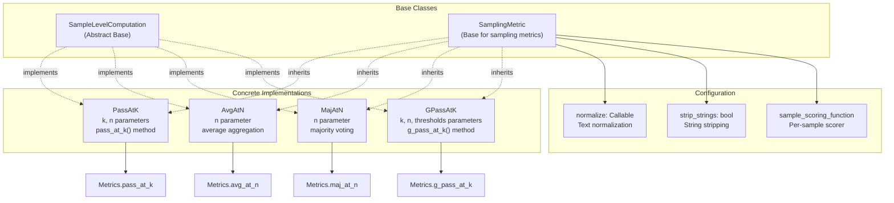
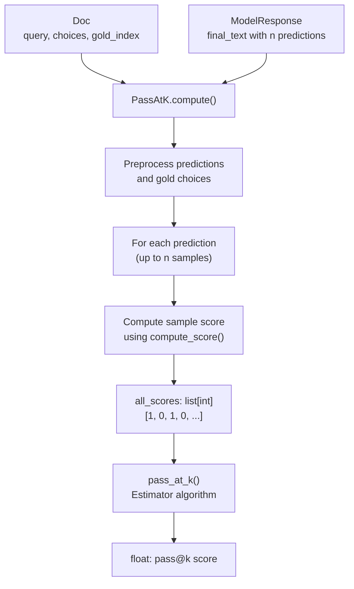
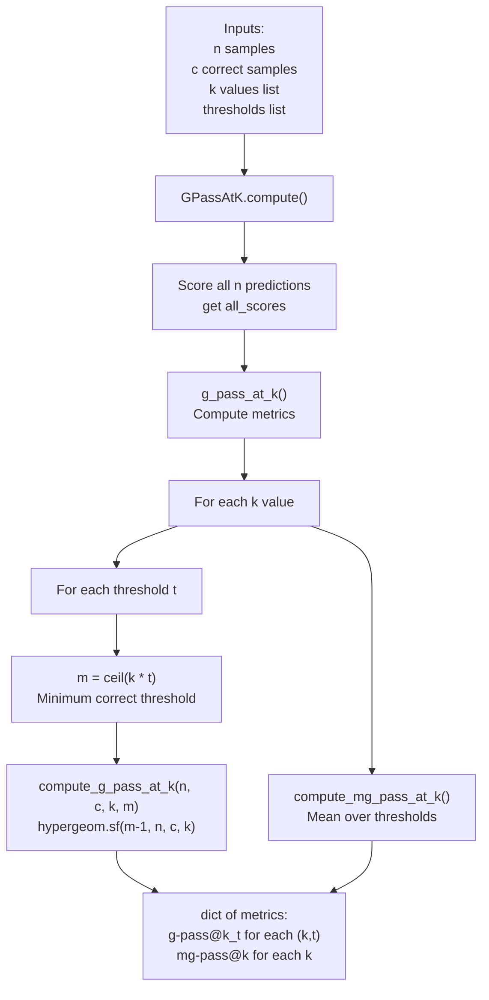
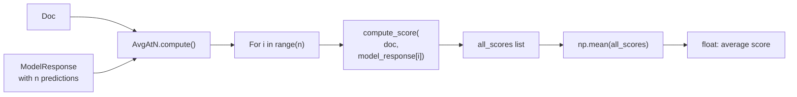
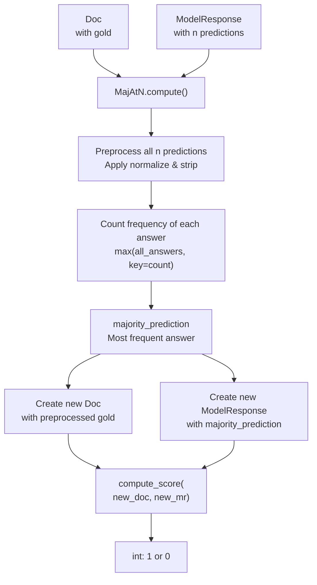

<!-- source: DeepWiki mcp.deepwiki.com · repo huggingface/lighteval · page 8.4 Sampling Metrics · fetched 2026-10-26 -->

# Sampling Metrics

<details>
<summary>Relevant source files</summary>

The following files were used as context for generating this wiki page:

- [src/lighteval/metrics/metrics.py](src/lighteval/metrics/metrics.py)
- [src/lighteval/metrics/metrics_sample.py](src/lighteval/metrics/metrics_sample.py)

</details>


## Purpose and Scope

This document covers **sampling metrics** in lighteval - metrics designed to evaluate models when generating multiple samples per input document. These metrics aggregate results across multiple generations to compute a single score per sample.

Sampling metrics are distinct from standard sample-level metrics (see [Sample-Level Metrics](#8.2)) which process a single prediction per document. They are commonly used for code generation tasks (e.g., pass@k), mathematical reasoning with self-consistency, and other scenarios where models generate multiple candidate answers.

For information about the broader metrics system architecture, see [Metrics System](#8). For details on how metrics are applied during evaluation, see [Metric Application](#8.8).

---

## Overview

Sampling metrics evaluate tasks where the model generates `n` samples per input document, then aggregate these samples using various strategies:

| Metric | Strategy | Use Case |
|--------|----------|----------|
| `PassAtK` | At least `k` correct samples | Code generation benchmarks (HumanEval) |
| `GPassAtK` | Generalized pass@k with thresholds | Advanced code evaluation with partial credit |
| `AvgAtN` | Average score across `n` samples | General multi-sample evaluation |
| `MajAtN` | Majority voting across `n` samples | Self-consistency for reasoning tasks |

All sampling metrics inherit from the `SamplingMetric` base class which provides normalization and a default sample scoring function.

**Sources:** [src/lighteval/metrics/metrics_sample.py:1109-1174]()

---

## Architecture

### Sampling Metrics Class Hierarchy



**Sources:** [src/lighteval/metrics/metrics_sample.py:1109-1458](), [src/lighteval/metrics/metrics.py:146-624]()

---

## SamplingMetric Base Class

The `SamplingMetric` class provides common functionality for all sampling metrics.

### Initialization Parameters

| Parameter | Type | Description |
|-----------|------|-------------|
| `normalize` | `Callable \| str \| None` | Normalization function or name from `lighteval.metrics.normalizations` |
| `strip_strings` | `bool` | Whether to strip whitespace from predictions and golds |
| `sample_scoring_function` | `Callable \| str \| None` | Custom scoring function or exact match type (`"prefix"`, `"suffix"`, `"full"`) |

### Key Methods

**`preprocess(text: str) -> str`**

Applies normalization and stripping to text:

```python
def preprocess(self, text: str) -> str:
    if not text:
        return ""
    if self.strip_strings:
        text = text.strip()
    if self.normalize is not None:
        text = self.normalize(text)
    return text
```

**`default_sample_scoring(doc: Doc, model_response: ModelResponse) -> int`**

Default scoring function that performs exact match (full, prefix, or suffix) after preprocessing. Returns `1` for match, `0` otherwise.

### Custom Scoring Functions

Sampling metrics can use custom scoring functions instead of exact match. For example, `PassAtK` for math tasks uses `MultilingualExtractiveMatchMetric`:

```python
PassAtK(
    strip_strings=True,
    sample_scoring_function=MultilingualExtractiveMatchMetric(
        language=Language.ENGLISH,
        gold_extraction_target=[ExprExtractionConfig(), LatexExtractionConfig()],
        pred_extraction_target=[ExprExtractionConfig(), LatexExtractionConfig()],
        precision=6,
    ),
)
```

**Sources:** [src/lighteval/metrics/metrics_sample.py:1109-1174]()

---

## PassAtK Implementation

`PassAtK` estimates the probability that at least `k` out of `n` samples are correct using an unbiased estimator.

### Computation Flow



### Pass@K Estimator Algorithm

The implementation uses the unbiased estimator from [Chen et al. (2021)](https://arxiv.org/pdf/2107.03374):

$$\text{pass@k} = 1 - \prod_{i=n-c+1}^{n} \frac{n-k}{i}$$

where:
- `n` = total number of samples
- `c` = number of correct samples
- `k` = threshold for success

```python
def pass_at_k(self, all_scores: list[int]) -> float:
    """Algo from https://arxiv.org/pdf/2107.03374"""
    c: int = all_scores.count(1)
    if self.n - c < self.k:
        return 1.0
    return 1.0 - np.prod(1.0 - self.k / np.arange(self.n - c + 1, self.n + 1))
```

### Usage Example

For code generation evaluation (HumanEval):

```python
# Generate 10 samples, check if at least 1 is correct
Metrics.pass_at_k(sample_params={"k": 1, "n": 10})

# Generate 100 samples, check if at least 10 are correct
Metrics.pass_at_k(sample_params={"k": 10, "n": 100})
```

**Sources:** [src/lighteval/metrics/metrics_sample.py:1264-1329](), [src/lighteval/metrics/metrics.py:462-498]()

---

## GPassAtK Implementation

`GPassAtK` implements Generalized Pass@K from [G-Pass@K paper](http://arxiv.org/abs/2412.13147), which provides a more nuanced evaluation with configurable thresholds.

### Key Features

- Multiple `k` values in a single computation
- Threshold-based success criteria (0.0 to 1.0)
- Mean G-Pass@K (`mg-pass@k`) for average performance
- Uses hypergeometric survival function for probability calculation

### Computation



### Default Thresholds

By default, `GPassAtK` uses five thresholds: `[0.0, 0.25, 0.5, 0.75, 1.0]`

For `k=5`, this produces metrics:
- `g-pass@5_0.0` - at least 0 correct (always 1.0 unless all wrong)
- `g-pass@5_0.25` - at least 2 correct (ceil(5 * 0.25))
- `g-pass@5_0.5` - at least 3 correct
- `g-pass@5_0.75` - at least 4 correct
- `g-pass@5_1.0` - all 5 correct
- `mg-pass@5` - mean of middle thresholds

### Hypergeometric Survival Function

The core calculation uses `scipy.stats.hypergeom.sf()`:

```python
def _compute_g_pass_at_k(n, c, k, m):
    if m > min(c, k) or k > n or c < 0 or n <= 0 or m < 0:
        return 0.0
    return hypergeom.sf(m - 1, n, c, k)
```

This computes the probability of getting at least `m` successes when drawing `k` samples from a population of `n` with `c` correct items.

**Sources:** [src/lighteval/metrics/metrics_sample.py:1331-1458](), [src/lighteval/metrics/metrics.py:375-419]()

---

## AvgAtN Implementation

`AvgAtN` computes the average score across `n` samples.

### Algorithm



### Implementation

```python
def compute(self, doc: Doc, model_response: ModelResponse, **kwargs):
    all_scores = []
    for i in range(self.n):
        all_scores.append(self.compute_score(doc, model_response[i]))
    avg_score = np.mean(all_scores)
    return avg_score
```

### Use Cases

- Averaging multiple reasoning attempts
- Evaluating consistency across samples
- Soft metric for multi-sample generation

**Example:** Generate 5 samples for each math problem, compute extractive match for each, return average:

```python
AvgAtN(
    n=5,
    sample_scoring_function=MultilingualExtractiveMatchMetric(
        language=Language.ENGLISH,
        gold_extraction_target=[ExprExtractionConfig()],
        pred_extraction_target=[ExprExtractionConfig(), LatexExtractionConfig()],
        precision=6,
    )
)
```

**Sources:** [src/lighteval/metrics/metrics_sample.py:1176-1210](), [src/lighteval/metrics/metrics.py:154-174]()

---

## MajAtN Implementation

`MajAtN` uses majority voting to select the most frequent answer from `n` samples, then scores it against the gold.

### Algorithm



### Implementation Details

```python
def compute(self, doc: Doc, model_response: ModelResponse, **kwargs):
    golds = doc.get_golds()
    if len(golds) > 1:
        raise Exception("Cannot compute maj@n with several golds")
    
    # Preprocess gold
    processed_choices = [self.preprocess(text=g) for g in doc.get_golds()]
    new_doc = Doc(
        choices=processed_choices,
        query=doc.query,
        gold_index=doc.gold_index,
    )
    
    # Collect and preprocess all predictions
    all_answers = []
    for pred in model_response.final_text[: self.n]:
        all_answers.append(self.preprocess(text=pred))
    
    # Find majority
    majority_prediction = max(all_answers, key=all_answers.count)
    
    # Score majority against gold
    new_model_response = ModelResponse(text=[majority_prediction])
    return self.compute_score(new_doc, new_model_response)
```

### Use Cases

- Self-consistency for chain-of-thought reasoning
- Reducing variance in stochastic generation
- Consensus-based evaluation

**Example:** Generate 10 reasoning paths, select most common answer:

```python
Metrics.maj_at_n(sample_params={"n": 10})
```

**Sources:** [src/lighteval/metrics/metrics_sample.py:1212-1262](), [src/lighteval/metrics/metrics.py:434-440]()

---

## Integration with Metrics Enum

Sampling metrics are defined in the `Metrics` enum with parametrizable values.

### Metrics Enum Definitions

```mermaid
graph TB
    subgraph "Metrics Enum"
        PassEnum["Metrics.pass_at_k<br/>SampleLevelMetric"]
        PassMath["Metrics.pass_at_k_math<br/>with ExtractiveMatch"]
        PassLetters["Metrics.pass_at_k_letters<br/>with IndicesExtraction"]
        
        GPassEnum["Metrics.g_pass_at_k<br/>SampleLevelMetricGrouping"]
        GPassMath["Metrics.g_pass_at_k_math<br/>with ExtractiveMatch"]
        GPassLatex["Metrics.g_pass_at_k_latex<br/>with LatexExtraction"]
        
        AvgEnum["Metrics.avg_at_n<br/>SampleLevelMetric"]
        AvgMath["Metrics.avg_at_n_math<br/>with ExtractiveMatch"]
        
        MajEnum["Metrics.maj_at_n<br/>SampleLevelMetric"]
    end
    
    subgraph "Implementations"
        PassAtKImpl["PassAtK<br/>class"]
        GPassAtKImpl["GPassAtK<br/>class"]
        AvgAtNImpl["AvgAtN<br/>class"]
        MajAtNImpl["MajAtN<br/>class"]
    end
    
    subgraph "Helpers"
        ExtractiveMatch["MultilingualExtractiveMatchMetric"]
    end
    
    PassEnum --> PassAtKImpl
    PassMath --> PassAtKImpl
    PassMath --> ExtractiveMatch
    PassLetters --> PassAtKImpl
    PassLetters --> ExtractiveMatch
    
    GPassEnum --> GPassAtKImpl
    GPassMath --> GPassAtKImpl
    GPassMath --> ExtractiveMatch
    GPassLatex --> GPassAtKImpl
    GPassLatex --> ExtractiveMatch
    
    AvgEnum --> AvgAtNImpl
    AvgMath --> AvgAtNImpl
    AvgMath --> ExtractiveMatch
    
    MajEnum --> MajAtNImpl
```



### Sample Parameters

Sampling metrics require the `n` parameter (and `k` for pass@k metrics) to be set via `sample_params`:

```python
# Basic usage
metric = Metrics.pass_at_k(sample_params={"k": 1, "n": 10})

# G-Pass@K with multiple k values
metric = Metrics.g_pass_at_k_math(sample_params={"k": [1, 5, 10], "n": 100})

# AvgAtN
metric = Metrics.avg_at_n(sample_params={"n": 5})

# MajAtN
metric = Metrics.maj_at_n(sample_params={"n": 10})
```

### Predefined Variants

| Enum Value | Sample Scoring Function | Use Case |
|------------|-------------------------|----------|
| `pass_at_k` | Exact match with stripping | General code generation |
| `pass_at_k_math` | `MultilingualExtractiveMatchMetric` with math/latex | Mathematical reasoning |
| `pass_at_k_letters` | `MultilingualExtractiveMatchMetric` with indices | Multiple choice extraction |
| `g_pass_at_k` | Exact match with stripping | General multi-threshold evaluation |
| `g_pass_at_k_math` | Math/latex extraction | Mathematical reasoning with thresholds |
| `g_pass_at_k_latex` | LaTeX extraction | LaTeX-formatted answers |
| `avg_at_n` | Exact match with stripping | General averaging |
| `avg_at_n_math` | Math/latex extraction | Mathematical reasoning averaging |
| `maj_at_n` | Exact match with stripping | Self-consistency voting |

**Sources:** [src/lighteval/metrics/metrics.py:154-624]()

---

## Multi-Sample Response Handling

### ModelResponse Structure

When using sampling metrics, `ModelResponse.final_text` contains a list of all `n` predictions:

```python
# Single sample
ModelResponse(final_text=["answer1"])

# Multiple samples (n=5)
ModelResponse(final_text=[
    "answer1",
    "answer2", 
    "answer3",
    "answer4",
    "answer5"
])
```

### Indexing in Sampling Metrics

Different metrics access predictions differently:

**PassAtK / GPassAtK / AvgAtN**: Iterate through predictions by index
```python
for pred in predictions[:self.n]:
    # Process each prediction
```

**MajAtN**: Uses entire list to find majority
```python
all_answers = [preprocess(pred) for pred in model_response.final_text[:self.n]]
majority = max(all_answers, key=all_answers.count)
```

### Generation Configuration

To generate multiple samples, tasks must configure `num_samples` in their generation parameters:

```python
# In task definition
LightevalTaskConfig(
    ...,
    generation_size=10,  # Generate 10 samples per document
    ...
)
```

**Sources:** [src/lighteval/metrics/metrics_sample.py:1189-1258]()

---

## Corpus-Level Aggregation

All sampling metrics use `np.mean` as their corpus-level aggregation function. This means:

1. For each document, compute the sampling metric (e.g., pass@k score between 0.0 and 1.0)
2. Average all document-level scores across the corpus

```python
# Example for pass@10
document_scores = [
    0.85,  # Document 1: high pass@10 probability
    0.42,  # Document 2: medium pass@10 probability  
    0.91,  # Document 3: high pass@10 probability
]
corpus_score = np.mean(document_scores)  # 0.73
```

This differs from some other implementations that aggregate at the corpus level first, then compute the metric.

**Sources:** [src/lighteval/metrics/metrics.py:154-624]()

---

## Usage Patterns

### Code Generation Tasks

```python
# HumanEval-style evaluation
LightevalTaskConfig(
    name="humaneval",
    prompt_function=humaneval_prompt,
    hf_repo="openai_humaneval",
    metric=["pass_at_k"],
    generation_size=100,  # Generate 100 samples
    ...
)

# At evaluation time
Metrics.pass_at_k(sample_params={"k": 1, "n": 100})   # pass@1
Metrics.pass_at_k(sample_params={"k": 10, "n": 100})  # pass@10
Metrics.pass_at_k(sample_params={"k": 100, "n": 100}) # pass@100
```

### Mathematical Reasoning with Self-Consistency

```python
# Generate multiple reasoning paths
LightevalTaskConfig(
    name="gsm8k_cot",
    prompt_function=cot_prompt,
    hf_repo="gsm8k",
    metric=["maj_at_n", "avg_at_n_math"],
    generation_size=10,
    ...
)

# Majority voting
Metrics.maj_at_n(sample_params={"n": 10})

# Average correctness
Metrics.avg_at_n_math(sample_params={"n": 10})
```

### Advanced Multi-Threshold Evaluation

```python
# Nuanced code evaluation
LightevalTaskConfig(
    name="code_contest",
    prompt_function=contest_prompt,
    hf_repo="code_contests",
    metric=["g_pass_at_k"],
    generation_size=50,
    ...
)

# Multiple k values and thresholds
Metrics.g_pass_at_k(sample_params={"k": [1, 5, 10], "n": 50})
# Produces: g-pass@1_0.0, g-pass@1_0.25, ..., mg-pass@1,
#           g-pass@5_0.0, g-pass@5_0.25, ..., mg-pass@5,
#           g-pass@10_0.0, g-pass@10_0.25, ..., mg-pass@10
```

**Sources:** [src/lighteval/metrics/metrics_sample.py:1109-1458](), [src/lighteval/metrics/metrics.py:146-624]()

---

