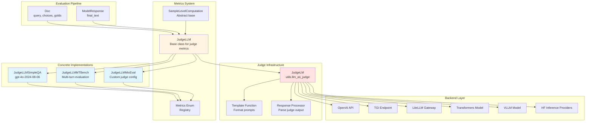
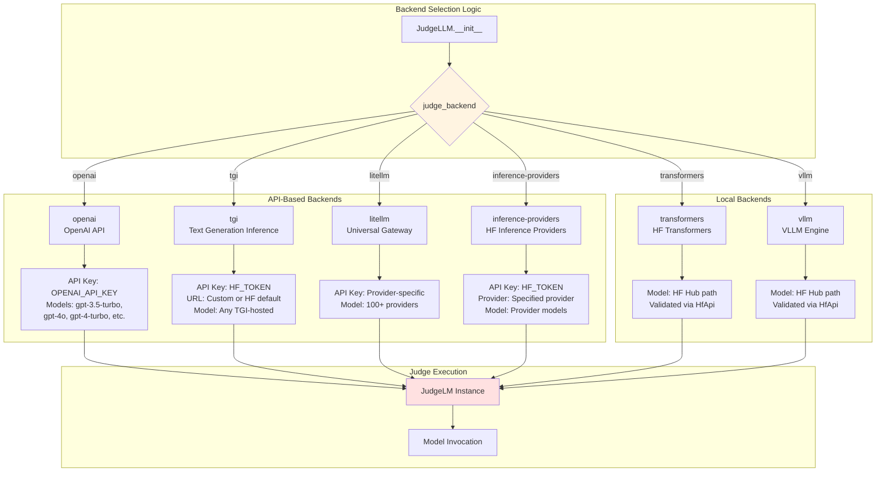
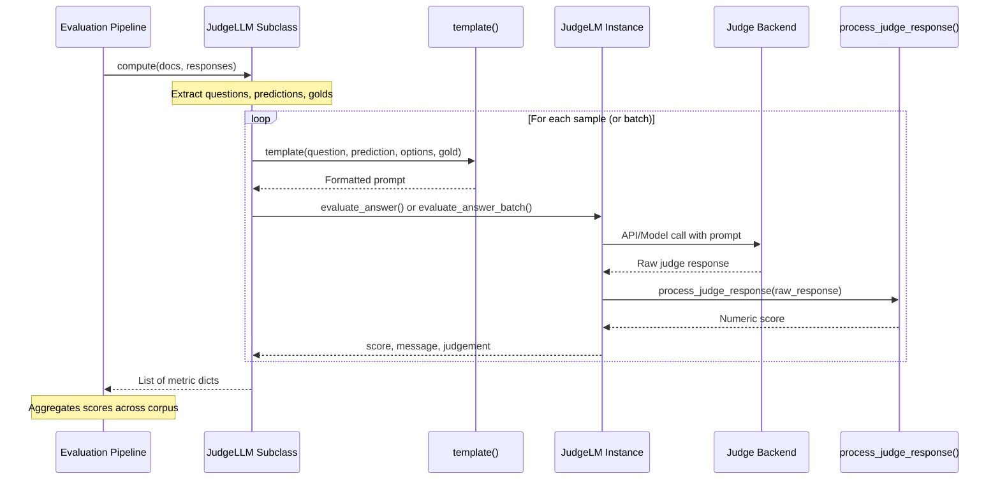

<!-- source: DeepWiki mcp.deepwiki.com · repo huggingface/lighteval · page 8.5 LLM-as-Judge Metrics · fetched 2026-10-26 -->

# LLM-as-Judge Metrics

<details>
<summary>Relevant source files</summary>

The following files were used as context for generating this wiki page:

- [src/lighteval/metrics/metrics.py](src/lighteval/metrics/metrics.py)
- [src/lighteval/metrics/metrics_sample.py](src/lighteval/metrics/metrics_sample.py)

</details>


## Purpose and Scope

This document describes the LLM-as-Judge metrics system in lighteval, which enables evaluation of model outputs using another language model as a judge. These metrics are particularly useful for assessing subjective qualities like helpfulness, coherence, or correctness in open-ended generation tasks where traditional metrics (exact match, BLEU, etc.) are insufficient.

This page covers the `JudgeLLM` base class, supported evaluation backends, and concrete implementations for specific benchmarks. For general information about the metrics system architecture, see [Metrics System](#8). For creating custom metrics in general, see [Creating Custom Metrics](#8.9).

## Architecture Overview

LLM-as-Judge metrics extend the standard sample-level metric computation pattern by delegating the scoring decision to a language model. The following diagram shows how these metrics integrate with lighteval's evaluation pipeline:



**Sources:** [src/lighteval/metrics/metrics_sample.py:942-1106](), [src/lighteval/metrics/metrics.py:553-562]()

## JudgeLLM Base Class

The `JudgeLLM` class ([src/lighteval/metrics/metrics_sample.py:942-1009]()) serves as the abstract base for all LLM-as-judge metrics. It inherits from `SampleLevelComputation` and handles backend initialization and API configuration.

### Class Definition

```python
class JudgeLLM(SampleLevelComputation):
    def __init__(
        self,
        judge_model_name: str,
        template: Callable,
        process_judge_response: Callable,
        judge_backend: Literal["litellm", "openai", "transformers", "vllm", "tgi", "inference-providers"],
        short_judge_name: str | None = None,
        response_format: BaseModel | None = None,
        url: str | None = None,
        hf_provider: str | None = None,
        max_tokens: int | None = None,
        backend_options: dict | None = None,
    ) -> None
```

### Key Parameters

| Parameter | Type | Description |
|-----------|------|-------------|
| `judge_model_name` | `str` | Model identifier (e.g., "gpt-4o-2024-08-06", HF model path) |
| `template` | `Callable` | Function that formats the judge prompt from question/answer/gold |
| `process_judge_response` | `Callable` | Function that parses the judge's response into a numeric score |
| `judge_backend` | `Literal` | Backend to use for judge model inference |
| `short_judge_name` | `str \| None` | Short identifier used in metric result keys |
| `response_format` | `BaseModel \| None` | Pydantic model for structured output (OpenAI only) |
| `url` | `str \| None` | Custom endpoint URL (for TGI backend) |
| `hf_provider` | `str \| None` | HuggingFace provider name (for inference-providers) |
| `max_tokens` | `int \| None` | Maximum tokens for judge response |
| `backend_options` | `dict \| None` | Additional backend-specific configuration |

### Internal Components

The `JudgeLLM` class initializes a `JudgeLM` instance ([src/lighteval/metrics/utils/llm_as_judge.py]()) which handles:
- API authentication and configuration
- Prompt formatting via the `template` function
- Judge model invocation
- Response parsing via `process_judge_response`

**Sources:** [src/lighteval/metrics/metrics_sample.py:942-1009]()

## Supported Backends

The following diagram shows the backend architecture and configuration flow:



### Backend Comparison

| Backend | Use Case | Authentication | Model Selection | Notes |
|---------|----------|---------------|-----------------|-------|
| `openai` | OpenAI models | `OPENAI_API_KEY` env var | Restricted to `available_models_openai` list | Supports structured output via `response_format` |
| `tgi` | Self-hosted TGI | `HF_TOKEN` env var | Any model on TGI endpoint | Default URL: `https://api-inference.huggingface.co/v1/` |
| `litellm` | Multi-provider support | Provider-specific | 100+ providers supported | Maximum flexibility for different APIs |
| `inference-providers` | HF Inference Providers | `HF_TOKEN` env var | Provider-specific models | Requires `hf_provider` parameter |
| `transformers` | Local HF model | None | Any HF Hub model | Validates model exists via `HfApi.list_models()` |
| `vllm` | Local high-performance | None | Any HF Hub model | Validates model exists via `HfApi.list_models()` |

### Backend Initialization Logic

The initialization logic ([src/lighteval/metrics/metrics_sample.py:962-990]()) follows this pattern:

1. **API Key Retrieval**: For API-based backends, retrieves API keys from environment variables
2. **Model Validation**: For local backends (`transformers`, `vllm`), validates model exists on HuggingFace Hub
3. **Configuration Setup**: Prepares backend-specific configuration
4. **JudgeLM Instantiation**: Creates the `JudgeLM` instance with all configuration

**Sources:** [src/lighteval/metrics/metrics_sample.py:942-1009]()

## Evaluation Flow

The following diagram illustrates how a single sample is evaluated using an LLM-as-judge metric:



**Sources:** [src/lighteval/metrics/metrics_sample.py:1006-1106]()

## Concrete Implementations

### JudgeLLMSimpleQA

Implementation for the SimpleQA benchmark ([src/lighteval/metrics/metrics_sample.py:1011-1044]()):

```python
class JudgeLLMSimpleQA(JudgeLLM):
    def __init__(self):
        super().__init__(
            judge_model_name="gpt-4o-2024-08-06",
            template=get_judge_prompt_simpleqa,
            process_judge_response=process_judge_response_simpleqa,
            judge_backend="openai",
            short_judge_name="gpt4o",
        )
```

**Key Characteristics:**
- **Judge Model**: GPT-4o (2024-08-06 checkpoint)
- **Backend**: OpenAI API
- **Template**: `get_judge_prompt_simpleqa` from [src/lighteval/metrics/utils/judge_utils.py:54]()
- **Batched Evaluation**: Supports batch processing via `evaluate_answer_batch()`
- **Output Format**: Returns `simpleqa_judge` score plus `user_prompt_gpt4o` and `judgement_gpt4o` metadata

**Return Format:**
```python
{
    "simpleqa_judge": float,  # Binary or scaled score
    "user_prompt_gpt4o": str,  # Prompt sent to judge
    "judgement_gpt4o": str     # Judge's textual response
}
```

### JudgeLLMMTBench

Implementation for MT-Bench multi-turn evaluation ([src/lighteval/metrics/metrics_sample.py:1047-1079]()):

```python
class JudgeLLMMTBench(JudgeLLM):
    def compute(self, model_response: list[ModelResponse], doc: list[Doc], **kwargs):
        # Evaluates multi-turn conversations (max 2 turns)
        # Extracts turns from doc.specific["multi_turn_queries"]
```

**Key Characteristics:**
- **Multi-Turn Support**: Evaluates conversations with context from previous turns
- **Turn-by-Turn Scoring**: Returns separate scores for turn 1 and turn 2
- **Context Handling**: Turn 2 evaluation includes turn 1 prediction as context
- **Required Fields**: Expects `multi_turn_queries` in `doc.specific`

**Return Format:**
```python
{
    "judge_score_turn_1": float,
    "judge_score_turn_2": float,
    "user_prompt": [str, str],       # Prompts for both turns
    "judgement": [str, str]          # Judgements for both turns
}
```

### JudgeLLMMixEval

Implementation for MixEval benchmark ([src/lighteval/metrics/metrics_sample.py:1082-1106]()):

```python
class JudgeLLMMixEval(JudgeLLM):
    def compute(self, responses: list[ModelResponse], docs: list[Doc], **kwargs):
        # Batch evaluation for MixEval
        # Expects doc.specific["question"] field
```

**Key Characteristics:**
- **Flexible Configuration**: Judge model and backend configurable via `__init__`
- **Batched Processing**: Processes multiple samples efficiently
- **Compact Output**: Only returns score (optionally includes prompts/judgements)
- **Required Fields**: Expects `question` in `doc.specific`

**Return Format:**
```python
{
    f"judge_score_{self.short_judge_name}": float,
    # Optional:
    # f"user_prompt_{self.short_judge_name}": str,
    # f"judgement_{self.short_judge_name}": str
}
```

### Implementation Comparison

| Implementation | Backend | Batched | Multi-Turn | Required Doc Fields | Output Keys |
|----------------|---------|---------|------------|---------------------|-------------|
| `JudgeLLMSimpleQA` | OpenAI (gpt-4o) | Yes | No | Standard (query, choices, golds) | `simpleqa_judge`, metadata |
| `JudgeLLMMTBench` | Configurable | No | Yes (2 turns) | `multi_turn_queries`, `reference` | `judge_score_turn_1/2`, metadata |
| `JudgeLLMMixEval` | Configurable | Yes | No | `question` | `judge_score_{judge_name}` |

**Sources:** [src/lighteval/metrics/metrics_sample.py:1011-1106]()

## Metrics Enum Integration

Judge metrics are registered in the `Metrics` enum like any other metric. Example from [src/lighteval/metrics/metrics.py:553-562]():

```python
simpleqa_judge = SampleLevelMetricGrouping(
    metric_name=["simpleqa_judge"],
    higher_is_better={"simpleqa_judge": True},
    category=SamplingMethod.GENERATIVE,
    sample_level_fn=JudgeLLMSimpleQA(),
    corpus_level_fn={
        "simpleqa_judge": np.mean,
    },
    batched_compute=True,
)
```

**Key Configuration:**
- **`sample_level_fn`**: Instance of `JudgeLLM` subclass
- **`category`**: Always `SamplingMethod.GENERATIVE` (judges evaluate generated text)
- **`batched_compute`**: Set to `True` for implementations supporting batch processing
- **`corpus_level_fn`**: Aggregation function (typically `np.mean`)
- **`higher_is_better`**: Score direction for each metric key

**Sources:** [src/lighteval/metrics/metrics.py:553-562]()

## Creating Custom Judge Metrics

To create a custom LLM-as-judge metric:

### Step 1: Define Template and Response Processor

Create functions to format prompts and parse responses:

```python
def my_judge_template(question: str, answer: str, gold: str = None) -> str:
    """Format the judge prompt."""
    prompt = f"Question: {question}\nAnswer: {answer}\n"
    if gold:
        prompt += f"Reference: {gold}\n"
    prompt += "Rate the answer quality from 0-10:"
    return prompt

def my_response_processor(response: str) -> float:
    """Extract score from judge response."""
    # Parse numeric score from response text
    import re
    match = re.search(r'\d+', response)
    return float(match.group()) / 10.0 if match else 0.0
```

### Step 2: Create JudgeLLM Subclass

```python
class JudgeLLMCustom(JudgeLLM):
    def __init__(self):
        super().__init__(
            judge_model_name="gpt-4o",  # or any other model
            template=my_judge_template,
            process_judge_response=my_response_processor,
            judge_backend="openai",  # or other backend
            short_judge_name="custom",
            max_tokens=100,
        )
    
    def compute(self, responses: list[ModelResponse], docs: list[Doc], **kwargs):
        """Compute scores for a batch of samples."""
        questions = [doc.query for doc in docs]
        predictions = [resp.final_text[0] for resp in responses]
        golds = [doc.get_golds()[0] for doc in docs]
        
        scores, messages, judgements = self.judge.evaluate_answer_batch(
            questions, predictions, None, golds
        )
        
        return [
            {
                f"custom_judge": scores[i],
                f"user_prompt_custom": messages[i],
                f"judgement_custom": judgements[i],
            }
            for i in range(len(docs))
        ]
```

### Step 3: Register in Metrics Enum

```python
# Add to Metrics enum or use extend_enum()
from lighteval.metrics.metrics import Metrics
from aenum import extend_enum

extend_enum(
    Metrics,
    "custom_judge",
    SampleLevelMetricGrouping(
        metric_name=["custom_judge"],
        higher_is_better={"custom_judge": True},
        category=SamplingMethod.GENERATIVE,
        sample_level_fn=JudgeLLMCustom(),
        corpus_level_fn={"custom_judge": np.mean},
        batched_compute=True,
    )
)
```

### Backend Selection Guidelines

Choose your backend based on:

| Requirement | Recommended Backend |
|-------------|---------------------|
| Production reliability | `openai` (with commercial model) |
| Cost optimization | `litellm` (mix of providers) |
| Self-hosted control | `tgi` or `vllm` |
| Multi-provider flexibility | `litellm` |
| HF ecosystem integration | `inference-providers` |
| Local development/testing | `transformers` |

### Best Practices

1. **Batched Evaluation**: Implement batch processing when possible for efficiency
2. **Error Handling**: Handle API failures gracefully (timeouts, rate limits)
3. **Metadata Logging**: Include prompts and judgements for transparency
4. **Deterministic Parsing**: Make `process_judge_response` robust to variations
5. **Cost Monitoring**: Track API costs for production deployments
6. **Validation**: Test with known good/bad examples before deployment

**Sources:** [src/lighteval/metrics/metrics_sample.py:942-1106](), [src/lighteval/metrics/metrics.py:553-562]()

---

