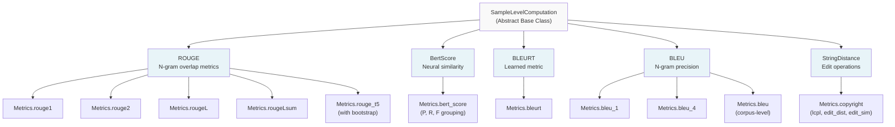
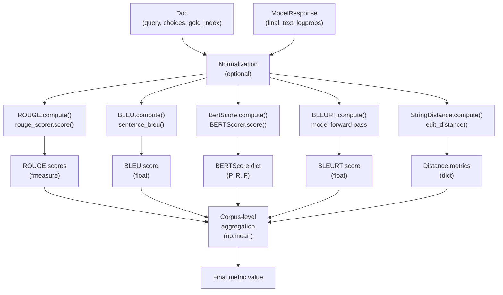
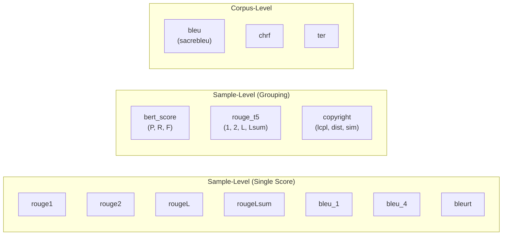

<!-- source: DeepWiki mcp.deepwiki.com · repo huggingface/lighteval · page 8.6 Text Similarity Metrics · fetched 2026-10-26 -->

# Text Similarity Metrics

<details>
<summary>Relevant source files</summary>

The following files were used as context for generating this wiki page:

- [src/lighteval/metrics/metrics.py](src/lighteval/metrics/metrics.py)
- [src/lighteval/metrics/metrics_sample.py](src/lighteval/metrics/metrics_sample.py)

</details>


## Purpose and Scope

This page documents the text similarity metrics available in lighteval for evaluating generated text against reference texts. These metrics quantify how similar two pieces of text are using various algorithms ranging from simple n-gram overlap (ROUGE, BLEU) to neural similarity models (BERTScore, BLEURT) to edit distance measures.

Text similarity metrics are primarily used with generative tasks (category `SamplingMethod.GENERATIVE`) where the model produces free-form text that must be compared to reference answers. For other metric categories, see [Sample-Level Metrics](#8.2) for the base class architecture and [Predefined Metrics](#8.1) for the complete catalog.

## Overview

Lighteval implements five main categories of text similarity metrics:

| Metric Category | Implementation Classes | Purpose | Dependencies |
|----------------|----------------------|---------|--------------|
| **ROUGE** | `ROUGE` | N-gram and longest common subsequence overlap | `rouge_scorer` |
| **BLEU** | `BLEU` | N-gram precision for translation/generation | `nltk` |
| **BERTScore** | `BertScore` | Neural embedding-based similarity | `transformers`, custom `BERTScorer` |
| **BLEURT** | `BLEURT` | Learned evaluation metric | `transformers` (bleurt-tiny-512) |
| **String Distance** | `StringDistance` | Edit distance and prefix matching | `nltk` |

All text similarity metrics extend `SampleLevelComputation` and compute scores by comparing model predictions against reference texts (golds) for each document.

**Sources:** [src/lighteval/metrics/metrics_sample.py:486-940](), [src/lighteval/metrics/metrics.py:175-552]()

## Text Similarity Metric Class Hierarchy



**Sources:** [src/lighteval/metrics/metrics_sample.py:64-68](), [src/lighteval/metrics/metrics.py:146-552]()

## ROUGE Metrics

### Implementation

The `ROUGE` class ([src/lighteval/metrics/metrics_sample.py:486-596]()) is a wrapper around the `rouge_scorer` library that computes recall-oriented understudy for gisting evaluation scores. ROUGE measures n-gram and longest common subsequence overlap between predictions and references.

**Key Features:**
- Supports four ROUGE variants: `rouge1`, `rouge2`, `rougeL`, `rougeLsum`
- Optional text normalization for both gold and predicted texts
- Multiple aggregation modes for handling multiple references or predictions
- Bootstrap aggregation option for variance estimation

### Configuration

```python
ROUGE(
    methods: str | list[str],           # "rouge1", "rouge2", "rougeL", "rougeLsum"
    multiple_golds: bool = False,       # Compare to all golds at once
    bootstrap: bool = False,            # Use bootstrap for confidence intervals
    normalize_gold: Callable = None,    # Normalization function for references
    normalize_pred: Callable = None,    # Normalization function for predictions
    aggregation_function: Callable = None,  # Default: np.mean
    tokenizer: object = None           # Custom tokenizer (default: rouge_scorer's)
)
```

### Computation Methods

The class provides three computation strategies:

1. **Standard Mode** (`_rouge_score`): Compares each prediction to each gold, aggregates scores
2. **Multiple Golds Mode** (`_rouge_score_multi_golds`): Compares predictions to all golds simultaneously
3. **Bootstrap Mode** (`_rouge_score_with_bootsrap`): Uses bootstrap aggregation for statistical robustness

**Sources:** [src/lighteval/metrics/metrics_sample.py:486-596]()

### ROUGE Variants in Metrics Enum

| Metric | Method | Corpus Function | Use Case |
|--------|--------|----------------|----------|
| `Metrics.rouge1` | Unigram overlap | `np.mean` | General text similarity |
| `Metrics.rouge2` | Bigram overlap | `np.mean` | Captures phrase-level similarity |
| `Metrics.rougeL` | Longest common subsequence | `np.mean` | Sentence-level structure |
| `Metrics.rougeLsum` | LCS with summary-level sentence splitting | `np.mean` | Multi-sentence summaries |
| `Metrics.rouge_t5` | All four methods with bootstrap | `np.mean` per method | T5-style evaluation |

The `rouge_t5` metric uses bootstrap aggregation and applies `bigbench_normalizer` to both predictions and references for consistency with BigBench evaluations.

**Sources:** [src/lighteval/metrics/metrics.py:513-552]()

## BLEU Metrics

### Implementation

The `BLEU` class ([src/lighteval/metrics/metrics_sample.py:805-845]()) implements sentence-level BLEU (Bilingual Evaluation Understudy) scoring using `nltk.translate.bleu_score.sentence_bleu`. BLEU measures n-gram precision between predictions and references, commonly used for machine translation evaluation.

**Key Implementation Details:**
- Configurable n-gram order (1-4)
- Word tokenization using `nltk.tokenize.word_tokenize`
- Supports multiple references per prediction
- Returns average score across all predictions

### Configuration

```python
BLEU(
    n_gram: int  # N-gram order (1, 2, 3, or 4)
)
```

### Sample-Level vs Corpus-Level

Lighteval provides both sample-level and corpus-level BLEU metrics:

**Sample-Level:** `Metrics.bleu_1`, `Metrics.bleu_4`
- Compute BLEU for each document independently
- Aggregate using `np.mean` across the corpus
- Implementation: [src/lighteval/metrics/metrics_sample.py:805-845]()

**Corpus-Level:** `Metrics.bleu`
- Uses `CorpusLevelTranslationMetric` for proper corpus-level aggregation
- Relies on `sacrebleu` library for standardized scoring
- Implementation: [src/lighteval/metrics/metrics.py:189-195]()

The corpus-level BLEU is preferred for translation tasks as it computes BLEU over the entire corpus rather than averaging sample scores.

**Sources:** [src/lighteval/metrics/metrics_sample.py:805-845](), [src/lighteval/metrics/metrics.py:189-209]()

## BERTScore

### Implementation

The `BertScore` class ([src/lighteval/metrics/metrics_sample.py:598-659]()) computes contextual embeddings-based similarity using a custom `BERTScorer` implementation. BERTScore measures semantic similarity by computing cosine similarity between token embeddings from a pretrained BERT model.

### Scoring Formula

For each token in prediction and reference:

```
Precision = Σ max(Cos.Sim.(pred_token, ref_token)) / IDF(pred_token)
Recall = Σ max(Cos.Sim.(ref_token, pred_token)) / IDF(ref_token)
F1 = 2 * Precision * Recall / (Precision + Recall)
```

Where:
- `Cos.Sim.` is cosine similarity between token embeddings
- `IDF(.)` is inverse document frequency (defaults to 1 for most tokens, 0 for special tokens)

### Configuration

```python
BertScore(
    normalize_gold: Callable = None,  # Normalization for references
    normalize_pred: Callable = None   # Normalization for predictions
)
```

**Model Details:**
- Default model: `microsoft/deberta-large-mnli`
- Language: English
- Rescaled with baseline for calibration
- Number of layers: 9

The model is lazily initialized on first use to avoid unnecessary downloads.

### Metrics Output

BERTScore returns a dictionary with three scores:

| Score Key | Description | Higher is Better |
|-----------|-------------|------------------|
| `BERTScore-P` | Precision | Yes |
| `BERTScore-R` | Recall | Yes |
| `BERTScore-F` | F1 Score | Yes |

In the `Metrics` enum, these are wrapped in a `SampleLevelMetricGrouping` ([src/lighteval/metrics/metrics.py:175-181]()).

**Sources:** [src/lighteval/metrics/metrics_sample.py:598-659](), [src/lighteval/metrics/metrics.py:175-181](), [src/lighteval/metrics/imports/bert_scorer.py]()

## BLEURT

### Implementation

The `BLEURT` class ([src/lighteval/metrics/metrics_sample.py:765-803]()) implements a learned evaluation metric using a fine-tuned sequence classification model. BLEURT (Bilingual Evaluation Understudy with Representations from Transformers) is trained to predict human judgments of translation quality.

**Model Details:**
- Model: `Elron/bleurt-tiny-512` (lightweight variant)
- Alternative: `Elron/bleurt-base-128` for more complex use cases
- Task: Sequence classification with paired inputs (gold, prediction)

### Configuration

The BLEURT metric requires no configuration parameters:

```python
BLEURT()  # Uses default tiny-512 model
```

### Lazy Initialization

Both the tokenizer and model are lazily loaded using property decorators to avoid initialization overhead:

```python
@property
def tokenizer(self):
    if self._tokenizer is None:
        self._tokenizer = AutoTokenizer.from_pretrained("Elron/bleurt-tiny-512")
    return self._tokenizer

@property
def model(self):
    if self._model is None:
        self._model = AutoModelForSequenceClassification.from_pretrained("Elron/bleurt-tiny-512")
        self._model.eval()
    return self._model
```

### Computation

BLEURT tokenizes gold-prediction pairs and returns a single scalar score representing the learned similarity:

1. Tokenizes both references and predictions
2. Feeds pairs through the sequence classification model
3. Extracts regression score from model output
4. Returns score as float

**Sources:** [src/lighteval/metrics/metrics_sample.py:765-803](), [src/lighteval/metrics/metrics.py:211-217]()

## String Distance Metrics

### Implementation

The `StringDistance` class ([src/lighteval/metrics/metrics_sample.py:847-940]()) implements character and word-level distance metrics using edit operations. These metrics are useful for exact text matching tasks where token-level precision matters.

### Available Metrics

| Metric Type | Description | Aggregation | Higher is Better |
|-------------|-------------|-------------|------------------|
| `edit_distance` | Number of insertions/deletions/substitutions | `min` | No |
| `edit_similarity` | 1 - (edit_distance / max_length) | `max` | Yes |
| `longest_common_prefix_length` | Length of matching prefix tokens | `max` | Yes |

### Configuration

```python
StringDistance(
    metric_types: list[str] | str,  # One or more of the metrics above
    strip_prediction: bool = True   # Whether to strip whitespace from predictions
)
```

### Tokenization

String distance metrics use `TreebankWordTokenizer` from NLTK to tokenize text into word tokens before computing distances. This provides more meaningful comparisons than character-level distances for natural language.

### Reference Truncation

For fair comparison, references are truncated to match prediction length:

```python
truncated_reference = reference[:len(completion)]
```

This is particularly important for tasks like text continuation where the reference is longer than expected completions.

### Usage in Copyright Detection

The `Metrics.copyright` entry ([src/lighteval/metrics/metrics.py:239-247]()) uses all three string distance metrics as a `SampleLevelMetricGrouping` to detect copied text by measuring exact overlap with source material.

**Sources:** [src/lighteval/metrics/metrics_sample.py:847-940](), [src/lighteval/metrics/metrics.py:239-247]()

## Text Similarity Metric Computation Flow



**Sources:** [src/lighteval/metrics/metrics_sample.py:486-940](), [src/lighteval/metrics/metrics.py:175-552]()

## Normalization and Preprocessing

All text similarity metrics support optional normalization functions to canonicalize text before comparison. Common normalizations include:

| Normalization | Function | Purpose |
|---------------|----------|---------|
| `remove_braces` | Removes curly braces | Clean up formatting |
| `remove_braces_and_strip` | Removes braces and strips whitespace | More aggressive cleaning |
| `bigbench_normalizer` | BigBench standard normalization | Consistency with BigBench eval |

Example from `Metrics.bert_score`:

```python
BertScore(
    normalize_gold=remove_braces,
    normalize_pred=remove_braces_and_strip
)
```

Normalization is applied before computing similarity scores but does not affect the original text stored in results.

For details on available normalization functions, see [Normalization and Preprocessing](#8.7).

**Sources:** [src/lighteval/metrics/metrics.py:175-181](), [src/lighteval/metrics/normalizations.py]()

## Metrics Enum Registration

Text similarity metrics are registered in the `Metrics` enum as either `SampleLevelMetric` (single score) or `SampleLevelMetricGrouping` (multiple related scores):



### Sample-Level Metrics

Created with `SampleLevelMetric` wrapper:
- `metric_name`: Display name
- `sample_level_fn`: Instance of metric class (e.g., `ROUGE("rouge1")`)
- `category`: Always `SamplingMethod.GENERATIVE` for text similarity
- `corpus_level_fn`: Aggregation function (usually `np.mean`)
- `higher_is_better`: Whether higher scores are better

### Sample-Level Groupings

Created with `SampleLevelMetricGrouping` for metrics that return multiple scores:
- `metric_name`: List of names (e.g., `["rouge1", "rouge2", "rougeL", "rougeLsum"]`)
- `corpus_level_fn`: Dict mapping names to aggregation functions
- `higher_is_better`: Dict mapping names to boolean values

### Corpus-Level Metrics

Some text similarity metrics (BLEU, ChrF, TER) use `CorpusLevelMetric` for proper corpus-level aggregation through `CorpusLevelTranslationMetric`, which uses the `sacrebleu` library.

**Sources:** [src/lighteval/metrics/metrics.py:175-247](), [src/lighteval/metrics/metrics.py:513-552](), [src/lighteval/metrics/utils/metric_utils.py]()

## Usage Example

Text similarity metrics are automatically applied when specified in task configurations. Here's how they flow through the evaluation pipeline:

```python
# Task configuration specifies metrics
LightevalTaskConfig(
    name="summarization_task",
    metrics=["rouge1", "rouge2", "rougeL", "bert_score"],
    # ... other config
)
```

During evaluation:
1. Model generates predictions stored in `ModelResponse.final_text`
2. References retrieved from `Doc.get_golds()`
3. Metric's `compute()` method called with both
4. Sample-level scores computed and stored
5. Corpus-level aggregation applied across all samples
6. Final scores logged to output

For creating custom text similarity metrics, see [Creating Custom Metrics](#8.9).

**Sources:** [src/lighteval/metrics/metrics.py:146-634](), [src/lighteval/tasks/lighteval_task.py]()

## Performance Considerations

### Model Loading

Neural metrics (BERTScore, BLEURT) download and load large models:
- **BERTScore**: ~1.3GB (deberta-large-mnli)
- **BLEURT**: ~500MB (bleurt-tiny-512)

Both use lazy initialization to delay loading until first use. Models are cached after first download.

### Computation Cost

| Metric | Complexity | Relative Speed | GPU Benefit |
|--------|-----------|----------------|-------------|
| ROUGE | O(n*m) token comparisons | Fast | No |
| BLEU | O(n*m) token comparisons | Fast | No |
| StringDistance | O(n*m) dynamic programming | Fast | No |
| BERTScore | O(n*m) + model inference | Slow | Yes |
| BLEURT | O(n) model inference per pair | Moderate | Yes |

For large-scale evaluations, consider:
- Using ROUGE/BLEU for initial screening
- Running neural metrics on subset for deeper analysis
- Batching predictions when possible (BLEURT supports batching)

**Sources:** [src/lighteval/metrics/metrics_sample.py:486-803]()

---

