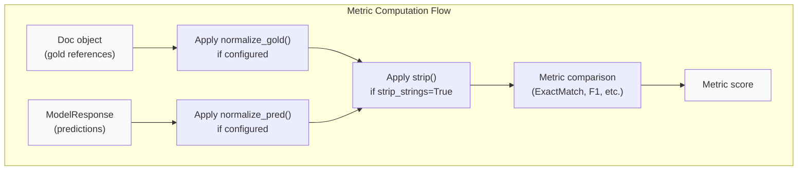
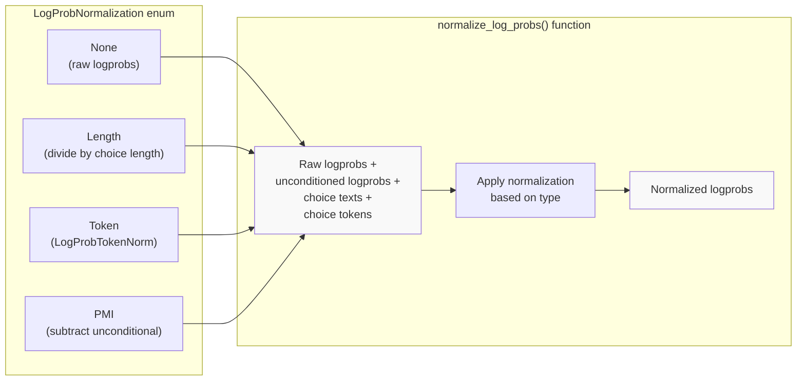
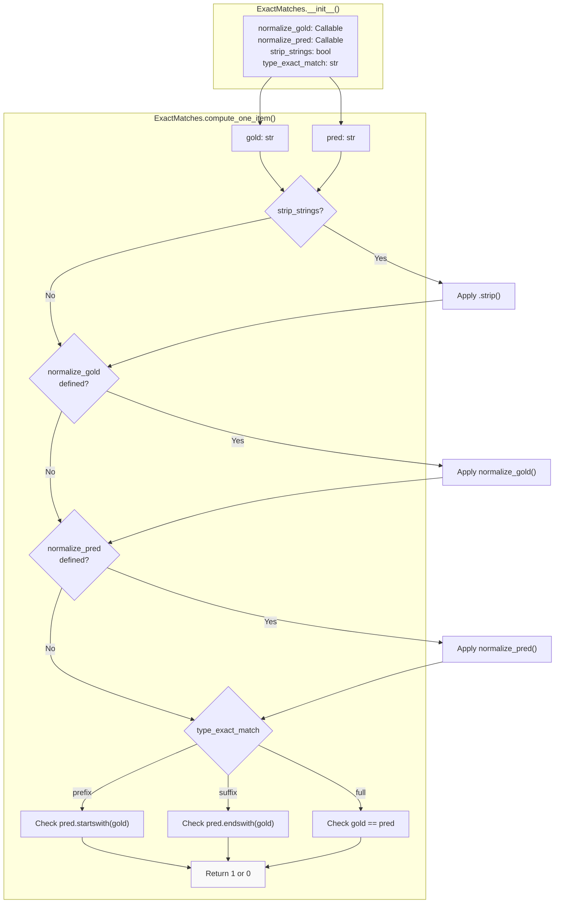
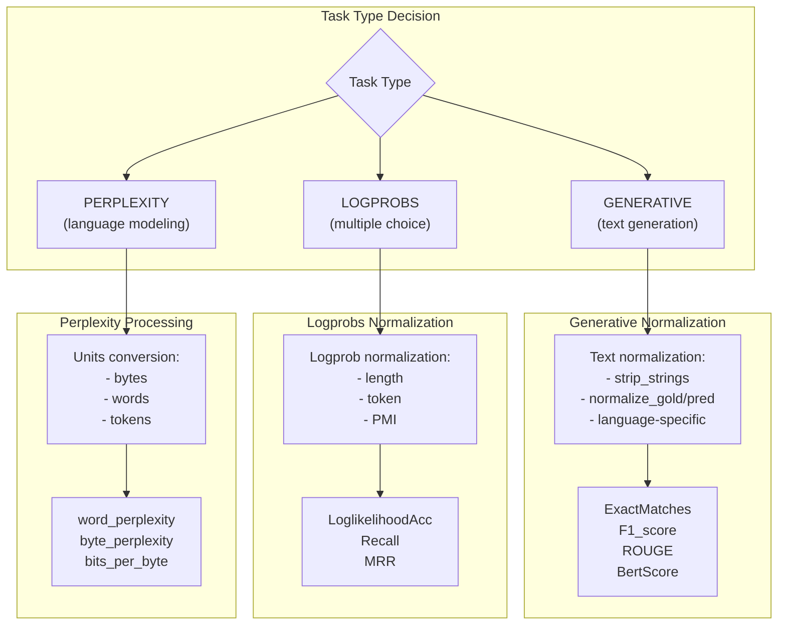

<!-- source: DeepWiki mcp.deepwiki.com · repo huggingface/lighteval · page 8.7 Normalization and Preprocessing · fetched 2026-10-26 -->

# Normalization and Preprocessing

<details>
<summary>Relevant source files</summary>

The following files were used as context for generating this wiki page:

- [src/lighteval/metrics/metrics.py](src/lighteval/metrics/metrics.py)
- [src/lighteval/metrics/metrics_sample.py](src/lighteval/metrics/metrics_sample.py)

</details>


This page documents the text normalization and preprocessing functions used throughout lighteval's metrics system. These functions standardize text representations before metric computation to ensure fair and consistent comparisons between model predictions and gold references.

For information about metric computation itself, see [Metric Application](#8.8). For details on specific metric implementations, see [Sample-Level Metrics](#8.2) and [Corpus-Level Metrics](#8.3).

## Purpose and Scope

Normalization and preprocessing serve two primary purposes in lighteval:

1. **Text Normalization**: Standardizing prediction and gold reference strings before comparison (e.g., removing formatting, stripping whitespace, lowercasing)
2. **Log Probability Normalization**: Adjusting raw log probabilities to account for choice length, unconditional probabilities, or token counts in loglikelihood-based metrics

These operations are applied selectively based on task requirements and metric definitions to ensure evaluation fairness while respecting task-specific formatting requirements.

---

## Text Normalization Functions

Text normalization functions transform strings before metric computation. They are primarily defined in `src/lighteval/metrics/normalizations.py` and imported by metric classes.

### Common Normalization Functions

The following table summarizes frequently used text normalization functions:

| Function | Purpose | Typical Use Case |
|----------|---------|------------------|
| `remove_braces` | Removes curly braces `{}` from text | Input document preprocessing |
| `remove_braces_and_strip` | Removes braces and strips whitespace | Prediction preprocessing |
| `bigbench_normalizer` | Applies BigBench-style normalization | ROUGE metrics with BigBench tasks |

**Sources**: [src/lighteval/metrics/metrics_sample.py:47-53](), [src/lighteval/metrics/metrics.py:60]()

### Normalization Application Pattern



**Diagram**: Text normalization flow in metric computation

**Sources**: [src/lighteval/metrics/metrics_sample.py:81-168]()

---

## Log Probability Normalization

Log probability normalization adjusts raw logprobs from model outputs to account for various factors. This is critical for fair comparison in loglikelihood-based metrics where choices have different lengths or characteristics.

### Normalization Types



**Diagram**: Log probability normalization types and application

The `normalize_log_probs()` function takes several parameters:

- `normalization`: A `LogProbNormalization` enum value or `LogProbTokenNorm` instance
- `choices_logprob`: Raw log probabilities for each choice
- `unconditioned_logprob`: Log probabilities without context (for PMI normalization)
- `choices_text`: Text strings of choices (for length-based normalization)
- `choices_tokens`: Tokenized choices (for token-based normalization)

**Sources**: [src/lighteval/metrics/metrics_sample.py:47-53](), [src/lighteval/metrics/metrics_sample.py:244-295]()

### Application in Metrics

Log probability normalization is primarily used in multiple-choice and loglikelihood-based metrics:

| Metric Class | Normalization Parameter | Default Value |
|--------------|------------------------|---------------|
| `LoglikelihoodAcc` | `logprob_normalization` | `None` |
| `NormalizedMultiChoiceProbability` | `log_prob_normalization` | `None` |
| `Probability` | `normalization` | `None` |
| `MRR` | `length_normalization` (boolean) | `False` |

**Example Usage**:

[src/lighteval/metrics/metrics_sample.py:281-291]() shows how `LoglikelihoodAcc` applies normalization:

```python
normalized_log_probs = (
    normalize_log_probs(
        self.logprob_normalization,
        choices_logprobs,
        unconditioned_logprobs,
        doc.choices,
        choices_tokens,
    )
    if self.logprob_normalization
    else choices_logprobs
)
```

**Sources**: [src/lighteval/metrics/metrics_sample.py:243-295](), [src/lighteval/metrics/metrics_sample.py:297-355](), [src/lighteval/metrics/metrics_sample.py:357-406]()

---

## Normalization in Sample-Level Metrics

Sample-level metrics that compare text (e.g., exact match, F1, ROUGE) accept optional normalization parameters in their constructors.

### ExactMatches Normalization



**Diagram**: `ExactMatches` normalization and comparison flow

**Sources**: [src/lighteval/metrics/metrics_sample.py:81-168]()

### Common Patterns in Metric Classes

The following metric classes follow similar normalization patterns:

1. **ExactMatches** [src/lighteval/metrics/metrics_sample.py:81-168]()
   - Parameters: `normalize_gold`, `normalize_pred`, `strip_strings`
   - Applied in: `compute_one_item()` method

2. **F1_score** [src/lighteval/metrics/metrics_sample.py:170-241]()
   - Parameters: `normalize_gold`, `normalize_pred`, `strip_strings`
   - Applied before computing bag-of-words overlap

3. **ROUGE** [src/lighteval/metrics/metrics_sample.py:486-596]()
   - Parameters: `normalize_gold`, `normalize_pred`
   - Applied to lists of gold/prediction strings before rouge_scorer

4. **BertScore** [src/lighteval/metrics/metrics_sample.py:598-659]()
   - Parameters: `normalize_gold`, `normalize_pred`
   - Applied before BERT embedding computation

5. **Extractiveness** [src/lighteval/metrics/metrics_sample.py:661-715]()
   - Parameters: `normalize_input`, `normalize_pred`
   - Uses different names to distinguish input document vs prediction

6. **Faithfulness** [src/lighteval/metrics/metrics_sample.py:717-763]()
   - Parameters: `normalize_input`, `normalize_pred`
   - Similar to Extractiveness

**Sources**: [src/lighteval/metrics/metrics_sample.py:81-763]()

---

## Normalization in Sampling Metrics

The `SamplingMetric` base class provides unified normalization for metrics that operate on multiple samples (e.g., `PassAtK`, `MajAtN`, `AvgAtN`).

### SamplingMetric Preprocessing Pipeline

```mermaid
graph TB
    subgraph "SamplingMetric.__init__()"
        InitParams["normalize: Callable or str<br/>strip_strings: bool<br/>sample_scoring_function: Callable"]
        
        CheckType{"normalize is str?"}
        
        LoadFunc["Load function from<br/>lighteval.metrics.normalizations"]
        UseFunc["Use provided callable"]
        
        SetNorm["self.normalize = func"]
    end
    
    subgraph "SamplingMetric.preprocess()"
        TextIn["text: str"]
        
        EmptyCheck{"text empty?"}
        ReturnEmpty["Return ''"]
        
        StripCheck{"strip_strings?"}
        ApplyStrip["text = text.strip()"]
        
        NormCheck{"normalize defined?"}
        ApplyNorm["text = normalize(text)"]
        
        TextOut["Normalized text"]
    end
    
    InitParams --> CheckType
    CheckType -->|Yes| LoadFunc
    CheckType -->|No| UseFunc
    LoadFunc --> SetNorm
    UseFunc --> SetNorm
    
    TextIn --> EmptyCheck
    EmptyCheck -->|Yes| ReturnEmpty
    EmptyCheck -->|No| StripCheck
    
    StripCheck -->|Yes| ApplyStrip
    StripCheck -->|No| NormCheck
    ApplyStrip --> NormCheck
    
    NormCheck -->|Yes| ApplyNorm
    NormCheck -->|No| TextOut
    ApplyNorm --> TextOut
    
    style TextOut fill:#f9f9f9
    style ReturnEmpty fill:#f9f9f9
```



**Diagram**: `SamplingMetric` preprocessing flow

**Key Feature**: The constructor accepts normalization as either a callable or a string. If a string is provided, it dynamically loads the function from `lighteval.metrics.normalizations` using Python's `inspect.getmembers()`.

**Sources**: [src/lighteval/metrics/metrics_sample.py:1109-1171]()

### Sampling Metric Classes Using Normalization

The following sampling metrics inherit from `SamplingMetric` and use its preprocessing:

1. **PassAtK** [src/lighteval/metrics/metrics_sample.py:1264-1329]()
   - Preprocesses predictions before scoring
   - Used in code generation tasks

2. **MajAtN** [src/lighteval/metrics/metrics_sample.py:1212-1262]()
   - Preprocesses all predictions to find majority vote
   - Preprocesses gold for comparison

3. **AvgAtN** [src/lighteval/metrics/metrics_sample.py:1176-1210]()
   - Applies normalization via `sample_scoring_function`

4. **GPassAtK** [src/lighteval/metrics/metrics_sample.py:1331-1458]()
   - Similar preprocessing to PassAtK
   - Used for graded pass@k metrics

**Sources**: [src/lighteval/metrics/metrics_sample.py:1176-1458]()

---

## Common Normalization Patterns

### Pattern 1: Basic String Normalization

Used by most text comparison metrics (ExactMatch, F1, ROUGE):

```
Input: raw string
  ↓
[Optional] strip whitespace
  ↓
[Optional] apply custom normalize function
  ↓
Output: normalized string
```

**Example from Metrics Enum**:

[src/lighteval/metrics/metrics.py:255-261]() defines exact match with stripping:
```python
exact_match = SampleLevelMetric(
    metric_name="em",
    sample_level_fn=ExactMatches(strip_strings=True),
    category=SamplingMethod.GENERATIVE,
    corpus_level_fn=np.mean,
    higher_is_better=True,
)
```

### Pattern 2: Specialized Document Preprocessing

Used by summarization metrics (Extractiveness, Faithfulness):

```
Input document: remove braces
  ↓
Prediction: remove braces AND strip
  ↓
Compute metric (coverage, density, faithfulness)
```

**Example from Metrics Enum**:

[src/lighteval/metrics/metrics.py:277-293]() defines extractiveness:
```python
extractiveness = SampleLevelMetricGrouping(
    metric_name=["summarization_coverage", "summarization_density", "summarization_compression"],
    sample_level_fn=Extractiveness(
        normalize_input=remove_braces, 
        normalize_pred=remove_braces_and_strip, 
        input_column="text"
    ),
    # ...
)
```

### Pattern 3: BigBench Normalization

Used for compatibility with BigBench evaluation:

[src/lighteval/metrics/metrics.py:513-524]() defines ROUGE with BigBench normalization:
```python
rouge_t5 = CorpusLevelMetricGrouping(
    metric_name=["rouge1", "rouge2", "rougeL", "rougeLsum"],
    sample_level_fn=ROUGE(
        ["rouge1", "rouge2", "rougeL", "rougeLsum"],
        bootstrap=True,
        normalize_gold=bigbench_normalizer,
        normalize_pred=bigbench_normalizer,
    ),
    # ...
)
```

### Pattern 4: Log Probability Adjustment

Used in loglikelihood-based metrics for fair comparison:

```
Raw logprobs from model
  ↓
[Optional] Divide by choice length (length normalization)
  ↓
[Optional] Subtract unconditional logprobs (PMI normalization)
  ↓
[Optional] Divide by token count (token normalization)
  ↓
Compute argmax/ranking/probability
```

**Sources**: [src/lighteval/metrics/metrics.py:175-524]()

---

## Normalization Function Discovery

### Dynamic Loading Mechanism

The `SamplingMetric` class supports loading normalization functions by string name:

[src/lighteval/metrics/metrics_sample.py:1120-1131]():
```python
if isinstance(normalize, str):
    import lighteval.metrics.normalizations
    
    allowed_normalizations = inspect.getmembers(
        lighteval.metrics.normalizations, inspect.isfunction
    )
    if normalize in allowed_normalizations:
        self.normalize = allowed_normalizations[normalize]
    else:
        raise ValueError(f"Unknown normalization function: {normalize}")
```

This allows users to specify normalization by name when defining custom metrics:
- `"remove_braces"`
- `"remove_braces_and_strip"`
- `"bigbench_normalizer"`
- Any other function in `lighteval.metrics.normalizations`

**Sources**: [src/lighteval/metrics/metrics_sample.py:1114-1131]()

---

## Integration with Metric System

### Normalization Selection by Task Type



**Diagram**: Normalization strategy by sampling method

**Sources**: [src/lighteval/metrics/metrics.py:146-590]()

---

## Summary

Normalization and preprocessing in lighteval operate at two levels:

1. **Text-level**: Standardizing string representations for fair comparison (stripping, case normalization, format removal)
2. **Probability-level**: Adjusting log probabilities to account for structural differences (length, tokens, context)

These operations are configurable per-metric and per-task, allowing lighteval to support diverse evaluation scenarios while maintaining consistency. Normalization functions are applied automatically during metric computation and can be customized through metric constructor parameters or string-based function references.

**Sources**: [src/lighteval/metrics/metrics_sample.py:1-1458](), [src/lighteval/metrics/metrics.py:1-634]()

---

