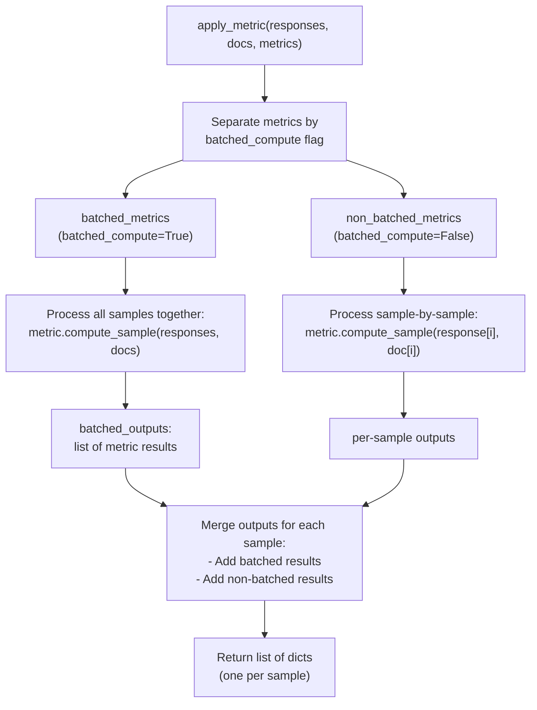
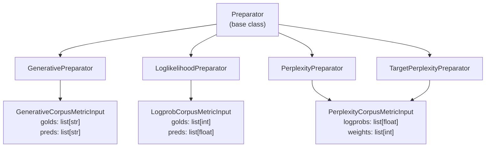
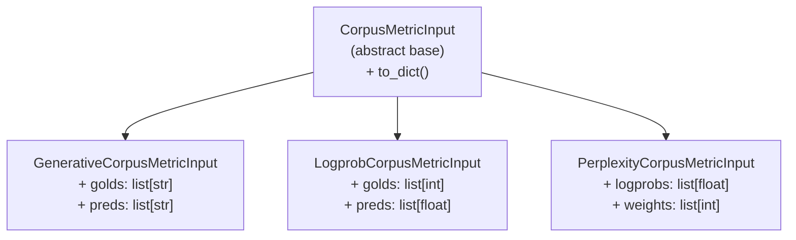
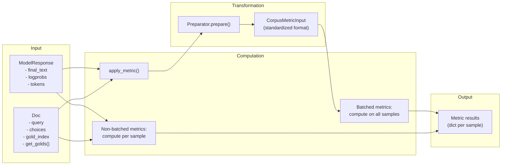
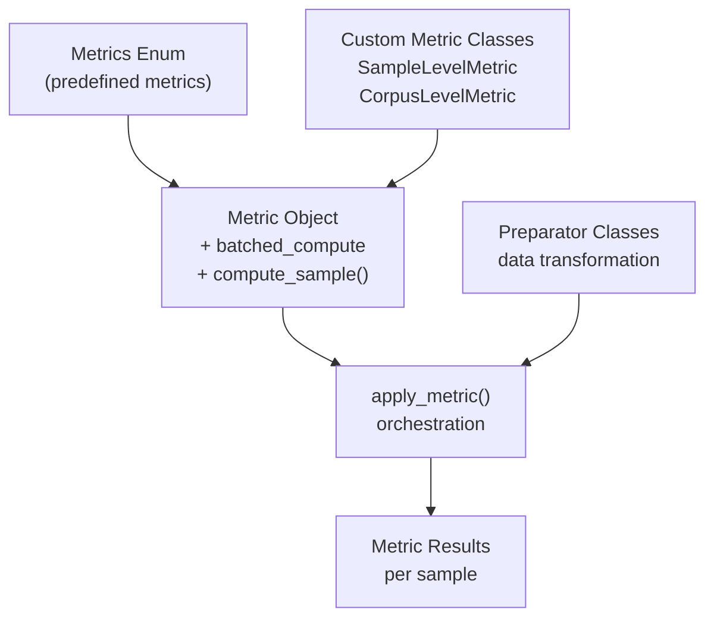

<!-- source: DeepWiki mcp.deepwiki.com · repo huggingface/lighteval · page 8.8 Metric Application · fetched 2026-10-26 -->

# Metric Application

<details>
<summary>Relevant source files</summary>

The following files were used as context for generating this wiki page:

- [src/lighteval/data.py](src/lighteval/data.py)
- [src/lighteval/metrics/__init__.py](src/lighteval/metrics/__init__.py)
- [tests/test_unit_harness_metrics.py](tests/test_unit_harness_metrics.py)

</details>


## Purpose and Scope

This document covers the metric application system in lighteval, which serves as the orchestration layer between model inference outputs and metric computation. The `apply_metric` function and associated Preparator classes transform raw model responses and document data into formats suitable for metric evaluation.

For information about predefined metrics, see [Predefined Metrics](#8.1). For custom metric creation, see [Sample-Level Metrics](#8.2) and [Corpus-Level Metrics](#8.3). For normalization utilities used within metrics, see [Normalization and Preprocessing](#8.7).

## The apply_metric Function

The `apply_metric` function is the central entry point for computing metrics on model outputs. It coordinates the application of multiple metrics to a batch of model responses and their corresponding documents.

### Function Signature

[src/lighteval/metrics/__init__.py:29-62]()

```python
def apply_metric(responses: list[ModelResponse], docs: list[Doc], metrics: list[Metric])
```

**Parameters:**
- `responses`: List of `ModelResponse` objects containing model predictions, logprobs, and tokens
- `docs`: List of `Doc` objects containing queries, gold references, and task metadata
- `metrics`: List of `Metric` objects to compute

**Returns:** List of dictionaries, one per sample, where each dictionary contains metric name/value pairs

### Processing Flow



**Sources:** [src/lighteval/metrics/__init__.py:29-62]()

### Processing Logic

The function separates metrics into two categories based on the `batched_compute` attribute:

1. **Batched metrics** ([src/lighteval/metrics/__init__.py:31]()): Process all samples together, enabling optimizations and corpus-level computations
2. **Non-batched metrics** ([src/lighteval/metrics/__init__.py:32]()): Process each sample individually

For each sample index `i`, the function:
1. Creates an output dictionary
2. Adds results from all batched metrics (extracted from batch results at index `i`)
3. Adds results from all non-batched metrics (computed on-the-fly for sample `i`)

**Sources:** [src/lighteval/metrics/__init__.py:44-60]()

## Processing Modes

### Batched Processing

Batched processing applies a metric to all samples simultaneously. This is used when:
- The metric requires corpus-level statistics (e.g., corpus BLEU)
- Batch operations are more efficient (e.g., vectorized computations)
- Cross-sample information is needed (e.g., IRT-based metrics)

**Implementation:**
```python
metric_outputs = metric.compute_sample(responses=responses, docs=docs)
# Returns list of dicts, one per sample
```

The metric's `compute_sample` method receives the entire list of responses and documents, computes results for all samples, and returns a list where each element corresponds to one sample's metrics.

**Sources:** [src/lighteval/metrics/__init__.py:38-41]()

### Non-Batched Processing

Non-batched processing applies a metric to individual samples. This is used when:
- The metric is purely sample-level (e.g., exact match)
- Each sample can be evaluated independently
- No corpus-level aggregation is needed

**Implementation:**
```python
output = metric.compute_sample(model_response=responses[i], doc=docs[i])
# Returns dict for single sample
```

The metric's `compute_sample` method receives a single response and document, computes the metric, and returns a dictionary with the results.

**Sources:** [src/lighteval/metrics/__init__.py:52-58]()

## Preparator Classes

Preparator classes transform raw model responses and documents into standardized `CorpusMetricInput` formats. These classes bridge the gap between diverse task types (generative, loglikelihood, perplexity) and corpus-level metric computation.

### Base Class and Architecture



**Sources:** [src/lighteval/metrics/sample_preparator.py:63-223]()

### GenerativePreparator

The `GenerativePreparator` prepares generative task outputs (free-form text generation) for corpus-level metrics.

**Method:**
[src/lighteval/metrics/sample_preparator.py:68-82]()

**Transformation:**
1. Extracts gold references from `doc.get_golds()` (can be single or multiple references)
2. Extracts predicted text from `model_response.final_text`
3. Returns `GenerativeCorpusMetricInput(golds=golds, preds=predictions)`

**Used by:** ROUGE, BLEU, BERTScore, and other text generation metrics

**Sources:** [src/lighteval/metrics/sample_preparator.py:67-93]()

### LoglikelihoodPreparator

The `LoglikelihoodPreparator` prepares multiple-choice task outputs (loglikelihood-based selection) for corpus-level metrics.

**Initialization:**
[src/lighteval/metrics/sample_preparator.py:97-104]()

- `is_single_token`: If `True`, handles metrics that only need the single best token (faster computation)

**Method:**
[src/lighteval/metrics/sample_preparator.py:106-127]()

**Transformation:**
1. Extracts gold indices from `doc.gold_index` (can be multiple correct answers)
2. Computes predicted index using `np.argmax(model_response.logprobs)` (choice with highest logprob)
3. For single-token mode: Takes only first gold index, logs warning if multiple golds exist
4. Returns `LogprobCorpusMetricInput(golds=gold_ixs, preds=argmax_result)`

**Used by:** Accuracy, F1 score for multiple-choice tasks

**Sources:** [src/lighteval/metrics/sample_preparator.py:96-128]()

### PerplexityPreparator

The `PerplexityPreparator` prepares perplexity measurements on input text (using `loglikelihood_rolling`).

**Initialization:**
[src/lighteval/metrics/sample_preparator.py:176-188]()

- `units_type`: Either `"words"` or `"bytes"` for weighting perplexity by text length

**Unit Counting:**
[src/lighteval/metrics/sample_preparator.py:190-202]()

- **Words**: Splits on whitespace using `re.split(r"\s+", text)`
- **Bytes**: Counts UTF-8 encoded bytes using `len(text.encode("utf-8"))`

**Method:**
[src/lighteval/metrics/sample_preparator.py:204-222]()

**Transformation:**
1. Sums logprobs from `model_response.logprobs`
2. Uses `doc.original_query` if available, otherwise falls back to `doc.query`
3. Counts units in the reference text
4. Returns `PerplexityCorpusMetricInput(logprobs=sum, weights=unit_count)`

**Used by:** Perplexity metrics on input sequences

**Sources:** [src/lighteval/metrics/sample_preparator.py:175-223]()

### TargetPerplexityPreparator

The `TargetPerplexityPreparator` prepares perplexity measurements on target/gold text (using `loglikelihood`).

**Initialization and Unit Counting:**
[src/lighteval/metrics/sample_preparator.py:131-157]()

Identical to `PerplexityPreparator` (supports `"words"` or `"bytes"`).

**Method:**
[src/lighteval/metrics/sample_preparator.py:159-172]()

**Transformation:**
1. Sums logprobs from `model_response.logprobs`
2. Joins all gold references from `doc.get_golds()`
3. Counts units in the concatenated gold text
4. Returns `PerplexityCorpusMetricInput(logprobs=sum, weights=unit_count)`

**Used by:** Target perplexity metrics, conditional perplexity

**Sources:** [src/lighteval/metrics/sample_preparator.py:130-173]()

## CorpusMetricInput Classes

The `CorpusMetricInput` classes provide standardized data structures for corpus-level metric computation. These dataclasses ensure consistent interfaces between preparators and metrics.



### CorpusMetricInput (Base)

[src/lighteval/metrics/sample_preparator.py:37-42]()

**Fields:** None (abstract base)

**Methods:**
- `to_dict()`: Converts dataclass to dictionary using `asdict()`

### GenerativeCorpusMetricInput

[src/lighteval/metrics/sample_preparator.py:45-48]()

**Fields:**
- `golds`: List of gold reference strings (can have multiple references per sample)
- `preds`: List of predicted strings (typically single prediction per sample)

**Used for:** Text generation metrics (ROUGE, BLEU, BERTScore, etc.)

### LogprobCorpusMetricInput

[src/lighteval/metrics/sample_preparator.py:51-54]()

**Fields:**
- `golds`: List of gold choice indices (integers)
- `preds`: List of predicted choice indices or logprobs (floats)

**Used for:** Multiple-choice accuracy and classification metrics

### PerplexityCorpusMetricInput

[src/lighteval/metrics/sample_preparator.py:57-60]()

**Fields:**
- `logprobs`: List of summed log probabilities (floats)
- `weights`: List of text length weights in specified units (integers)

**Used for:** Perplexity calculations with length-weighted averaging

**Sources:** [src/lighteval/metrics/sample_preparator.py:37-61]()

## Data Flow Through Metric Application

The following diagram shows how data flows from raw model outputs through the metric application system:



**Sources:** [src/lighteval/metrics/__init__.py:29-62](), [src/lighteval/metrics/sample_preparator.py:63-223]()

## Usage Example from Tests

The test suite demonstrates metric application in practice:

[tests/test_unit_harness_metrics.py:65-140]()

### Example: Generative Task

```python
# Create Doc with gold references
doc = Doc(
    query="full_prompt_text",
    choices=None,
    gold_index=None,
    original_query="original_text"
)

# Model produces text predictions
response = ModelResponse(
    text="predicted output",
    output_tokens=[[]],
    input_tokens=[]
)

# Apply metric
results = apply_metric(
    responses=[response],
    docs=[doc],
    metrics=[Metrics.rouge1.value]
)[0]

# Results contain computed metrics
# {"rouge1": 0.45}
```

### Example: Loglikelihood Task

```python
# Create Doc with multiple choices
doc = Doc(
    query="question",
    choices=["choice A", "choice B", "choice C"],
    gold_index=[1],  # B is correct
)

# Model produces logprobs for each choice
response = ModelResponse(
    logprobs=[-2.3, -0.5, -3.1],  # B has highest prob
    output_tokens=[[]],
    input_tokens=[]
)

# Apply metric
results = apply_metric(
    responses=[response],
    docs=[doc],
    metrics=[Metrics.loglikelihood_acc.value]
)[0]

# Results contain accuracy
# {"loglikelihood_acc": 1.0}
```

**Sources:** [tests/test_unit_harness_metrics.py:72-139]()

## Performance Considerations

### When to Use Batched Metrics

| Scenario | Batched | Reason |
|----------|---------|--------|
| Corpus-level statistics needed | ✓ | Requires all samples to compute (e.g., corpus BLEU) |
| Vectorized computation possible | ✓ | More efficient with NumPy/batch operations |
| Cross-sample comparisons | ✓ | Needs to see all samples (e.g., IRT metrics) |
| Simple per-sample metrics | ✗ | No benefit from batching |
| Early stopping desired | ✗ | Can't stop mid-batch |

### Memory Considerations

Batched metrics load all samples into memory simultaneously, which can be problematic for:
- Very large evaluation sets
- Metrics requiring substantial intermediate storage
- Memory-constrained environments

Non-batched metrics process one sample at a time, using constant memory regardless of dataset size.

**Sources:** [src/lighteval/metrics/__init__.py:29-62]()

## Integration with Metrics System

The `apply_metric` function integrates with the broader metrics system:



- **Metrics Enum** ([Predefined Metrics](#8.1)): Provides 200+ built-in metrics
- **Custom Metrics** ([Sample-Level](#8.2), [Corpus-Level](#8.3)): User-defined metric implementations
- **Preparators**: Transform data for corpus-level metrics
- **apply_metric**: Orchestrates computation and result aggregation

**Sources:** [src/lighteval/metrics/__init__.py:24-29](), Diagram 5 from high-level architecture

---

