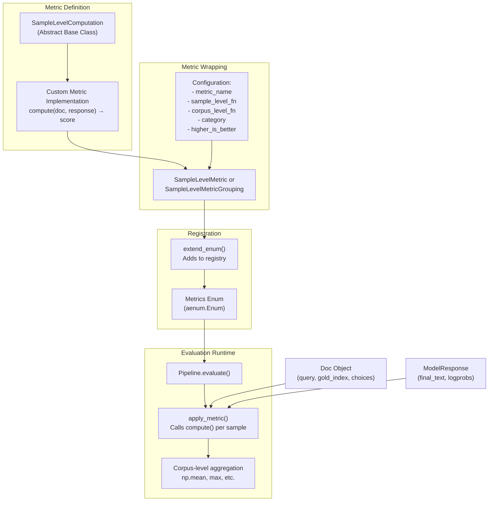
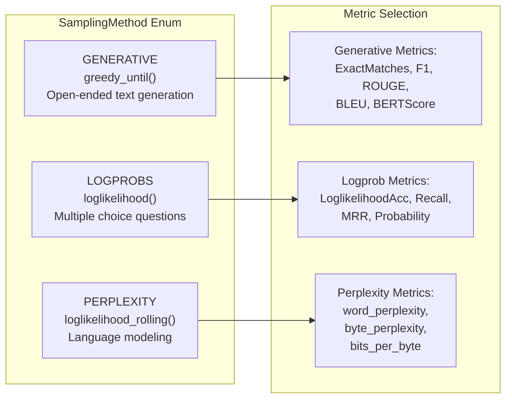
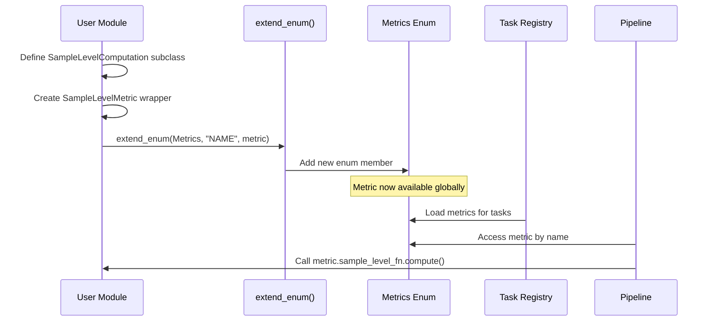

<!-- source: DeepWiki mcp.deepwiki.com · repo huggingface/lighteval · page 8.9 Creating Custom Metrics · fetched 2026-10-26 -->

# Creating Custom Metrics

<details>
<summary>Relevant source files</summary>

The following files were used as context for generating this wiki page:

- [.github/workflows/pr_style_bot.yaml](.github/workflows/pr_style_bot.yaml)
- [docs/source/adding-a-new-metric.mdx](docs/source/adding-a-new-metric.mdx)
- [src/lighteval/__main__.py](src/lighteval/__main__.py)
- [src/lighteval/main_baseline.py](src/lighteval/main_baseline.py)
- [src/lighteval/metrics/metrics.py](src/lighteval/metrics/metrics.py)
- [src/lighteval/metrics/metrics_sample.py](src/lighteval/metrics/metrics_sample.py)

</details>


This document explains how to create and register custom metrics in lighteval. Metrics evaluate model predictions against ground truth, computing scores at both individual sample and corpus levels.

For information about using predefined metrics, see [Predefined Metrics](#8.1). For details on metric application during evaluation, see [Metric Application](#8.8). For creating custom tasks that use these metrics, see [Creating Custom Tasks](#5.6).

---

## Metric System Architecture

Lighteval's metric system operates in two stages: sample-level computation followed by corpus-level aggregation.



**Sources:** [src/lighteval/metrics/metrics_sample.py:64-79](), [src/lighteval/metrics/metrics.py:146-634](), [src/lighteval/metrics/utils/metric_utils.py]()

---

## Sample-Level Metrics

### The SampleLevelComputation Interface

All sample-level metrics must inherit from `SampleLevelComputation` and implement the `compute` method:

```python
class SampleLevelComputation(ABC):
    @abstractmethod
    def compute(self, doc: Doc, model_response: ModelResponse, **kwargs):
        raise NotImplementedError
```

**Sources:** [src/lighteval/metrics/metrics_sample.py:64-79]()

### Input Data Structures

| Field | Type | Description |
|-------|------|-------------|
| `doc.query` | `str` | The prompt/question text |
| `doc.choices` | `list[str]` | Multiple choice options (if applicable) |
| `doc.gold_index` | `int \| list[int]` | Index(es) of correct choice(s) |
| `doc.get_golds()` | `list[str]` | Gold answer text(s) |
| `model_response.final_text` | `list[str]` | Decoded model outputs |
| `model_response.logprobs` | `list[float]` | Log probabilities for choices |
| `model_response.output_tokens` | `list[list[int]]` | Token IDs of outputs |

**Sources:** [src/lighteval/tasks/requests.py](), [src/lighteval/models/model_output.py]()

### Implementation Examples

#### Single-Value Metric

```python
from lighteval.metrics.metrics_sample import SampleLevelComputation
from lighteval.tasks.requests import Doc
from lighteval.models.model_output import ModelResponse

class CustomAccuracy(SampleLevelComputation):
    def __init__(self, strip_strings: bool = True):
        self.strip_strings = strip_strings
    
    def compute(self, doc: Doc, model_response: ModelResponse, **kwargs) -> float:
        """Returns 1.0 if prediction matches gold, 0.0 otherwise."""
        prediction = model_response.final_text[0]
        gold = doc.get_golds()[0]
        
        if self.strip_strings:
            prediction = prediction.strip()
            gold = gold.strip()
        
        return 1.0 if prediction == gold else 0.0
```

**Sources:** [src/lighteval/metrics/metrics_sample.py:81-168]()

#### Multi-Value Metric

For metrics that compute multiple scores per sample, return a dictionary:

```python
class CustomDetailedMetric(SampleLevelComputation):
    def compute(self, doc: Doc, model_response: ModelResponse, **kwargs) -> dict[str, float]:
        """Returns multiple scores per sample."""
        prediction = model_response.final_text[0]
        gold = doc.get_golds()[0]
        
        return {
            "exact_match": 1.0 if prediction == gold else 0.0,
            "length_ratio": len(prediction) / max(len(gold), 1),
            "prefix_match": 1.0 if prediction.startswith(gold[:5]) else 0.0
        }
```

**Sources:** [src/lighteval/metrics/metrics_sample.py:170-241]()

#### Using Normalization

Apply text normalization before comparison:

```python
from lighteval.metrics.normalizations import remove_braces, remove_braces_and_strip

class NormalizedExactMatch(SampleLevelComputation):
    def __init__(
        self,
        normalize_gold: callable = None,
        normalize_pred: callable = None
    ):
        self.normalize_gold = normalize_gold
        self.normalize_pred = normalize_pred
    
    def compute(self, doc: Doc, model_response: ModelResponse, **kwargs) -> float:
        prediction = model_response.final_text[0]
        gold = doc.get_golds()[0]
        
        if self.normalize_gold:
            gold = self.normalize_gold(gold)
        if self.normalize_pred:
            prediction = self.normalize_pred(prediction)
        
        return 1.0 if prediction == gold else 0.0
```

**Sources:** [src/lighteval/metrics/metrics_sample.py:81-168](), [src/lighteval/metrics/normalizations.py]()

#### Multiple Golds or Predictions

Handle cases with multiple reference answers or model outputs:

```python
class MaxAggregationMetric(SampleLevelComputation):
    def __init__(self, aggregation_function: callable = max):
        self.aggregation_function = aggregation_function
    
    def compute(self, doc: Doc, model_response: ModelResponse, **kwargs) -> float:
        """Computes score for all gold/pred pairs, aggregates with max."""
        results = []
        golds = doc.get_golds()
        predictions = model_response.final_text
        
        for gold in golds:
            for pred in predictions:
                score = self._compute_one_pair(gold, pred)
                results.append(score)
        
        return self.aggregation_function(results)
    
    def _compute_one_pair(self, gold: str, pred: str) -> float:
        # Your comparison logic here
        return 1.0 if gold == pred else 0.0
```

**Sources:** [src/lighteval/metrics/metrics_sample.py:118-136]()

---

## Metric Wrapping and Configuration

### Wrapping Single Metrics

Use `SampleLevelMetric` to wrap single-value metrics:

```python
from lighteval.metrics.utils.metric_utils import SampleLevelMetric, SamplingMethod
import numpy as np

custom_accuracy = SampleLevelMetric(
    metric_name="custom_acc",
    sample_level_fn=CustomAccuracy(strip_strings=True),
    category=SamplingMethod.GENERATIVE,
    corpus_level_fn=np.mean,
    higher_is_better=True
)
```

**Configuration Parameters:**

| Parameter | Type | Description |
|-----------|------|-------------|
| `metric_name` | `str` | Name displayed in results |
| `sample_level_fn` | `SampleLevelComputation` | Your metric implementation |
| `category` | `SamplingMethod` | GENERATIVE, LOGPROBS, or PERPLEXITY |
| `corpus_level_fn` | `callable` | Aggregation function (e.g., `np.mean`, `max`) |
| `higher_is_better` | `bool` | Whether higher scores are better |

**Sources:** [src/lighteval/metrics/utils/metric_utils.py](), [src/lighteval/metrics/metrics.py:147-153]()

### Wrapping Multi-Value Metrics

Use `SampleLevelMetricGrouping` for metrics that return dictionaries:

```python
from lighteval.metrics.utils.metric_utils import SampleLevelMetricGrouping

custom_detailed_metric = SampleLevelMetricGrouping(
    metric_name=["exact_match", "length_ratio", "prefix_match"],
    sample_level_fn=CustomDetailedMetric(),
    category=SamplingMethod.GENERATIVE,
    corpus_level_fn={
        "exact_match": np.mean,
        "length_ratio": np.mean,
        "prefix_match": np.mean
    },
    higher_is_better={
        "exact_match": True,
        "length_ratio": False,  # Penalize overly long outputs
        "prefix_match": True
    }
)
```

**Sources:** [src/lighteval/metrics/metrics.py:239-247](), [src/lighteval/metrics/metrics.py:277-293]()

### Sampling Method Categories



**Sources:** [src/lighteval/tasks/requests.py](), [src/lighteval/metrics/metrics.py:154-590]()

---

## Registering Custom Metrics

### Complete Registration Example

Create a Python file with your metric implementation and registration:

```python
# my_custom_metric.py
from aenum import extend_enum
import numpy as np

from lighteval.metrics import Metrics
from lighteval.metrics.metrics_sample import SampleLevelComputation
from lighteval.metrics.utils.metric_utils import SampleLevelMetric, SamplingMethod
from lighteval.tasks.requests import Doc
from lighteval.models.model_output import ModelResponse


class MyCustomMetric(SampleLevelComputation):
    def __init__(self, threshold: float = 0.5):
        self.threshold = threshold
    
    def compute(self, doc: Doc, model_response: ModelResponse, **kwargs) -> float:
        # Your metric logic here
        prediction = model_response.final_text[0]
        gold = doc.get_golds()[0]
        similarity = len(set(prediction.split()) & set(gold.split())) / len(set(gold.split()))
        return 1.0 if similarity >= self.threshold else 0.0


# Wrap the metric
my_custom_metric = SampleLevelMetric(
    metric_name="custom_similarity",
    sample_level_fn=MyCustomMetric(threshold=0.5),
    category=SamplingMethod.GENERATIVE,
    corpus_level_fn=np.mean,
    higher_is_better=True
)

# Register to the Metrics enum
extend_enum(Metrics, "CUSTOM_SIMILARITY", my_custom_metric)

if __name__ == "__main__":
    print("Successfully registered custom_similarity metric")
```

**Sources:** [docs/source/adding-a-new-metric.mdx:46-137](), [src/lighteval/metrics/metrics.py:1-28]()

### Registration Flow



**Sources:** [docs/source/adding-a-new-metric.mdx:127-137](), [src/lighteval/metrics/metrics.py:146-634]()

---

## Using Custom Metrics

### With Custom Tasks

Reference your custom metric in a task definition:

```python
# my_custom_task.py
from lighteval.tasks.lighteval_task import LightevalTaskConfig

# Import and register your metric
from my_custom_metric import my_custom_metric

task = LightevalTaskConfig(
    name="my_task_with_custom_metric",
    prompt_function=my_prompt_function,
    hf_repo="username/my_dataset",
    hf_subset="default",
    evaluation_splits=["test"],
    metric=[my_custom_metric],  # Use registered metric
)

TASKS_TABLE = [task]
```

**Sources:** [docs/source/adding-a-new-metric.mdx:141-163]()

### CLI Usage

Load custom metrics using the `--custom-tasks` flag:

```bash
lighteval accelerate \
    "model_name=gpt2" \
    "my_task_with_custom_metric" \
    --custom-tasks my_custom_metric.py,my_custom_task.py
```

The system will:
1. Import `my_custom_metric.py`, executing `extend_enum()` to register the metric
2. Import `my_custom_task.py`, which references the now-registered metric
3. Execute evaluation using your custom metric

**Sources:** [docs/source/adding-a-new-metric.mdx:143-151]()

### Programmatic Usage

```python
from lighteval.pipeline import Pipeline, PipelineParameters

# Custom metrics auto-registered on import
import my_custom_metric

pipeline = Pipeline(
    tasks="my_task_with_custom_metric",
    pipeline_parameters=PipelineParameters(
        custom_tasks="my_custom_task.py"
    ),
    model_config=model_config
)

results = pipeline.evaluate()
```

**Sources:** [src/lighteval/pipeline.py]()

---

## Advanced Metric Patterns

### Loglikelihood-Based Metrics

For multiple-choice tasks that use log probabilities:

```python
class LogprobAccuracy(SampleLevelComputation):
    def __init__(self, logprob_normalization=None):
        self.logprob_normalization = logprob_normalization
    
    def compute(self, doc: Doc, model_response: ModelResponse, **kwargs) -> int:
        """Returns 1 if highest logprob choice is correct."""
        n_choices = len(doc.choices)
        choices_logprobs = model_response.logprobs[:n_choices]
        gold_indices = [doc.gold_index] if isinstance(doc.gold_index, int) else doc.gold_index
        
        # Apply normalization if specified
        if self.logprob_normalization:
            # Normalization logic here
            pass
        
        best_choice = np.argmax(choices_logprobs)
        return int(best_choice in gold_indices)
```

**Sources:** [src/lighteval/metrics/metrics_sample.py:243-295]()

### Corpus-Level Metrics

For metrics requiring full dataset aggregation (e.g., BLEU, F1):

```python
from lighteval.metrics.utils.metric_utils import CorpusLevelMetric
from lighteval.metrics.sample_preparator import GenerativePreparator

# Preparator collects data at sample level
bleu_metric = CorpusLevelMetric(
    metric_name="bleu",
    sample_level_fn=GenerativePreparator(),  # Just stores predictions/golds
    category=SamplingMethod.GENERATIVE,
    corpus_level_fn=CorpusLevelTranslationMetric("bleu"),  # Computes BLEU
    higher_is_better=True
)
```

**Sources:** [src/lighteval/metrics/metrics.py:189-195](), [src/lighteval/metrics/metrics_corpus.py]()

### Batched Computation

For metrics that benefit from batch processing (e.g., LLM-as-judge):

```python
custom_batched_metric = SampleLevelMetricGrouping(
    metric_name=["judge_score"],
    sample_level_fn=MyBatchedJudge(),
    category=SamplingMethod.GENERATIVE,
    corpus_level_fn={"judge_score": np.mean},
    higher_is_better={"judge_score": True},
    batched_compute=True  # Enables batched processing
)
```

**Sources:** [src/lighteval/metrics/metrics.py:553-562]()

---

## Metric Implementation Checklist

| Step | Description | File Location |
|------|-------------|---------------|
| 1. Define class | Create `SampleLevelComputation` subclass | Your metric file |
| 2. Implement `compute()` | Return `float`, `int`, or `dict[str, float]` | Your metric file |
| 3. Add initialization | Define configurable parameters in `__init__` | Your metric file |
| 4. Create wrapper | Use `SampleLevelMetric` or `SampleLevelMetricGrouping` | Your metric file |
| 5. Set category | Choose GENERATIVE, LOGPROBS, or PERPLEXITY | Your metric file |
| 6. Define aggregation | Specify corpus-level function (`np.mean`, etc.) | Your metric file |
| 7. Register metric | Call `extend_enum(Metrics, "NAME", metric)` | Your metric file |
| 8. Test import | Add `if __name__ == "__main__"` block | Your metric file |

**Sources:** [docs/source/adding-a-new-metric.mdx:1-163](), [src/lighteval/metrics/metrics_sample.py:64-1526]()

---

## Common Patterns and Best Practices

### Pattern: Multiple Aggregation Strategies

```python
class FlexibleMetric(SampleLevelComputation):
    def __init__(self, aggregation_function: callable = max):
        """Allows customizing how multiple scores are combined."""
        self.aggregation_function = aggregation_function
    
    def compute(self, doc: Doc, model_response: ModelResponse, **kwargs) -> float:
        scores = []
        # Compute multiple scores
        for gold in doc.get_golds():
            for pred in model_response.final_text:
                scores.append(self._score_pair(gold, pred))
        return self.aggregation_function(scores)
```

**Sources:** [src/lighteval/metrics/metrics_sample.py:82-136]()

### Pattern: External Model Integration

For metrics using external models (BERTScore, BLEURT):

```python
class ExternalModelMetric(SampleLevelComputation):
    def __init__(self, model_name: str):
        self.model_name = model_name
        self._model = None  # Lazy initialization
        self._tokenizer = None
    
    @property
    def model(self):
        """Lazy load model on first use."""
        if self._model is None:
            from transformers import AutoModel
            self._model = AutoModel.from_pretrained(self.model_name)
        return self._model
    
    def compute(self, doc: Doc, model_response: ModelResponse, **kwargs) -> float:
        # Use self.model for scoring
        pass
```

**Sources:** [src/lighteval/metrics/metrics_sample.py:765-803]()

### Pattern: Stateful Metrics

For metrics accumulating state across samples:

```python
class StatefulMetric(SampleLevelComputation):
    def __init__(self):
        self.scorer = None  # Initialize once, reuse
    
    def compute(self, doc: Doc, model_response: ModelResponse, **kwargs) -> float:
        if self.scorer is None:
            # One-time initialization
            self.scorer = self._initialize_scorer()
        
        return self.scorer.score(
            model_response.final_text[0],
            doc.get_golds()[0]
        )
```

**Sources:** [src/lighteval/metrics/metrics_sample.py:486-596](), [src/lighteval/metrics/metrics_sample.py:598-659]()

---

## Debugging and Testing

### Verify Metric Registration

```python
# test_my_metric.py
from lighteval.metrics import Metrics

# Import registers the metric
import my_custom_metric

# Verify it's available
assert hasattr(Metrics, "CUSTOM_SIMILARITY")
print(f"Metric registered: {Metrics.CUSTOM_SIMILARITY}")
print(f"Metric name: {Metrics.CUSTOM_SIMILARITY.value.metric_name}")
```

### Test Metric Computation

```python
from lighteval.tasks.requests import Doc
from lighteval.models.model_output import ModelResponse

# Create test data
test_doc = Doc(
    query="What is 2+2?",
    choices=["3", "4", "5"],
    gold_index=1,
    instruction=""
)

test_response = ModelResponse(
    final_text=["4"],
    logprobs=[-0.1, -0.01, -0.5],
    output_tokens=[[19]]
)

# Test your metric
metric_impl = MyCustomMetric()
score = metric_impl.compute(test_doc, test_response)
print(f"Score: {score}")
```

**Sources:** [src/lighteval/tasks/requests.py](), [src/lighteval/models/model_output.py]()

---

**Complete Sources:** [src/lighteval/metrics/metrics_sample.py](), [src/lighteval/metrics/metrics.py](), [src/lighteval/metrics/utils/metric_utils.py](), [docs/source/adding-a-new-metric.mdx](), [src/lighteval/metrics/normalizations.py](), [src/lighteval/tasks/requests.py](), [src/lighteval/models/model_output.py]()

---

