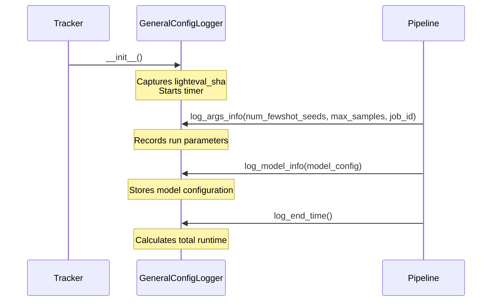
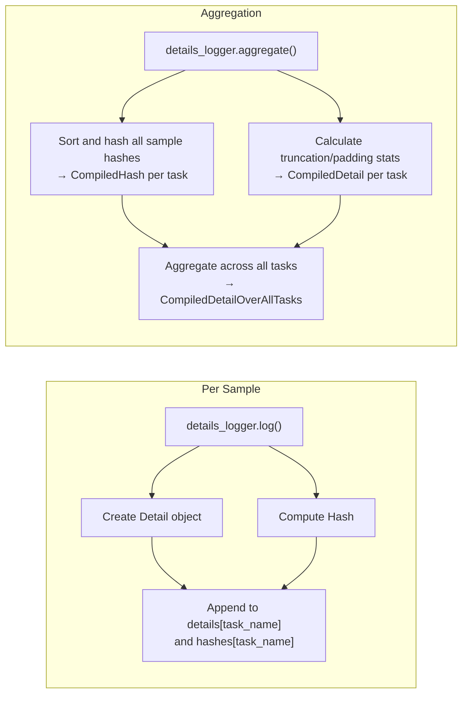
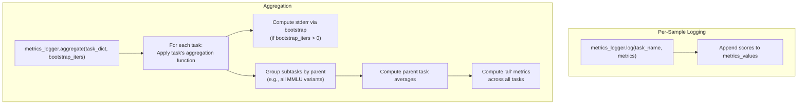
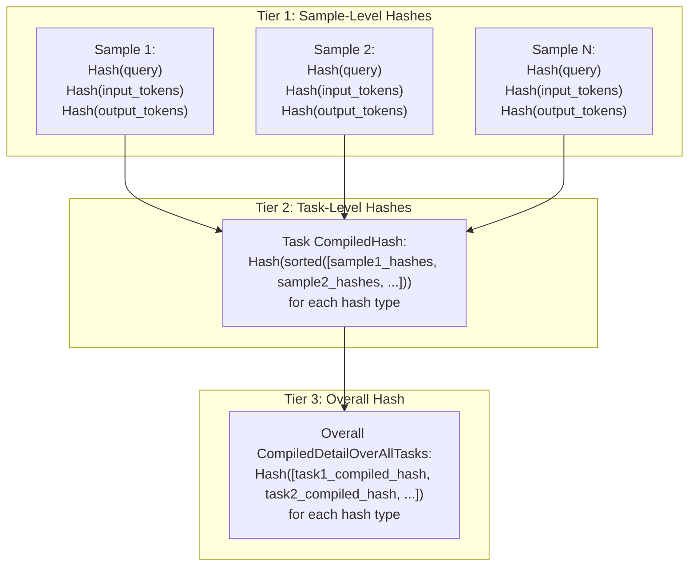
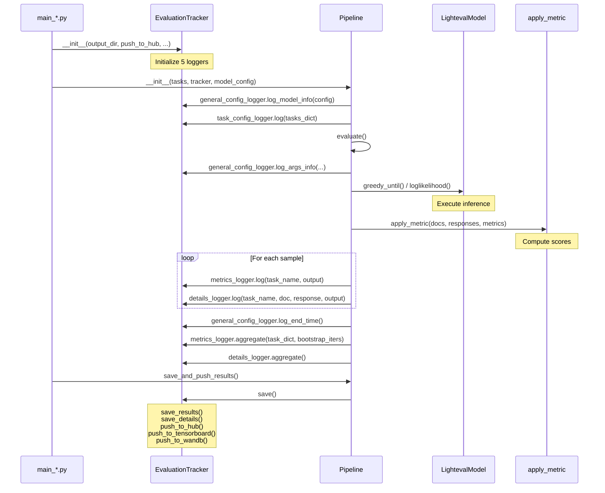

<!-- source: DeepWiki mcp.deepwiki.com · repo huggingface/lighteval · page 9 Evaluation Tracking and Output · fetched 2026-10-26 -->

# Evaluation Tracking and Output

<details>
<summary>Relevant source files</summary>

The following files were used as context for generating this wiki page:

- [src/lighteval/logging/evaluation_tracker.py](src/lighteval/logging/evaluation_tracker.py)
- [src/lighteval/logging/info_loggers.py](src/lighteval/logging/info_loggers.py)
- [src/lighteval/main_accelerate.py](src/lighteval/main_accelerate.py)
- [src/lighteval/main_custom.py](src/lighteval/main_custom.py)
- [src/lighteval/main_endpoint.py](src/lighteval/main_endpoint.py)
- [src/lighteval/main_nanotron.py](src/lighteval/main_nanotron.py)
- [src/lighteval/main_sglang.py](src/lighteval/main_sglang.py)
- [src/lighteval/main_vllm.py](src/lighteval/main_vllm.py)
- [src/lighteval/pipeline.py](src/lighteval/pipeline.py)

</details>


This page documents how lighteval tracks, logs, and persists evaluation results with reproducibility guarantees. The tracking system captures configuration details, per-sample outputs, aggregated metrics, and version information, then outputs to multiple destinations including local storage, HuggingFace Hub, TensorBoard, and Weights & Biases.

For information about how metrics are computed before being logged, see [Metrics System](#8). For details about the overall evaluation flow that uses this tracker, see [Evaluation Pipeline](#4).

## Overview

The tracking system is built around the `EvaluationTracker` class, which aggregates five specialized loggers that each capture different aspects of an evaluation run. The tracker is initialized at the start of every evaluation and coordinates all logging throughout the pipeline execution.

```mermaid
graph TB
    subgraph "Pipeline Execution"
        Pipeline["Pipeline.evaluate()"]
    end
    
    subgraph "EvaluationTracker"
        Tracker["EvaluationTracker"]
        GCL["GeneralConfigLogger"]
        TCL["TaskConfigLogger"]
        VL["VersionsLogger"]
        DL["DetailsLogger"]
        ML["MetricsLogger"]
    end
    
    subgraph "Logging Events"
        ModelInfo["log_model_info()"]
        TaskInfo["task_config_logger.log()"]
        SampleData["details_logger.log()"]
        MetricData["metrics_logger.log()"]
        EndTime["log_end_time()"]
    end
    
    subgraph "Output Operations"
        Save["save()"]
        Results["save_results()"]
        Details["save_details()"]
        Hub["push_to_hub()"]
        TB["push_to_tensorboard()"]
        WB["push_to_wandb()"]
    end
    
    Pipeline --> ModelInfo
    Pipeline --> TaskInfo
    Pipeline --> SampleData
    Pipeline --> MetricData
    Pipeline --> EndTime
    Pipeline --> Save
    
    Tracker --> GCL
    Tracker --> TCL
    Tracker --> VL
    Tracker --> DL
    Tracker --> ML
    
    ModelInfo --> GCL
    TaskInfo --> TCL
    SampleData --> DL
    SampleData --> VL
    MetricData --> ML
    EndTime --> GCL
    
    Save --> Results
    Save --> Details
    Save --> Hub
    Save --> TB
    Save --> WB
```



**Diagram: EvaluationTracker coordinates five specialized loggers and multiple output operations**

Sources: [src/lighteval/logging/evaluation_tracker.py:95-210](), [src/lighteval/pipeline.py:117-156]()

## EvaluationTracker Initialization

The `EvaluationTracker` is instantiated in all evaluation entry points with configuration for output behavior:

| Parameter | Type | Purpose |
|-----------|------|---------|
| `output_dir` | `str` | Base directory for local output files |
| `results_path_template` | `str \| None` | Custom template for results directory structure |
| `save_details` | `bool` | Whether to save per-sample details (can be large) |
| `push_to_hub` | `bool` | Whether to upload results to HuggingFace Hub |
| `push_to_tensorboard` | `bool` | Whether to log metrics to TensorBoard |
| `hub_results_org` | `str` | Organization name for Hub uploads |
| `tensorboard_metric_prefix` | `str` | Prefix for TensorBoard metric names |
| `public` | `bool` | Whether Hub uploads should be public |
| `nanotron_run_info` | `GeneralArgs` | Nanotron-specific run metadata (optional) |
| `use_wandb` | `bool` | Whether to enable Weights & Biases logging |

```python
# Example initialization from main_accelerate.py
evaluation_tracker = EvaluationTracker(
    output_dir=output_dir,
    results_path_template=results_path_template,
    save_details=save_details,
    push_to_hub=push_to_hub,
    push_to_tensorboard=push_to_tensorboard,
    public=public_run,
    hub_results_org=results_org,
    use_wandb=wandb,
)
```

During initialization, the tracker:
1. Creates all five logger instances
2. Initializes HuggingFace Hub API client
3. Sets up filesystem interface via `fsspec` (supports local and remote paths)
4. Initializes Weights & Biases or trackio if `use_wandb=True`

Sources: [src/lighteval/logging/evaluation_tracker.py:142-210](), [src/lighteval/main_accelerate.py:98-107]()

## The Five Specialized Loggers

Each logger has a distinct responsibility and tracks specific evaluation aspects:

### GeneralConfigLogger

**Purpose**: Tracks system-level configuration and timing information for reproducibility.

**Key Attributes**:
- `lighteval_sha`: Git commit SHA of lighteval version used (enables exact reproducibility)
- `num_fewshot_seeds`: Number of few-shot sampling seeds used
- `max_samples`: Maximum samples per task (for debugging runs)
- `job_id`: Slurm job ID for cluster execution tracking
- `start_time`, `end_time`, `total_evaluation_time_secondes`: Runtime timing
- `model_config`: Complete `ModelConfig` object
- `model_name`: Model identifier string

**Lifecycle**:


**Diagram: GeneralConfigLogger captures system-level metadata throughout execution**

Sources: [src/lighteval/logging/info_loggers.py:47-135](), [src/lighteval/pipeline.py:152-153](), [src/lighteval/pipeline.py:272-276](), [src/lighteval/pipeline.py:293]()

### TaskConfigLogger

**Purpose**: Maintains per-task configuration details.

**Key Attributes**:
- `tasks_configs`: Maps task names to `LightevalTaskConfig` objects

**Data Captured**:
- Task name and version
- Prompt function references
- Dataset repository and split information
- Metric configurations
- Few-shot settings
- Original vs effective number of documents (after filtering/truncation)

**Usage**:
```python
# Logged once after task initialization
evaluation_tracker.task_config_logger.log(self.tasks_dict)

# Can update document counts
evaluation_tracker.task_config_logger.log_num_docs(
    task_name="task_name",
    original_num_docs=1000,
    effective_num_docs=500
)
```

Sources: [src/lighteval/logging/info_loggers.py:424-441](), [src/lighteval/pipeline.py:238]()

### VersionsLogger

**Purpose**: Records task and dataset version identifiers.

**Key Attributes**:
- `versions`: Maps task names to version numbers/dates

This enables tracking which specific metric definitions and dataset versions were used, crucial for comparing results across different evaluation runs.

Sources: [src/lighteval/logging/info_loggers.py:405-422]()

### DetailsLogger

**Purpose**: Stores per-sample evaluation information and reproducibility hashes.

**Key Data Structures**:

| Class | Purpose |
|-------|---------|
| `Detail` | Single sample's doc, model response, and metric scores |
| `Hash` | Hashes for one sample's query, input tokens, output tokens |
| `CompiledDetail` | Aggregated statistics over all samples in a task |
| `CompiledHash` | Aggregated hash over all samples in a task |
| `CompiledDetailOverAllTasks` | Statistics aggregated across all tasks |

**Sample-Level Detail Structure**:
```python
@dataclass
class Detail:
    doc: Doc                      # Input document with query, context, gold answer
    model_response: ModelResponse # Model's predictions and logprobs
    metric: dict                  # Per-sample metric scores
```

**Hashing for Reproducibility**:
```python
@dataclass
class Hash:
    example: str        # Hash of Doc.query
    full_prompt: str    # Hash of Doc.ctx (full formatted prompt)
    input_tokens: str   # Hash of input token IDs
    cont_tokens: str    # Hash of output token IDs
```

**Logging Flow**:


**Diagram: DetailsLogger captures sample-level data and computes reproducibility hashes**

The hash aggregation is **order-independent** (uses sorted hashes) to ensure reproducibility across different execution orders.

Sources: [src/lighteval/logging/info_loggers.py:137-306](), [src/lighteval/pipeline.py:399]()

### MetricsLogger

**Purpose**: Logs and aggregates metric scores.

**Key Attributes**:
- `metrics_values`: Maps `task_name → metric_name → list[float]` (per-sample scores)
- `metric_aggregated`: Maps `task_name → metric_name → float` (aggregated scores)

**Aggregation Process**:


**Diagram: MetricsLogger aggregation pipeline with bootstrap stderr and task grouping**

**Aggregation Features**:

1. **Task-level aggregation**: Uses the aggregation function specified in each task's configuration (e.g., mean, median, or custom functions)

2. **Bootstrap standard errors**: When `bootstrap_iters > 0`, computes confidence intervals via statistical bootstrap

3. **Subtask grouping**: Automatically groups related subtasks (e.g., all MMLU subjects) and computes parent task averages:
   ```python
   # Example: All tasks like "mmlu:anatomy", "mmlu:biology" get grouped under "mmlu:_average"
   if "|" in task_name:
       task, fewshot = task_name.split("|")
       grouped_tasks[f"{task.split(':')[0]}:_average|{fewshot}"].append(task_name)
   ```

4. **Global average**: Computes `metric_aggregated["all"]` with averages across all tasks

Sources: [src/lighteval/logging/info_loggers.py:308-403](), [src/lighteval/pipeline.py:398]()

## Reproducibility and Hashing System

The three-tier hashing system enables detection of differences at any level of granularity:



**Diagram: Three-tier hashing enables granular reproducibility verification**

**Hash Types**:

| Hash Type | What It Captures | Use Case |
|-----------|------------------|----------|
| `hash_examples` | All `Doc.query` strings | Verify same questions were asked |
| `hash_full_prompts` | All formatted prompts with few-shot examples | Detect prompt template changes |
| `hash_input_tokens` | All input token ID sequences | Catch tokenization differences |
| `hash_cont_tokens` | All output token ID sequences | Identify model prediction changes |

**Implementation Details**:
- Uses `xxhash.xxh64` for fast, deterministic hashing
- Hashes are sorted before aggregation to ensure order-independence
- Individual sample hashes stored in `DetailsLogger.hashes[task_name]`
- Compiled hashes stored in `DetailsLogger.compiled_hashes[task_name]`
- Overall hashes stored in `DetailsLogger.compiled_details_over_all_tasks.hashes`

**Usage Example**:
```python
# Compare two evaluation runs
run1_compiled = tracker1.details_logger.compiled_hashes["mmlu:anatomy"]
run2_compiled = tracker2.details_logger.compiled_hashes["mmlu:anatomy"]

if run1_compiled.hash_input_tokens != run2_compiled.hash_input_tokens:
    print("Input tokenization differs between runs")

if run1_compiled.hash_cont_tokens != run2_compiled.hash_cont_tokens:
    print("Model predictions differ between runs")
```

Sources: [src/lighteval/logging/info_loggers.py:209-306]()

## Output Destinations and Formats

### Local Filesystem Output

The `save()` method orchestrates all output operations:

```python
def save(self) -> None:
    date_id = datetime.now().isoformat().replace(":", "-")
    
    results_dict = self.results  # Aggregated metrics and configs
    details_datasets = {}  # Per-sample details as HF Datasets
    
    # Always save results
    self.save_results(date_id, results_dict)
    
    # Optionally save details
    if self.should_save_details:
        self.save_details(date_id, details_datasets)
    
    # Optional remote outputs
    if self.should_push_to_hub:
        self.push_to_hub(date_id, details, results_dict)
    
    if self.use_wandb:
        self.push_to_wandb(results_dict, details_datasets)
    
    if self.should_push_results_to_tensorboard:
        self.push_to_tensorboard(results, compiled_details)
```

**Directory Structure**:
```
{output_dir}/
├── results/
│   └── {model_name}/
│       └── results_{date_id}.json
└── details/
    └── {model_name}/
        └── {date_id}/
            ├── details_task1_{date_id}.parquet
            ├── details_task2_{date_id}.parquet
            └── ...
```

**Results File Format**:
```json
{
  "config_general": {
    "lighteval_sha": "abc123...",
    "num_fewshot_seeds": 1,
    "model_config": {...},
    "total_evaluation_time_secondes": "123.45"
  },
  "results": {
    "task_name|num_fewshots": {
      "metric_name": 0.85,
      "metric_name_stderr": 0.02
    }
  },
  "versions": {
    "task_name|num_fewshots": 0
  },
  "config_tasks": {
    "task_name|num_fewshots": {...}
  },
  "summary_tasks": {
    "task_name|num_fewshots": {
      "hashes": {...},
      "truncated": 0,
      "non_truncated": 100
    }
  },
  "summary_general": {
    "hashes": {...},
    "truncated": 0,
    "non_truncated": 1000
  }
}
```

**Details File Format** (Parquet with columns):
- `doc`: Serialized `Doc` object with query, choices, gold answers
- `model_response`: Serialized `ModelResponse` with predictions, logprobs, tokens
- `metric`: Dictionary of per-sample metric scores

Sources: [src/lighteval/logging/evaluation_tracker.py:247-292](), [src/lighteval/logging/evaluation_tracker.py:302-362]()

### HuggingFace Hub Upload

When `push_to_hub=True`, results are uploaded to a Hub dataset repository:

**Repository Structure**:
```
{hub_results_org}/details_{sanitized_model_name}[_private]
├── results_{date_id}.json
├── results_{date_id}.parquet
├── {date_id}/
│   ├── details_task1_{date_id}.parquet
│   ├── details_task2_{date_id}.parquet
│   └── ...
└── README.md (auto-generated dataset card)
```

**Dataset Card Generation**:
The tracker automatically generates a comprehensive dataset card with:
- Model name and link
- Number of evaluation runs
- Latest results with direct links
- Dataset configuration YAML for loading specific tasks/dates
- Instructions for loading details via `datasets.load_dataset()`

**Configuration YAML** (generated in dataset card):
```yaml
configs:
  - config_name: task1_0
    data_files:
      - split: "2024_01_15T10_30_00"
        path: ["2024-01-15T10-30-00/details_task1_*.parquet"]
      - split: "latest"
        path: ["2024-01-15T10-30-00/details_task1_*.parquet"]
  - config_name: lighteval_mmlu_5  # Special aggregated config for MMLU
    data_files:
      - split: "2024_01_15T10_30_00"
        path: ["2024-01-15T10-30-00/details_*mmlu*_5_*.parquet"]
```

**Special Handling for MMLU and Similar Benchmarks**:
The system automatically creates aggregated configurations for multi-task benchmarks, allowing users to load all subtasks together:
```python
# Load all MMLU results at once
from datasets import load_dataset
data = load_dataset("org/details_model", "lighteval_mmlu_5", split="latest")
```

Sources: [src/lighteval/logging/evaluation_tracker.py:387-453](), [src/lighteval/logging/evaluation_tracker.py:454-661]()

### TensorBoard Integration

When `push_to_tensorboard=True`, metrics are logged to TensorBoard with support for:

1. **Hierarchical metric organization**:
   - Individual task metrics: `{prefix}/{task_name}/{metric_name}`
   - Benchmark suite metrics: `{prefix}_{suite_name}/{task_name}/{metric_name}`
   - Stderr metrics: `stderr_{prefix}/{task_name}/{metric_name}`
   - Benchmark averages: `{prefix}/{suite_name}/{metric_name}`

2. **Nanotron checkpoint tracking**:
   - Uses `global_step` from nanotron training state
   - Renames log files with step prefix for proper ordering in TensorBoard

3. **Evaluation details as text**:
   - Logs compiled details as markdown text in TensorBoard
   - Enables visual inspection alongside metrics

**File Handling for Multi-Checkpoint Evaluation**:
```python
# Rename files to ensure proper ordering in TensorBoard
files = os.listdir(output_dir_tb)
for file in files:
    os.rename(
        os.path.join(output_dir_tb, file),
        os.path.join(output_dir_tb, f"{global_step:07d}_{file}")
    )
```

This solves TensorBoard's issue with displaying out-of-order checkpoints.

Sources: [src/lighteval/logging/evaluation_tracker.py:662-751]()

### Weights & Biases / Trackio Integration

When `use_wandb=True`, the tracker supports both `wandb` and `trackio` (HuggingFace's internal experiment tracking):

```python
# Initialization
if use_wandb:
    try:
        import trackio as wandb
        self.wandb_run = wandb.init(
            project=os.environ["WANDB_PROJECT"],
            space_id=os.environ["WANDB_SPACE_ID"],
            resume="allow"
        )
    except ImportError:
        import wandb
        self.wandb_run = wandb.init(
            project=os.environ["WANDB_PROJECT"],
            resume="allow"
        )

# Logging
def push_to_wandb(self, results_dict: dict, details_datasets: dict):
    # Reformat keys: replace ':' with '/'
    results_dict = {k.replace(":", "/"): v for k, v in results_dict["results"].items()}
    self.wandb_run.log({**results_dict})
    self.wandb_run.finish()
```

**Key Features**:
- Automatically detects trackio if available (used within HuggingFace)
- Falls back to standard wandb
- Reformats metric keys for W&B's hierarchical display
- Requires `WANDB_PROJECT` environment variable

Sources: [src/lighteval/logging/evaluation_tracker.py:183-210](), [src/lighteval/logging/evaluation_tracker.py:293-300]()

## Integration with Pipeline

The `EvaluationTracker` is integrated throughout the `Pipeline` evaluation lifecycle:



**Diagram: EvaluationTracker is invoked at key points throughout pipeline execution**

**Key Integration Points**:

1. **Initialization** ([src/lighteval/pipeline.py:122](), [src/lighteval/pipeline.py:152-153]()):
   - Tracker passed to Pipeline constructor
   - Model info logged immediately after model initialization

2. **Pre-evaluation** ([src/lighteval/pipeline.py:272-276]()):
   - Args info logged at start of `evaluate()`
   - Task configs logged after task loading

3. **During evaluation** ([src/lighteval/pipeline.py:397-399]()):
   - Per-sample details and metrics logged in `_compute_metrics()`
   - Logged for every doc/response/metric combination

4. **Post-evaluation** ([src/lighteval/pipeline.py:293-297]()):
   - End time logged
   - Metrics aggregated with bootstrap stderr
   - Details aggregated for hashing

5. **Output** ([src/lighteval/pipeline.py:426-429]()):
   - `save_and_push_results()` called from main entry points
   - Delegates to tracker's `save()` method

**Accessing Results Programmatically**:
```python
# From Pipeline object
pipeline = Pipeline(...)
pipeline.evaluate()

# Get aggregated results
results = pipeline.get_results()  # Returns tracker.generate_final_dict()

# Get per-sample details
details = pipeline.get_details()  # Returns tracker.details_logger.details

# Or access tracker directly
results_dict = pipeline.evaluation_tracker.results
details_dict = pipeline.evaluation_tracker.details
```

Sources: [src/lighteval/pipeline.py:117-156](), [src/lighteval/pipeline.py:271-400](), [src/lighteval/pipeline.py:426-448]()

## Loading Previously Saved Details

The tracker supports loading previously saved details to recompute metrics without re-running inference:

```python
# In PipelineParameters
pipeline_params = PipelineParameters(
    load_responses_from_details_date_id="2024-01-15T10-30-00",  # or "first", "last"
    ...
)

# In Pipeline.evaluate()
if self.pipeline_parameters.load_responses_from_details_date_id:
    outputs = self._load_responses_from_details()
else:
    outputs = self._run_model()
```

**Loading Process**:
1. Calls `tracker.load_details_datasets(date_id, task_names)`
2. Finds all parquet files matching `details_*_{date_id}.parquet`
3. Loads them as HuggingFace `Dataset` objects
4. Reconstructs `ModelResponse` objects from serialized data
5. Returns in same format as `_run_model()` output

**Special Date IDs**:
- `"first"`: Load oldest evaluation run
- `"last"`: Load most recent evaluation run
- ISO timestamp string: Load specific run

This feature is useful for:
- Recomputing metrics with new metric definitions
- Comparing different metric configurations on same model outputs
- Debugging metric implementations

Sources: [src/lighteval/pipeline.py:278-286](), [src/lighteval/pipeline.py:401-424](), [src/lighteval/logging/evaluation_tracker.py:334-362]()

## EnhancedJSONEncoder

The tracker uses a custom JSON encoder to serialize complex Python objects:

```python
class EnhancedJSONEncoder(json.JSONEncoder):
    def default(self, o):
        if is_dataclass(o):
            return asdict(o)
        if callable(o):
            return o.__name__ if hasattr(o, "__name__") else o.func.__name__
        if isinstance(o, torch.dtype):
            return str(o)
        if isinstance(o, Enum):
            return o.name
        return super().default(o)
```

**Handles**:
- Dataclasses → dictionaries
- Callables → function names
- PyTorch dtypes → strings
- Enums → enum names
- Other objects → `type(o).__name__` or string representation

This enables serialization of `ModelConfig`, `TaskConfig`, `Doc`, `ModelResponse`, and other complex objects without manual conversion.

Sources: [src/lighteval/logging/evaluation_tracker.py:61-93]()

## Summary

The evaluation tracking system provides:

1. **Comprehensive logging** via five specialized loggers capturing different aspects of evaluation
2. **Reproducibility guarantees** through three-tier hashing system
3. **Multiple output formats** supporting local files, HuggingFace Hub, TensorBoard, and W&B
4. **Automatic dataset card generation** for Hub uploads with proper metadata
5. **Detail persistence** enabling metric recomputation without re-running inference
6. **Seamless integration** with the Pipeline for minimal user intervention

All tracking operations are coordinated by the `EvaluationTracker` class, which is instantiated once per evaluation run and accessed throughout the pipeline execution.

---

