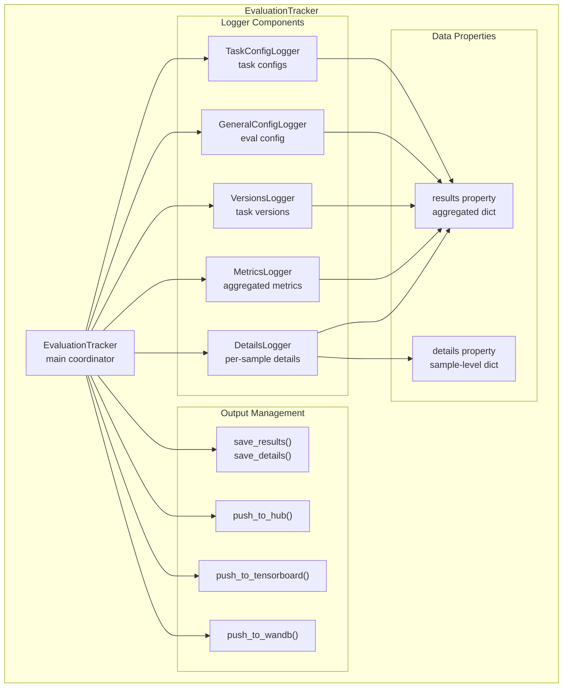
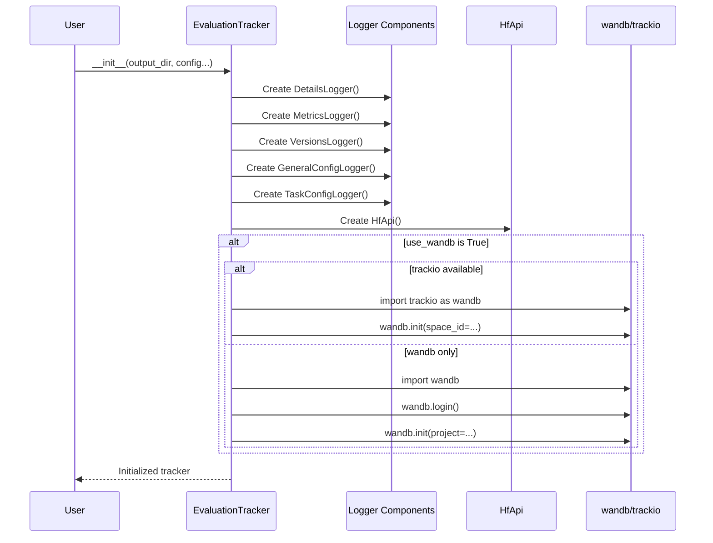
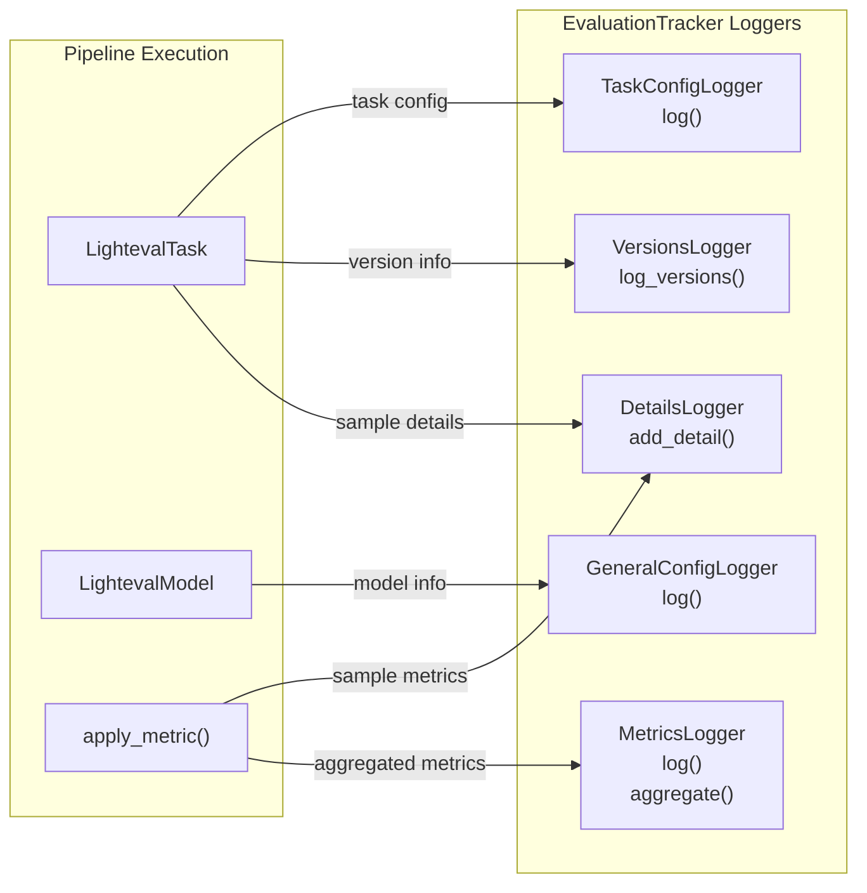
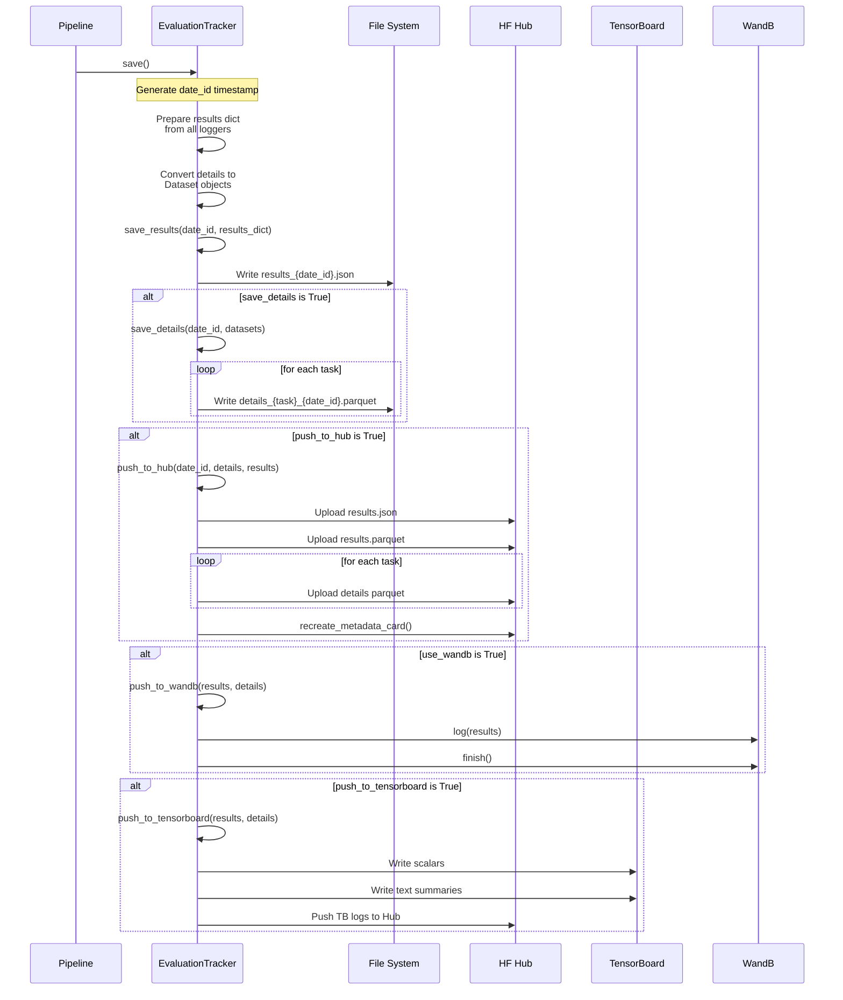
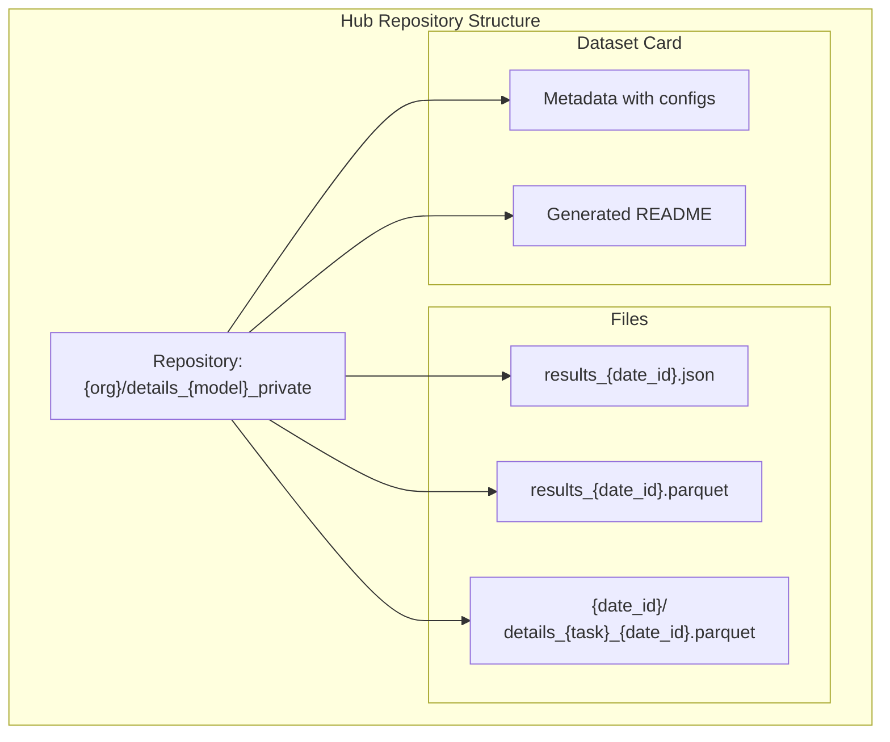
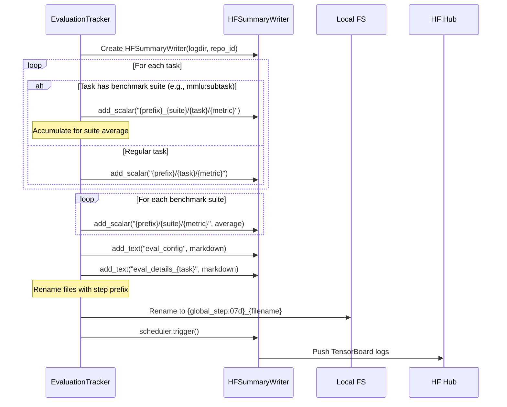
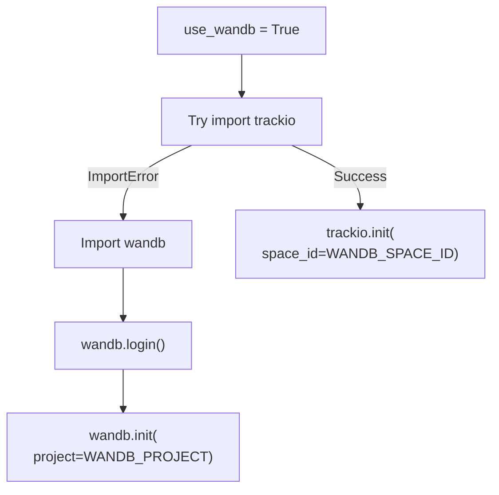
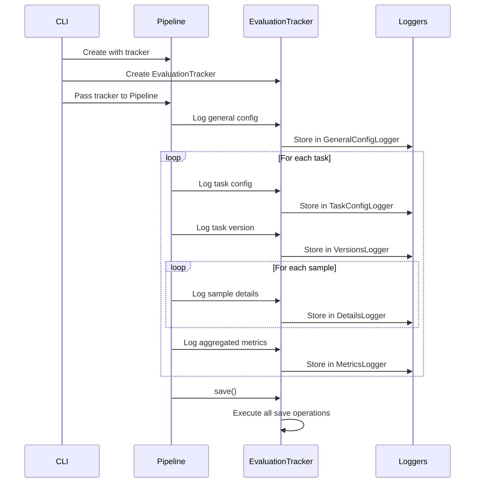

<!-- source: DeepWiki mcp.deepwiki.com · repo huggingface/lighteval · page 9.1 EvaluationTracker · fetched 2026-10-26 -->

# EvaluationTracker

<details>
<summary>Relevant source files</summary>

The following files were used as context for generating this wiki page:

- [src/lighteval/logging/evaluation_tracker.py](src/lighteval/logging/evaluation_tracker.py)
- [src/lighteval/main_accelerate.py](src/lighteval/main_accelerate.py)
- [src/lighteval/main_custom.py](src/lighteval/main_custom.py)
- [src/lighteval/main_endpoint.py](src/lighteval/main_endpoint.py)
- [src/lighteval/main_nanotron.py](src/lighteval/main_nanotron.py)
- [src/lighteval/main_sglang.py](src/lighteval/main_sglang.py)
- [src/lighteval/main_vllm.py](src/lighteval/main_vllm.py)

</details>


The `EvaluationTracker` class is the central logging and result management system in lighteval. It coordinates multiple specialized loggers to track different aspects of model evaluation and manages the persistence of results to multiple destinations including local files, Hugging Face Hub, TensorBoard, and Weights & Biases.

This page covers the tracker's architecture, configuration, and usage. For information about the specific logger classes it coordinates, see [Logging System](#9.2). For details on output formats and loading results, see [Results Format](#9.4).

## Overview

`EvaluationTracker` serves as the orchestrator for all evaluation logging in lighteval. During an evaluation run, the Pipeline populates the tracker's loggers with data, and at the end of evaluation, the tracker saves this data to configured destinations.

The tracker maintains five specialized logger components:

| Logger | Purpose | Data Tracked |
|--------|---------|--------------|
| `DetailsLogger` | Per-sample evaluation records | Individual predictions, inputs, metrics for each sample |
| `MetricsLogger` | Aggregate metrics | Task-level and corpus-level metric scores |
| `VersionsLogger` | Version tracking | Task versions, dataset versions |
| `GeneralConfigLogger` | General configuration | Model name, timing, system info, model config |
| `TaskConfigLogger` | Task configurations | Per-task configuration details |

**Sources:** [src/lighteval/logging/evaluation_tracker.py:92-157]()

## Component Architecture



**Sources:** [src/lighteval/logging/evaluation_tracker.py:92-157](), [src/lighteval/logging/evaluation_tracker.py:208-227]()

## Initialization

The `EvaluationTracker` is initialized with configuration parameters that control where and how results are saved:

```python
tracker = EvaluationTracker(
    output_dir="./results",           # Local output directory
    save_details=True,                # Save per-sample details
    push_to_hub=True,                 # Push to Hugging Face Hub
    hub_results_org="my-org",         # Hub organization
    push_to_tensorboard=False,        # Push to TensorBoard
    tensorboard_metric_prefix="eval", # TB metric prefix
    public=False,                     # Make Hub datasets private
    use_wandb=False,                  # Use W&B/Trackio
    results_path_template=None        # Custom path template
)
```

### Configuration Parameters

| Parameter | Type | Default | Description |
|-----------|------|---------|-------------|
| `output_dir` | str | required | Local directory for saving results (fsspec compatible) |
| `results_path_template` | str\|None | None | Custom path template with `{output_dir}`, `{org}`, `{model}` |
| `save_details` | bool | True | Whether to save per-sample details in Parquet |
| `push_to_hub` | bool | False | Push results to Hugging Face Hub |
| `push_to_tensorboard` | bool | False | Push metrics to TensorBoard |
| `hub_results_org` | str\|None | "" | HF Hub organization (required if pushing to Hub/TB) |
| `tensorboard_metric_prefix` | str | "eval" | Prefix for TensorBoard metric names |
| `public` | bool | False | Make Hub datasets public (default: private) |
| `nanotron_run_info` | GeneralArgs\|None | None | Nanotron run information for TB integration |
| `use_wandb` | bool | False | Log to Weights & Biases or Trackio |

**Sources:** [src/lighteval/logging/evaluation_tracker.py:139-207]()

### Initialization Sequence



**Sources:** [src/lighteval/logging/evaluation_tracker.py:139-207]()

## Data Collection During Evaluation

During evaluation, the Pipeline populates the tracker's loggers. Each logger accumulates specific types of data:



**Sources:** [src/lighteval/logging/evaluation_tracker.py:92-107]()

## Save Operations

The `save()` method is the main entry point for persisting all evaluation results. It orchestrates multiple save operations based on configuration:



**Sources:** [src/lighteval/logging/evaluation_tracker.py:244-289]()

### Local File System Save

The tracker saves results to structured local paths:

| Content | Path Pattern | Format |
|---------|-------------|---------|
| Results | `{output_dir}/results/{model_name}/results_{date_id}.json` | JSON |
| Details | `{output_dir}/details/{model_name}/{date_id}/details_{task}_{date_id}.parquet` | Parquet |
| TensorBoard | `{output_dir}/tb/{run}/` | TensorBoard events |

The `results_path_template` parameter allows customization:

```python
# Default behavior
output_path = f"{output_dir}/results/{model_name}/results_{date_id}.json"

# With custom template
results_path_template = "{output_dir}/custom/{org}_{model}"
# Extracts org and model from model_name (e.g., "HuggingFace/gpt2")
output_path = f"{output_dir}/custom/HuggingFace_gpt2/results_{date_id}.json"
```

**Sources:** [src/lighteval/logging/evaluation_tracker.py:299-313](), [src/lighteval/logging/evaluation_tracker.py:351-359]()

## Results Data Structure

The `results` property aggregates data from all loggers into a comprehensive dictionary:

```python
results = {
    "config_general": {
        # From GeneralConfigLogger
        "model_name": str,
        "model_sha": str,
        "lighteval_sha": str,
        "start_time": float,
        "end_time": float,
        "total_evaluation_time_secondes": str,
        "model_dtype": str | None,
        "model_size": str,
        "model_config": dict  # Model configuration
    },
    "results": {
        # From MetricsLogger.metric_aggregated
        "task_name|config|few_shot": {
            "metric_name": float,
            "metric_name_stderr": float
        }
    },
    "versions": {
        # From VersionsLogger
        "task_name": int  # Version number
    },
    "config_tasks": {
        # From TaskConfigLogger
        "task_name": {
            # Full task configuration dict
        }
    },
    "summary_tasks": {
        # From DetailsLogger.compiled_details
        "task_name": {
            "hashes": dict,
            "padded": int,
            "non_padded": int,
            "effective_few_shots": float
        }
    },
    "summary_general": {
        # From DetailsLogger.compiled_details_over_all_tasks
        "hashes": dict,
        "padded": int,
        "non_padded": int
    }
}
```

**Sources:** [src/lighteval/logging/evaluation_tracker.py:208-220]()

### Details Data Structure

The `details` property contains per-sample evaluation records:

```python
details = {
    "task_name": [
        {
            "__doc__": {
                # Doc object fields
                "query": str,
                "choices": list[str],
                "gold_index": int,
                "few_shot_examples": list,
                # ... other Doc fields
            },
            "__model_response__": {
                # ModelResponse fields
                "text": str | list[str],
                "input": str | list[str],
                "logprobs": list[float] | None,
                "tokens": list[str] | None,
                # ... other ModelResponse fields
            },
            "__metric__": {
                # Metric results
                "metric_name": float,
                # ... other metrics
            }
        },
        # ... more samples
    ],
    # ... more tasks
}
```

**Sources:** [src/lighteval/logging/evaluation_tracker.py:222-227](), [src/lighteval/logging/evaluation_tracker.py:252-264]()

## Hugging Face Hub Integration

When `push_to_hub=True`, the tracker creates a dataset repository with comprehensive metadata:



### Dataset Configurations

The tracker automatically creates dataset configurations for easy loading:

| Configuration | Description | Split Names |
|--------------|-------------|-------------|
| `results` | Aggregated results | Each timestamp + `latest` |
| `{task_name}` | Per-task details | Each timestamp + `latest` |
| Special configs | For task suites like MMLU | Grouped by suite |

### Metadata Card Generation

The `recreate_metadata_card()` method creates a comprehensive dataset card:

1. **Discovers all files** in the repository (results and details parquets)
2. **Parses timestamps** from filenames to track evaluation history
3. **Creates configurations** for each task with proper splits
4. **Generates README** with:
   - Model information and links
   - Dataset structure explanation
   - Latest results preview
   - Loading instructions

**Sources:** [src/lighteval/logging/evaluation_tracker.py:384-424](), [src/lighteval/logging/evaluation_tracker.py:451-657]()

## TensorBoard Integration

When `push_to_tensorboard=True`, the tracker pushes metrics to TensorBoard with hierarchical organization:

### Metric Organization

```
{prefix}/                          # e.g., "eval/"
├── task_name/
│   ├── metric_1
│   └── metric_2
├── {bench_suite}/                 # e.g., "eval_mmlu/"
│   ├── task_name:subtask/
│   │   ├── metric_1
│   │   └── metric_2
│   └── metric_name (average)      # Average across subtasks
└── stderr_{prefix}/
    └── task_name/
        └── metric_stderr
```

### TensorBoard Workflow



**Sources:** [src/lighteval/logging/evaluation_tracker.py:659-748]()

## Weights & Biases / Trackio Integration

The tracker supports both Weights & Biases and Trackio (a HF-native alternative):

### Initialization Logic



### Environment Variables

| Variable | Purpose | Required For |
|----------|---------|--------------|
| `WANDB_PROJECT` | Project name | Both W&B and Trackio |
| `WANDB_SPACE_ID` | Trackio space ID | Trackio only |

### Logging Process

The `push_to_wandb()` method reformats metric keys and logs to W&B:

```python
# Original format: "task_name|config|few_shot:metric"
# Converted to:    "task_name/config/few_shot/metric"
results = {k.replace(":", "/"): v for k, v in results["results"].items()}
wandb_run.log(results)
wandb_run.finish()
```

**Sources:** [src/lighteval/logging/evaluation_tracker.py:180-206](), [src/lighteval/logging/evaluation_tracker.py:290-297]()

## Loading Saved Results

The tracker provides methods to load previously saved evaluation details:

### Loading from Local Files

```python
tracker = EvaluationTracker(output_dir="./results")

# Load details from a specific timestamp
details = tracker.load_details_datasets(
    date_id="2024-01-15T10-30-45.123456",
    task_names=["lighteval|gsm8k|0"]
)

# Load latest details
details = tracker.load_details_datasets(
    date_id="last",  # or "first"
    task_names=["lighteval|gsm8k|0"]
)
```

### Date ID Resolution

The tracker supports special date_id values:

- **Specific timestamp**: Use the exact ISO format timestamp
- **`"last"`**: Automatically selects the most recent evaluation
- **`"first"`**: Automatically selects the oldest evaluation

**Sources:** [src/lighteval/logging/evaluation_tracker.py:314-349]()

## Helper Methods

### Preview Outputs

The `preview_outputs()` method provides a quick look at evaluation results:

```python
tracker.preview_outputs()
# Logs:
# Task: task_name
#   - Model response text
#   - Model input
#   - Metrics computed
```

**Sources:** [src/lighteval/logging/evaluation_tracker.py:229-243]()

### Generate Final Dictionary

The `generate_final_dict()` method creates a formatted dictionary for display:

```python
final_dict = tracker.generate_final_dict()
# Reformats task names: "task|config|fewshot" -> "task:config:fewshot"
```

**Sources:** [src/lighteval/logging/evaluation_tracker.py:360-382]()

### Direct Hub Push Methods

For custom workflows, the tracker provides direct push methods:

```python
# Push only results
tracker.push_results_to_hub(
    repo_id="my-org/my-results",
    path_in_repo="results.json",
    private=True
)

# Push only details
tracker.push_details_to_hub(
    repo_id="my-org/my-details",
    path_in_repo="details/{task_name}.jsonl",
    private=True
)
```

**Sources:** [src/lighteval/logging/evaluation_tracker.py:426-449]()

## EnhancedJSONEncoder

The tracker uses a custom JSON encoder to serialize complex Python objects:

```python
class EnhancedJSONEncoder(json.JSONEncoder):
    def default(self, o):
        # Handles:
        # - Dataclasses -> dict
        # - Callables -> function name
        # - torch.dtype -> str
        # - Enum -> name
        # - Objects with __str__ -> str
        # - Fallback -> type name
```

This encoder ensures that evaluation results containing model configurations, metrics enums, and other complex objects can be properly serialized to JSON.

**Sources:** [src/lighteval/logging/evaluation_tracker.py:61-90]()

## Integration with Pipeline

The Pipeline creates and uses the tracker throughout the evaluation lifecycle:



**Sources:** [src/lighteval/logging/evaluation_tracker.py:92-137]()

---

