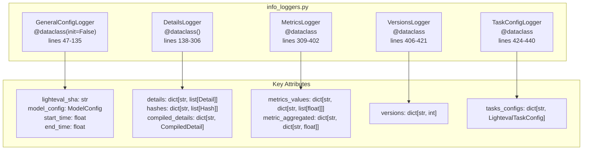
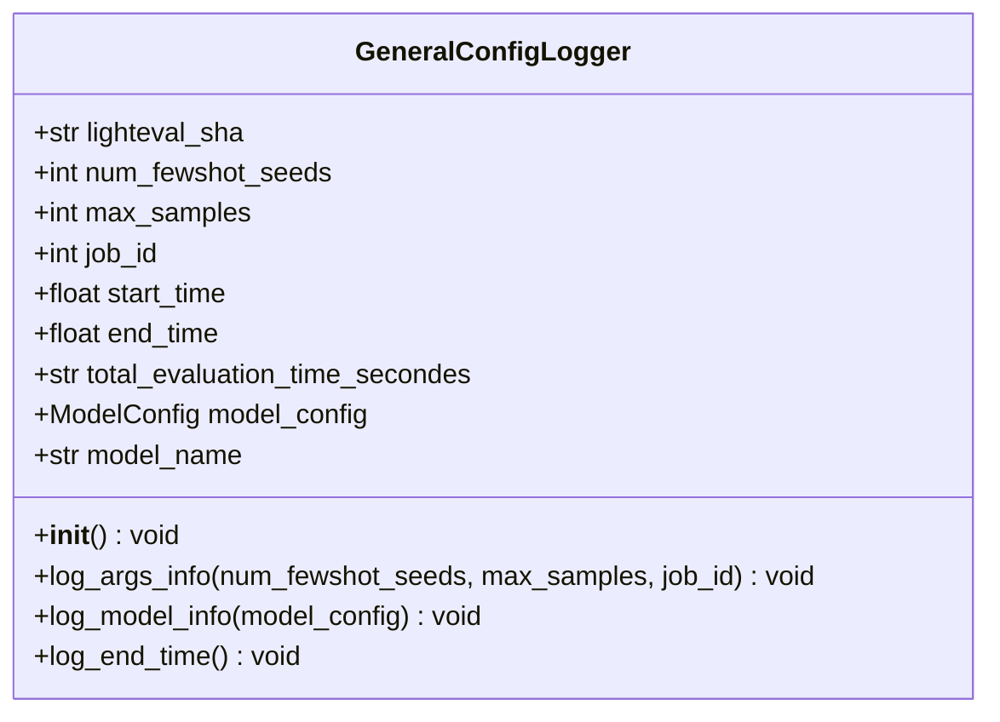
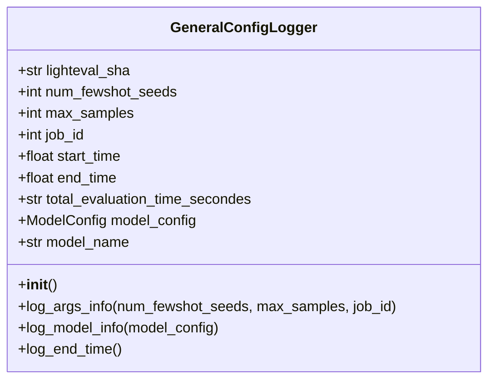
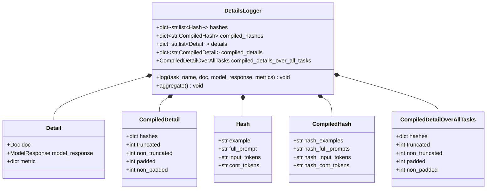
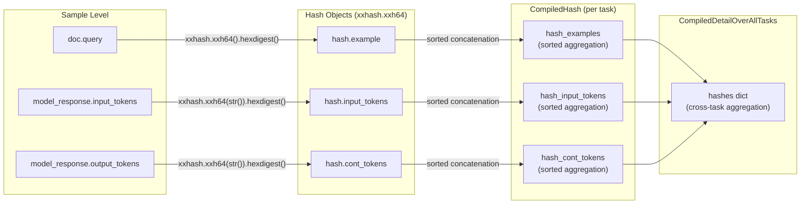
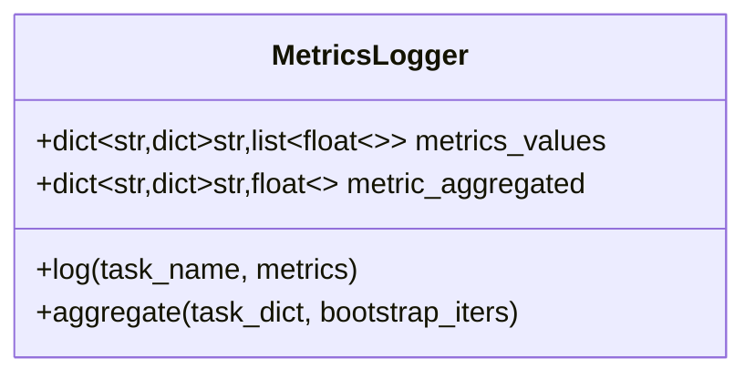
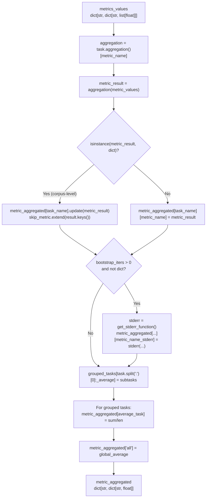
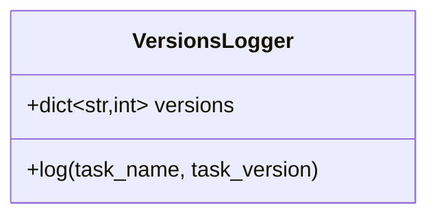
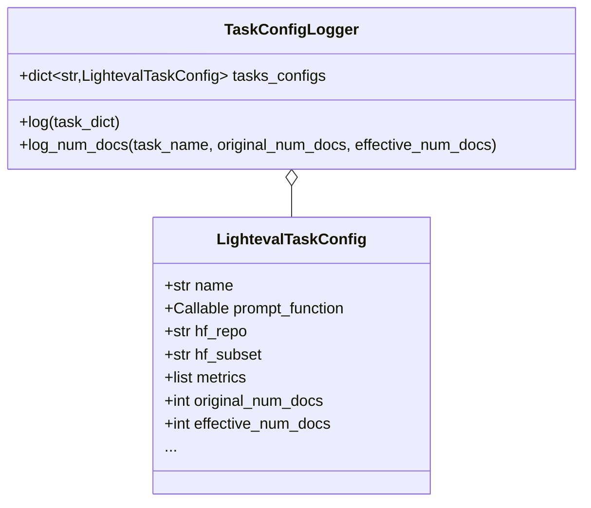
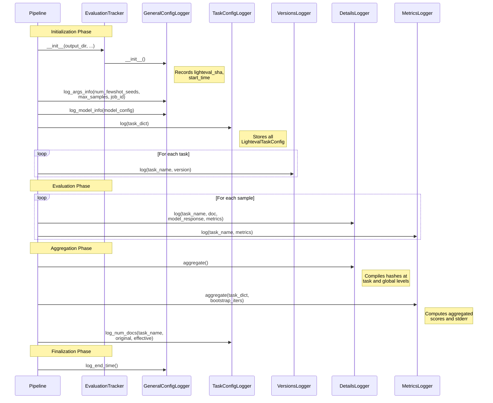

<!-- source: DeepWiki mcp.deepwiki.com · repo huggingface/lighteval · page 9.2 Logging System · fetched 2026-10-26 -->

# Logging System

<details>
<summary>Relevant source files</summary>

The following files were used as context for generating this wiki page:

- [src/lighteval/logging/evaluation_tracker.py](src/lighteval/logging/evaluation_tracker.py)
- [src/lighteval/logging/info_loggers.py](src/lighteval/logging/info_loggers.py)
- [src/lighteval/main_accelerate.py](src/lighteval/main_accelerate.py)
- [src/lighteval/main_custom.py](src/lighteval/main_custom.py)
- [src/lighteval/main_endpoint.py](src/lighteval/main_endpoint.py)
- [src/lighteval/main_nanotron.py](src/lighteval/main_nanotron.py)
- [src/lighteval/main_sglang.py](src/lighteval/main_sglang.py)
- [src/lighteval/main_vllm.py](src/lighteval/main_vllm.py)
- [src/lighteval/pipeline.py](src/lighteval/pipeline.py)

</details>


The logging system in lighteval consists of five specialized logger classes that capture different aspects of an evaluation run. Each logger is responsible for tracking a specific category of information: general configuration, per-sample details, metric scores, task versions, and task configurations. These loggers work together to provide comprehensive tracking and reproducibility of evaluation experiments.

For information about how these loggers are orchestrated by the `EvaluationTracker`, see [EvaluationTracker](#9.1). For information about where logged data is saved, see [Output Destinations](#9.3).

## Logger Architecture Overview

The logging system is organized into five independent logger classes, each capturing a distinct aspect of the evaluation:

| Logger | Purpose | Key Attributes |
|--------|---------|----------------|
| `GeneralConfigLogger` | Runtime metadata and timing | `lighteval_sha`, `model_config`, `start_time`, `end_time` |
| `DetailsLogger` | Per-sample evaluation data | `details`, `hashes`, `compiled_details`, `compiled_hashes` |
| `MetricsLogger` | Metric scores | `metrics_values`, `metric_aggregated` |
| `VersionsLogger` | Task version tracking | `versions` (dict[str, int]) |
| `TaskConfigLogger` | Task configuration | `tasks_configs` (dict[str, LightevalTaskConfig]) |

All logger classes are defined in [src/lighteval/logging/info_loggers.py]().

**Logger Classes to Data Flow**


**Sources:** [src/lighteval/logging/info_loggers.py:1-441]()
</thinking>

## GeneralConfigLogger

`GeneralConfigLogger` tracks runtime metadata and timing information for reproducibility. Initialized at evaluation start, populated progressively during execution.

### Dataclass Structure

[src/lighteval/logging/info_loggers.py:47-135]()



### Attributes

| Attribute | Type | Set By | Purpose |
|-----------|------|--------|---------|
| `lighteval_sha` | `str` | `__init__()` | Git commit SHA from `git.Repo.git.rev_parse("HEAD")` |
| `num_fewshot_seeds` | `int` | `log_args_info()` | Number of seeds for few-shot sampling variance |
| `max_samples` | `int` | `log_args_info()` | Sample limit per task (debugging only) |
| `job_id` | `int` | `log_args_info()` | Slurm job identifier |
| `start_time` | `float` | `__init__()` | `time.perf_counter()` at initialization |
| `end_time` | `float` | `log_end_time()` | `time.perf_counter()` at completion |
| `total_evaluation_time_secondes` | `str` | `log_end_time()` | `str(end_time - start_time)` |
| `model_config` | `ModelConfig` | `log_model_info()` | Full model configuration object |
| `model_name` | `str` | `log_model_info()` | Extracted from `model_config.model_name` |

### Initialization Flow

[src/lighteval/logging/info_loggers.py:96-104]()

```python
def __init__(self) -> None:
    try:
        repo = git.Repo(os.path.dirname(__file__).split("src")[0])
    except git.InvalidGitRepositoryError:
        repo = None
    self.lighteval_sha = repo.git.rev_parse("HEAD") if repo is not None else "?"
    self.start_time = time.perf_counter()
```

**Sources:** [src/lighteval/logging/info_loggers.py:47-135]()

## GeneralConfigLogger

The `GeneralConfigLogger` tracks general configuration and runtime information for reproducibility. It captures the lighteval version, model configuration, timing information, and execution parameters.

### Structure

[src/lighteval/logging/info_loggers.py:47-135]()



### Key Attributes

| Attribute | Type | Purpose |
|-----------|------|---------|
| `lighteval_sha` | `str` | Git commit SHA of lighteval for exact version reproducibility |
| `num_fewshot_seeds` | `int` | Number of random seeds used for few-shot sampling (HELM-style evaluation if >1) |
| `max_samples` | `int` | Maximum samples per task (for debugging) |
| `job_id` | `int` | Slurm job ID for cluster execution tracking |
| `start_time` | `float` | Unix timestamp when evaluation started |
| `end_time` | `float` | Unix timestamp when evaluation completed |
| `total_evaluation_time_secondes` | `str` | Total runtime in seconds |
| `model_config` | `ModelConfig` | Complete model configuration |
| `model_name` | `str` | Model identifier |

### Method Signatures

[src/lighteval/logging/info_loggers.py:106-134]()

```python
def log_args_info(
    self,
    num_fewshot_seeds: int,
    max_samples: int | None,
    job_id: str,
) -> None:
    """Logs evaluation parameters."""

def log_model_info(self, model_config: ModelConfig) -> None:
    """Logs model configuration."""
    
def log_end_time(self) -> None:
    """Records end time and computes total duration."""
```

**Sources:** [src/lighteval/logging/info_loggers.py:47-135]()

## DetailsLogger

The `DetailsLogger` is the most complex logger, capturing detailed per-sample evaluation data including predictions, hashes for reproducibility verification, and statistics about truncation and padding.

### Nested Data Classes

`DetailsLogger` defines five nested dataclasses for hierarchical detail storage:

**DetailsLogger Composition**


### Data Structure Hierarchy

| Class | Purpose | Level |
|-------|---------|-------|
| `Detail` ([lines 154-166]()) | Single example's evaluation data | Sample-level |
| `Hash` ([lines 209-223]()) | Hash values for one sample | Sample-level |
| `CompiledDetail` ([lines 169-186]()) | Aggregated statistics for one task | Task-level |
| `CompiledHash` ([lines 226-239]()) | Aggregated hashes for one task | Task-level |
| `CompiledDetailOverAllTasks` ([lines 189-206]()) | Aggregated statistics across all tasks | Global-level |

### Hashing Strategy

`DetailsLogger` uses `xxhash.xxh64()` for three-tier reproducibility checksums.

**Three-Tier Hashing Architecture**


**Sample-level hashing** [src/lighteval/logging/info_loggers.py:271-275]():
```python
hash = self.Hash()
hash.example = xxhash.xxh64(doc.query).hexdigest()
hash.input_tokens = xxhash.xxh64(str(model_response.input_tokens)).hexdigest()
hash.cont_tokens = xxhash.xxh64(str(model_response.output_tokens)).hexdigest()
```

**Task-level compilation** [src/lighteval/logging/info_loggers.py:280-293]():
```python
compiled_hash.hash_examples = xxhash.xxh64(
    "".join(sorted(q.example for q in self.hashes[task_name]))
).hexdigest()
```

**Global-level compilation** [src/lighteval/logging/info_loggers.py:300-305]():
```python
self.compiled_details_over_all_tasks.hashes[hash_type] = xxhash.xxh64(
    "".join(compiled_detail.hashes[hash_type] for _, compiled_detail in sorted(self.compiled_details.items()))
).hexdigest()
```

### Method Implementations

[src/lighteval/logging/info_loggers.py:253-305]()

```python
def log(
    self,
    task_name: str,
    doc: Doc,
    model_response: ModelResponse,
    metrics: dict,
) -> None:
    """Stores sample-level data and hashes."""
    detail = self.Detail(doc, model_response, metrics)
    self.details[task_name].append(detail)
    
    hash = self.Hash()
    hash.example = xxhash.xxh64(doc.query).hexdigest()
    hash.input_tokens = xxhash.xxh64(str(model_response.input_tokens)).hexdigest()
    hash.cont_tokens = xxhash.xxh64(str(model_response.output_tokens)).hexdigest()
    self.hashes[task_name].append(hash)

def aggregate(self):
    """Compiles hashes at task and global levels."""
    # Task-level: compile sorted sample hashes
    for task_name in self.hashes:
        compiled_hash = self.CompiledHash()
        compiled_hash.hash_examples = xxhash.xxh64(
            "".join(sorted(q.example for q in self.hashes[task_name]))
        ).hexdigest()
        # ... (similar for other hash types)
        self.compiled_hashes[task_name] = compiled_hash
    
    # Global-level: aggregate task hashes
    for hash_type in hash_types:
        self.compiled_details_over_all_tasks.hashes[hash_type] = xxhash.xxh64(
            "".join(compiled_detail.hashes[hash_type] for _, compiled_detail in sorted(self.compiled_details.items()))
        ).hexdigest()
```

**Sources:** [src/lighteval/logging/info_loggers.py:138-306]()

## MetricsLogger

The `MetricsLogger` tracks metric scores at both sample and corpus levels, performing aggregation and computing statistical measures like standard error.

### Structure

[src/lighteval/logging/info_loggers.py:308-402]()



### Data Organization

The `MetricsLogger` maintains two levels of metric data:

| Attribute | Structure | Example |
|-----------|-----------|---------|
| `metrics_values` | `dict[str, dict[str, list[float]]]` | `{"winogrande\|0": {"accuracy": [0.5, 0.6, 0.5, ...]}}` |
| `metric_aggregated` | `dict[str, dict[str, float]]` | `{"winogrande\|0": {"accuracy": 0.53, "accuracy_stderr": 0.02}}` |

### Aggregation Process

`MetricsLogger.aggregate()` [src/lighteval/logging/info_loggers.py:330-402]() performs metric aggregation, error computation, and task grouping.

**aggregate() Execution Flow**


### Task Grouping Logic

[src/lighteval/logging/info_loggers.py:374-402]()

**Subtask grouping**: Tasks matching pattern `suite|task:subtask|fewshots` are grouped as `suite|task:_average|fewshots`
```python
for k, metrics in self.metric_aggregated.items():
    if "|" in k:
        task, fewshot = k.split("|")
        grouped_tasks[f"{task.split(':')[0]}:_average|{fewshot}"].append(k)
```

**Average computation**: For groups with >1 subtask:
```python
self.metric_aggregated[average_task] = {
    metric: sum(self.metric_aggregated[k][metric] for k in list_of_subtasks) / len(list_of_subtasks)
    for metric in metrics
}
```

**Global average**: Entry `"all"` contains mean across all tasks:
```python
self.metric_aggregated["all"] = {metric: value / suite_nb[metric] for metric, value in suite_average.items()}
```

### Error Handling

[src/lighteval/logging/info_loggers.py:348-372]()

| Condition | Action |
|-----------|--------|
| `OverflowError` during aggregation | Set `metric_result = float("nan")`, log warning |
| `isinstance(metric_result, dict)` | Update with dict, skip stderr computation |
| `bootstrap_iters == 0` | Skip stderr computation |
| `len(metric_values) <= 1` | Skip stderr computation |
| `OverflowError` during stderr | Set `stderr = float("nan")`, log warning |

**Sources:** [src/lighteval/logging/info_loggers.py:308-402]()

## VersionsLogger

The `VersionsLogger` is the simplest logger, tracking version numbers for each evaluated task.

### Structure

[src/lighteval/logging/info_loggers.py:405-421]()



### Structure

[src/lighteval/logging/info_loggers.py:405-421]()

```python
@dataclass
class VersionsLogger:
    versions: dict[str, int] = field(default_factory=dict)
    
    def log(self, task_name: str, task_version: int) -> None:
        self.versions[task_name] = task_version
```

Task versions track metric definitions and dataset versions. Version changes indicate:
- Dataset updates
- Prompt format modifications  
- Metric definition changes
- Any non-comparable evaluation changes

Example:
```python
versions = {
    "winogrande|winogrande_xl|0": 0,
    "mmlu|abstract_algebra|5": 1,
}
```

Source: `LightevalTaskConfig.version` [src/lighteval/tasks/lighteval_task.py:142]()

**Sources:** [src/lighteval/logging/info_loggers.py:405-421]()

## TaskConfigLogger

The `TaskConfigLogger` stores the complete configuration for each evaluated task, including dynamic information about document counts.

### Structure

[src/lighteval/logging/info_loggers.py:424-440]()



### Stored Configuration

[src/lighteval/logging/info_loggers.py:424-440]()

`TaskConfigLogger` stores complete `LightevalTaskConfig` objects with these fields:

| Category | `LightevalTaskConfig` Fields |
|----------|------------------------------|
| Dataset | `hf_repo`, `hf_subset`, `hf_revision`, `hf_filter`, `hf_avail_splits` |
| Evaluation | `evaluation_splits`, `few_shots_split`, `num_fewshots` |
| Generation | `generation_size`, `generation_grammar`, `stop_sequence`, `num_samples` |
| Metrics | `metrics` (list of `MetricCategory` objects) |
| Tracking | `original_num_docs`, `effective_num_docs`, `version` |

### Methods

```python
def log(self, task_dict: dict[str, LightevalTask]) -> None:
    """Stores configs from task_dict."""
    self.tasks_configs = {name: task.config for name, task in task_dict.items()}

def log_num_docs(self, task_name: str, original_num_docs: int, effective_num_docs: int) -> None:
    """Updates document counts post-evaluation."""
    self.tasks_configs[task_name].original_num_docs = original_num_docs
    self.tasks_configs[task_name].effective_num_docs = effective_num_docs
```

- `original_num_docs`: Total dataset documents
- `effective_num_docs`: Actually evaluated documents (after sampling/filtering)

**Sources:** [src/lighteval/logging/info_loggers.py:424-440](), [src/lighteval/tasks/lighteval_task.py:46-191]()

## Logger Interaction During Evaluation

The five loggers are populated at different stages via `Pipeline` and `EvaluationTracker`.

**Logger Population Sequence**


### Logging Call Sites

| Phase | Logger Method | Called From |
|-------|--------------|-------------|
| Init | `GeneralConfigLogger.__init__()` | `EvaluationTracker.__init__()` [evaluation_tracker.py:159]() |
| Init | `GeneralConfigLogger.log_args_info()` | `Pipeline.evaluate()` [pipeline.py:272]() |
| Init | `GeneralConfigLogger.log_model_info()` | `Pipeline.__init__()` [pipeline.py:152]() |
| Init | `TaskConfigLogger.log()` | `Pipeline._init_tasks_and_requests()` [pipeline.py:238]() |
| Eval | `DetailsLogger.log()` | `Pipeline._compute_metrics()` [pipeline.py:399]() |
| Eval | `MetricsLogger.log()` | `Pipeline._compute_metrics()` [pipeline.py:398]() |
| Agg | `DetailsLogger.aggregate()` | `Pipeline.evaluate()` [pipeline.py:297]() |
| Agg | `MetricsLogger.aggregate()` | `Pipeline.evaluate()` [pipeline.py:294]() |
| Final | `GeneralConfigLogger.log_end_time()` | `Pipeline.evaluate()` [pipeline.py:293]() |

**Sources:** [src/lighteval/logging/info_loggers.py:1-441](), [src/lighteval/pipeline.py:117-448](), [src/lighteval/logging/evaluation_tracker.py:95-210]()

## Logger Output Format

Each logger's data is serialized to specific output formats (see [Output Destinations](#9.3) for details on where data is saved):

| Logger | Output Location | Format |
|--------|----------------|--------|
| `GeneralConfigLogger` | `results.json` → `config_general` | JSON dict |
| `DetailsLogger.details` | `details.parquet` | Parquet table with columns for doc, response, metrics |
| `DetailsLogger.compiled_details` | `results.json` → `config_details` | JSON dict with hashes and stats |
| `MetricsLogger.metric_aggregated` | `results.json` → `results` | JSON dict of metric scores |
| `VersionsLogger` | `results.json` → `versions` | JSON dict of version numbers |
| `TaskConfigLogger` | `results.json` → `config_tasks` | JSON dict of task configs |

**Sources:** [src/lighteval/logging/info_loggers.py:1-441]()

---

