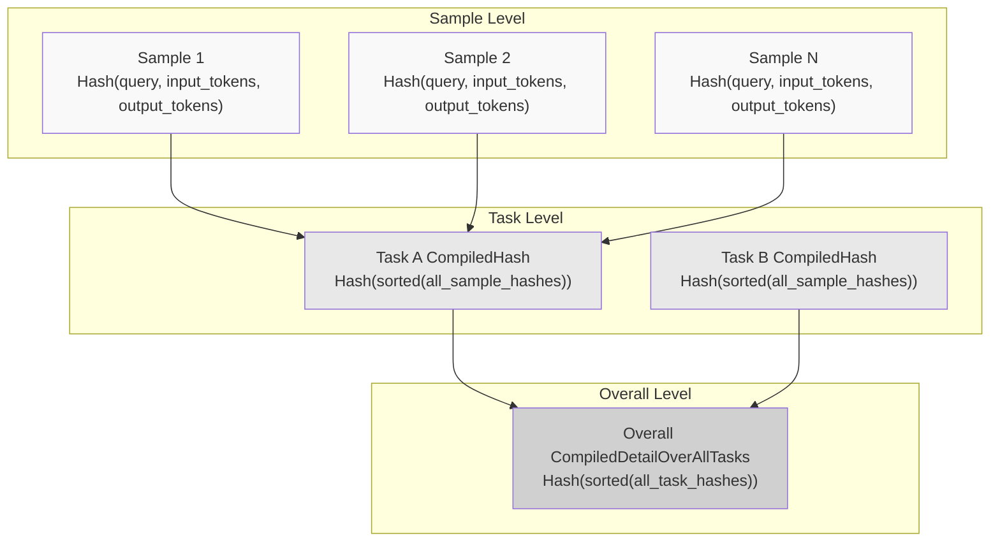
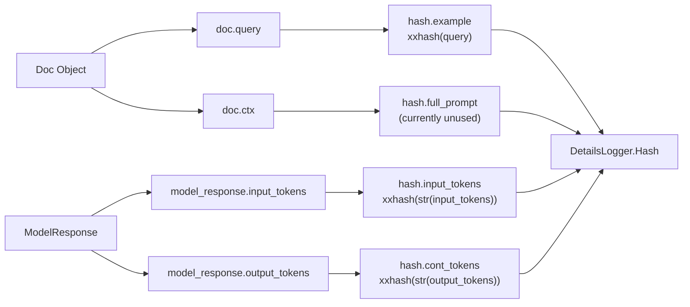
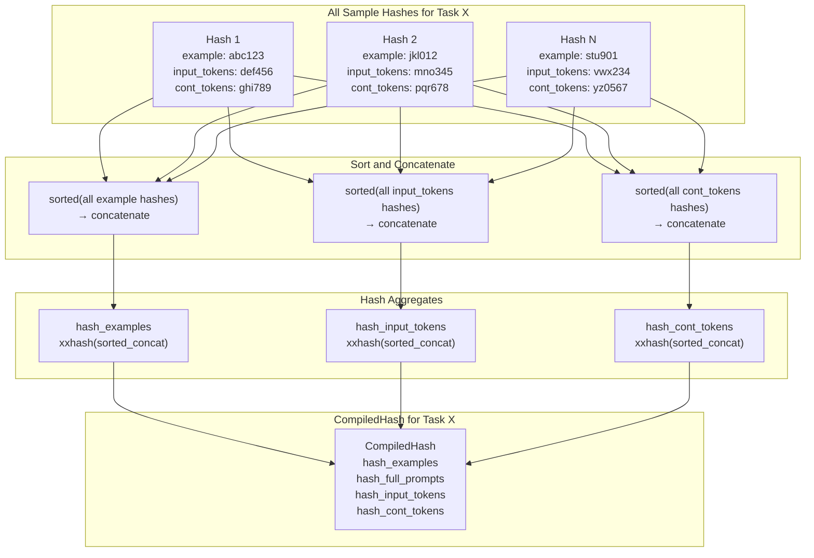
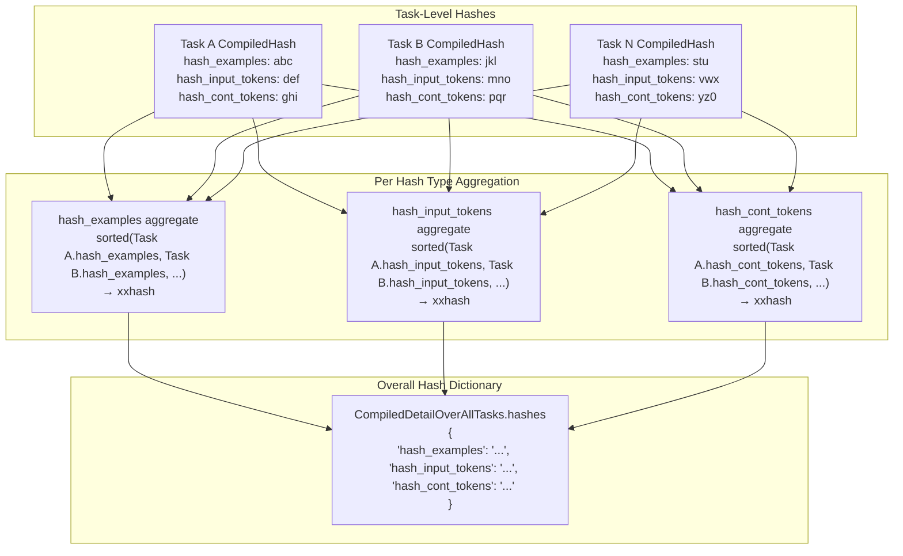
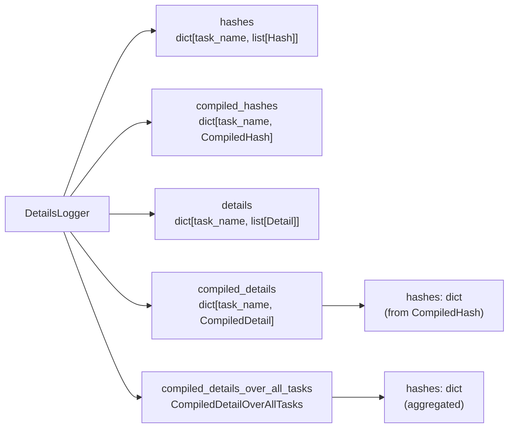
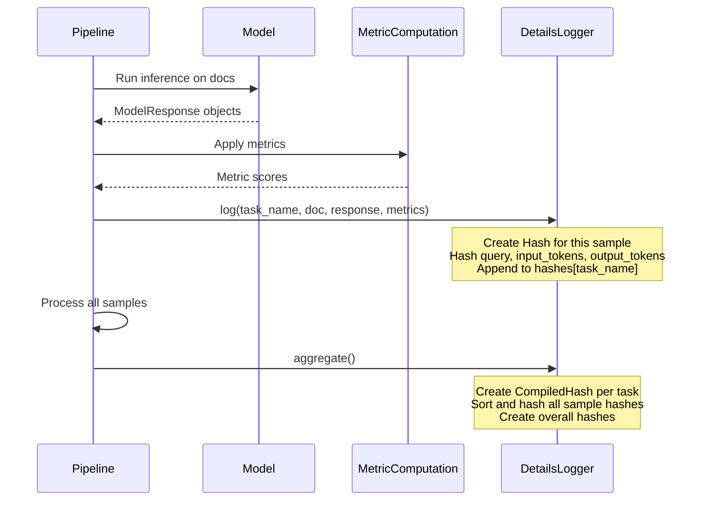

<!-- source: DeepWiki mcp.deepwiki.com · repo huggingface/lighteval · page 9.3 Reproducibility and Hashing · fetched 2026-10-26 -->

# Reproducibility and Hashing

<details>
<summary>Relevant source files</summary>

The following files were used as context for generating this wiki page:

- [src/lighteval/logging/info_loggers.py](src/lighteval/logging/info_loggers.py)
- [src/lighteval/pipeline.py](src/lighteval/pipeline.py)

</details>


This page documents lighteval's three-tier hashing system that ensures evaluation reproducibility by creating cryptographic fingerprints at the sample, task, and overall evaluation levels. These hashes enable detection of differences between evaluation runs and verification that results are truly comparable.

For information about the broader logging architecture, see [Logging System](#9.2). For details on how hashed data is persisted, see [Output Destinations](#9.4).

## Purpose and Design Goals

Lighteval's hashing system addresses a critical challenge in LLM evaluation: ensuring that results from different runs are truly comparable. Even subtle differences in prompts, tokenization, or data ordering can produce different results. The hashing system provides:

1. **Exact reproducibility verification**: Detect any differences between evaluation runs at multiple granularities
2. **Order-independent comparison**: Results are comparable regardless of execution order or parallelization
3. **Efficient change detection**: Quickly identify which tasks or samples differ without inspecting full datasets
4. **Audit trail**: Cryptographic fingerprints that prove evaluation integrity

The system uses a hierarchical design where hashes at each level aggregate hashes from the level below, enabling both fine-grained and coarse-grained comparison.

**Sources**: [src/lighteval/logging/info_loggers.py:137-306]()

## Three-Tier Hash Architecture



**Diagram**: Three-tier hashing hierarchy showing how sample hashes aggregate into task hashes, which aggregate into overall hashes

The system maintains three levels of hashes:

| Level | Granularity | Purpose | Data Structure |
|-------|-------------|---------|----------------|
| Sample | Individual example | Verify each prompt and response unchanged | `DetailsLogger.Hash` |
| Task | All samples in a task | Verify task-level consistency | `DetailsLogger.CompiledHash` |
| Overall | All tasks | Verify full evaluation unchanged | `CompiledDetailOverAllTasks.hashes` |

**Sources**: [src/lighteval/logging/info_loggers.py:208-306]()

## Sample-Level Hashing

Each sample (represented as a `Doc` object with its corresponding `ModelResponse`) generates a `Hash` object containing four cryptographic fingerprints:



**Diagram**: Sample-level hash computation flow from Doc and ModelResponse to Hash object

### Hash Data Structure

The `DetailsLogger.Hash` dataclass stores four hash strings:

| Field | Source | Purpose |
|-------|--------|---------|
| `example` | `doc.query` | Hash of the raw query text before any processing |
| `full_prompt` | `doc.ctx` | Hash of the full prompt (currently unused in implementation) |
| `input_tokens` | `model_response.input_tokens` | Hash of tokenized input as fed to model |
| `cont_tokens` | `model_response.output_tokens` | Hash of tokenized output generated by model |

**Hash Creation Code Location**: [src/lighteval/logging/info_loggers.py:271-275]()

The hash creation occurs in `DetailsLogger.log()`:

```python
hash = self.Hash()
hash.example = xxhash.xxh64(doc.query).hexdigest()
hash.input_tokens = xxhash.xxh64(str(model_response.input_tokens)).hexdigest()
hash.cont_tokens = xxhash.xxh64(str(model_response.output_tokens)).hexdigest()
```

Note that `hash.full_prompt` is not populated in the current implementation, remaining as an empty string.

**Sources**: [src/lighteval/logging/info_loggers.py:208-276]()

## Task-Level Hashing

After all samples for a task are processed, their individual hashes are aggregated into a `CompiledHash` that provides a task-level fingerprint. The compilation process occurs in `DetailsLogger.aggregate()`.



**Diagram**: Task-level hash compilation showing how sample hashes are sorted and aggregated

### CompiledHash Data Structure

The `DetailsLogger.CompiledHash` dataclass contains four aggregated hash strings:

| Field | Aggregates | Purpose |
|-------|-----------|---------|
| `hash_examples` | All `Hash.example` values | Verify all query texts unchanged |
| `hash_full_prompts` | All `Hash.full_prompt` values | Verify all full prompts unchanged |
| `hash_input_tokens` | All `Hash.input_tokens` values | Verify all tokenized inputs unchanged |
| `hash_cont_tokens` | All `Hash.cont_tokens` values | Verify all generated outputs unchanged |

**Task-Level Hash Computation**: [src/lighteval/logging/info_loggers.py:277-293]()

The aggregation uses sorted concatenation to ensure order-independence:

```python
compiled_hash.hash_examples = xxhash.xxh64(
    "".join(sorted(q.example for q in self.hashes[task_name]))
).hexdigest()
```

This pattern is repeated for each hash field, ensuring that:
1. All samples contribute to the hash
2. Execution order doesn't affect the result
3. Any change to any sample changes the task hash

**Sources**: [src/lighteval/logging/info_loggers.py:225-293]()

## Overall Hashing

The highest level aggregates all task-level hashes into a single fingerprint for the entire evaluation. This occurs at the end of `DetailsLogger.aggregate()`.



**Diagram**: Overall hash computation aggregating task-level hashes across all evaluation tasks

**Overall Hash Computation**: [src/lighteval/logging/info_loggers.py:298-305]()

The implementation iterates over each hash type and aggregates across tasks:

```python
hash_types: list[str] = list(self.compiled_details.values())[0].hashes.keys()

for hash_type in hash_types:
    self.compiled_details_over_all_tasks.hashes[hash_type] = xxhash.xxh64(
        "".join(
            compiled_detail.hashes[hash_type] for _, compiled_detail in sorted(self.compiled_details.items())
        )
    ).hexdigest()
```

The result is stored in `DetailsLogger.compiled_details_over_all_tasks.hashes`, a dictionary mapping hash type names to overall hash values.

**Sources**: [src/lighteval/logging/info_loggers.py:188-306]()

## Hash Storage and Integration

Hashes are stored alongside other evaluation details in the `DetailsLogger`:



**Diagram**: Hash storage locations within DetailsLogger

The `DetailsLogger` maintains five collections:

1. **`hashes`**: Raw `Hash` objects for each sample of each task
2. **`compiled_hashes`**: `CompiledHash` objects for each task
3. **`details`**: Full `Detail` objects (doc, response, metrics) for each sample
4. **`compiled_details`**: `CompiledDetail` objects that include hash dictionaries
5. **`compiled_details_over_all_tasks`**: Overall statistics including the overall hash dictionary

During the aggregation step ([src/lighteval/logging/info_loggers.py:295-296]()), task-level compiled hashes are converted to dictionaries and stored in `compiled_details`:

```python
for task_name, _ in self.details.items():
    self.compiled_details[task_name].hashes = asdict(self.compiled_hashes[task_name])
```

**Sources**: [src/lighteval/logging/info_loggers.py:137-306]()

## Hash Computation Timing

The hashing process is integrated into the evaluation pipeline at specific points:



**Diagram**: Timing of hash computation during evaluation pipeline execution

### Sample-Level Hash Creation

Sample hashes are created in `DetailsLogger.log()` immediately after metrics are computed for each sample:

**Invocation**: [src/lighteval/pipeline.py:399]()

```python
self.evaluation_tracker.details_logger.log(task_name, doc, response, output)
```

**Implementation**: [src/lighteval/logging/info_loggers.py:253-276]()

### Aggregated Hash Creation

Task-level and overall hashes are created when `DetailsLogger.aggregate()` is called after all samples are processed:

**Invocation**: [src/lighteval/pipeline.py:297]()

```python
self.evaluation_tracker.details_logger.aggregate()
```

**Implementation**: [src/lighteval/logging/info_loggers.py:277-306]()

**Sources**: [src/lighteval/pipeline.py:362-400](), [src/lighteval/logging/info_loggers.py:253-306]()

## xxhash Algorithm Choice

Lighteval uses the `xxhash` library with the `xxh64` algorithm for all hash computations:

```python
import xxhash

hash.example = xxhash.xxh64(doc.query).hexdigest()
```

**Why xxhash?**

1. **Speed**: Significantly faster than cryptographic hashes (MD5, SHA) while maintaining excellent collision resistance for this use case
2. **Determinism**: Produces identical hashes across platforms and Python versions
3. **Quality**: Excellent avalanche properties ensure small input changes produce very different hashes
4. **64-bit output**: Provides 2^64 possible values, making collisions astronomically unlikely for evaluation datasets

The `.hexdigest()` method returns the hash as a 16-character hexadecimal string for easy storage and comparison.

**Sources**: [src/lighteval/logging/info_loggers.py:29-30](), [src/lighteval/logging/info_loggers.py:272-275]()

## Order Independence

A critical design feature is that hashes remain identical regardless of sample processing order. This is achieved through sorting before hashing:

```python
# Example: aggregating example hashes
compiled_hash.hash_examples = xxhash.xxh64(
    "".join(sorted(q.example for q in self.hashes[task_name]))
).hexdigest()
```

The `sorted()` call ensures that:
- Parallel evaluation with different process orders produces identical hashes
- Resuming evaluations from checkpoints produces identical hashes
- Different batching strategies produce identical hashes

For overall hashes, tasks are also sorted by name:

```python
"".join(
    compiled_detail.hashes[hash_type] 
    for _, compiled_detail in sorted(self.compiled_details.items())
)
```

This guarantees true reproducibility verification regardless of execution details.

**Sources**: [src/lighteval/logging/info_loggers.py:281-305]()

## Verification Workflow

To verify that two evaluation runs are identical:

### 1. Compare Overall Hashes

Check `compiled_details_over_all_tasks.hashes` from both runs:

```python
run1_hashes = run1_tracker.details_logger.compiled_details_over_all_tasks.hashes
run2_hashes = run2_tracker.details_logger.compiled_details_over_all_tasks.hashes

if run1_hashes == run2_hashes:
    print("Evaluations are identical")
else:
    print("Evaluations differ")
```

### 2. Compare Task-Level Hashes

If overall hashes differ, check which tasks changed:

```python
run1_task_hashes = run1_tracker.details_logger.compiled_hashes
run2_task_hashes = run2_tracker.details_logger.compiled_hashes

for task_name in run1_task_hashes:
    if task_name not in run2_task_hashes:
        print(f"Task {task_name} missing from run2")
    elif run1_task_hashes[task_name] != run2_task_hashes[task_name]:
        print(f"Task {task_name} differs")
        # Check which hash type differs
        for hash_type in ['hash_examples', 'hash_input_tokens', 'hash_cont_tokens']:
            h1 = getattr(run1_task_hashes[task_name], hash_type)
            h2 = getattr(run2_task_hashes[task_name], hash_type)
            if h1 != h2:
                print(f"  - {hash_type} differs")
```

### 3. Compare Sample-Level Hashes

If a task differs, identify which samples changed:

```python
run1_sample_hashes = run1_tracker.details_logger.hashes[task_name]
run2_sample_hashes = run2_tracker.details_logger.hashes[task_name]

for i, (h1, h2) in enumerate(zip(run1_sample_hashes, run2_sample_hashes)):
    if h1.example != h2.example:
        print(f"Sample {i}: query differs")
    if h1.input_tokens != h2.input_tokens:
        print(f"Sample {i}: input tokenization differs")
    if h1.cont_tokens != h2.cont_tokens:
        print(f"Sample {i}: output differs")
```

This hierarchical approach efficiently identifies the source of differences without comparing full text.

**Sources**: [src/lighteval/logging/info_loggers.py:137-306]()

## Hash Persistence

Hashes are persisted as part of the evaluation output in multiple locations:

| Location | Content | Format |
|----------|---------|--------|
| Sample details files | Individual `Hash` objects per sample | Parquet/JSON |
| Compiled details files | `CompiledHash` dictionaries per task | JSON |
| Overall results | `compiled_details_over_all_tasks.hashes` | JSON |

When results are saved via `EvaluationTracker.save()`, the hash information is included in the output files. This enables post-evaluation verification by loading saved hashes and comparing them.

For details on output file formats and locations, see [Output Destinations](#9.4) and [Results Format](#9.5).

**Sources**: [src/lighteval/logging/info_loggers.py:137-306](), [src/lighteval/pipeline.py:426-429]()

## Implementation Summary

The complete hashing implementation involves these key components:

| Component | Location | Responsibility |
|-----------|----------|----------------|
| `DetailsLogger.Hash` | [src/lighteval/logging/info_loggers.py:208-224]() | Store sample-level hashes |
| `DetailsLogger.CompiledHash` | [src/lighteval/logging/info_loggers.py:225-240]() | Store task-level aggregated hashes |
| `CompiledDetailOverAllTasks` | [src/lighteval/logging/info_loggers.py:188-207]() | Store overall aggregated hashes |
| `DetailsLogger.log()` | [src/lighteval/logging/info_loggers.py:253-276]() | Create hashes for each sample |
| `DetailsLogger.aggregate()` | [src/lighteval/logging/info_loggers.py:277-306]() | Aggregate to task and overall level |
| `Pipeline.evaluate()` | [src/lighteval/pipeline.py:271-298]() | Orchestrate hash creation during evaluation |

The system provides strong reproducibility guarantees through cryptographic fingerprinting at multiple granularities, enabling efficient verification that evaluation results are truly comparable.

**Sources**: [src/lighteval/logging/info_loggers.py:137-306](), [src/lighteval/pipeline.py:271-400]()

---

