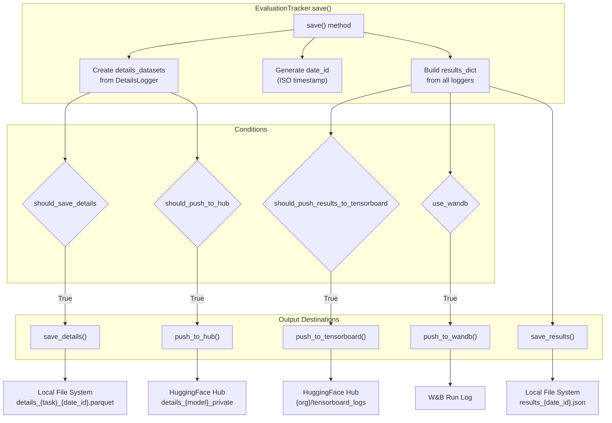
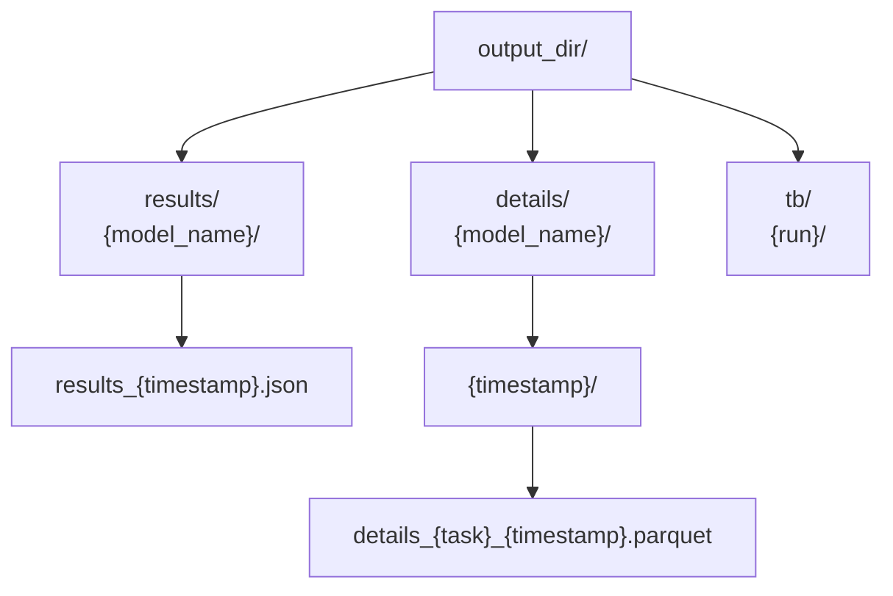
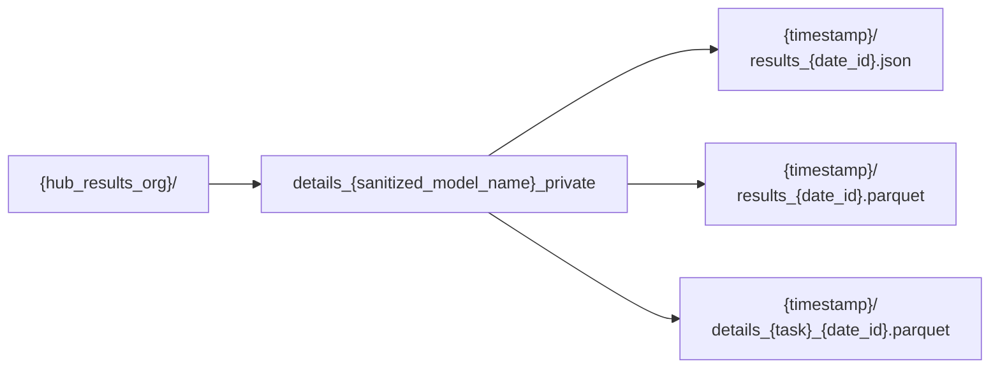
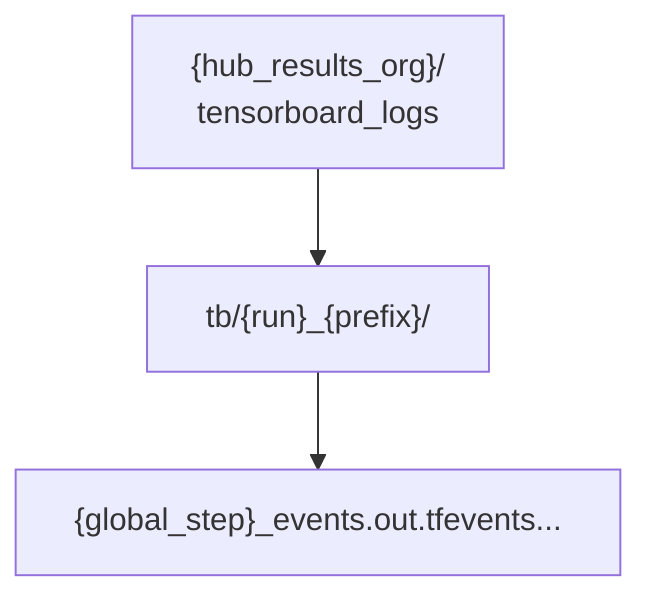
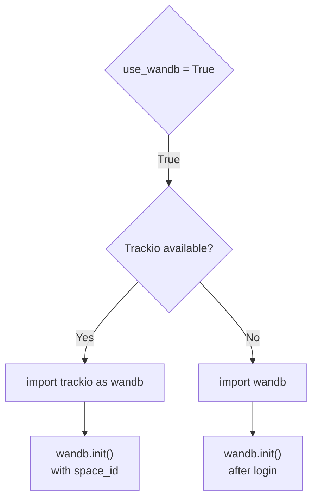

<!-- source: DeepWiki mcp.deepwiki.com · repo huggingface/lighteval · page 9.4 Output Destinations · fetched 2026-10-26 -->

# Output Destinations

<details>
<summary>Relevant source files</summary>

The following files were used as context for generating this wiki page:

- [src/lighteval/logging/evaluation_tracker.py](src/lighteval/logging/evaluation_tracker.py)
- [src/lighteval/main_accelerate.py](src/lighteval/main_accelerate.py)
- [src/lighteval/main_custom.py](src/lighteval/main_custom.py)
- [src/lighteval/main_endpoint.py](src/lighteval/main_endpoint.py)
- [src/lighteval/main_nanotron.py](src/lighteval/main_nanotron.py)
- [src/lighteval/main_sglang.py](src/lighteval/main_sglang.py)
- [src/lighteval/main_vllm.py](src/lighteval/main_vllm.py)

</details>


This page describes the various destinations where LightEval can save and publish evaluation results. It covers configuration options, file paths, and integration details for each output destination.

For information about the `EvaluationTracker` class that coordinates these output operations, see [EvaluationTracker](#9.1). For details about the logger components that prepare data for output, see [Logging System](#9.2). For the structure and format of saved results, see [Results Format](#9.4).

## Overview

LightEval supports four primary output destinations:

| Destination | Purpose | Configuration Flag | Required Parameters |
|-------------|---------|-------------------|---------------------|
| Local File System | Save results and details to disk | Always enabled | `output_dir` |
| HuggingFace Hub | Share results as datasets | `push_to_hub` | `hub_results_org` |
| TensorBoard | Visualize metrics over training steps | `push_to_tensorboard` | `hub_results_org` |
| Weights & Biases / Trackio | Experiment tracking | `use_wandb` | `WANDB_PROJECT` env var |

All output operations are coordinated by the `save()` method in `EvaluationTracker` [src/lighteval/logging/evaluation_tracker.py:244-289]().

## Output Flow Architecture



**Sources:** [src/lighteval/logging/evaluation_tracker.py:244-289]()

## Local File System

The local file system is the primary output destination and is always enabled. Results are saved using the `fsspec` library, allowing any fsspec-compliant path (local, S3, Google Cloud Storage, etc.).

### File Structure



### Results Saving

The `save_results()` method writes aggregated metrics and configuration to JSON:

**Path determination:**
- If `results_path_template` is provided: uses template with variables `{output_dir}`, `{org}`, `{model}`
- Otherwise: `{output_dir}/results/{model_name}/results_{date_id}.json`

**Implementation:** [src/lighteval/logging/evaluation_tracker.py:299-312]()

```python
# Template example
results_path_template = "{output_dir}/custom/{org}_{model}"
```

### Details Saving

The `save_details()` method writes per-sample evaluation data as Parquet files:

**Path:** `{output_dir}/details/{model_name}/{date_id}/details_{task_name}_{date_id}.parquet`

**Process:**
1. Convert `DetailsLogger.details` to `Dataset` objects using `Dataset.from_list()` [src/lighteval/logging/evaluation_tracker.py:255]()
2. Sort column names for consistency [src/lighteval/logging/evaluation_tracker.py:263]()
3. Write each task's dataset to a separate Parquet file [src/lighteval/logging/evaluation_tracker.py:351-358]()

**Loading details:** The `load_details_datasets()` method can reload saved details by date_id ("first", "last", or specific timestamp) [src/lighteval/logging/evaluation_tracker.py:331-349]()

**Sources:** [src/lighteval/logging/evaluation_tracker.py:299-358](), [docs/source/saving-and-reading-results.mdx:6-21]()

## HuggingFace Hub

Results and details can be pushed to HuggingFace Hub as datasets for easy sharing and collaboration.

### Repository Structure



### Push Process

The `push_to_hub()` method [src/lighteval/logging/evaluation_tracker.py:384-424]():

1. **Sanitizes model name:** Replaces `/` with `__` [src/lighteval/logging/evaluation_tracker.py:391]()
2. **Constructs repo_id:** `{hub_results_org}/details_{sanitized_model_name}` (adds `_private` suffix if not public) [src/lighteval/logging/evaluation_tracker.py:394-396]()
3. **Creates repository** if it doesn't exist using `HfApi.create_repo()` [src/lighteval/logging/evaluation_tracker.py:400-402]()
4. **Uploads results** as both JSON and Parquet [src/lighteval/logging/evaluation_tracker.py:405-418]()
5. **Uploads details** for each task [src/lighteval/logging/evaluation_tracker.py:420-422]()
6. **Regenerates metadata card** [src/lighteval/logging/evaluation_tracker.py:424]()

### Dataset Card Generation

The `recreate_metadata_card()` method creates a comprehensive dataset card [src/lighteval/logging/evaluation_tracker.py:451-657]():

**Metadata configurations:**
- Each task gets a configuration with splits by timestamp
- Special "latest" split points to most recent evaluation
- Results stored in a separate configuration
- Special handling for MMLU tasks to group all subtasks [src/lighteval/logging/evaluation_tracker.py:554-606]()

**Card content includes:**
- Dataset summary with model link and configuration count
- Latest results section with formatted JSON
- Usage examples for loading datasets
- Special formatting for Open LLM Leaderboard [src/lighteval/logging/evaluation_tracker.py:619-629]()

**Sources:** [src/lighteval/logging/evaluation_tracker.py:384-657](), [docs/source/saving-and-reading-results.mdx:23-32]()

## TensorBoard

TensorBoard integration allows visualization of metrics across training steps, particularly useful for evaluations during training.

### TensorBoard Repository Structure



### Push Implementation

The `push_to_tensorboard()` method [src/lighteval/logging/evaluation_tracker.py:659-747]():

**Requirements:**
- `tensorboardX` package [src/lighteval/logging/evaluation_tracker.py:662-664]()
- `nanotron` package (for step tracking) [src/lighteval/logging/evaluation_tracker.py:666-668]()

**Configuration:**
- `tensorboard_repo`: `{hub_results_org}/tensorboard_logs` [src/lighteval/logging/evaluation_tracker.py:173]()
- `tensorboard_metric_prefix`: defaults to "eval" [src/lighteval/logging/evaluation_tracker.py:147, 670]()

**Process:**

1. **Determine global_step:**
   - From `nanotron_run_info.step` if available [src/lighteval/logging/evaluation_tracker.py:673]()
   - Otherwise defaults to 0 [src/lighteval/logging/evaluation_tracker.py:676]()

2. **Create HFSummaryWriter:**
   - Local directory: `{output_dir}/tb/{run}` [src/lighteval/logging/evaluation_tracker.py:679]()
   - Push to: `{tensorboard_repo}/tb` [src/lighteval/logging/evaluation_tracker.py:682-688]()

3. **Log metrics with hierarchy:**
   - Standard errors: `stderr_{prefix}/{task_name}/{metric}` [src/lighteval/logging/evaluation_tracker.py:709]()
   - Bench suite metrics: `{prefix}_{bench_suite}/{task_name}/{metric}` [src/lighteval/logging/evaluation_tracker.py:711-713]()
   - Regular metrics: `{prefix}/{task_name}/{metric}` [src/lighteval/logging/evaluation_tracker.py:715]()
   - Suite averages: `{prefix}/{suite_name}/{metric}` [src/lighteval/logging/evaluation_tracker.py:720]()

4. **Handle parallel evaluations:**
   - Rename files with global_step prefix to maintain ordering [src/lighteval/logging/evaluation_tracker.py:732-740]()
   - Addresses TensorBoard's sequential display issue [src/lighteval/logging/evaluation_tracker.py:733]()

**Sources:** [src/lighteval/logging/evaluation_tracker.py:659-747](), [docs/source/saving-and-reading-results.mdx:34-38]()

## Weights & Biases / Trackio

Integration with experiment tracking platforms for logging and analysis.

### Platform Selection



### Initialization

The `__init__` method handles platform detection [src/lighteval/logging/evaluation_tracker.py:180-206]():

**Trackio (preferred):**
- Automatically detected if available [src/lighteval/logging/evaluation_tracker.py:182-190]()
- Requires environment variables:
  - `WANDB_PROJECT`: Project name [src/lighteval/logging/evaluation_tracker.py:185]()
  - `WANDB_SPACE_ID`: HuggingFace dataset for results [src/lighteval/logging/evaluation_tracker.py:186]()
- Initializes with `space_id` parameter [src/lighteval/logging/evaluation_tracker.py:188-190]()

**Weights & Biases (fallback):**
- Used if Trackio not available [src/lighteval/logging/evaluation_tracker.py:192-197]()
- Requires `WANDB_PROJECT` environment variable [src/lighteval/logging/evaluation_tracker.py:195]()
- Calls `wandb.login()` [src/lighteval/logging/evaluation_tracker.py:196]()

**Common initialization:**
```python
self.wandb_run = wandb.init(
    project=self.wandb_project,
    resume="allow",
    **wandb_kwargs
)
```
[src/lighteval/logging/evaluation_tracker.py:202-206]()

### Logging Results

The `push_to_wandb()` method logs metrics [src/lighteval/logging/evaluation_tracker.py:290-297]():

1. **Reformat keys:** Replace `:` with `/` for W&B compatibility [src/lighteval/logging/evaluation_tracker.py:292]()
2. **Log to run:** `self.wandb_run.log(results_dict)` [src/lighteval/logging/evaluation_tracker.py:294-296]()
3. **Finalize run:** `self.wandb_run.finish()` [src/lighteval/logging/evaluation_tracker.py:297]()

**Sources:** [src/lighteval/logging/evaluation_tracker.py:180-206, 290-297](), [docs/source/saving-and-reading-results.mdx:40-58]()

## Configuration Parameters

The `EvaluationTracker.__init__()` parameters control output destinations [src/lighteval/logging/evaluation_tracker.py:139-151]():

| Parameter | Type | Default | Purpose |
|-----------|------|---------|---------|
| `output_dir` | str | required | Base directory for all outputs (fsspec-compliant path) |
| `results_path_template` | str \| None | None | Custom template for results path structure |
| `save_details` | bool | True | Enable saving detailed per-sample data |
| `push_to_hub` | bool | False | Enable HuggingFace Hub push |
| `push_to_tensorboard` | bool | False | Enable TensorBoard logging |
| `hub_results_org` | str \| None | "" | HuggingFace organization for Hub/TensorBoard |
| `tensorboard_metric_prefix` | str | "eval" | Prefix for TensorBoard metric names |
| `public` | bool | False | Make Hub repositories public |
| `nanotron_run_info` | GeneralArgs | None | Nanotron training metadata for TensorBoard steps |
| `use_wandb` | bool | False | Enable Weights & Biases / Trackio logging |

### Validation

The tracker validates configuration consistency [src/lighteval/logging/evaluation_tracker.py:163-166]():

```python
if hub_results_org in ["", None] and any([push_to_hub, push_to_tensorboard]):
    raise Exception(
        "You need to select which org to push to, using `--results_org`, "
        "if you want to save information to the hub."
    )
```

### CLI Mapping

These parameters map to CLI flags:

```bash
lighteval accelerate \
  --output-dir ./results \
  --save-details \
  --push-to-hub \
  --push-to-tensorboard \
  --results-org my-org \
  --public-run \
  --wandb
```

**Sources:** [src/lighteval/logging/evaluation_tracker.py:139-178](), [docs/source/saving-and-reading-results.mdx:149-159]()

## Helper Methods

### Repository Management

```python
# Push results to custom Hub repository
tracker.push_results_to_hub(
    repo_id="org/custom-results",
    path_in_repo="results.json",
    private=True
)
```
[src/lighteval/logging/evaluation_tracker.py:426-436]()

```python
# Push details to custom Hub repository
tracker.push_details_to_hub(
    repo_id="org/custom-details",
    path_in_repo="details/{task_name}.jsonl",
    private=False
)
```
[src/lighteval/logging/evaluation_tracker.py:438-449]()

### Data Access

```python
# Access aggregated results
results_dict = tracker.results
# Contains: config_general, results, versions, config_tasks, 
#           summary_tasks, summary_general
```
[src/lighteval/logging/evaluation_tracker.py:208-220]()

```python
# Access detailed predictions
details_dict = tracker.details
# Dict[task_name, List[detail_dicts]]
```
[src/lighteval/logging/evaluation_tracker.py:222-227]()

### Output Generation

```python
# Generate final aggregated dictionary for display
final_dict = tracker.generate_final_dict()
# Replaces | with : in keys for readability
```
[src/lighteval/logging/evaluation_tracker.py:360-382]()

**Sources:** [src/lighteval/logging/evaluation_tracker.py:208-227, 360-382, 426-449]()

---

