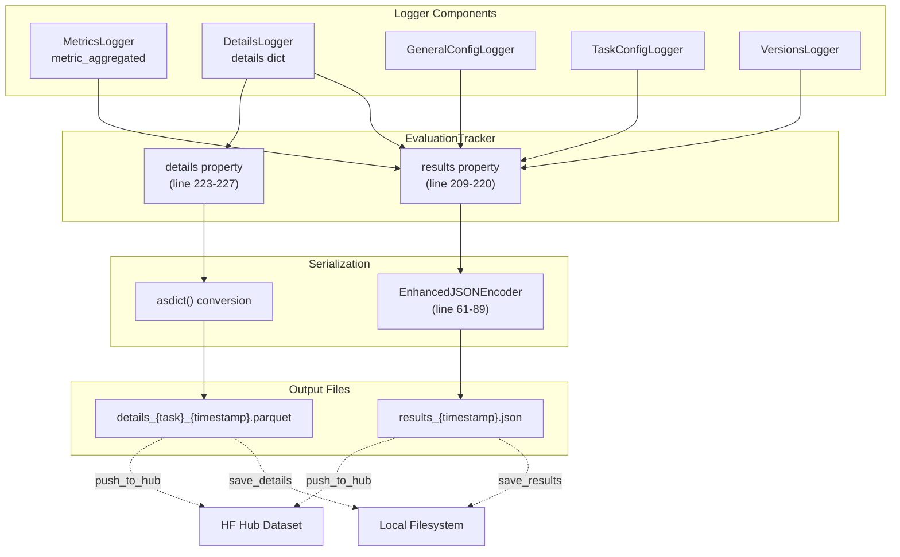
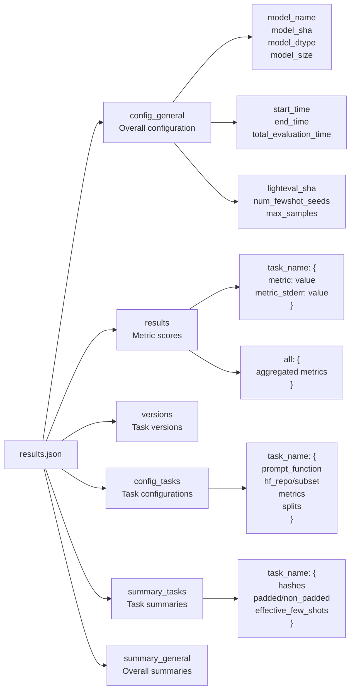
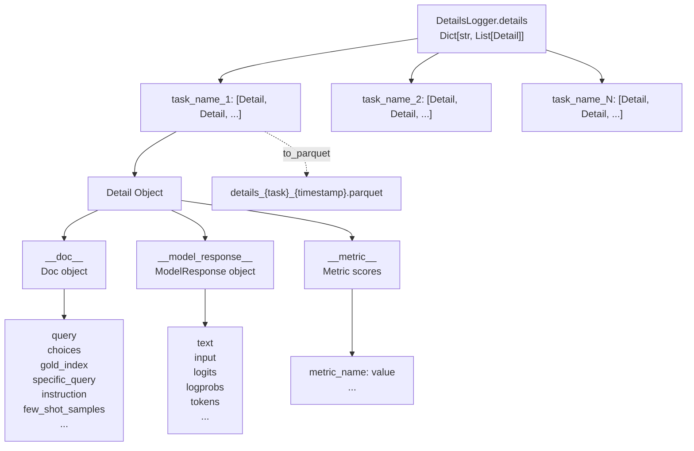
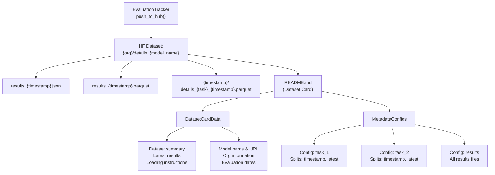
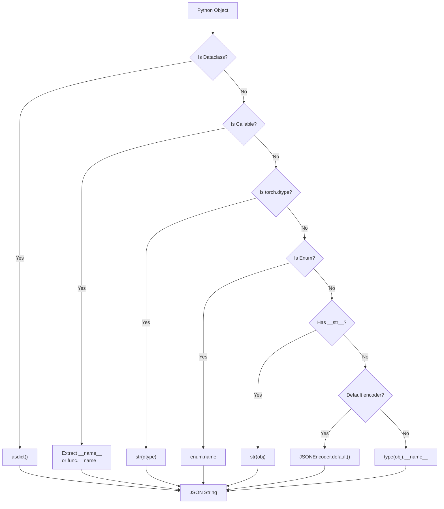

<!-- source: DeepWiki mcp.deepwiki.com · repo huggingface/lighteval · page 9.5 Results Format · fetched 2026-10-26 -->

# Results Format

<details>
<summary>Relevant source files</summary>

The following files were used as context for generating this wiki page:

- [src/lighteval/logging/evaluation_tracker.py](src/lighteval/logging/evaluation_tracker.py)
- [src/lighteval/logging/info_loggers.py](src/lighteval/logging/info_loggers.py)
- [src/lighteval/main_accelerate.py](src/lighteval/main_accelerate.py)
- [src/lighteval/main_custom.py](src/lighteval/main_custom.py)
- [src/lighteval/main_endpoint.py](src/lighteval/main_endpoint.py)
- [src/lighteval/main_nanotron.py](src/lighteval/main_nanotron.py)
- [src/lighteval/main_sglang.py](src/lighteval/main_sglang.py)
- [src/lighteval/main_vllm.py](src/lighteval/main_vllm.py)
- [src/lighteval/pipeline.py](src/lighteval/pipeline.py)

</details>


This page describes the structure and format of evaluation results produced by lighteval. It covers the schema of `results.json` files, the structure of detailed evaluation logs in Parquet format, and how to programmatically load and inspect results.

For information about the `EvaluationTracker` class that produces these results, see [EvaluationTracker](#9.1). For information about output destinations (local filesystem, Hugging Face Hub, TensorBoard, W&B), see [Output Destinations](#9.3).

## Output Files Overview

Lighteval generates two primary types of output files during evaluation:

| File Type | Purpose | Default Location | Format |
|-----------|---------|------------------|---------|
| Results | Aggregated metrics and configuration | `{output_dir}/results/{model_name}/results_{timestamp}.json` | JSON |
| Details | Per-sample predictions and scores | `{output_dir}/details/{model_name}/{timestamp}/details_{task}_{timestamp}.parquet` | Parquet |

The directory structure follows this pattern:

```
output_dir/
├── results/
│   └── model_name/
│       ├── results_2024-01-15T10-30-00.json
│       └── results_2024-01-16T14-20-00.json
└── details/
    └── model_name/
        ├── 2024-01-15T10-30-00/
        │   ├── details_lighteval|mmlu:anatomy|5_2024-01-15T10-30-00.parquet
        │   └── details_lighteval|gsm8k|0_2024-01-15T10-30-00.parquet
        └── 2024-01-16T14-20-00/
            └── details_lighteval|hellaswag|10_2024-01-16T14-20-00.parquet
```

**Diagram: Output File Generation Flow**



Sources: [src/lighteval/logging/evaluation_tracker.py:209-227](), [src/lighteval/logging/evaluation_tracker.py:299-312](), [src/lighteval/logging/evaluation_tracker.py:351-358]()

## results.json Structure

The `results.json` file contains comprehensive evaluation information assembled by the `results` property of `EvaluationTracker`. The file structure includes six top-level keys:

**Diagram: results.json Schema**



### config_general

Contains overall evaluation configuration from `GeneralConfigLogger`:

| Field | Type | Description |
|-------|------|-------------|
| `lighteval_sha` | string | Git commit hash of lighteval version |
| `model_name` | string | Model identifier (e.g., "gpt2", "meta-llama/Llama-2-7b") |
| `model_sha` | string | Git commit hash of model repository |
| `model_dtype` | string/null | Data type used for model (e.g., "float16", "bfloat16") |
| `model_size` | string | Model size in MB/GB |
| `start_time` | float | Unix timestamp when evaluation started |
| `end_time` | float | Unix timestamp when evaluation ended |
| `total_evaluation_time_secondes` | string | Total time taken for evaluation |
| `num_fewshot_seeds` | int | Number of seeds used for few-shot sampling |
| `max_samples` | int/null | Maximum samples evaluated per task |
| `job_id` | string | Job identifier (if running in a cluster) |
| `model_config` | dict | Full model configuration object |

### results

Contains aggregated metrics from `MetricsLogger.metric_aggregated`. Each key is a task name with format `suite|task_name|num_fewshot`, and values are metric dictionaries:

```json
{
  "lighteval|gsm8k|0": {
    "em": 0.85,
    "em_stderr": 0.012,
    "maj@8": 0.92,
    "maj@8_stderr": 0.008
  },
  "lighteval|mmlu:anatomy|5": {
    "acc": 0.67,
    "acc_stderr": 0.015
  },
  "all": {
    "em": 0.76,
    "acc": 0.65
  }
}
```

The `"all"` key contains metrics averaged across all tasks.

### versions

Contains version information from `VersionsLogger`. Maps task names to their version numbers (usually integers):

```json
{
  "lighteval|gsm8k|0": 0,
  "lighteval|mmlu:anatomy|5": 1
}
```

### config_tasks

Contains task configuration from `TaskConfigLogger`. Each task includes its complete `LightevalTaskConfig`:

| Field | Description |
|-------|-------------|
| `name` | Task identifier |
| `prompt_function` | Name of the prompt function used |
| `hf_repo` | HuggingFace dataset repository |
| `hf_subset` | Dataset subset name |
| `metric` | List of metric configurations with details |
| `hf_avail_splits` | Available dataset splits |
| `evaluation_splits` | Splits used for evaluation |
| `few_shots_split` | Split used for few-shot examples |
| `few_shots_select` | Few-shot selection strategy |
| `generation_size` | Maximum generation length |
| `stop_sequence` | Stop sequences for generation |
| `suite` | Task suite(s) this task belongs to |
| `original_num_docs` | Total documents in dataset |
| `effective_num_docs` | Documents actually evaluated |
| `version` | Task version number |

### summary_tasks

Contains per-task summaries from `DetailsLogger.compiled_details`:

| Field | Description |
|-------|-------------|
| `hashes` | Cryptographic hashes of examples, prompts, and tokens for reproducibility |
| `padded` | Number of padded samples |
| `non_padded` | Number of non-padded samples |
| `effective_few_shots` | Average number of few-shot examples used |

### summary_general

Contains overall summaries from `DetailsLogger.compiled_details_over_all_tasks`, aggregating statistics across all tasks.

Sources: [src/lighteval/logging/evaluation_tracker.py:209-220](), [docs/source/saving-and-reading-results.mdx:177-283]()

## details.parquet Structure

Detail files contain per-sample evaluation information saved as Parquet datasets. Each task generates a separate Parquet file. The `EvaluationTracker` converts the `DetailsLogger.details` dictionary to datasets using `Dataset.from_list()` at [src/lighteval/logging/evaluation_tracker.py:255]().

**Diagram: Details Data Structure**



### Schema

The Parquet files contain three main column groups:

#### `__doc__` Columns

Contains information about the evaluation document from the `Doc` dataclass. Common fields include:

| Field | Type | Description |
|-------|------|-------------|
| `query` | string | The main query/question text |
| `choices` | list[string] | Multiple choice options (for MC tasks) |
| `gold_index` | int/list[int] | Correct answer index/indices |
| `instruction` | string | Task instruction prepended to query |
| `specific_query` | object | Task-specific query format |
| `target_for_fewshot_sorting` | string | Target used for few-shot sorting |
| `few_shot_samples` | list | Few-shot example documents |
| `task_name` | string | Task identifier |
| `num_asked_few_shots` | int | Number of few-shots requested |
| `num_effective_few_shots` | int | Number of few-shots actually used |

#### `__model_response__` Columns

Contains model predictions and inference details from the `ModelResponse` dataclass:

| Field | Type | Description |
|-------|------|-------------|
| `text` | string | Full generated text |
| `input` | string | Input text sent to the model |
| `result` | string | Extracted result from generation |
| `logits` | list[float] | Raw logits from model |
| `logprobs` | list[float] | Log probabilities for tokens |
| `tokens` | list[string] | Generated tokens |
| `truncated_tokens_count` | int | Number of tokens truncated |
| `padded_tokens_count` | int | Number of padding tokens added |

#### `__metric__` Columns

Contains computed metric scores for the sample. The structure depends on which metrics were configured for the task. Each metric produces one or more fields, e.g.:

- `em`: Exact match score (0.0 or 1.0)
- `f1`: F1 score
- `rouge1`, `rouge2`, `rougeL`: ROUGE scores
- Custom metric outputs

### Loading Details

You can load details using the `load_details_datasets()` method at [src/lighteval/logging/evaluation_tracker.py:331-349]() or directly with the datasets library:

```python
from datasets import load_dataset

# Load from local file
details = load_dataset(
    "parquet",
    data_files="output_dir/details/model_name/2024-01-15T10-30-00/details_lighteval|gsm8k|0_2024-01-15T10-30-00.parquet",
    split="train"
)

# Access fields
for sample in details:
    print(sample["__doc__"]["query"])
    print(sample["__model_response__"]["text"])
    print(sample["__metric__"])
```

The `EvaluationTracker` can also load details with special date_id values:
- `"first"`: Loads the earliest evaluation
- `"last"`: Loads the most recent evaluation
- ISO timestamp: Loads specific evaluation

Sources: [src/lighteval/logging/evaluation_tracker.py:223-227](), [src/lighteval/logging/evaluation_tracker.py:253-264](), [src/lighteval/logging/evaluation_tracker.py:331-349](), [docs/source/saving-and-reading-results.mdx:107-114]()

## Dataset Card Generation

When results are pushed to the Hugging Face Hub with `push_to_hub=True`, the `EvaluationTracker` automatically generates a comprehensive dataset card using the `recreate_metadata_card()` method at [src/lighteval/logging/evaluation_tracker.py:451-657]().

**Diagram: Hub Dataset Structure**



### Repository Structure

The created dataset repository has the format:

- **Public runs**: `{org}/details_{sanitized_model_name}`
- **Private runs**: `{org}/details_{sanitized_model_name}_private`

Where `sanitized_model_name` replaces `/` with `__` (e.g., `meta-llama/Llama-2-7b` becomes `meta-llama__Llama-2-7b`).

### Dataset Configurations

The dataset card includes multiple configurations (accessible via `load_dataset(repo_id, config_name, split)`):

1. **Task-specific configs**: One per task, with sanitized task names (non-word characters replaced with `_`)
2. **Results config**: Contains all `results_{timestamp}.json` files
3. **Special aggregate configs**: For task suites like MMLU, all subtasks are grouped

Each configuration has multiple splits:
- **Timestamp splits**: Named with sanitized ISO timestamps (`:` replaced with `_`)
- **`latest` split**: Always points to the most recent evaluation

### Special Task Grouping

Tasks from the same suite (e.g., all MMLU subtasks) are automatically grouped into aggregate configurations. This is handled at [src/lighteval/logging/evaluation_tracker.py:554-606]() and includes special handling for:

- `lighteval|mmlu:*` tasks
- `original|mmlu:*` tasks

The grouping preserves few-shot information in the configuration name.

### Metadata Fields

The `DatasetCardData` includes:

| Field | Description |
|-------|-------------|
| `dataset_summary` | Description of the dataset with model info, configuration count, and loading examples |
| `repo_url` | URL to the evaluated model repository |
| `pretty_name` | Human-readable name (e.g., "Evaluation run of model_name") |
| `leaderboard_url` | URL to leaderboard (if pushing to open-llm-leaderboard org) |
| `point_of_contact` | Contact email (if pushing to open-llm-leaderboard org) |

### Loading from Hub

```python
from datasets import load_dataset

# Load latest results
results = load_dataset(
    "org/details_model_name",
    "results",
    split="latest"
)

# Load specific task details
task_details = load_dataset(
    "org/details_model_name",
    "lighteval_gsm8k_0",  # Sanitized task name
    split="latest"
)

# Load historical results
old_results = load_dataset(
    "org/details_model_name",
    "results",
    split="2024_01_15T10_30_00_123456"  # Sanitized timestamp
)
```

Sources: [src/lighteval/logging/evaluation_tracker.py:384-424](), [src/lighteval/logging/evaluation_tracker.py:451-657](), [docs/source/saving-and-reading-results.mdx:89-105]()

## JSON Serialization

The `EnhancedJSONEncoder` class at [src/lighteval/logging/evaluation_tracker.py:61-89]() handles serialization of complex Python objects that are not natively JSON-serializable:

**Diagram: EnhancedJSONEncoder Handling**



This encoder handles:
- **Dataclasses**: Converted using `asdict()` with fallback to `str()` if that fails
- **Callables**: Extracts function name via `__name__` or unwraps partial functions
- **torch.dtype**: Converts to string representation
- **Enums**: Uses the enum's name attribute
- **Objects with `__str__`**: Falls back to string representation
- **Unknown types**: Uses type name as last resort

Sources: [src/lighteval/logging/evaluation_tracker.py:61-89]()

## Complete Example

Here's a complete example of loading and inspecting results:

```python
from datasets import load_dataset
from lighteval.logging.evaluation_tracker import EvaluationTracker
import json
from pathlib import Path

# Method 1: Load from local filesystem
output_dir = "./eval_results"
model_name = "gpt2"

# Load results
results_path = Path(output_dir) / "results" / model_name
latest_results_file = sorted(results_path.glob("results_*.json"))[-1]

with open(latest_results_file) as f:
    results = json.load(f)

print("Overall metrics:", results["results"]["all"])
print("Task configs:", results["config_tasks"].keys())

# Load details for specific task
details_path = Path(output_dir) / "details" / model_name
latest_timestamp = sorted(details_path.iterdir())[-1].name
task_name = "lighteval|gsm8k|0"

details = load_dataset(
    "parquet",
    data_files=str(details_path / latest_timestamp / f"details_{task_name}_{latest_timestamp}.parquet"),
    split="train"
)

for sample in details.select(range(5)):
    print(f"Query: {sample['__doc__']['query']}")
    print(f"Prediction: {sample['__model_response__']['result']}")
    print(f"Metrics: {sample['__metric__']}")
    print("-" * 80)

# Method 2: Use EvaluationTracker to load
tracker = EvaluationTracker(output_dir=output_dir)
# Load details using special date_id "last"
details_datasets = tracker.load_details_datasets(
    date_id="last",
    task_names=["lighteval|gsm8k"]
)

# Method 3: Load from Hugging Face Hub
hub_details = load_dataset(
    "org/details_gpt2",
    "lighteval_gsm8k_0",
    split="latest"
)

hub_results = load_dataset(
    "org/details_gpt2",
    "results",
    split="latest"
)
```

Sources: [src/lighteval/logging/evaluation_tracker.py:331-349](), [docs/source/saving-and-reading-results.mdx:60-105]()

---

