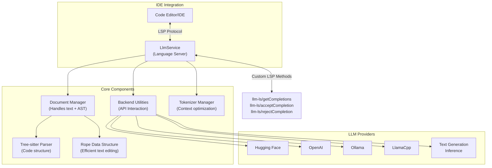
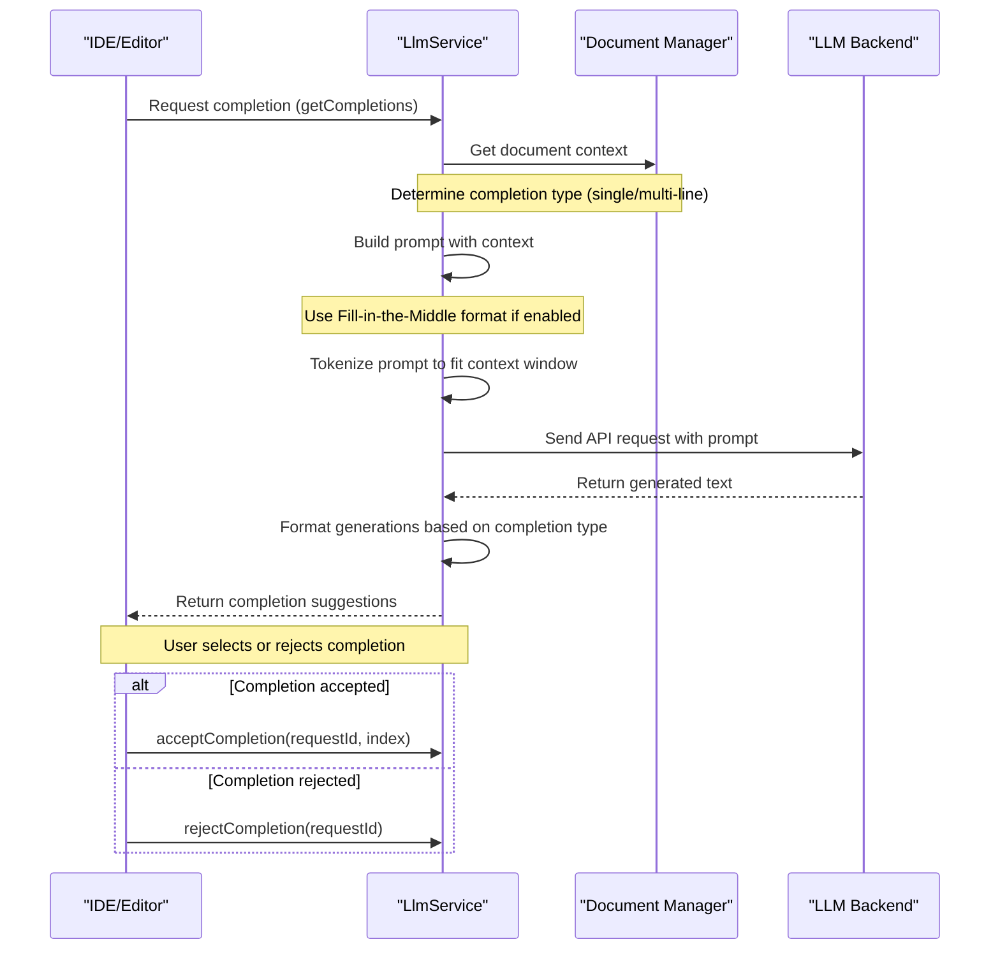
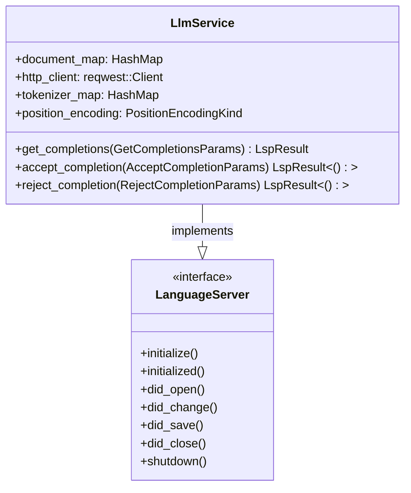
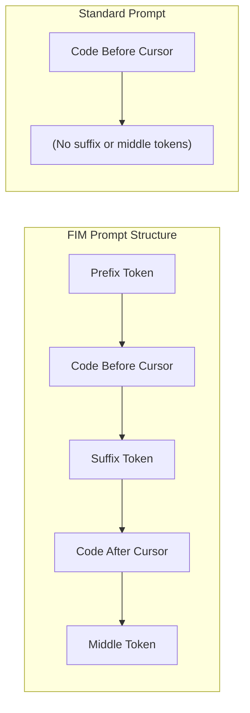
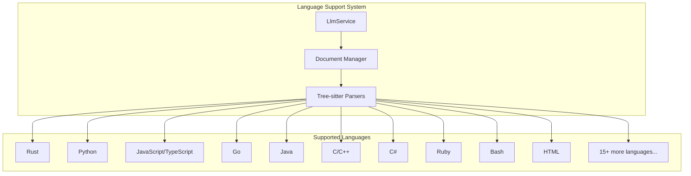

<!-- source: DeepWiki mcp.deepwiki.com · repo huggingface/llm-ls · page 1 Overview · fetched 2026-10-26 -->

# Overview

Relevant source files

The following files were used as context for generating this wiki page:

- [Cargo.lock](Cargo.lock)
- [Cargo.toml](Cargo.toml)
- [README.md](README.md)
- [crates/llm-ls/src/main.rs](crates/llm-ls/src/main.rs)

This page provides a comprehensive overview of the llm-ls (Language Server for LLM-Powered Code Completion) system. llm-ls is an implementation of the Language Server Protocol (LSP) that leverages Large Language Models to provide intelligent code completions across multiple programming languages and development environments.

For specific details about the language server implementation, see [Language Server (llm-ls)](#2). For information about the LLM backend integration, see [LLM Backend System](#3). For testing and evaluation, see [Testbed Framework](#4).

## Purpose and Design Goals

llm-ls serves as a common platform for IDE extensions, handling the complexities of LLM interactions so that extensions can remain lightweight. It aims to:

1. Provide contextually relevant code completions using LLMs
2. Support multiple LLM backends with a unified interface
3. Optimize prompt management with context-aware strategies
4. Integrate seamlessly with various programming languages and IDEs
5. Collect detailed telemetry for potential model improvements

Sources: [README.md:6-8](), [crates/llm-ls/src/main.rs:25-33]()

## System Architecture

The llm-ls system follows a modular architecture that separates concerns between language server functionality, document management, and LLM interaction.

Sources: [crates/llm-ls/src/main.rs:129-139](), [crates/llm-ls/src/main.rs:25-33]()

## Code Completion Flow

The code completion process in llm-ls involves multiple steps, from detecting when completions should be triggered to processing the LLM's response.

Sources: [crates/llm-ls/src/main.rs:492-594](), [crates/llm-ls/src/main.rs:65-122](), [crates/llm-ls/src/main.rs:141-233](), [crates/llm-ls/src/main.rs:275-303]()

## Core Components

### Language Server Implementation (LlmService)

The central component of llm-ls is the `LlmService` struct, which implements the Language Server Protocol interface and adds custom methods for LLM interactions.

Sources: [crates/llm-ls/src/main.rs:129-139](), [crates/llm-ls/src/main.rs:597-713]()

### Document Management

The Document Manager handles text documents using the Rope data structure and provides parsing capabilities through tree-sitter.

| Component | Role |
|-----------|------|
| `Document` | Contains text content (as Rope) and parsed syntax tree |
| `LanguageId` | Identifies programming language for appropriate parsing |
| `Tree-sitter` | Provides AST (Abstract Syntax Tree) parsing for code understanding |
| `Rope` | Efficient data structure for text manipulation |

Sources: [crates/llm-ls/src/main.rs:26](), [crates/llm-ls/src/main.rs:634-654]()

### LLM Backend System

llm-ls supports multiple LLM backends through a unified API interface, allowing seamless switching between different providers.

| Backend | URL Formation | Request Format |
|---------|--------------|----------------|
| Hugging Face | `{url}/models/{model}` | API-specific JSON |
| OpenAI | `{url}/v1/completions` | OpenAI format |
| Ollama | `{url}/api/generate` | Ollama-specific format |
| LlamaCpp | `{url}/completions` | OpenAI-compatible |
| TGI | `{url}/generate` | TGI-specific format |

Sources: [crates/llm-ls/src/main.rs:425-489](), [crates/llm-ls/src/main.rs:235-273]()

## Prompt Management

llm-ls employs sophisticated prompt management techniques to optimize the context provided to LLMs.

### Fill-in-the-Middle (FIM) Prompting

The Fill-in-the-Middle approach provides better context awareness by including both the code before and after the cursor position.

Sources: [crates/llm-ls/src/main.rs:141-233]()

### Tokenization and Context Window Management

llm-ls ensures that prompts fit within the model's context window by:

1. Dynamically tokenizing text to accurately count tokens
2. Prioritizing content closest to the cursor position
3. Balancing "before" and "after" context when using FIM

Sources: [crates/llm-ls/src/main.rs:367-422](), [crates/llm-ls/src/main.rs:141-233]()

## Completion Types

llm-ls analyzes code structure to determine the appropriate completion type:

| Type | Description | Implementation |
|------|-------------|---------------|
| Empty | No completion needed | No content returned |
| SingleLine | Single-line completion | Takes first line of generated text |
| MultiLine | Multi-line completion | Uses complete generated text |

The completion type is determined by examining the syntax tree of the code and the cursor position.

Sources: [crates/llm-ls/src/main.rs:48-63](), [crates/llm-ls/src/main.rs:65-122](), [crates/llm-ls/src/main.rs:275-303]()

## Custom LSP Protocol Extensions

llm-ls extends the Language Server Protocol with custom methods to support LLM-specific interactions:

| Method | Purpose | Parameters |
|--------|---------|------------|
| `llm-ls/getCompletions` | Request completions at cursor position | Document URI, position, model, backend settings |
| `llm-ls/acceptCompletion` | Record accepted completion | Request ID, completion index |
| `llm-ls/rejectCompletion` | Record rejected completion | Request ID |

Sources: [crates/llm-ls/src/main.rs:775-777](), [crates/llm-ls/src/main.rs:492-594]()

## Supported Languages

llm-ls integrates tree-sitter parsers for a wide range of programming languages, enabling intelligent code completion across different development environments.

Sources: [Cargo.toml:1002-1023]()

## Compatible IDE Extensions

llm-ls is designed to work with multiple IDE extensions, providing a common backend for LLM-powered code completion across different editors.

| Extension | Editor/IDE | Status |
|-----------|------------|--------|
| llm.nvim | Neovim | Supported |
| llm-vscode | Visual Studio Code | Supported |
| llm-intellij | IntelliJ IDEA family | Supported |
| jupytercoder | Jupyter Notebooks | Planned |

Sources: [README.md:34-37]()

## Telemetry and Logging

llm-ls includes telemetry capabilities for monitoring and improving completion performance:

1. Request and response logging
2. Completion acceptance/rejection tracking 
3. Performance timing metrics

All telemetry is stored locally in `~/.cache/llm_ls/llm-ls.log` and is not exported externally.

Sources: [README.md:18-22](), [crates/llm-ls/src/main.rs:738-751]()

---

