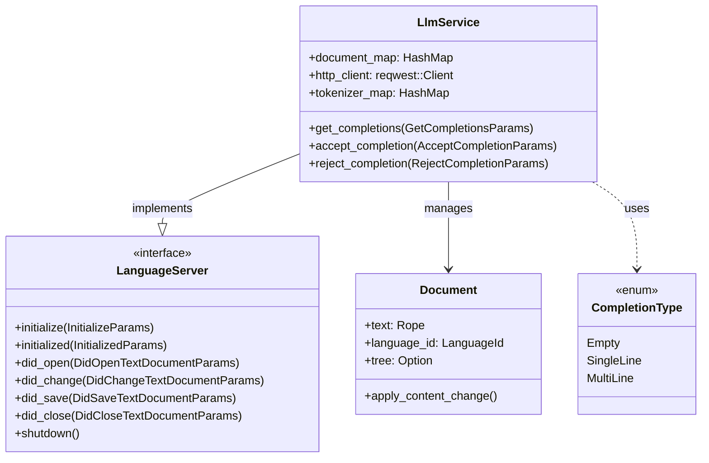
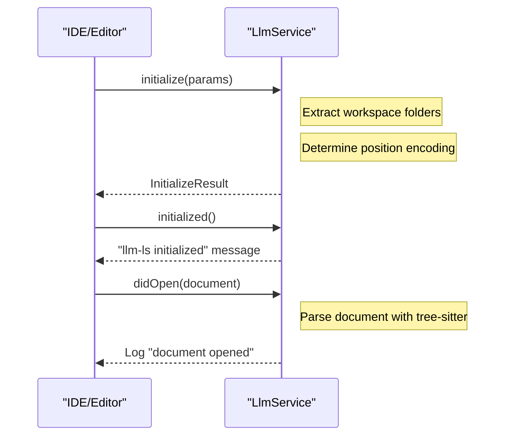
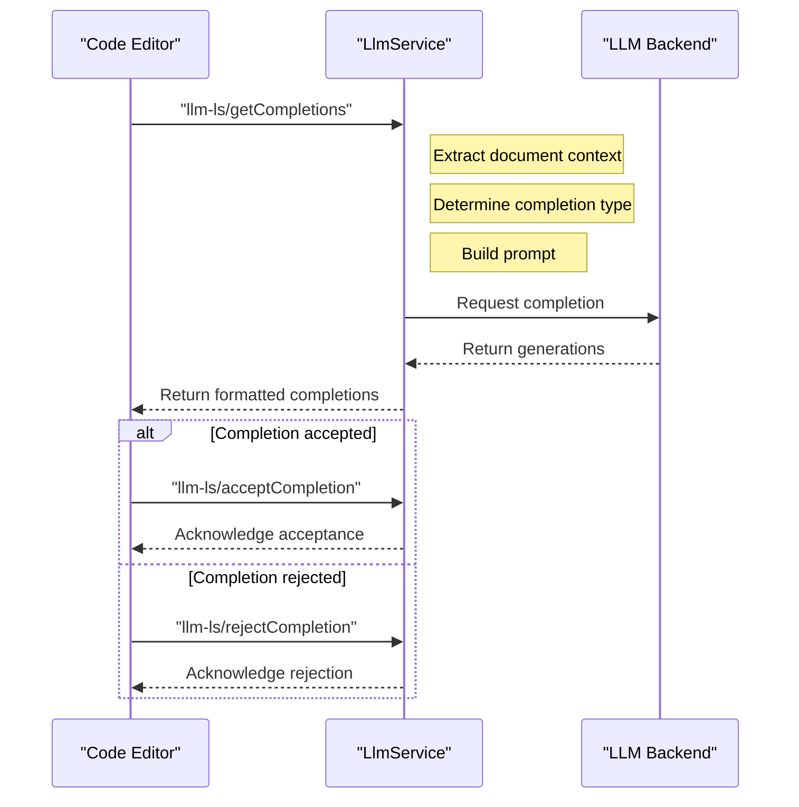
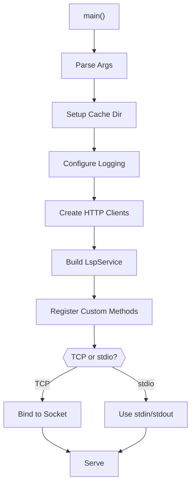

<!-- source: DeepWiki mcp.deepwiki.com · repo huggingface/llm-ls · page 2 Language Server (llm-ls) · fetched 2026-10-26 -->

# Language Server (llm-ls)

Relevant source files

The following files were used as context for generating this wiki page:

- [crates/llm-ls/Cargo.toml](crates/llm-ls/Cargo.toml)
- [crates/llm-ls/src/main.rs](crates/llm-ls/src/main.rs)

This document describes the core language server implementation (`llm-ls`) in the llm-ls project. The language server is responsible for implementing the Language Server Protocol (LSP), managing documents, processing code completion requests, and communicating with LLM backends. For information about the LLM backend systems, see [LLM Backend System](#3).

## Purpose and Scope

The `llm-ls` language server acts as a bridge between code editors/IDEs and Large Language Models (LLMs). It implements the Language Server Protocol (LSP) with custom extensions to provide context-aware code completions powered by various LLM backends.

Sources: [crates/llm-ls/src/main.rs:129-713](). [crates/llm-ls/Cargo.toml:1-62]()

## Architecture Overview

The language server is built on the `tower-lsp` framework and follows a service-oriented architecture. The core component is the `LlmService` struct which implements the `LanguageServer` trait and custom methods for LLM completions.

Sources: [crates/llm-ls/src/main.rs:129-139](), [crates/llm-ls/src/main.rs:598-713]()

## Service Initialization and Configuration

The language server is initialized with:
- Document management capabilities
- HTTP clients for secure and insecure connections
- Tokenizer management
- Position encoding support

During initialization, the server establishes workspace folders and position encoding configuration from client capabilities.

Sources: [crates/llm-ls/src/main.rs:599-633](), [crates/llm-ls/src/main.rs:635-658]()

## Document Management

The language server maintains a map of open documents, with each document represented by the `Document` struct. It handles standard LSP notifications for document changes:

| LSP Method | Function | Purpose |
|------------|----------|---------|
| `textDocument/didOpen` | `did_open()` | Creates a new document in the document map |
| `textDocument/didChange` | `did_change()` | Updates document content with incremental changes |
| `textDocument/didSave` | `did_save()` | Logs that a document was saved |
| `textDocument/didClose` | `did_close()` | Logs that a document was closed |

The server uses the Rope data structure for efficient text manipulation and Tree-sitter for parsing and syntax analysis.

Sources: [crates/llm-ls/src/main.rs:635-707]()

## Custom LSP Extensions

The language server implements three custom LSP methods for handling LLM-powered code completions:

### 1. llm-ls/getCompletions

This method processes completion requests with the following steps:
1. Retrieves the document from the document map
2. Determines the appropriate completion type (single-line, multi-line, or empty)
3. Fetches or creates a tokenizer for the specified model
4. Builds a prompt using the document context
5. Sends the request to the LLM backend
6. Formats and returns the completions

Sources: [crates/llm-ls/src/main.rs:492-575]()

### 2. llm-ls/acceptCompletion

Logs information about accepted completions, which can be used for analytics and model improvement.

Sources: [crates/llm-ls/src/main.rs:577-585]()

### 3. llm-ls/rejectCompletion

Logs information about rejected completions, which can be used for analytics and model improvement.

Sources: [crates/llm-ls/src/main.rs:587-594]()

## Completion Processing

### Completion Types

The language server determines the appropriate completion type based on the document context:

| Type | Description |
|------|-------------|
| `Empty` | No completion should be provided |
| `SingleLine` | Only single-line completion is appropriate |
| `MultiLine` | Multi-line completion is appropriate |

The `should_complete()` function analyzes the document structure using Tree-sitter to make this determination.

Sources: [crates/llm-ls/src/main.rs:48-122](), [crates/llm-ls/src/main.rs:49-53]()

### Prompt Construction

The `build_prompt()` function creates an effective prompt for the LLM by:
1. Extracting text before and after the cursor position
2. Applying Fill-in-the-Middle (FIM) formatting if enabled
3. Ensuring the prompt fits within the model's context window
4. Tokenizing the text if a tokenizer is available

For FIM prompts, the function uses special tokens to indicate the prefix, suffix, and middle sections.

Sources: [crates/llm-ls/src/main.rs:141-233]()

### Backend Communication

The `request_completion()` function handles communication with LLM backends:
1. Builds the request body based on the backend type
2. Constructs appropriate headers, including authentication
3. Sends the request to the backend URL
4. Parses the generation results

The server supports multiple backend types through the `Backend` enum, each with specific URL handling and request formatting.

Sources: [crates/llm-ls/src/main.rs:235-273](), [crates/llm-ls/src/main.rs:425-489]()

## Tokenizer Management

The language server maintains a cache of tokenizers for different models. When needed, it:
1. Checks if the tokenizer is already in the cache
2. If not, loads it based on the specified configuration:
   - From a local file
   - From Hugging Face (downloading if necessary)
   - From a custom URL

Tokenizers are crucial for accurately counting tokens and optimizing prompts to fit within model context windows.

Sources: [crates/llm-ls/src/main.rs:305-422]()

## Entry Point and Configuration

The main function initializes the server with:
1. Command-line argument parsing
2. Logging configuration
3. Cache directory setup
4. HTTP client creation
5. LSP service construction with custom methods
6. Transport selection (stdio or TCP)

Sources: [crates/llm-ls/src/main.rs:715-795]()

## Supported Languages

The language server supports a wide range of programming languages through Tree-sitter parsers, as specified in the Cargo.toml dependencies:

| Language | Tree-sitter Parser |
|----------|-------------------|
| Rust | tree-sitter-rust |
| Python | tree-sitter-python |
| JavaScript | tree-sitter-javascript |
| TypeScript | tree-sitter-typescript |
| C/C++ | tree-sitter-c/tree-sitter-cpp |
| Java | tree-sitter-java |
| Go | tree-sitter-go |
| And many more | Various tree-sitter parsers |

Sources: [crates/llm-ls/Cargo.toml:36-58]()

---

