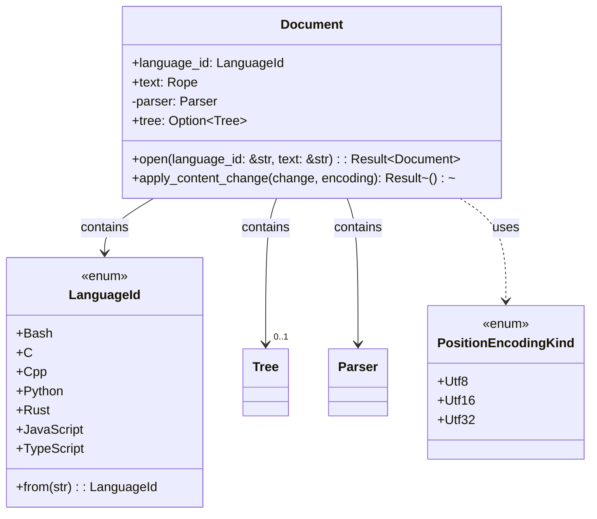
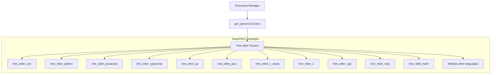
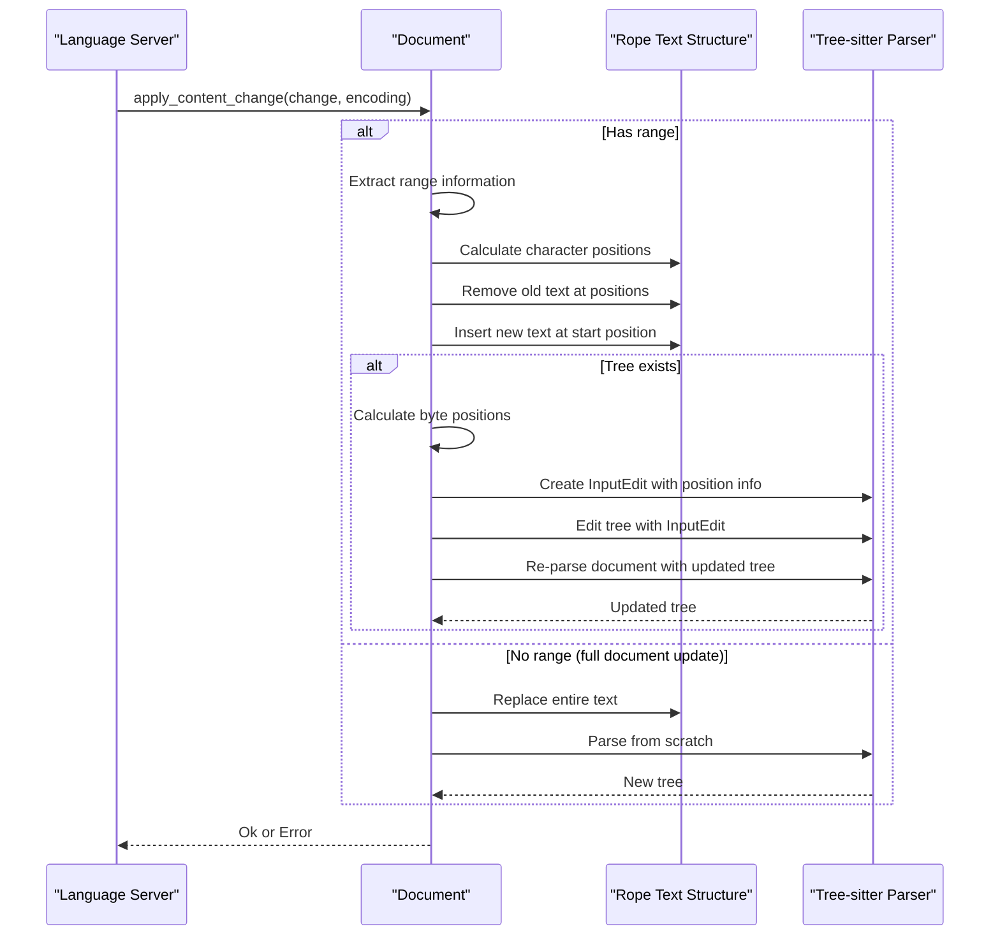
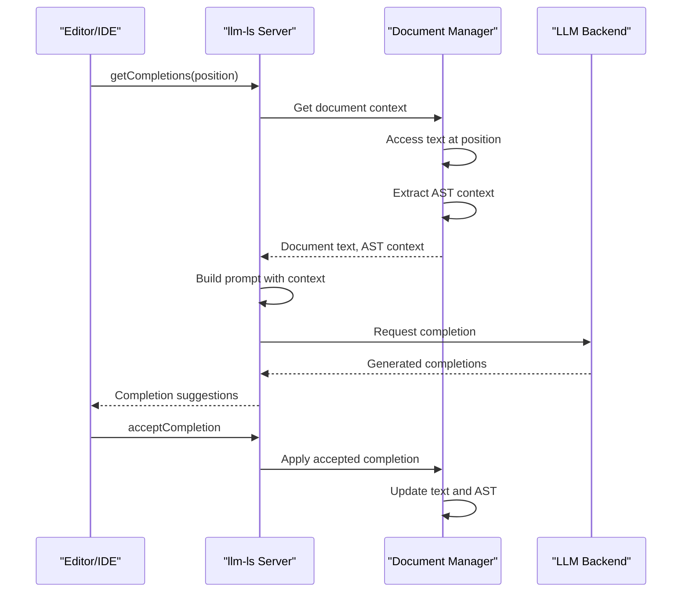

<!-- source: DeepWiki mcp.deepwiki.com · repo huggingface/llm-ls · page 2.1 Document Management · fetched 2026-10-26 -->

# Document Management

Relevant source files

The following files were used as context for generating this wiki page:

- [crates/llm-ls/src/document.rs](crates/llm-ls/src/document.rs)
- [crates/llm-ls/src/language_id.rs](crates/llm-ls/src/language_id.rs)

The Document Management system in the llm-ls Language Server provides the foundation for managing text content, parsing code syntax, and serving document context for LLM-powered code completion. This component acts as the bridge between raw text in the editor and the structured code representation needed for intelligent language model interactions.

## Core Components and Structure

The Document Management system centers around the `Document` struct which maintains the state of each file being edited:

Sources: [crates/llm-ls/src/document.rs:180-185](), [crates/llm-ls/src/language_id.rs:4-31]()

### Rope Data Structure

The system uses the Rope data structure (from the `ropey` crate) for efficient text handling. Ropes offer significant advantages for text editing operations:

- O(log n) insertions and deletions anywhere in the text
- Fast access to any position in a document
- Memory-efficient representation of large documents

### Tree-sitter Integration

Each document maintains a Tree-sitter parser and syntax tree, which:
- Provides syntactic structure of the code (Abstract Syntax Tree)
- Enables context-aware code completion
- Supports structural code analysis

## Language Support

The Document Manager supports numerous programming languages via Tree-sitter grammars, determined by the document's `LanguageId`:

Sources: [crates/llm-ls/src/document.rs:8-127](), [crates/llm-ls/src/language_id.rs:4-31]()

## Document Operations

### Opening Documents

Documents are initialized and opened using the `Document::open` method, which:
1. Converts the language ID string to a `LanguageId` enum
2. Creates a Rope from the input text
3. Initializes a Tree-sitter parser for the specified language
4. Parses the text to create an initial syntax tree

Sources: [crates/llm-ls/src/document.rs:188-198]()

### Applying Content Changes

The core functionality is the `apply_content_change` method, which handles document modifications from the editor:

Sources: [crates/llm-ls/src/document.rs:201-353]()

The content change handling process:
1. Determines if the change applies to a specific range or the entire document
2. For ranged changes:
   - Calculates character positions based on the position encoding
   - Updates the Rope text structure
   - Creates a Tree-sitter InputEdit to update the syntax tree
   - Re-parses the document to maintain tree consistency
3. For full document updates:
   - Replaces the entire Rope content
   - Parses the new content from scratch

## Position Encoding

Document management handles different text encodings via the `PositionEncodingKind` enum:

| Encoding | Description | Usage |
|----------|-------------|-------|
| UTF-8 | Byte-based positions | Raw byte operations |
| UTF-16 | UTF-16 code unit positions | Most editor interfaces (VS Code, etc.) |
| UTF-32 | Unicode code point positions | Character-based operations |

The system includes conversion functions between these encoding schemes to ensure accurate position calculations regardless of the client editor's encoding.

Sources: [crates/llm-ls/src/document.rs:129-177]()

## Role in Code Completion

The Document Manager plays a critical role in the code completion workflow:

When a code completion is requested, the Document Manager:
1. Provides the text surrounding the cursor position
2. Supplies structural context from the AST
3. Helps determine the appropriate completion type
4. Updates the document state after a completion is accepted

## Error Handling

The Document Management system handles various error conditions:
- Invalid ranges (when start position is after end position)
- Out-of-bound line access
- Tree-sitter parsing failures
- Unknown encoding kinds

Errors are returned as `Result` values, with specific error types defined in the Error Handling system. For more details on error types and handling, see [Error Handling](#2.2).

Sources: [crates/llm-ls/src/document.rs:201-353]()

## Conclusion

The Document Management system forms the foundation of the llm-ls Language Server by efficiently handling text content and maintaining synchronized syntax trees. This enables the language server to provide intelligent, context-aware code completions powered by Large Language Models that respect the code's syntax and structure.

---

