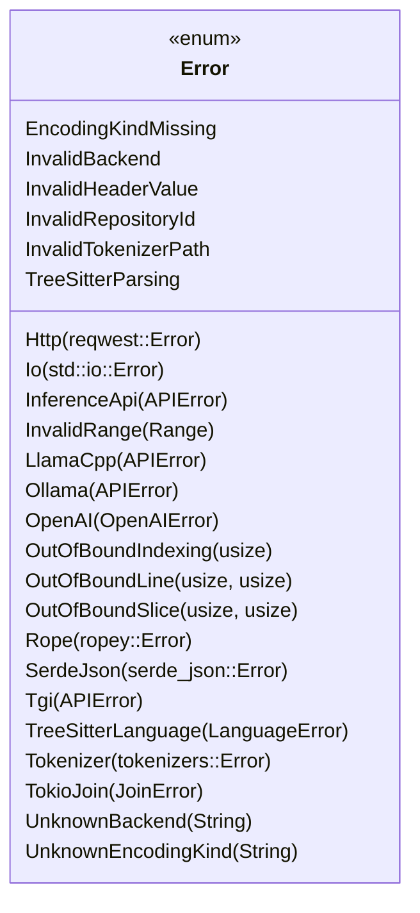
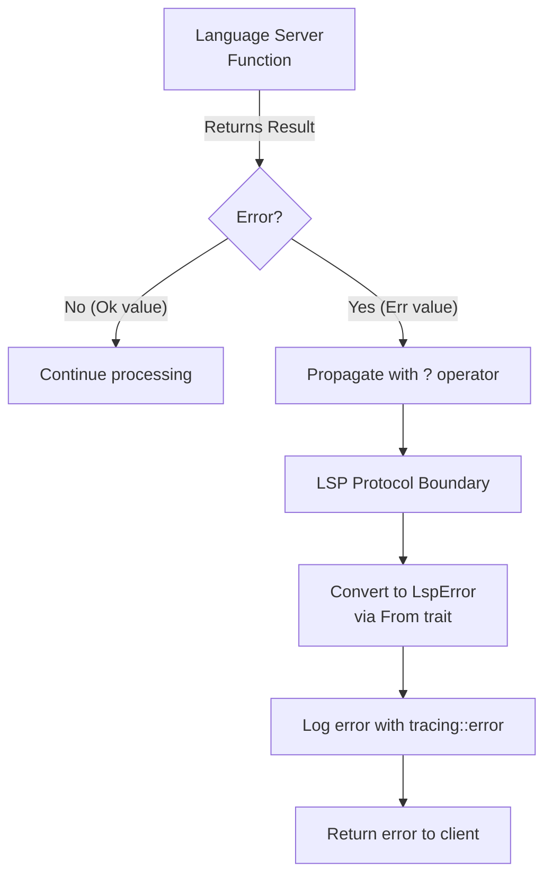
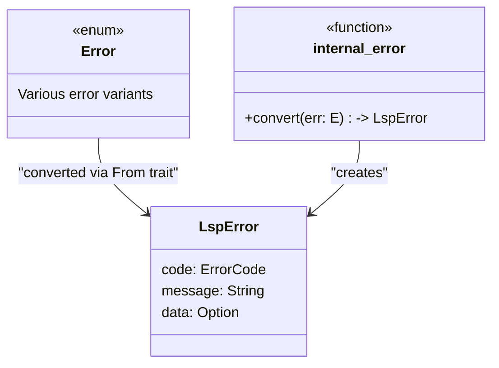
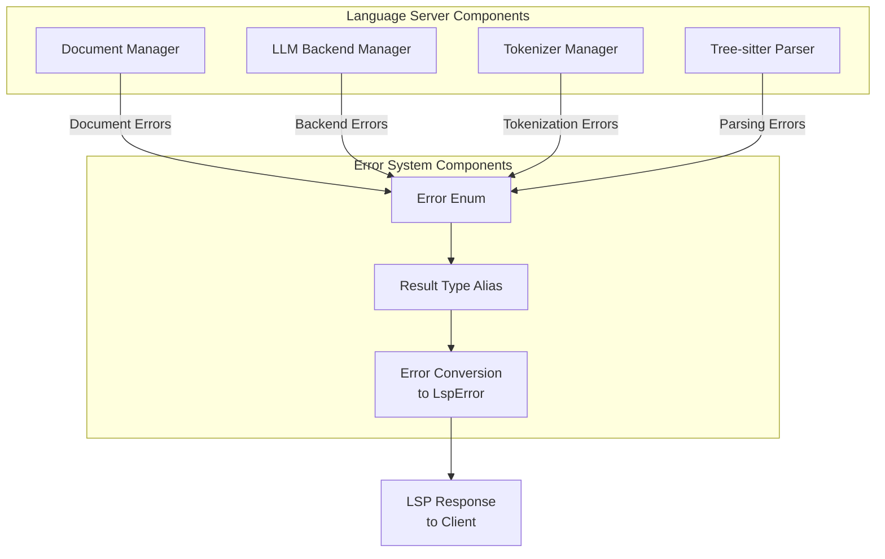
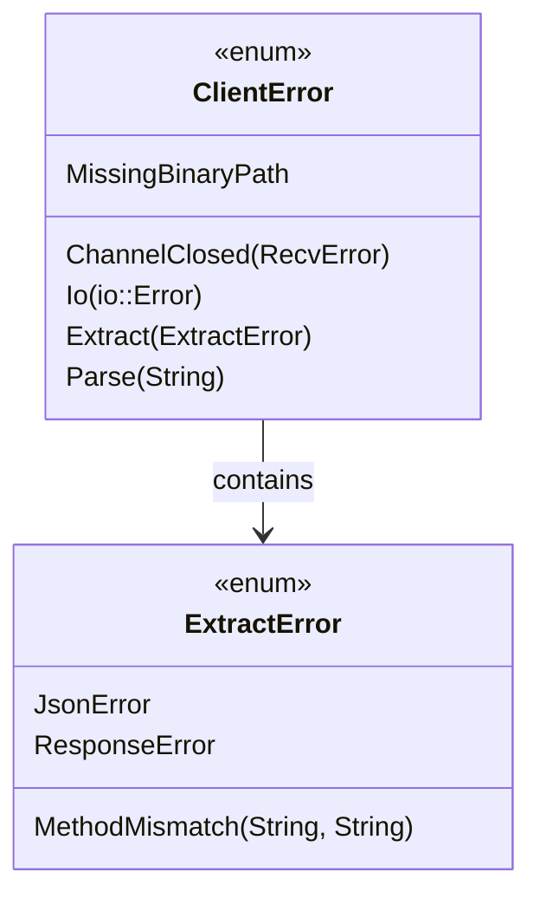

<!-- source: DeepWiki mcp.deepwiki.com · repo huggingface/llm-ls · page 2.2 Error Handling · fetched 2026-10-26 -->

# Error Handling

<details>
<summary>Relevant source files</summary>

The following files were used as context for generating this wiki page:

- [crates/llm-ls/src/error.rs](crates/llm-ls/src/error.rs)
- [crates/lsp-client/src/error.rs](crates/lsp-client/src/error.rs)

</details>


## Purpose and Scope

This document describes the error handling system implemented in the llm-ls language server. It covers the error types, conversion mechanisms, and propagation patterns used throughout the codebase. The focus is on server-side error handling within the language server component.

## Core Error System

The error handling system in llm-ls is built around a central `Error` enum that provides a comprehensive set of error types that can occur during language server operation.



Sources: [crates/llm-ls/src/error.rs:16-66]()

The `Error` enum is implemented using the `thiserror` crate, which automatically generates appropriate implementations of the `Error` trait including error messages based on the attributes provided.

## Error Categories

The error variants can be categorized into several functional groups that align with the system components:

| Category | Error Variants | Description |
|----------|----------------|-------------|
| Backend Errors | `InferenceApi`, `InvalidBackend`, `LlamaCpp`, `Ollama`, `OpenAI`, `Tgi`, `UnknownBackend` | Errors relating to LLM backends |
| Document Errors | `InvalidRange`, `OutOfBoundIndexing`, `OutOfBoundLine`, `OutOfBoundSlice`, `Rope` | Errors in document management |
| Parsing Errors | `SerdeJson`, `TreeSitterParsing`, `TreeSitterLanguage` | Errors in parsing code or JSON |
| Network Errors | `Http`, `InvalidHeaderValue` | Errors in HTTP communication |
| System Errors | `Io`, `TokioJoin` | General I/O and concurrency errors |
| Configuration Errors | `EncodingKindMissing`, `InvalidRepositoryId`, `InvalidTokenizerPath`, `UnknownEncodingKind` | Errors in server configuration |
| Tokenization Errors | `Tokenizer` | Errors in the tokenization process |

Sources: [crates/llm-ls/src/error.rs:16-66]()

## Error Flow Architecture

The following diagram illustrates how errors flow through the language server system:



Sources: [crates/llm-ls/src/error.rs:6-14](), [crates/llm-ls/src/error.rs:70-74]()

## Result Type and Error Conversion

For convenience and consistency, llm-ls defines a `Result<T>` type alias:

```rust
pub(crate) type Result<T> = std::result::Result<T, Error>;
```

This alias is used throughout the codebase for functions that can fail.

When errors need to be communicated to the client through the LSP protocol, they are converted to `LspError` using the `From<Error> for LspError` trait implementation:



Sources: [crates/llm-ls/src/error.rs:6-14](), [crates/llm-ls/src/error.rs:70-74]()

The implementation uses the `internal_error` function, which:
1. Converts the error to a string message
2. Logs the error using the `tracing` crate
3. Creates a new `LspError` with the `InternalError` code

```rust
pub(crate) fn internal_error<E: Display>(err: E) -> LspError {
    let err_msg = err.to_string();
    error!(err_msg);
    LspError {
        code: tower_lsp::jsonrpc::ErrorCode::InternalError,
        message: err_msg.into(),
        data: None,
    }
}
```

Sources: [crates/llm-ls/src/error.rs:6-14]()

## Integration with System Components

The error handling system integrates with various components of the language server:



Sources: [crates/llm-ls/src/error.rs:16-66]()

Each component in the language server can produce specific types of errors:

1. **Document Manager**: Can produce `InvalidRange`, `OutOfBoundIndexing`, `OutOfBoundLine`, `OutOfBoundSlice`, and `Rope` errors.
2. **LLM Backend Manager**: Can produce `InferenceApi`, `InvalidBackend`, `LlamaCpp`, `Ollama`, `OpenAI`, `Tgi`, and `UnknownBackend` errors.
3. **Tokenizer Manager**: Can produce `Tokenizer` and `EncodingKindMissing` errors.
4. **Tree-sitter Parser**: Can produce `TreeSitterParsing` and `TreeSitterLanguage` errors.

## Best Practices for Error Handling in llm-ls

When extending or modifying the llm-ls codebase, follow these error handling practices:

1. **Use the `Error` enum**: Add new error variants to the central `Error` enum rather than creating new error types.
2. **Implement `From` traits**: For wrapping errors from external libraries.
3. **Use descriptive error messages**: With the `#[error("...")]` attribute.
4. **Use the `Result<T>` type alias**: For consistency throughout the codebase.
5. **Propagate errors using `?`**: Let errors bubble up until they can be properly handled.
6. **Log errors at appropriate levels**: Use the `tracing` crate's macros.

Sources: [crates/llm-ls/src/error.rs:16-66](), [crates/llm-ls/src/error.rs:68]()

## Client-Side Error Handling

The LSP client implements its own error handling system, defined separately from the server-side system:



Sources: [crates/lsp-client/src/error.rs:64-86](), [crates/lsp-client/src/error.rs:19-62]()

The client error system is designed to handle failures in communicating with the language server, including protocol errors, message extraction issues, and IO problems.

## Summary

The error handling system in llm-ls provides a robust and consistent way to represent, propagate, and communicate errors. By centralizing errors in a single enum and providing convenient conversion mechanisms, the system makes error handling more uniform and predictable throughout the codebase.

The integration with the LSP protocol ensures that errors are properly communicated to clients, while the use of the `tracing` crate enables effective error logging and debugging.

---

