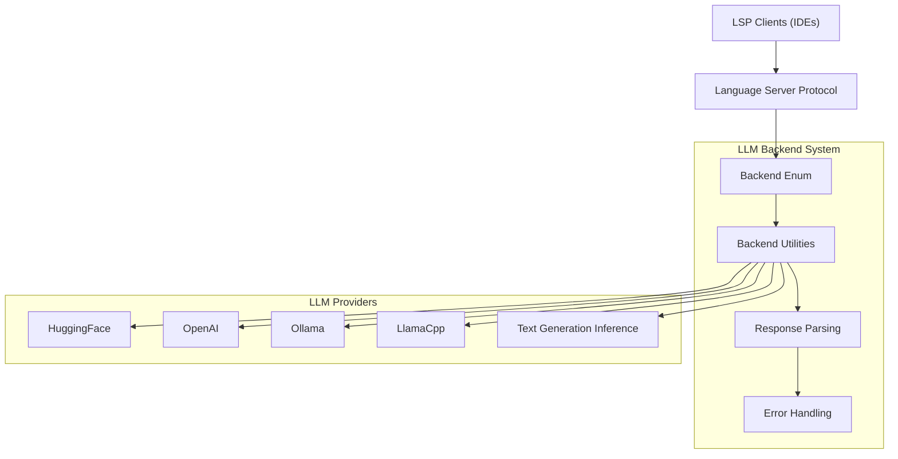
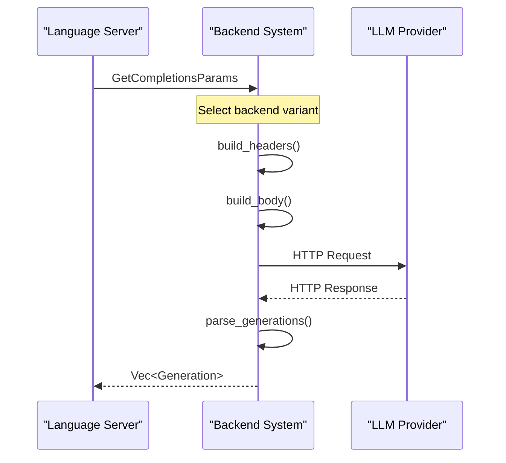
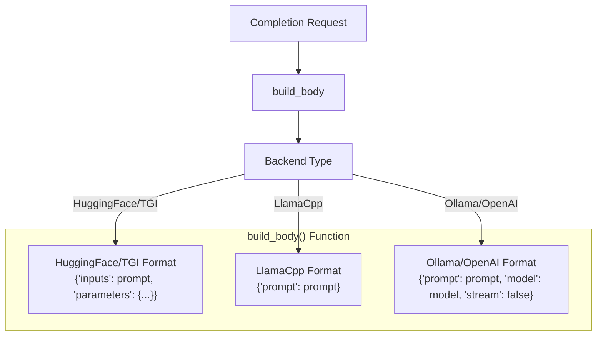

<!-- source: DeepWiki mcp.deepwiki.com · repo huggingface/llm-ls · page 3 LLM Backend System · fetched 2026-10-26 -->

# LLM Backend System

<details>
<summary>Relevant source files</summary>

The following files were used as context for generating this wiki page:

- [crates/custom-types/src/llm_ls.rs](crates/custom-types/src/llm_ls.rs)
- [crates/llm-ls/src/backend.rs](crates/llm-ls/src/backend.rs)

</details>


## Purpose and Scope

This document details the LLM Backend System within the llm-ls project, which provides a unified interface to communicate with different Large Language Model providers. The system handles connection, request formatting, response parsing, and error handling for multiple backend services. For information about how these backends are exposed through custom LSP protocol extensions, see [Custom LSP Protocol Extensions](#3.1).

## System Overview

The LLM Backend System enables the language server to interact with multiple LLM providers through a common interface. This abstraction allows clients to seamlessly switch between different backend services without changing the core code completion logic.



Sources: [crates/custom-types/src/llm_ls.rs:63-109](), [crates/llm-ls/src/backend.rs:1-33]()

## Backend Enum Implementation

The system defines a `Backend` enum representing the different supported LLM providers. Each variant contains the URL to connect to the service.

```mermaid
classDiagram
    class "Backend" {
        <<enum>>
        HuggingFace { url: String }
        LlamaCpp { url: String }
        Ollama { url: String }
        OpenAi { url: String }
        Tgi { url: String }
        +is_using_inference_api() bool
        +url() String
    }
```

Sources: [crates/custom-types/src/llm_ls.rs:63-109]()

The `Backend` enum provides these key methods:
- `is_using_inference_api()`: Determines if the backend is using the Hugging Face Inference API
- `url()`: Returns the URL configured for the backend

## Supported Backend Providers

The system currently supports five LLM backend providers:

| Backend | Description | URL Configuration |
|---------|-------------|------------------|
| HuggingFace | Hugging Face's Inference API | Default: `https://api-inference.huggingface.co` |
| LlamaCpp | Local LLama.cpp server | Custom URL required |
| Ollama | Ollama API for local models | Custom URL required |
| OpenAI | OpenAI API | Custom URL required |
| TGI | Text Generation Inference | Custom URL required |

Sources: [crates/custom-types/src/llm_ls.rs:63-109](), [crates/custom-types/src/llm_ls.rs:8-9]()

## Request/Response Flow

The LLM Backend System handles the full lifecycle of communicating with LLM providers:



Sources: [crates/llm-ls/src/backend.rs:210-260]()

## Request Construction

The system constructs appropriate HTTP requests for each backend provider. This includes building:

1. Request bodies with `build_body()`
2. HTTP headers with `build_headers()`

Each backend requires different request formats:



Sources: [crates/llm-ls/src/backend.rs:210-236]()

## Response Parsing

After receiving responses from the LLM providers, the system parses them into a common format using the `parse_generations()` function, which delegates to backend-specific parsers:

| Backend | Parser Function | Response Structure |
|---------|----------------|-------------------|
| HuggingFace | `parse_api_text()` | `Generation` or `Vec<Generation>` |
| LlamaCpp | `parse_llamacpp_text()` | `LlamaCppGeneration` → `Generation` |
| Ollama | `parse_ollama_text()` | `OllamaGeneration` → `Generation` |
| OpenAI | `parse_openai_text()` | `OpenAIGeneration.choices` → `Vec<Generation>` |
| TGI | `parse_tgi_text()` | `Generation` |

Sources: [crates/llm-ls/src/backend.rs:50-207](), [crates/llm-ls/src/backend.rs:252-260]()

## Error Handling

Each backend has specialized error handling to deal with service-specific error responses:

```mermaid
classDiagram
    class "APIError" {
        +error: String
        +description() &str
        +fmt() Result
    }
    
    class "OpenAIError" {
        +detail: Vec<OpenAIErrorDetail>
        +fmt() Result
    }
    
    class "OpenAIErrorDetail" {
        +loc: OpenAIErrorLoc
        +msg: String
        +type: String
    }
    
    class "APIResponse" {
        <<enum>>
        +Generation(Generation)
        +Generations(Vec<Generation>)
        +Error(APIError)
    }
    
    APIResponse --> APIError
    OpenAIError --> OpenAIErrorDetail
```

Sources: [crates/llm-ls/src/backend.rs:10-207]()

## Configuration

The system offers extensive configuration options through the `GetCompletionsParams` struct:

| Parameter | Description |
|-----------|-------------|
| `text_document_position` | Position in the document |
| `ide` | IDE being used |
| `fim` | Fill-in-the-Middle parameters |
| `api_token` | Authentication token |
| `model` | LLM model to use |
| `backend` | Backend provider configuration |
| `tokens_to_clear` | Tokens to remove from completions |
| `tokenizer_config` | Configuration for the tokenizer |
| `context_window` | Maximum context window size |
| `tls_skip_verify_insecure` | Flag to skip TLS verification |
| `request_body` | Additional request parameters |
| `disable_url_path_completion` | Flag to disable URL path completion |

Sources: [crates/custom-types/src/llm_ls.rs:136-156]()

## Integration with Language Server

The LLM Backend System is used by the language server to fulfill code completion requests. When a client requests completions, the server:

1. Constructs a `GetCompletionsParams` object
2. Sends a request to the appropriate backend
3. Parses the response into a list of completions
4. Returns the completions to the client

This integration enables the core functionality of the language server - providing code completions from large language models.

Sources: [crates/custom-types/src/llm_ls.rs:159-167]()

---

