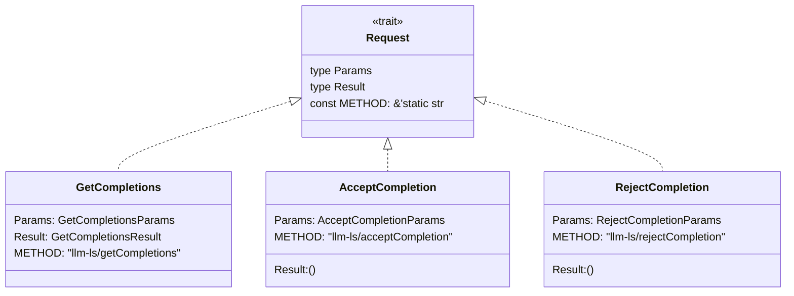
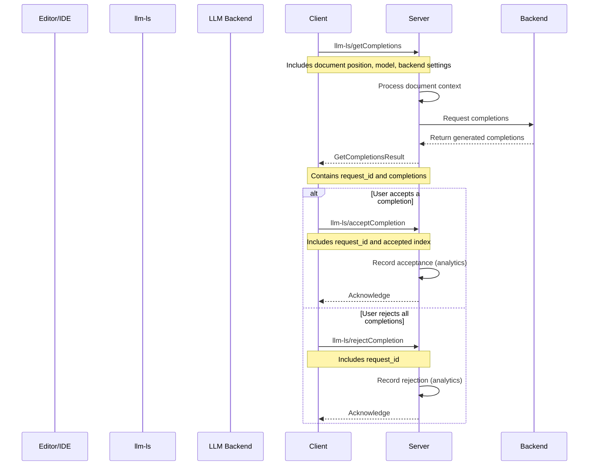
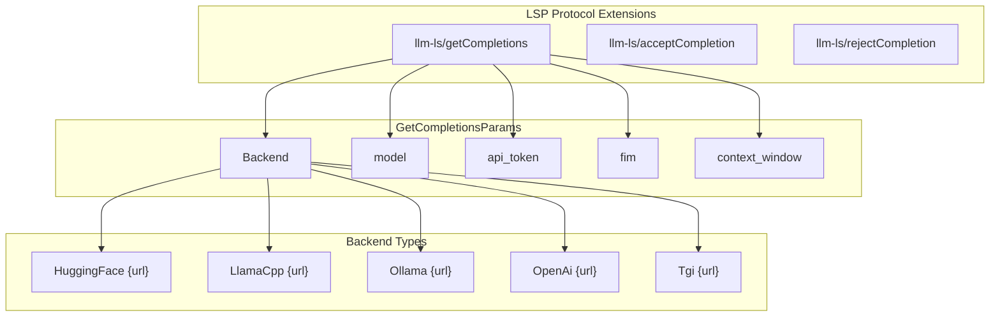

<!-- source: DeepWiki mcp.deepwiki.com · repo huggingface/llm-ls · page 3.1 Custom LSP Protocol Extensions · fetched 2026-10-26 -->

# Custom LSP Protocol Extensions

<details>
<summary>Relevant source files</summary>

The following files were used as context for generating this wiki page:

- [crates/custom-types/Cargo.toml](crates/custom-types/Cargo.toml)
- [crates/custom-types/src/lib.rs](crates/custom-types/src/lib.rs)
- [crates/custom-types/src/llm_ls.rs](crates/custom-types/src/llm_ls.rs)
- [crates/custom-types/src/request.rs](crates/custom-types/src/request.rs)

</details>


This page describes the custom Language Server Protocol (LSP) extensions implemented by llm-ls to support LLM-powered code completions. The standard LSP specification does not include methods for requesting AI-generated code completions or providing feedback on those completions, so llm-ls extends the protocol with custom methods to enable these interactions.

For information about the overall Language Server architecture, see [Language Server (llm-ls)](#2). For details on how the system interacts with different LLM backends, see [LLM Backend System](#3).

## Custom LSP Request Types Overview

llm-ls extends the LSP with three custom request types:



Sources: [crates/custom-types/src/request.rs:1-32]()

These custom requests form a complete interaction cycle:
1. Client requests completions with `getCompletions`
2. Server returns completion suggestions
3. Client either accepts a specific completion with `acceptCompletion` or rejects all completions with `rejectCompletion`

## GetCompletions Request

The `getCompletions` request is the primary method for obtaining code completions from an LLM.

### Request Definition

```
Method: llm-ls/getCompletions
Params: GetCompletionsParams
Result: GetCompletionsResult
```

Sources: [crates/custom-types/src/request.rs:8-14]()

### Parameters Structure

The `GetCompletionsParams` structure contains all the information needed to generate relevant code completions:

```mermaid
classDiagram
    class GetCompletionsParams {
        text_document_position: TextDocumentPositionParams
        ide: Ide
        fim: FimParams
        api_token: Option~String~
        model: String
        backend: Backend
        tokens_to_clear: Vec~String~
        tokenizer_config: Option~TokenizerConfig~
        context_window: usize
        tls_skip_verify_insecure: bool
        request_body: Map~String, Value~
        disable_url_path_completion: bool
    }
    
    class TextDocumentPositionParams {
        textDocument: TextDocumentIdentifier
        position: Position
    }
    
    class FimParams {
        enabled: bool
        prefix: String
        middle: String
        suffix: String
    }
    
    class Backend {
        <<enum>>
        HuggingFace {url: String}
        LlamaCpp {url: String}
        Ollama {url: String}
        OpenAi {url: String}
        Tgi {url: String}
    }
    
    class TokenizerConfig {
        <<enum>>
        Local {path: PathBuf}
        HuggingFace {repository: String, api_token: Option~String~}
        Download {url: String, to: PathBuf}
    }
    
    GetCompletionsParams --> TextDocumentPositionParams
    GetCompletionsParams --> FimParams
    GetCompletionsParams --> Backend
    GetCompletionsParams --> TokenizerConfig
```

Sources: [crates/custom-types/src/llm_ls.rs:135-156](), [crates/custom-types/src/llm_ls.rs:63-109](), [crates/custom-types/src/llm_ls.rs:111-117](), [crates/custom-types/src/llm_ls.rs:119-133]()

Key parameters include:

| Parameter | Type | Description |
|-----------|------|-------------|
| `text_document_position` | TextDocumentPositionParams | Standard LSP parameter identifying document and cursor position |
| `ide` | Ide | The editor/IDE making the request (VSCode, Neovim, etc.) |
| `fim` | FimParams | Fill-in-the-Middle parameters for prompt formatting |
| `api_token` | Option\<String\> | Optional token for LLM API authentication |
| `model` | String | The specific LLM model to use |
| `backend` | Backend | Which LLM backend to use (HuggingFace, OpenAI, etc.) |
| `context_window` | usize | Maximum context window size for the LLM |
| `tokenizer_config` | Option\<TokenizerConfig\> | Configuration for the tokenizer |

### Response Structure

The response to a `getCompletions` request is a `GetCompletionsResult` containing completion suggestions:

```
GetCompletionsResult {
    request_id: Uuid,
    completions: Vec<Completion>
}

Completion {
    generated_text: String
}
```

Sources: [crates/custom-types/src/llm_ls.rs:158-167]()

The `request_id` is a unique identifier for the completion request, which is used in subsequent `acceptCompletion` or `rejectCompletion` requests to reference the original completions.

## AcceptCompletion Request

The `acceptCompletion` request allows clients to indicate that a specific completion was accepted by the user.

### Request Definition

```
Method: llm-ls/acceptCompletion
Params: AcceptCompletionParams
Result: () (void)
```

Sources: [crates/custom-types/src/request.rs:16-23]()

### Parameters Structure

```
AcceptCompletionParams {
    request_id: Uuid,
    accepted_completion: u32,
    shown_completions: Vec<u32>
}
```

Sources: [crates/custom-types/src/llm_ls.rs:10-16]()

- `request_id`: The UUID of the original `getCompletions` request
- `accepted_completion`: The index of the completion that was accepted
- `shown_completions`: Indices of all completions that were shown to the user

This information can be used by the server for analytics and to improve future completions.

## RejectCompletion Request

The `rejectCompletion` request allows clients to indicate that all suggested completions were rejected.

### Request Definition

```
Method: llm-ls/rejectCompletion
Params: RejectCompletionParams
Result: () (void)
```

Sources: [crates/custom-types/src/request.rs:25-32]()

### Parameters Structure

```
RejectCompletionParams {
    request_id: Uuid,
    shown_completions: Vec<u32>
}
```

Sources: [crates/custom-types/src/llm_ls.rs:18-23]()

- `request_id`: The UUID of the original `getCompletions` request
- `shown_completions`: Indices of all completions that were shown to the user

## Completion Workflow

The following sequence diagram illustrates the complete workflow of a code completion cycle using the custom LSP extensions:



Sources: [crates/custom-types/src/request.rs:1-32](), [crates/custom-types/src/llm_ls.rs:10-23](), [crates/custom-types/src/llm_ls.rs:135-167]()

## Integration with LLM Backend System

The custom LSP requests integrate with the LLM backend system (described in [LLM Backend System](#3)) through the parameters in the `getCompletions` request:



Sources: [crates/custom-types/src/llm_ls.rs:63-109](), [crates/custom-types/src/llm_ls.rs:135-156]()

The `Backend` enum in the parameters allows the client to specify which LLM backend to use, along with the required configuration (like URL endpoints).

## Summary

The custom LSP protocol extensions implemented by llm-ls enable:

1. Rich interactions between code editors and LLM backends
2. Request configurations tailored to different LLM providers
3. User feedback mechanism through accept/reject requests
4. A complete end-to-end workflow for LLM-powered code completions

These extensions are essential for the functionality of llm-ls, as they provide capabilities beyond what the standard LSP protocol offers, specifically designed for LLM-based code assistance.

---

