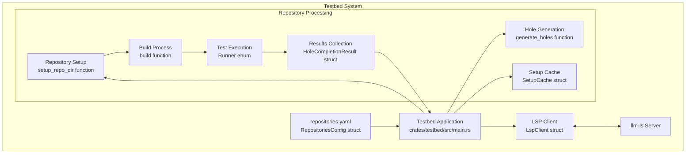
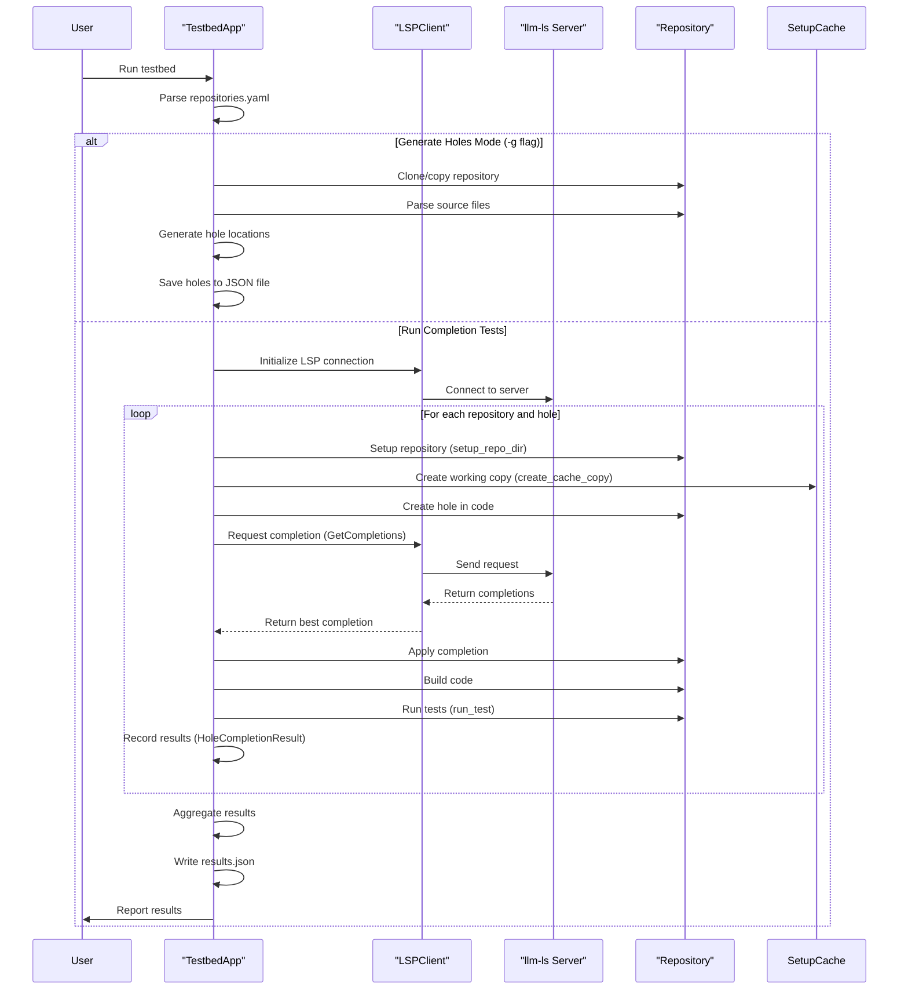
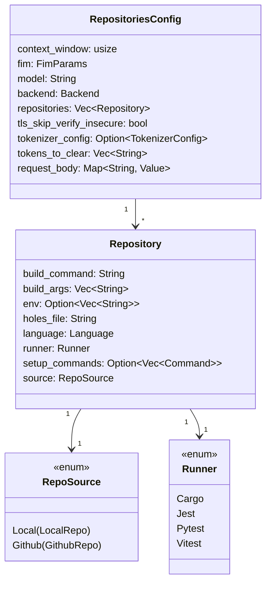
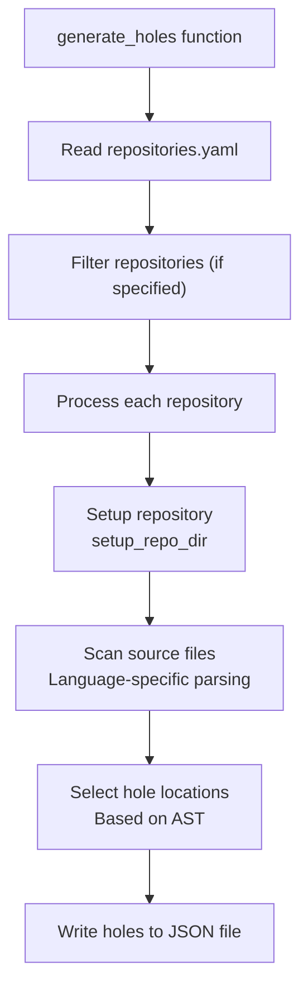
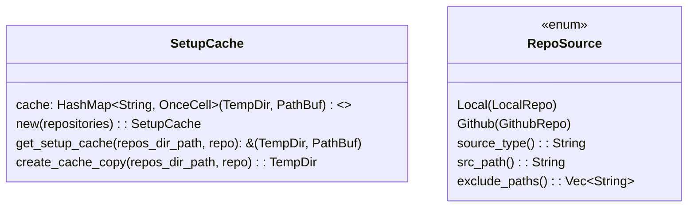
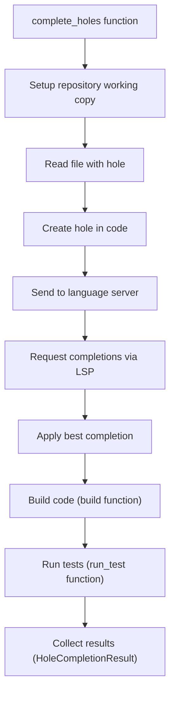
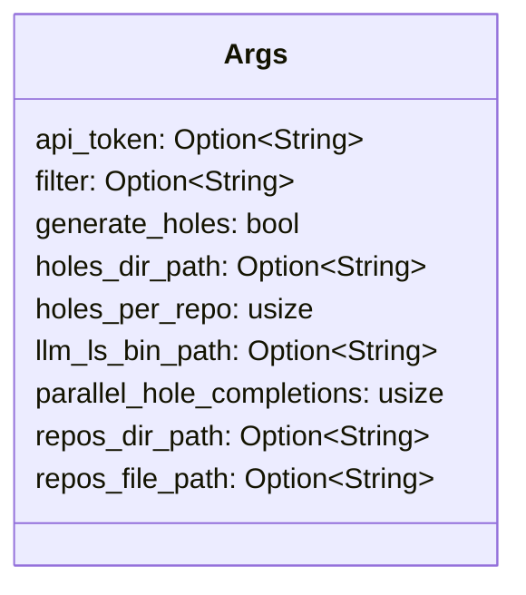
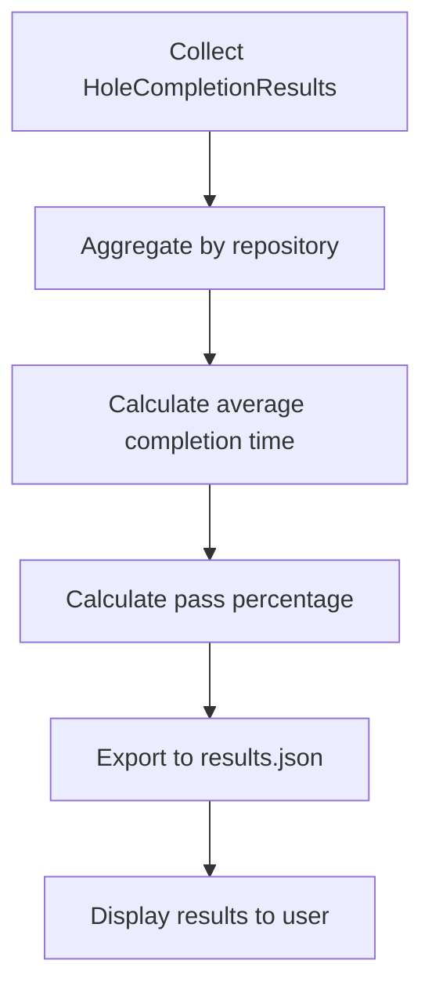

<!-- source: DeepWiki mcp.deepwiki.com · repo huggingface/llm-ls · page 4 Testbed Framework · fetched 2026-10-26 -->

# Testbed Framework

<details>
<summary>Relevant source files</summary>

The following files were used as context for generating this wiki page:

- [crates/testbed/README.md](crates/testbed/README.md)
- [crates/testbed/repositories.yaml](crates/testbed/repositories.yaml)
- [crates/testbed/src/main.rs](crates/testbed/src/main.rs)

</details>


## Purpose and Scope

The Testbed Framework provides a systematic approach for evaluating code completions generated by llm-ls. It creates "holes" in existing code from real-world repositories, requests completions from the language server, and validates them by checking if the completed code successfully builds and passes tests. This document covers the architecture, configuration, and workflow of the testbed system, explaining how it handles repositories, generates holes, processes completions, and analyzes results.

For information about the LLM Backend System that provides the completions, see [LLM Backend System](#3).

Sources: [crates/testbed/README.md:1-3]()

## Architecture Overview



The Testbed Framework consists of several key components that work together to evaluate code completions:

1. **Configuration**: Defined in `repositories.yaml`, specifying repositories, language model parameters, and test settings.
2. **Testbed Application**: Coordinates the evaluation process, implemented in `main.rs`.
3. **LSP Client**: Interfaces with the llm-ls server using the Language Server Protocol.
4. **Repository Management**: Handles repository setup, hole generation, and caching.
5. **Build and Test**: Validates completions by building code and running tests.
6. **Results Collection**: Gathers metrics on completion quality and performance.

Sources: [crates/testbed/src/main.rs:1-50](), [crates/testbed/README.md:9-23]()

## Evaluation Workflow



The testbed operates in two modes:

1. **Hole Generation Mode**: Creates "holes" in code where completions will be tested.
2. **Completion Evaluation Mode**: Tests the language model's ability to fill those holes with working code.

The workflow is designed to parallelize the completion process, using a semaphore to control concurrency and a caching mechanism to avoid redundant repository setup.

Sources: [crates/testbed/src/main.rs:606-780](), [crates/testbed/README.md:35-38]()

## Repository Configuration

The Testbed Framework uses a YAML configuration file to define repositories and testing parameters.



### Global Configuration

The configuration file includes global settings for the language model and completion parameters:

| Parameter | Description |
|-----------|-------------|
| `context_window` | Maximum token context for the model |
| `fim` | Fill-in-the-Middle prompt parameters |
| `model` | Model identifier (e.g., "bigcode/starcoder") |
| `backend` | LLM backend (huggingface, openai, etc.) |
| `request_body` | Model-specific parameters (temperature, tokens, etc.) |

### Repository Configuration

Each repository in the configuration includes:

| Parameter | Description |
|-----------|-------------|
| `source` | Repository location (local or GitHub) |
| `build_command` | Command to build the code |
| `build_args` | Arguments for the build command |
| `language` | Programming language (rust, python, etc.) |
| `runner` | Test runner (cargo, pytest, jest, vitest) |
| `setup_commands` | Commands to prepare the environment |
| `holes_file` | JSON file storing hole locations |

Sources: [crates/testbed/repositories.yaml:1-133](), [crates/testbed/src/main.rs:92-166]()

## Hole Generation System

Holes represent locations in the code where text has been removed and needs to be completed. The testbed first generates these holes, then later tests completions at these locations.



The `Hole` struct represents a specific location in code:

```rust
struct Hole {
    cursor: lsp_types::Position,  // Line and character position
    file: String,                 // Relative file path
}
```

The hole generation process:
1. Sets up each repository (local or GitHub)
2. Scans source files for suitable hole locations
3. Selects a specified number of locations (default: 100 per repository)
4. Writes hole locations to JSON files for later use

Sources: [crates/testbed/src/main.rs:168-192](), [crates/testbed/README.md:35-38]()

## Repository Setup and Caching

The testbed implements an efficient caching mechanism to avoid redundant repository setup operations.



The repository setup process:

1. **Initial Setup**: For each repository, creates a temporary directory with the repository contents.
   - For local repositories: copies files from the local path
   - For GitHub repositories: downloads and extracts the archive

2. **Setup Caching**: The `SetupCache` struct maintains a cache of set-up repositories.
   - First access: performs full setup and stores the result
   - Subsequent access: returns the cached result

3. **Working Copies**: For each hole completion, creates a fresh working copy from the cached setup.

This approach significantly improves performance by avoiding repetitive setup operations while ensuring isolated environments for each completion test.

Sources: [crates/testbed/src/main.rs:238-282](), [crates/testbed/src/main.rs:358-377](), [crates/testbed/README.md:39-49]()

## Completion Evaluation Process

The core of the testbed is the completion evaluation process, which tests how well the language model can fill code holes.



The completion evaluation process follows these steps:

1. **Preparation**:
   - Creates a working copy of the repository
   - Reads the file containing the hole
   - Makes the hole by removing code at the specified position

2. **Completion**:
   - Opens the file in the language server
   - Sends a `GetCompletions` request to the specified position
   - Receives completion suggestions

3. **Validation**:
   - Applies the best completion to the file
   - Builds the code using the repository's build command
   - Runs tests using the specified test runner
   - Records the percentage of tests that pass

4. **Restoration**:
   - Restores the original file content
   - Returns results for aggregation

Sources: [crates/testbed/src/main.rs:471-604](), [crates/testbed/README.md:9-23]()

## Build and Test Execution

After applying a completion, the testbed validates it by building the code and running tests.

### Build Process

The `build` function executes the repository's build command and captures the result:

```rust
async fn build(
    command: &str,
    args: &Vec<String>,
    env: &Option<Vec<String>>,
    repo_path: impl AsRef<Path>,
) -> anyhow::Result<bool>
```

The function returns `true` if the build succeeds, `false` otherwise.

### Test Runners

The testbed supports four test runners:

| Runner | Description |
|--------|-------------|
| `cargo` | For Rust projects |
| `pytest` | For Python projects |
| `jest` | For JavaScript/TypeScript projects |
| `vitest` | For JavaScript/TypeScript projects |

The `run_test` function executes the appropriate test runner and calculates the percentage of tests that pass.

### Results Collection

Results are collected in the `HoleCompletionResult` struct:

```rust
struct HoleCompletionResult {
    repo_name: String,
    repo_source_type: String,
    pass_percentage: f32,
    completion_time_ms: u128,
}
```

The results are aggregated by repository and exported to a JSON file.

Sources: [crates/testbed/src/main.rs:434-462](), [crates/testbed/README.md:61-77]()

## Command Line Interface

The testbed provides a command-line interface with several options:



Key command-line options:

| Option | Description |
|--------|-------------|
| `-g, --generate-holes` | Generate holes instead of running completions |
| `-n, --holes-per-repo` | Number of holes to create per repository (default: 100) |
| `-f, --filter` | Comma-separated list of repositories to include |
| `-p, --parallel-hole-completions` | Number of concurrent completions (default: 8) |
| `-a, --api-token` | Hugging Face Inference API token |

Basic usage:

1. Generate holes:
   ```bash
   cargo run -p testbed -- -g -n 100
   ```

2. Run completion tests:
   ```bash
   cargo run -p testbed
   ```

Sources: [crates/testbed/src/main.rs:51-90](), [crates/testbed/README.md:25-34]()

## Results Analysis

The testbed collects metrics for each hole completion and aggregates them by repository:



The final output includes:

1. **Repository-level metrics**:
   - Average pass percentage
   - Average completion time in milliseconds

2. **JSON output**:
   - Written to `results.json`
   - Contains detailed metrics for each repository
   - Can be used for further analysis or visualization

The performance of a language model is primarily measured by the percentage of completions that result in code that builds and passes tests.

Sources: [crates/testbed/src/main.rs:736-771]()

## Practical Usage Example

This is how a typical evaluation workflow would look:

1. **Create or modify repositories configuration**:
   ```yaml
   # repositories.yaml
   context_window: 2000
   fim:
     enabled: true
     prefix: <fim_prefix>
     middle: <fim_middle>
     suffix: <fim_suffix>
   model: bigcode/starcoder
   backend: huggingface
   request_body:
     max_new_tokens: 150
     temperature: 0.2
   repositories:
     - source:
         type: github
         owner: huggingface
         name: huggingface_hub
         revision: a48eb89d4186bc84bca67b117cf29a0ee0b69774
       build_command: huggingface_hub-venv/bin/python3
       build_args: ["-m", "compileall", "-q", "."]
       language: python
       runner: pytest
   ```

2. **Generate holes**:
   ```bash
   cargo run -p testbed -- -g -n 50
   ```

3. **Run completion evaluations**:
   ```bash
   cargo run -p testbed -- -p 16
   ```

4. **Analyze results in the generated JSON file**.

Sources: [crates/testbed/repositories.yaml:1-63](), [crates/testbed/README.md:25-34]()

## Limitations and Future Enhancements

The current testbed framework has some limitations:

1. **Line-level focus**: Currently optimized for single-line completions rather than multi-line blocks.
2. **Binary success metric**: Tests either pass or fail, with no nuance for code quality.
3. **Test dependency**: Effectiveness depends on the quality of the repository's test suite.
4. **Language support**: Limited by the languages supported by llm-ls.

Potential future enhancements:

1. **Multi-line completion support**: Evaluating more complex code completion scenarios.
2. **Qualitative metrics**: Measuring code style, efficiency, and maintainability.
3. **Expanded repository coverage**: Including more diverse codebases and languages.
4. **Interactive evaluation**: Allowing human reviewers to compare and rate completions.

Sources: [crates/testbed/README.md:81-83]()

---

