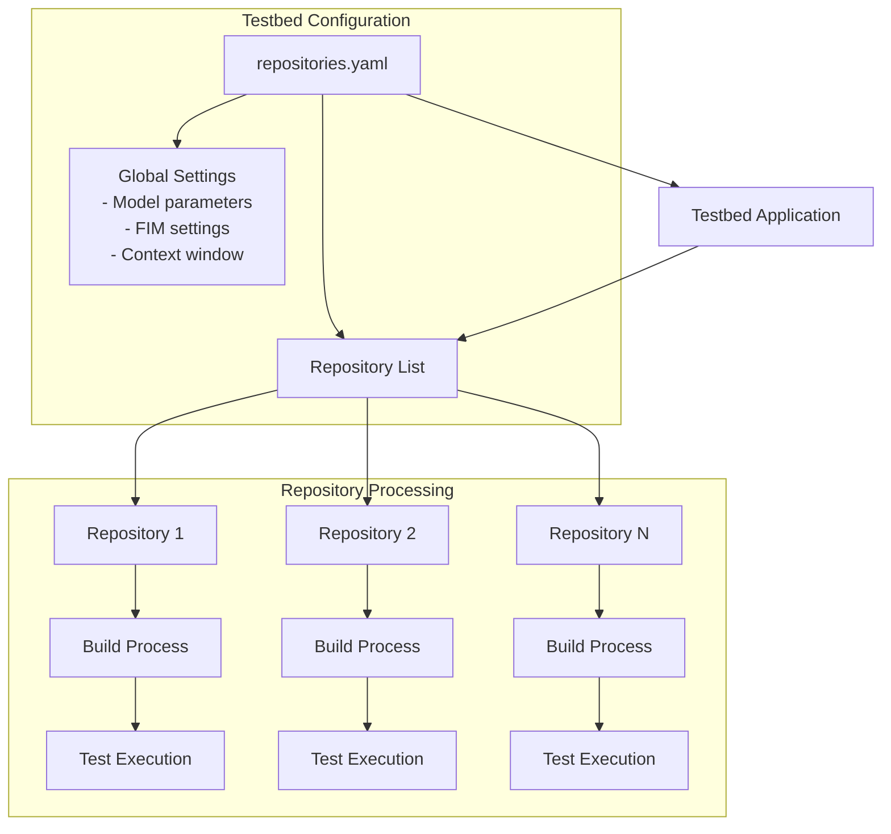
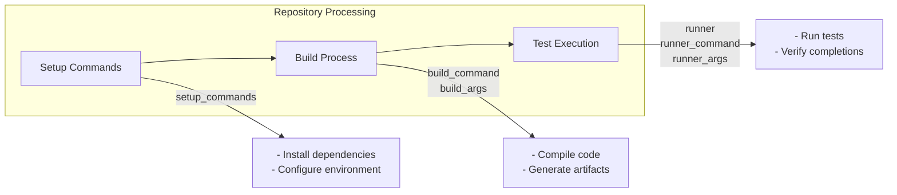
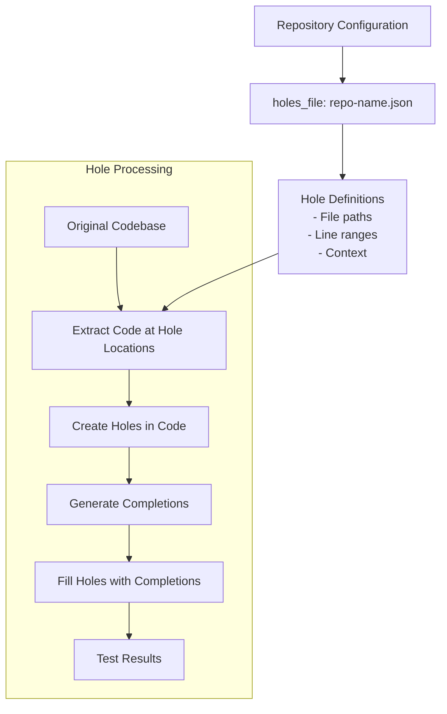
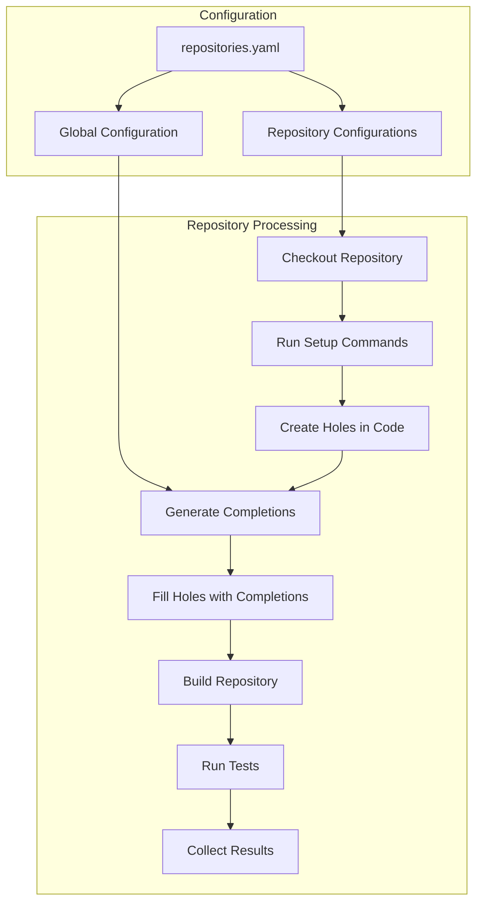

<!-- source: DeepWiki mcp.deepwiki.com · repo huggingface/llm-ls · page 4.1 Repository Configuration · fetched 2026-10-26 -->

# Repository Configuration

<details>
<summary>Relevant source files</summary>

The following files were used as context for generating this wiki page:

- [crates/testbed/repositories-ci.yaml](crates/testbed/repositories-ci.yaml)
- [crates/testbed/repositories.yaml](crates/testbed/repositories.yaml)

</details>


This document details how to configure repositories for testing in the llm-ls testbed framework. The testbed system evaluates code completions by creating "holes" in existing codebases, generating completions through the language server, and verifying if the generated code successfully builds and passes tests.

For information about the evaluation methodology and hole creation, see [Evaluation Methodology](#4.2).

## Overview of Repository Configuration

The repository configuration defines both global settings for the LLM and specific settings for each repository to be tested. This configuration is specified in a YAML file (typically `repositories.yaml` or `repositories-ci.yaml`) that serves as the primary input to the testbed application.



Sources: [crates/testbed/repositories.yaml:1-250](), [crates/testbed/repositories-ci.yaml:1-250]()

## Global Configuration Parameters

The first section of the repository configuration file contains global settings that apply to all repositories:

| Parameter | Description | Example Value |
|-----------|-------------|---------------|
| `context_window` | Maximum token context window size | `2000` |
| `fim.enabled` | Enable Fill-in-the-Middle format | `true` |
| `fim.prefix` | Prefix token for FIM prompt | `<PRE>` |
| `fim.middle` | Middle token for FIM prompt | `<MID>` |
| `fim.suffix` | Suffix token for FIM prompt | `<SUF>` |
| `model` | LLM model to use | `codellama/CodeLlama-13b-hf` |
| `backend` | LLM backend provider | `huggingface` |
| `request_body` | Parameters for the LLM request | |
| `tls_skip_verify_insecure` | Skip TLS verification | `false` |
| `tokenizer_config` | Configuration for the tokenizer | |
| `tokens_to_clear` | Tokens to remove from completions | `["<EOT>"]` |
| `disable_url_path_completion` | Disable URL path completion | `false` |

Example of global configuration:

```yaml
context_window: 2000
fim:
  enabled: true
  prefix: "<PRE> "
  middle: " <MID>"
  suffix: " <SUF>"
model: codellama/CodeLlama-13b-hf
backend: huggingface
request_body:
  max_new_tokens: 150
  temperature: 0.2
  do_sample: true
  top_p: 0.95
tls_skip_verify_insecure: false
tokenizer_config:
  repository: codellama/CodeLlama-13b-hf
tokens_to_clear: ["<EOT>"]
disable_url_path_completion: false
```

Sources: [crates/testbed/repositories.yaml:1-19](), [crates/testbed/repositories-ci.yaml:1-19]()

## Repository Definition Structure

Under the `repositories` key, a list of repository configurations is defined. Each repository entry contains detailed information about how to fetch, build, and test the codebase.

```mermaid
classDiagram
    class "Repository Configuration" {
        source: SourceConfig
        build_command: String
        build_args: String[]
        language: String
        runner: String
        runner_command: String
        runner_extra_args: String[]
        setup_commands: Command[]
        holes_file: String
        exclude_paths: String[]
    }
    
    class "SourceConfig" {
        type: "local" | "github"
        path: String
        src_path: String
        owner: String
        name: String
        revision: String
        exclude_paths: String[]
    }
    
    class "Command" {
        command: String
        args: String[]
    }
    
    "Repository Configuration" --> "SourceConfig" : contains
    "Repository Configuration" --> "Command" : contains many
```

Sources: [crates/testbed/repositories.yaml:20-250](), [crates/testbed/repositories-ci.yaml:20-250]()

## Source Configuration

Each repository requires a source configuration that defines where and how to fetch the code. Two types of sources are supported:

### Local Source

Used for testing with a local repository:

```yaml
source:
  type: local
  path: simple
  src_path: src
```

| Parameter | Description |
|-----------|-------------|
| `type` | Set to `local` for local repositories |
| `path` | Local path to the repository |
| `src_path` | Path to the source code within the repository |

### GitHub Source

Used for fetching repositories from GitHub:

```yaml
source:
  type: github
  owner: huggingface
  name: huggingface_hub
  revision: a48eb89d4186bc84bca67b117cf29a0ee0b69774
  src_path: src/huggingface_hub
  exclude_paths:
    - path1
    - path2
```

| Parameter | Description |
|-----------|-------------|
| `type` | Set to `github` for GitHub repositories |
| `owner` | GitHub repository owner |
| `name` | GitHub repository name |
| `revision` | Specific commit hash or branch to use |
| `src_path` | Path to the source code within the repository |
| `exclude_paths` | Optional list of paths to exclude |

Sources: [crates/testbed/repositories.yaml:21-36](), [crates/testbed/repositories.yaml:47-52](), [crates/testbed/repositories-ci.yaml:21-36](), [crates/testbed/repositories-ci.yaml:47-52]()

## Build and Test Configuration

For each repository, you need to specify how to build and test the code:



### Build Configuration

| Parameter | Description | Example |
|-----------|-------------|---------|
| `build_command` | Command to build the repository | `cargo` |
| `build_args` | Arguments for the build command | `["build"]` |

### Test Configuration

| Parameter | Description | Example |
|-----------|-------------|---------|
| `runner` | Type of test runner | `pytest` |
| `runner_command` | Optional command to use for running tests | `picklescan-venv/bin/python3` |
| `runner_args` | Arguments for the test runner | `["test", "--", "--no-colors"]` |
| `runner_extra_args` | Additional arguments for the test runner | `["-k", "_utils_"]` |

Sources: [crates/testbed/repositories.yaml:36-40](), [crates/testbed/repositories.yaml:52-62](), [crates/testbed/repositories-ci.yaml:36-40](), [crates/testbed/repositories-ci.yaml:52-62]()

## Language Configuration

The `language` parameter specifies the programming language of the repository. This information is essential for the language server to provide accurate code completions. Supported languages include:

| Language | Value | Example Repository |
|----------|-------|-------------------|
| Rust | `rust` | lancedb, async-executor |
| Python | `python` | picklescan, huggingface_hub |
| TypeScript | `typescript` | io-ts, zod |

Example configuration for a Rust project:
```yaml
language: rust
runner: cargo
```

Example configuration for a Python project:
```yaml
language: python
runner: pytest
runner_command: picklescan-venv/bin/python3
```

Example configuration for a TypeScript project:
```yaml
language: typescript
runner: jest
runner_command: yarn
runner_args: ["test", "--", "--no-colors"]
```

Sources: [crates/testbed/repositories.yaml:38-39](), [crates/testbed/repositories.yaml:54-56](), [crates/testbed/repositories.yaml:181-183](), [crates/testbed/repositories-ci.yaml:38-39](), [crates/testbed/repositories-ci.yaml:54-56](), [crates/testbed/repositories-ci.yaml:181-183]()

## Setup Commands

Setup commands are executed before building and testing the repository. They prepare the environment, install dependencies, and perform any necessary setup steps:

```yaml
setup_commands:
  - ["python3", ["-m", "venv", "picklescan-venv"]]
  - ["picklescan-venv/bin/python3", ["-m", "pip", "install", "."]]
  - ["picklescan-venv/bin/python3", ["-m", "pip", "install", "-r", "requirements.txt"]]
```

Each setup command is an array where:
- The first element is the command to execute
- The second element is an array of arguments for the command

Common setup commands include:
- Creating virtual environments for Python projects
- Installing dependencies
- Configuring the build environment
- Performing one-time initialization tasks

Sources: [crates/testbed/repositories.yaml:41-44](), [crates/testbed/repositories.yaml:60-62](), [crates/testbed/repositories-ci.yaml:41-44](), [crates/testbed/repositories-ci.yaml:60-62]()

## Holes Configuration

Each repository requires a `holes_file` parameter that points to a JSON file containing definitions of "holes" to be created in the codebase:

```yaml
holes_file: picklescan.json
```

In the CI version, smaller hole sets are used:

```yaml
holes_file: picklescan-smol.json
```

These JSON files define specific locations in the code where content will be removed and replaced with completions generated by the language server. The evaluation process then verifies if these completions allow the code to build and pass tests.



Sources: [crates/testbed/repositories.yaml:45](), [crates/testbed/repositories.yaml:63](), [crates/testbed/repositories-ci.yaml:45](), [crates/testbed/repositories-ci.yaml:63]()

## Exclusion Paths

For complex repositories, you can specify paths to exclude from processing. This is particularly useful for large repositories where only a subset of the code needs to be tested:

```yaml
exclude_paths:
  - .cargo
  - .github
  - book
  - contrib
  - docs
  - helix-core/tests
  - ...
```

Excluded paths are not processed when creating holes or evaluating completions. This can significantly improve performance by focusing only on relevant parts of the codebase.

Sources: [crates/testbed/repositories.yaml:117-122](), [crates/testbed/repositories.yaml:193](), [crates/testbed/repositories.yaml:208-242](), [crates/testbed/repositories-ci.yaml:117-122](), [crates/testbed/repositories-ci.yaml:193](), [crates/testbed/repositories-ci.yaml:208-242]()

## Complete Example

Below is a complete example of a repository configuration for a Python project:

```yaml
- source:
    type: github
    owner: huggingface
    name: huggingface_hub
    revision: a48eb89d4186bc84bca67b117cf29a0ee0b69774
    src_path: src/huggingface_hub
  build_command: huggingface_hub-venv/bin/python3
  build_args: ["-m", "compileall", "-q", "."]
  language: python
  runner: pytest
  runner_command: huggingface_hub-venv/bin/python3
  runner_extra_args:
    - "-k"
    - "_utils_ and not _utils_cache and not _utils_http and not paginate and not git"
  setup_commands:
    - ["python3", ["-m", "venv", "huggingface_hub-venv"]]
    - ["huggingface_hub-venv/bin/python3", ["-m", "pip", "install", ".[dev]"]]
  holes_file: huggingface_hub.json
```

Sources: [crates/testbed/repositories.yaml:46-63](), [crates/testbed/repositories-ci.yaml:46-63]()

## Repository Configuration Flow

The following diagram illustrates how repository configuration fits into the overall testbed workflow:



Sources: [crates/testbed/repositories.yaml:1-250](), [crates/testbed/repositories-ci.yaml:1-250]()

---

