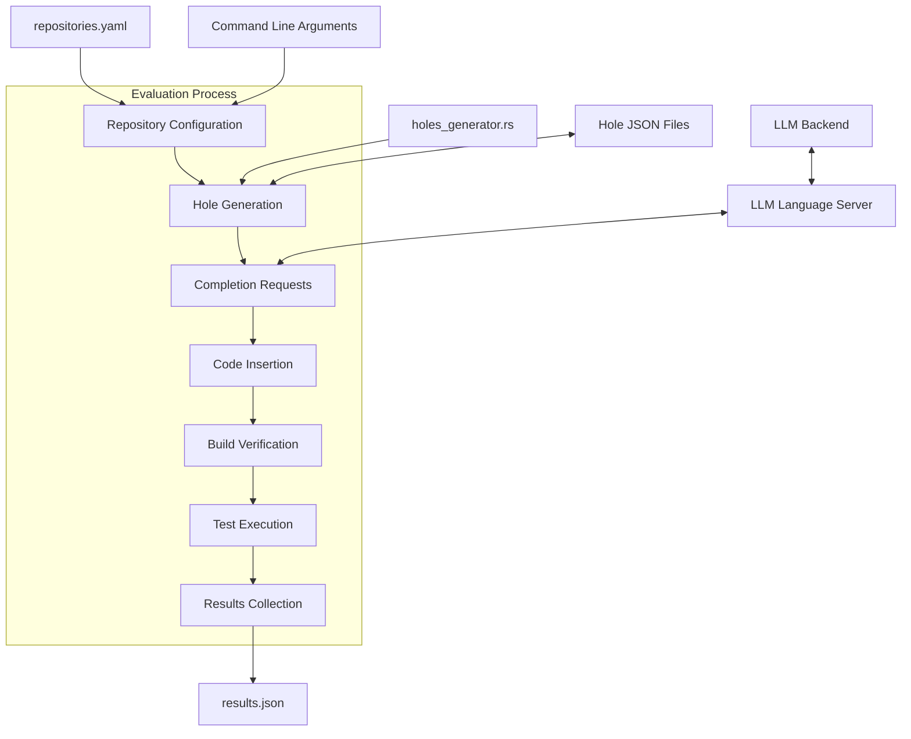
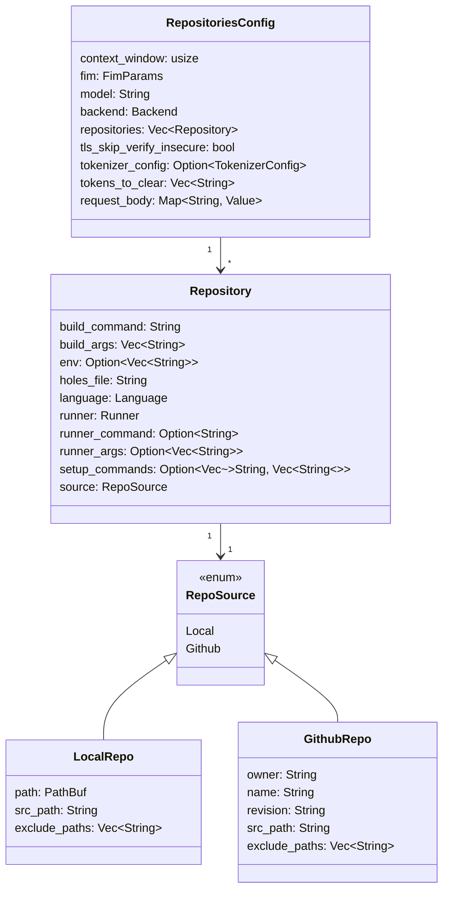
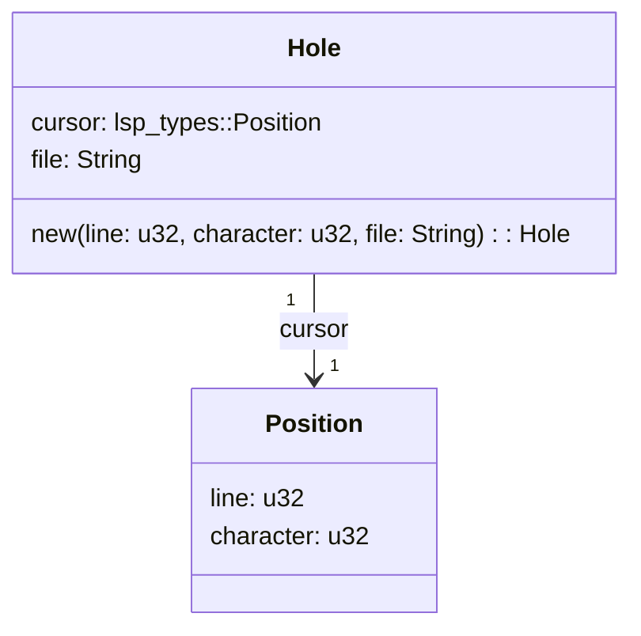
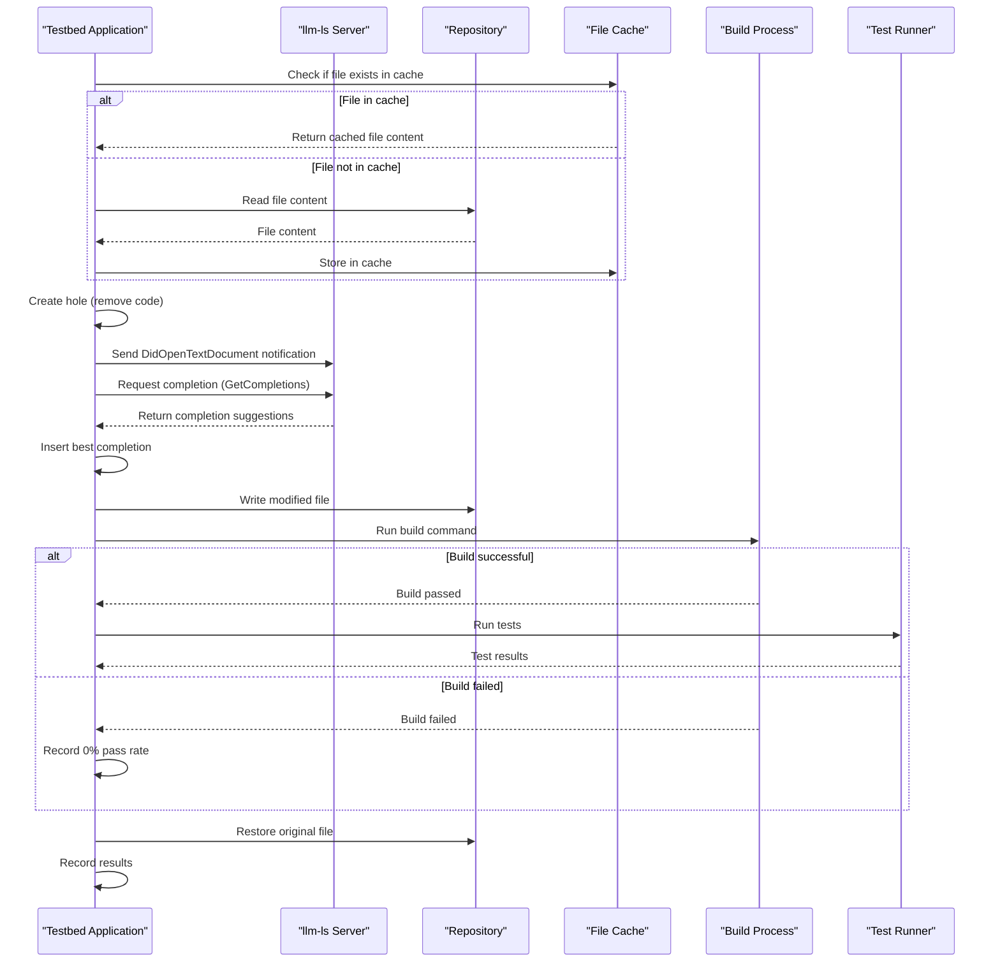
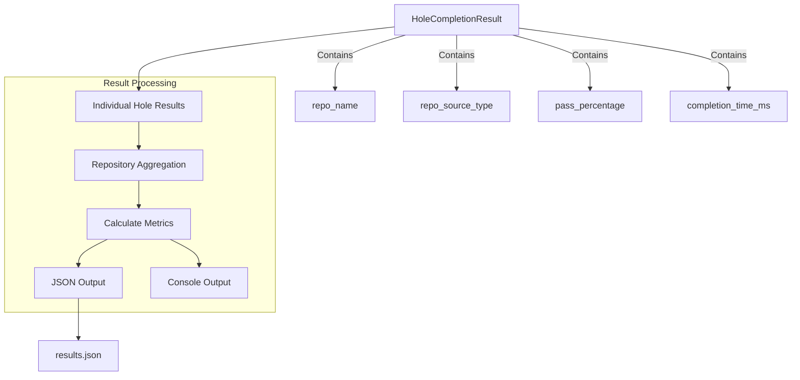

<!-- source: DeepWiki mcp.deepwiki.com · repo huggingface/llm-ls · page 4.2 Evaluation Methodology · fetched 2026-10-26 -->

# Evaluation Methodology

Relevant source files

The following files were used as context for generating this wiki page:

- [crates/testbed/holes/helix-smol.json](crates/testbed/holes/helix-smol.json)
- [crates/testbed/holes/helix.json](crates/testbed/holes/helix.json)
- [crates/testbed/src/main.rs](crates/testbed/src/main.rs)

## Purpose and Scope

This document describes the methodology used in the testbed framework to evaluate the effectiveness of code completions provided by llm-ls. It covers how test repositories are configured, how "code holes" are generated, how completions are evaluated through build and test execution, and how results are collected and reported. For information about repository configuration specifically, see [Repository Configuration](#4.1).

## Evaluation Process Overview

The testbed framework implements a systematic approach to evaluate code completion quality across different repositories. It creates "holes" (deliberate code omissions) in existing code, requests completions from the llm-ls server to fill these holes, and then verifies if the completed code builds successfully and passes tests.

Sources: [crates/testbed/src/main.rs:51-90](), [crates/testbed/src/main.rs:606-780]()

## Repository Setup and Configuration

The testbed uses a YAML configuration file to define repositories for testing and their associated build/test commands. Repositories can be local or sourced from GitHub. Each repository includes specific configuration for build commands, test runners, and code locations.

Sources: [crates/testbed/src/main.rs:92-166](), [crates/testbed/src/main.rs:200-213]()

## Code Hole Generation

Holes represent specific points in code files where content is removed and later filled by the code completion system. The testbed can create these holes automatically using the `--generate-holes` flag or use previously generated hole files.

### Hole Structure

A hole is defined by:
- A file path relative to the repository
- A cursor position (line and character)
- The content to be removed (automatically determined during processing)

Sources: [crates/testbed/src/main.rs:168-182](), [crates/testbed/holes/helix.json:1-1]()

The hole files are stored as JSON arrays containing multiple hole definitions. Example of a hole file structure:

| Field | Type | Description |
|-------|------|-------------|
| cursor | Object | Contains line and character position |
| cursor.line | u32 | Line number (0-indexed) |
| cursor.character | u32 | Character position on line (0-indexed) |
| file | String | Relative file path within repository |

Sources: [crates/testbed/holes/helix.json:1-1](), [crates/testbed/holes/helix-smol.json:1-1]()

## Completion Evaluation Process

The evaluation process tests how well the llm-ls server can fill in the missing code. The process follows these steps:

Sources: [crates/testbed/src/main.rs:472-604]()

## Execution Environment

The testbed creates isolated environments for each repository to ensure consistency and prevent cross-contamination between tests:

1. For each repository, the testbed:
   - Creates a temporary directory
   - Copies or clones the repository
   - Runs setup commands if specified
   - Caches the prepared repository to improve performance

2. For each hole completion:
   - Creates a new working copy from the cached repository
   - Applies and evaluates the completion
   - Reports results

Sources: [crates/testbed/src/main.rs:238-356](), [crates/testbed/src/main.rs:472-604]()

## Result Collection and Reporting

Results are collected per hole and aggregated per repository. The metrics include:

| Metric | Description |
|--------|-------------|
| Pass Percentage | Percentage of tests that pass after completion |
| Average Completion Time | Average time (in ms) taken to generate and evaluate completions |
| Repository Source Type | Whether the repository is local or from GitHub |

The final results are output to the console and saved to a `results.json` file.

Sources: [crates/testbed/src/main.rs:216-236](), [crates/testbed/src/main.rs:736-771]()

## Command-Line Options

The testbed supports various command-line options to configure the evaluation process:

| Option | Description |
|--------|-------------|
| `--api-token` | Hugging Face Inference API Token |
| `--filter` | Comma-separated list of repositories to evaluate |
| `--generate-holes` | Generate hole files instead of running evaluations |
| `--holes-dir-path` | Path to directory containing hole files |
| `--holes-per-repo` | Number of holes to create per repository |
| `--llm-ls-bin-path` | Path to llm-ls binary |
| `--parallel-hole-completions` | Number of concurrent hole completions |
| `--repos-dir-path` | Path to local repositories directory |
| `--repos-file-path` | Path to repositories.yaml configuration |

Sources: [crates/testbed/src/main.rs:51-90]()

## Parallelism and Performance

The testbed uses asynchronous processing and parallelism to improve performance:

1. Multiple hole completions can run in parallel (controlled by `--parallel-hole-completions`)
2. Each repository is set up only once and cached for subsequent holes
3. File contents are cached to minimize disk I/O
4. A semaphore controls resource usage to prevent overloading the system

Sources: [crates/testbed/src/main.rs:238-282](), [crates/testbed/src/main.rs:684-721]()

## Integration with llm-ls

The testbed interacts with the llm-ls language server through the Language Server Protocol (LSP):

1. Starts the llm-ls server as a child process
2. Communicates using standard LSP messages
3. Uses custom LSP extensions for retrieving completions
4. Provides the server with necessary context (file content, cursor position)

Sources: [crates/testbed/src/main.rs:666-676](), [crates/testbed/src/main.rs:544-562]()

---

