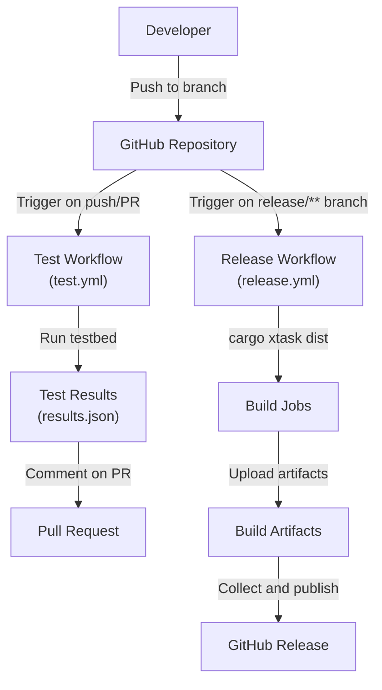
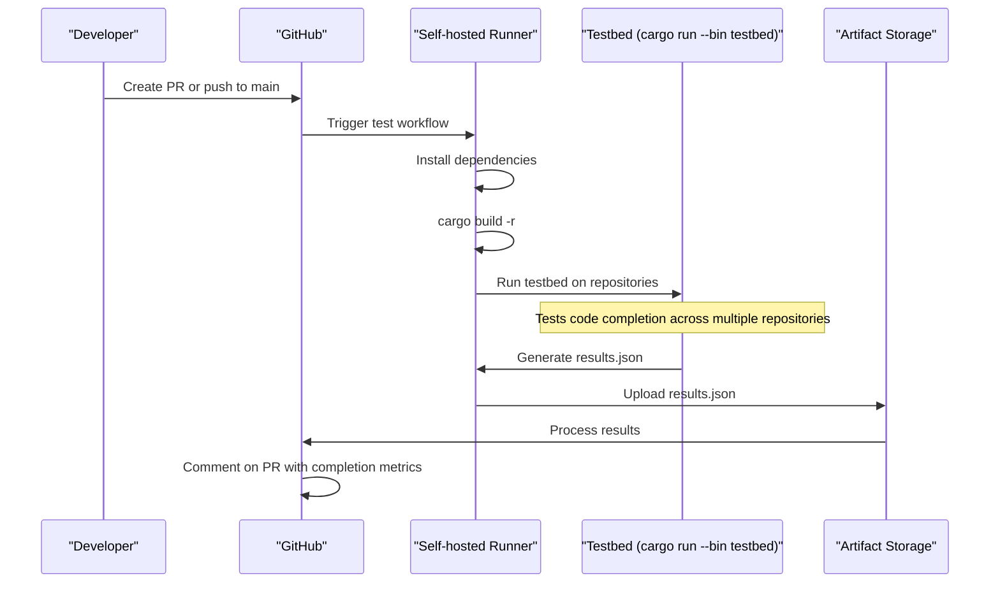
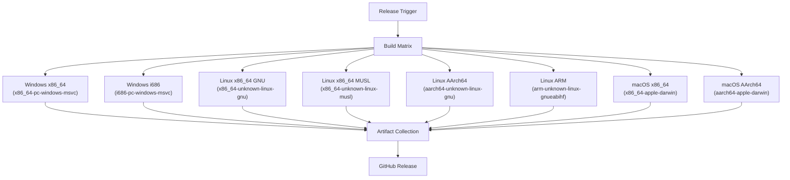
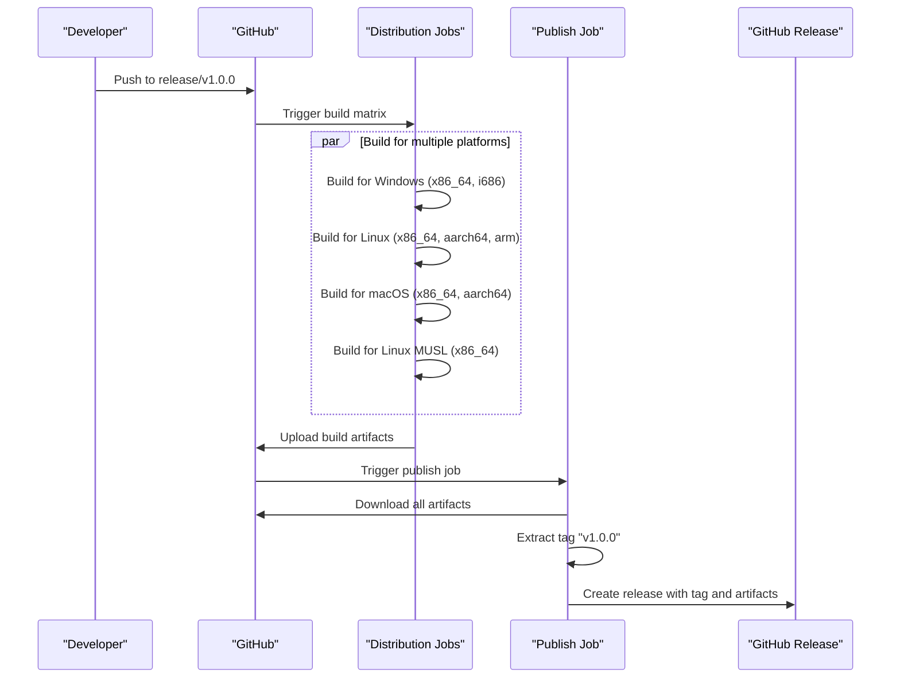
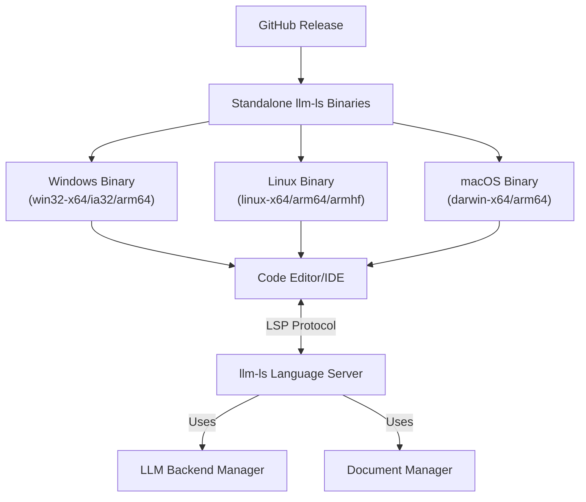

<!-- source: DeepWiki mcp.deepwiki.com · repo huggingface/llm-ls · page 5 Building and Deployment · fetched 2026-10-26 -->

# Building and Deployment

<details>
<summary>Relevant source files</summary>

The following files were used as context for generating this wiki page:

- [.github/workflows/release.yml](.github/workflows/release.yml)
- [.github/workflows/test.yml](.github/workflows/test.yml)
- [.gitignore](.gitignore)
- [crates/lsp-client/src/msg.rs](crates/lsp-client/src/msg.rs)

</details>


This document provides technical documentation on the build process, CI/CD pipeline, and release procedures for the llm-ls language server. It covers how to build the project locally and explains the automated systems that handle testing and release deployments.

## Local Build Process

The llm-ls project uses Cargo, Rust's package manager and build system. The repository produces a language server binary that can be integrated with code editors supporting the Language Server Protocol.

### Basic Build Commands

For development builds:
```bash
cargo build
```

For optimized release builds:
```bash
cargo build --release
```

Build artifacts are generated in the `target/` directory, which is excluded from version control as specified in [.gitignore:3]().

### Distribution Packaging

The project includes a custom xtask for creating distribution packages:

```bash
cargo xtask dist
```

This command creates distribution-ready binaries in the `dist/` directory, which is also excluded from version control per [.gitignore:2]().

## CI/CD Pipeline Overview

The project utilizes GitHub Actions for continuous integration and deployment with two primary workflows:



Sources: [.github/workflows/release.yml:1-181](), [.github/workflows/test.yml:1-211]()

## Test Workflow

The test workflow defined in [.github/workflows/test.yml]() is triggered on:
- Pushes to the main branch
- Pull requests
- Manual workflow dispatch

This workflow runs the testbed evaluation system against a configured set of repositories to validate code completion functionality:



Sources: [.github/workflows/test.yml:13-97](), [.github/workflows/test.yml:98-211]()

The test workflow uses a matrix strategy to test against multiple repositories in parallel, with each repository configured with specific parameters for parallelism and environment requirements.

## Release Process

The release workflow defined in [.github/workflows/release.yml]() is triggered:
- Manually via workflow dispatch
- Automatically when pushing to branches with the prefix 'release/'

### Cross-Platform Build Matrix

The release process uses a build matrix to simultaneously compile binaries for multiple target platforms:



Sources: [.github/workflows/release.yml:19-47](), [.github/workflows/release.yml:88-116]()

### Build and Publish Process

Each job in the release workflow follows these steps:

1. Checks out the repository with the appropriate fetch depth to access tags
2. Installs the Rust toolchain for the target platform
3. For Linux targets, installs necessary cross-compilation tools
4. Runs `cargo xtask dist` to build the distribution package
5. Uploads the built artifacts

After all builds complete, the publish job:

1. Downloads all artifacts from the build jobs
2. Extracts the version tag from the branch name
3. Creates a GitHub release with the collected artifacts



Sources: [.github/workflows/release.yml:55-116](), [.github/workflows/release.yml:118-181]()

## Binary Deployment and Integration

The produced binaries from the release process are standalone executable files that implement the Language Server Protocol. These can be integrated with any compatible code editor or IDE.



Sources: [.github/workflows/release.yml:19-47]()

### Integration Process

To deploy llm-ls with a compatible editor:

1. Download the appropriate binary for your platform from GitHub Releases
2. Place the binary in a location on your system's PATH or in a designated location for your editor's language server integrations
3. Configure your editor to use the `llm-ls` binary as the language server for supported file types
4. The server will handle the LSP communication, including the custom methods defined for LLM interactions

## Environment Variables and Configuration

The build process uses several environment variables to control the build behavior:

| Environment Variable | Purpose |
|----------------------|---------|
| `CARGO_INCREMENTAL` | Controls Rust's incremental compilation |
| `CARGO_NET_RETRY` | Number of retry attempts for network operations |
| `RUSTFLAGS` | Compiler flags, such as warnings and error handling |
| `RUSTUP_MAX_RETRIES` | Maximum number of retries for rustup operations |
| `FETCH_DEPTH` | Git fetch depth for accessing tags |
| `LLM_LS_TARGET` | Target platform for cross-compilation |

Sources: [.github/workflows/release.yml:9-16](), [.github/workflows/release.yml:48-50]()

## Conclusion

The build and deployment system for llm-ls provides a comprehensive pipeline for testing, building, and releasing the language server across multiple platforms. The automated GitHub Actions workflows ensure that the project is rigorously tested before release and that binaries are available for all supported platforms, making it easy for users to integrate the language server with their preferred code editors.

---

