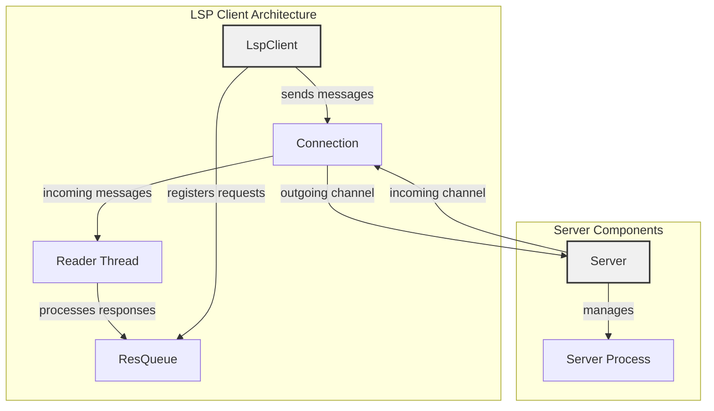
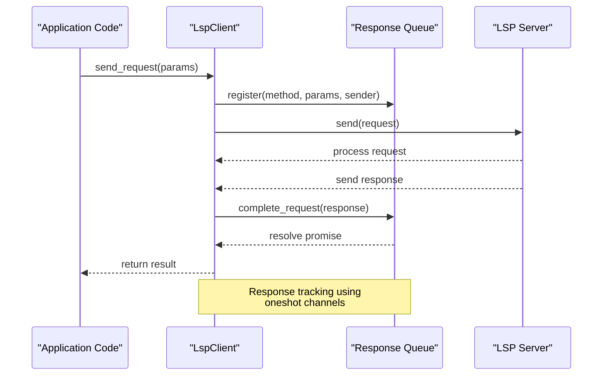
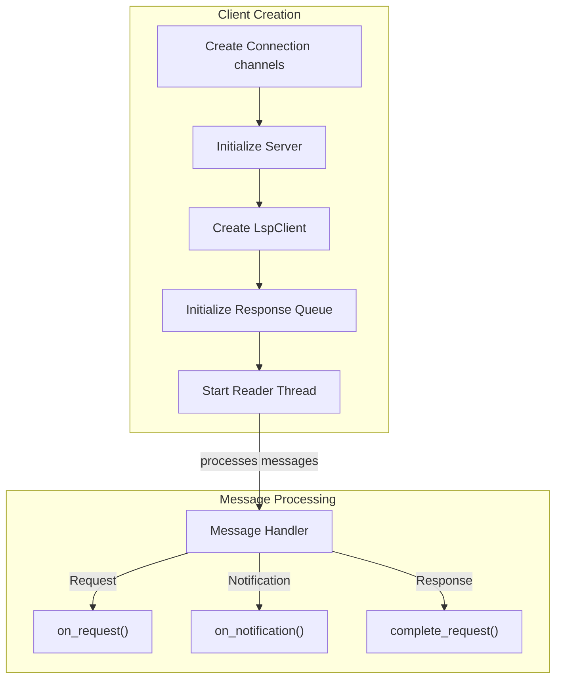
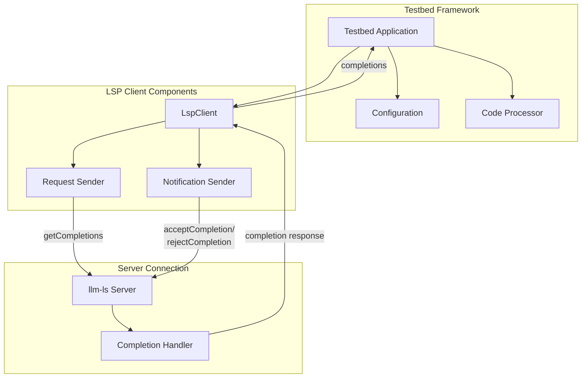

<!-- source: DeepWiki mcp.deepwiki.com · repo huggingface/llm-ls · page 6 LSP Client Implementation · fetched 2026-10-26 -->

# LSP Client Implementation

Relevant source files

The following files were used as context for generating this wiki page:

- [crates/lsp-client/Cargo.toml](crates/lsp-client/Cargo.toml)
- [crates/lsp-client/src/client.rs](crates/lsp-client/src/client.rs)
- [crates/testbed/Cargo.toml](crates/testbed/Cargo.toml)

## Purpose and Scope

This document describes the LSP Client implementation used within the `llm-ls` project. The client provides a programmatic Rust interface for communicating with the Language Server Protocol (LSP) server. This client is primarily used for automated testing in the testbed framework and for integration testing, rather than being a client for end-users. For information about the Language Server core implementation, see [Language Server (llm-ls)](#2).

## Architecture Overview

The LSP Client implementation follows a straightforward client-server communication model that adheres to the Language Server Protocol specification, with specific adaptations for the needs of the `llm-ls` project.

Sources:
- [crates/lsp-client/src/client.rs:13-47]()
- [crates/lsp-client/src/client.rs:58-73]()

## Key Components

### Connection

The `Connection` struct manages the bidirectional communication channels between the client and server:

- `sender`: Channel for outgoing messages from client to server
- `receiver`: Channel for incoming messages from server to client

### LspClient

The main client interface that provides methods for:

- Sending requests to the server
- Sending notifications
- Processing responses
- Managing server lifecycle (shutdown/exit)

### Request-Response System

The client implements an asynchronous request-response mechanism with request tracking:

Sources:
- [crates/lsp-client/src/client.rs:58-73]()
- [crates/lsp-client/src/client.rs:75-87]()

## Implementation Details

### Client Initialization

The client is created with a connection and server instance:

Sources:
- [crates/lsp-client/src/client.rs:27-48]()

### Request Handling

The client supports sending typed LSP requests and handling their responses:

1. Creates a oneshot channel for the response
2. Registers the request with a unique ID in the response queue
3. Sends the request to the server
4. Awaits the response on the channel
5. Extracts and returns the result

Sources:
- [crates/lsp-client/src/client.rs:58-73]()

### Notification Handling

For notifications (messages that don't require a response):

1. Creates a notification object with the LSP method name and parameters
2. Sends it to the server
3. No response tracking is needed

Sources:
- [crates/lsp-client/src/client.rs:89-92]()

### Server Lifecycle Management

The client provides methods to properly shutdown and exit the LSP server:

- `shutdown()`: Sends the LSP shutdown request
- `exit()`: Sends the exit notification and joins all threads

This ensures clean termination of both the client and server processes.

Sources:
- [crates/lsp-client/src/client.rs:94-126]()

## Usage in the Testbed Framework

The LSP Client is a critical component in the testbed framework, where it's used to evaluate code completions through automated testing.

In the testbed, the client is used to:

1. Connect to an `llm-ls` server instance
2. Request completions for code "holes"
3. Process and evaluate completion results
4. Send feedback (accept/reject) for completions

Sources:
- [crates/testbed/Cargo.toml:18]()

## Client Interface

The LSP Client provides a clean API for interacting with the server:

| Method | Purpose | LSP Method |
|--------|---------|------------|
| `send_request<R>` | Send a typed request and await response | Various (e.g., `textDocument/completion`) |
| `send_notification<N>` | Send a notification without response | Various (e.g., `textDocument/didOpen`) |
| `shutdown` | Request server shutdown | `shutdown` |
| `exit` | Notify server to exit and clean up resources | `exit` |

Sources:
- [crates/lsp-client/src/client.rs:58-130]()

## Error Handling

The client includes basic error handling for common scenarios:

1. Response tracking for unknown requests
2. Thread join errors when exiting
3. Server communication errors

When handling server responses, the client ensures that each response is matched to its corresponding request, reporting an error if a response arrives for an unknown request ID.

Sources:
- [crates/lsp-client/src/client.rs:75-87]()
- [crates/lsp-client/src/client.rs:103-126]()

## Dependencies

The LSP Client has minimal dependencies to maintain lightweight operation:

- `lsp-types`: For standard LSP protocol type definitions
- `tokio`: For asynchronous runtime and utilities
- `serde`/`serde_json`: For JSON serialization/deserialization
- `tracing`: For logging

Sources:
- [crates/lsp-client/Cargo.toml:10-15]()

## Integration with Custom LSP Extensions

While the LSP Client implements standard LSP protocol communication, it's also designed to work with the custom LSP extensions implemented by `llm-ls`. These extensions include:

- `llm-ls/getCompletions`
- `llm-ls/acceptCompletion`
- `llm-ls/rejectCompletion`

For more information about these custom extensions, see [Custom LSP Protocol Extensions](#3.1).

---

