# Page: Overview

# Overview

<details>
<summary>Relevant source files</summary>

The following files were used as context for generating this wiki page:

- [Cargo.lock](Cargo.lock)
- [Cargo.toml](Cargo.toml)
- [README.md](README.md)
- [crates/llm-ls/src/main.rs](crates/llm-ls/src/main.rs)

</details>


This page provides a comprehensive overview of the llm-ls (Language Server for LLM-Powered Code Completion) system. llm-ls is an implementation of the Language Server Protocol (LSP) that leverages Large Language Models to provide intelligent code completions across multiple programming languages and development environments.

For specific details about the language server implementation, see [Language Server (llm-ls)](#2). For information about the LLM backend integration, see [LLM Backend System](#3). For testing and evaluation, see [Testbed Framework](#4).

## Purpose and Design Goals

llm-ls serves as a common platform for IDE extensions, handling the complexities of LLM interactions so that extensions can remain lightweight. It aims to:

1. Provide contextually relevant code completions using LLMs
2. Support multiple LLM backends with a unified interface
3. Optimize prompt management with context-aware strategies
4. Integrate seamlessly with various programming languages and IDEs
5. Collect detailed telemetry for potential model improvements

Sources: [README.md:6-8](), [crates/llm-ls/src/main.rs:25-33]()

## System Architecture

The llm-ls system follows a modular architecture that separates concerns between language server functionality, document management, and LLM interaction.

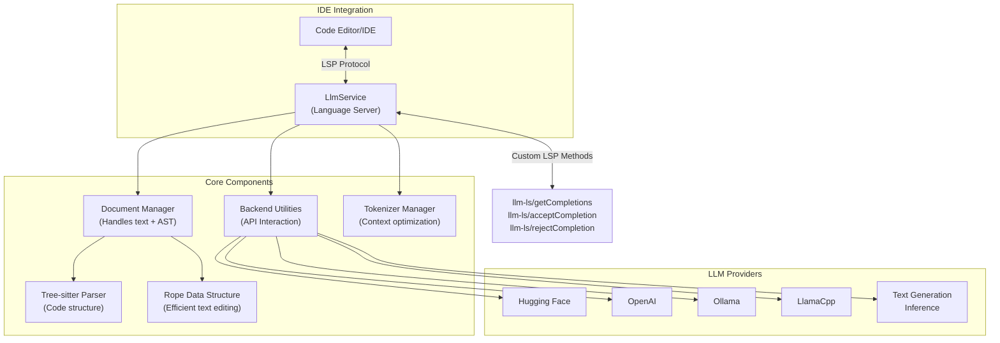

Sources: [crates/llm-ls/src/main.rs:129-139](), [crates/llm-ls/src/main.rs:25-33]()

## Code Completion Flow

The code completion process in llm-ls involves multiple steps, from detecting when completions should be triggered to processing the LLM's response.

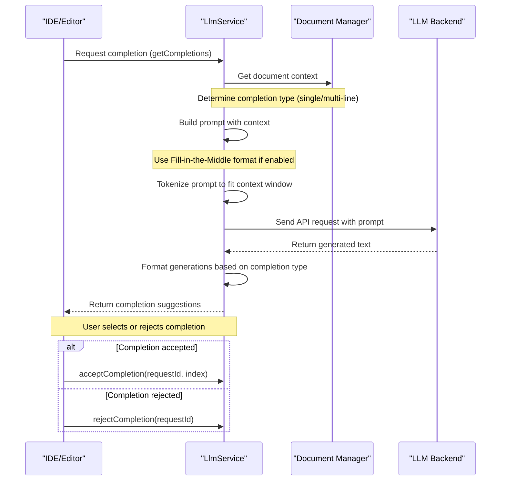

Sources: [crates/llm-ls/src/main.rs:492-594](), [crates/llm-ls/src/main.rs:65-122](), [crates/llm-ls/src/main.rs:141-233](), [crates/llm-ls/src/main.rs:275-303]()

## Core Components

### Language Server Implementation (LlmService)

The central component of llm-ls is the `LlmService` struct, which implements the Language Server Protocol interface and adds custom methods for LLM interactions.

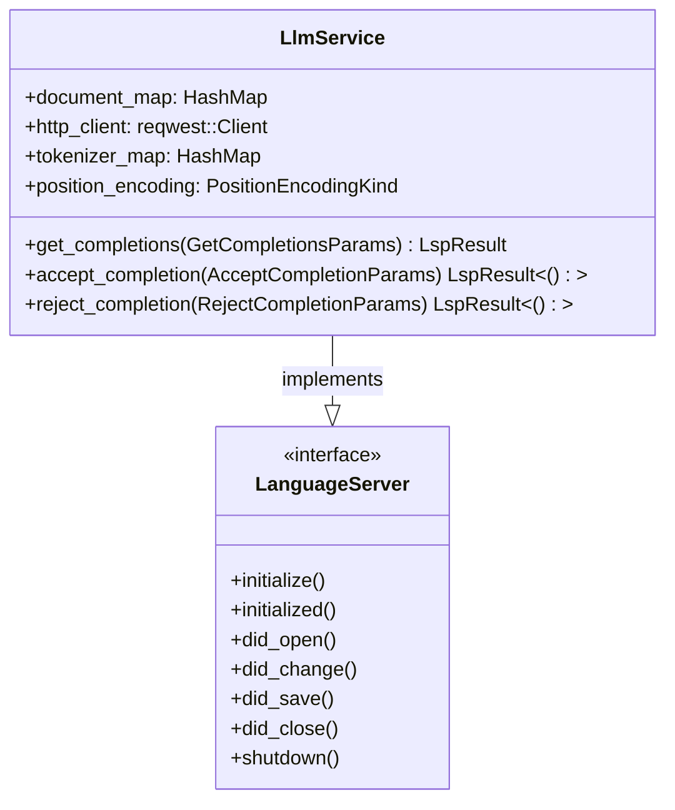

Sources: [crates/llm-ls/src/main.rs:129-139](), [crates/llm-ls/src/main.rs:597-713]()

### Document Management

The Document Manager handles text documents using the Rope data structure and provides parsing capabilities through tree-sitter.

| Component | Role |
|-----------|------|
| `Document` | Contains text content (as Rope) and parsed syntax tree |
| `LanguageId` | Identifies programming language for appropriate parsing |
| `Tree-sitter` | Provides AST (Abstract Syntax Tree) parsing for code understanding |
| `Rope` | Efficient data structure for text manipulation |

Sources: [crates/llm-ls/src/main.rs:26](), [crates/llm-ls/src/main.rs:634-654]()

### LLM Backend System

llm-ls supports multiple LLM backends through a unified API interface, allowing seamless switching between different providers.

| Backend | URL Formation | Request Format |
|---------|--------------|----------------|
| Hugging Face | `{url}/models/{model}` | API-specific JSON |
| OpenAI | `{url}/v1/completions` | OpenAI format |
| Ollama | `{url}/api/generate` | Ollama-specific format |
| LlamaCpp | `{url}/completions` | OpenAI-compatible |
| TGI | `{url}/generate` | TGI-specific format |

Sources: [crates/llm-ls/src/main.rs:425-489](), [crates/llm-ls/src/main.rs:235-273]()

## Prompt Management

llm-ls employs sophisticated prompt management techniques to optimize the context provided to LLMs.

### Fill-in-the-Middle (FIM) Prompting

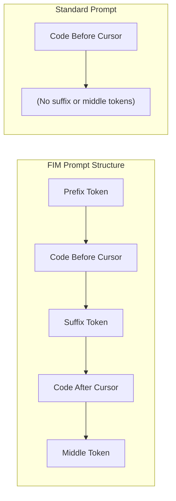

The Fill-in-the-Middle approach provides better context awareness by including both the code before and after the cursor position.

Sources: [crates/llm-ls/src/main.rs:141-233]()

### Tokenization and Context Window Management

llm-ls ensures that prompts fit within the model's context window by:

1. Dynamically tokenizing text to accurately count tokens
2. Prioritizing content closest to the cursor position
3. Balancing "before" and "after" context when using FIM

Sources: [crates/llm-ls/src/main.rs:367-422](), [crates/llm-ls/src/main.rs:141-233]()

## Completion Types

llm-ls analyzes code structure to determine the appropriate completion type:

| Type | Description | Implementation |
|------|-------------|---------------|
| Empty | No completion needed | No content returned |
| SingleLine | Single-line completion | Takes first line of generated text |
| MultiLine | Multi-line completion | Uses complete generated text |

The completion type is determined by examining the syntax tree of the code and the cursor position.

Sources: [crates/llm-ls/src/main.rs:48-63](), [crates/llm-ls/src/main.rs:65-122](), [crates/llm-ls/src/main.rs:275-303]()

## Custom LSP Protocol Extensions

llm-ls extends the Language Server Protocol with custom methods to support LLM-specific interactions:

| Method | Purpose | Parameters |
|--------|---------|------------|
| `llm-ls/getCompletions` | Request completions at cursor position | Document URI, position, model, backend settings |
| `llm-ls/acceptCompletion` | Record accepted completion | Request ID, completion index |
| `llm-ls/rejectCompletion` | Record rejected completion | Request ID |

Sources: [crates/llm-ls/src/main.rs:775-777](), [crates/llm-ls/src/main.rs:492-594]()

## Supported Languages

llm-ls integrates tree-sitter parsers for a wide range of programming languages, enabling intelligent code completion across different development environments.

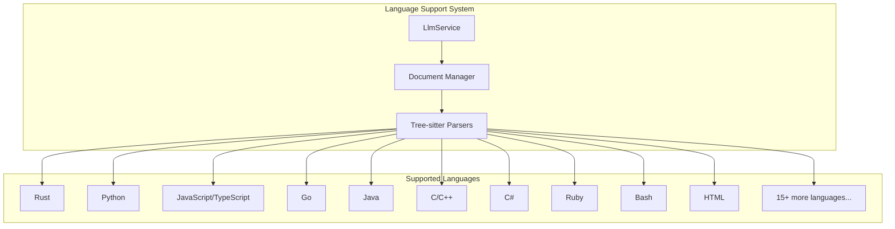

Sources: [Cargo.toml:1002-1023]()

## Compatible IDE Extensions

llm-ls is designed to work with multiple IDE extensions, providing a common backend for LLM-powered code completion across different editors.

| Extension | Editor/IDE | Status |
|-----------|------------|--------|
| llm.nvim | Neovim | Supported |
| llm-vscode | Visual Studio Code | Supported |
| llm-intellij | IntelliJ IDEA family | Supported |
| jupytercoder | Jupyter Notebooks | Planned |

Sources: [README.md:34-37]()

## Telemetry and Logging

llm-ls includes telemetry capabilities for monitoring and improving completion performance:

1. Request and response logging
2. Completion acceptance/rejection tracking 
3. Performance timing metrics

All telemetry is stored locally in `~/.cache/llm_ls/llm-ls.log` and is not exported externally.

Sources: [README.md:18-22](), [crates/llm-ls/src/main.rs:738-751]()

---

# Page: Language Server (llm-ls)

# Language Server (llm-ls)

<details>
<summary>Relevant source files</summary>

The following files were used as context for generating this wiki page:

- [crates/llm-ls/Cargo.toml](crates/llm-ls/Cargo.toml)
- [crates/llm-ls/src/main.rs](crates/llm-ls/src/main.rs)

</details>


This document describes the core language server implementation (`llm-ls`) in the llm-ls project. The language server is responsible for implementing the Language Server Protocol (LSP), managing documents, processing code completion requests, and communicating with LLM backends. For information about the LLM backend systems, see [LLM Backend System](#3).

## Purpose and Scope

The `llm-ls` language server acts as a bridge between code editors/IDEs and Large Language Models (LLMs). It implements the Language Server Protocol (LSP) with custom extensions to provide context-aware code completions powered by various LLM backends.

Sources: [crates/llm-ls/src/main.rs:129-713](). [crates/llm-ls/Cargo.toml:1-62]()

## Architecture Overview

The language server is built on the `tower-lsp` framework and follows a service-oriented architecture. The core component is the `LlmService` struct which implements the `LanguageServer` trait and custom methods for LLM completions.

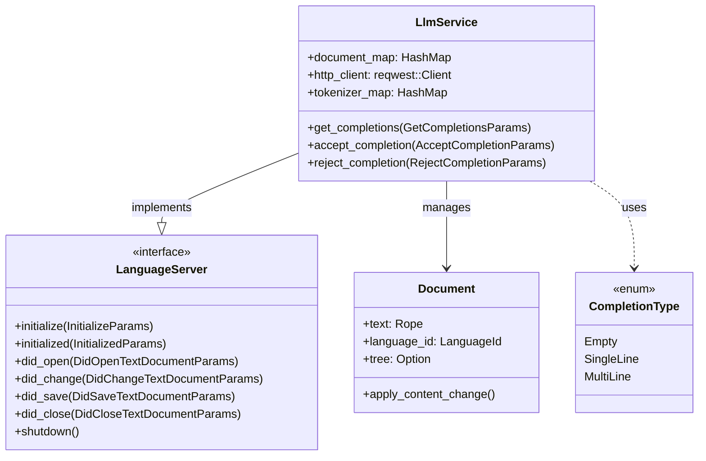

Sources: [crates/llm-ls/src/main.rs:129-139](), [crates/llm-ls/src/main.rs:598-713]()

## Service Initialization and Configuration

The language server is initialized with:
- Document management capabilities
- HTTP clients for secure and insecure connections
- Tokenizer management
- Position encoding support

During initialization, the server establishes workspace folders and position encoding configuration from client capabilities.

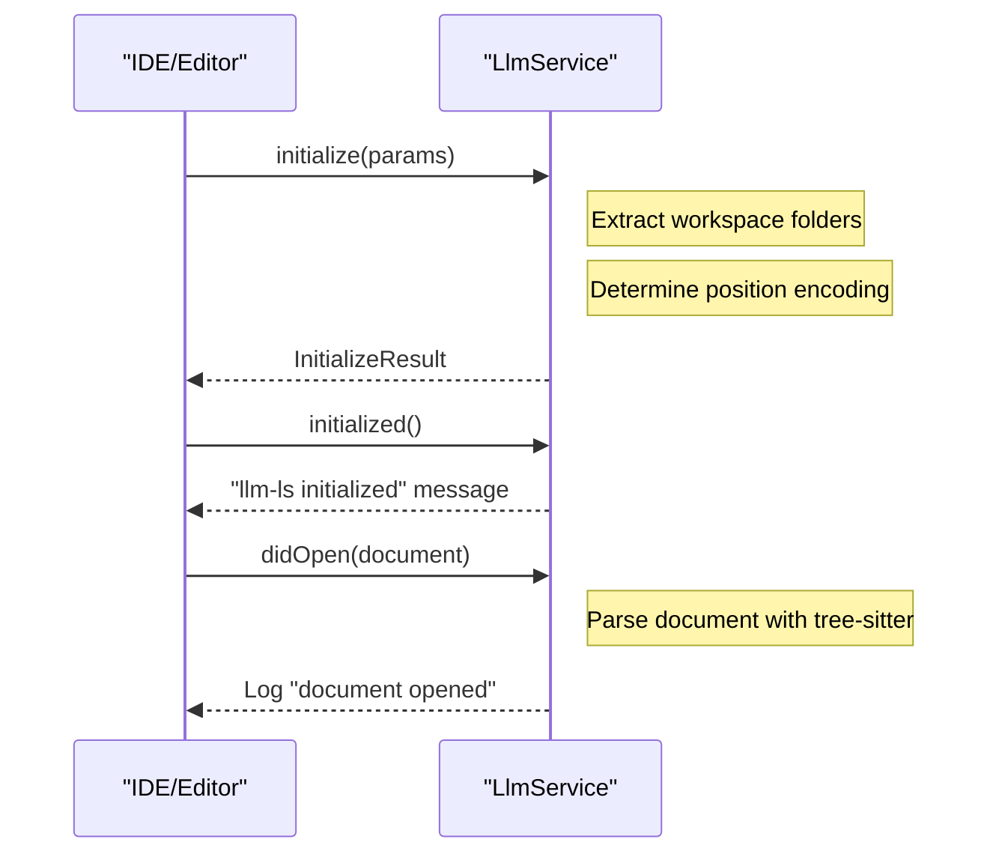

Sources: [crates/llm-ls/src/main.rs:599-633](), [crates/llm-ls/src/main.rs:635-658]()

## Document Management

The language server maintains a map of open documents, with each document represented by the `Document` struct. It handles standard LSP notifications for document changes:

| LSP Method | Function | Purpose |
|------------|----------|---------|
| `textDocument/didOpen` | `did_open()` | Creates a new document in the document map |
| `textDocument/didChange` | `did_change()` | Updates document content with incremental changes |
| `textDocument/didSave` | `did_save()` | Logs that a document was saved |
| `textDocument/didClose` | `did_close()` | Logs that a document was closed |

The server uses the Rope data structure for efficient text manipulation and Tree-sitter for parsing and syntax analysis.

Sources: [crates/llm-ls/src/main.rs:635-707]()

## Custom LSP Extensions

The language server implements three custom LSP methods for handling LLM-powered code completions:

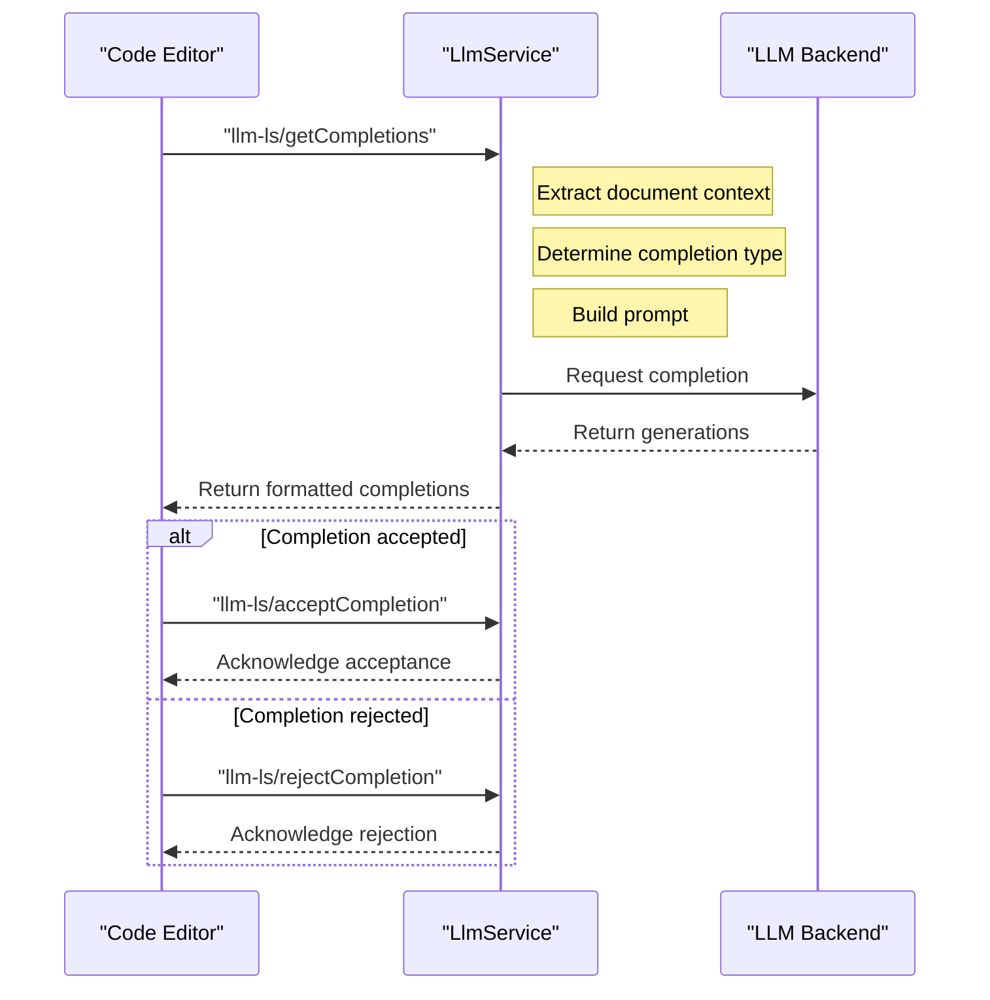

### 1. llm-ls/getCompletions

This method processes completion requests with the following steps:
1. Retrieves the document from the document map
2. Determines the appropriate completion type (single-line, multi-line, or empty)
3. Fetches or creates a tokenizer for the specified model
4. Builds a prompt using the document context
5. Sends the request to the LLM backend
6. Formats and returns the completions

Sources: [crates/llm-ls/src/main.rs:492-575]()

### 2. llm-ls/acceptCompletion

Logs information about accepted completions, which can be used for analytics and model improvement.

Sources: [crates/llm-ls/src/main.rs:577-585]()

### 3. llm-ls/rejectCompletion

Logs information about rejected completions, which can be used for analytics and model improvement.

Sources: [crates/llm-ls/src/main.rs:587-594]()

## Completion Processing

### Completion Types

The language server determines the appropriate completion type based on the document context:

| Type | Description |
|------|-------------|
| `Empty` | No completion should be provided |
| `SingleLine` | Only single-line completion is appropriate |
| `MultiLine` | Multi-line completion is appropriate |

The `should_complete()` function analyzes the document structure using Tree-sitter to make this determination.

Sources: [crates/llm-ls/src/main.rs:48-122](), [crates/llm-ls/src/main.rs:49-53]()

### Prompt Construction

The `build_prompt()` function creates an effective prompt for the LLM by:
1. Extracting text before and after the cursor position
2. Applying Fill-in-the-Middle (FIM) formatting if enabled
3. Ensuring the prompt fits within the model's context window
4. Tokenizing the text if a tokenizer is available

For FIM prompts, the function uses special tokens to indicate the prefix, suffix, and middle sections.

Sources: [crates/llm-ls/src/main.rs:141-233]()

### Backend Communication

The `request_completion()` function handles communication with LLM backends:
1. Builds the request body based on the backend type
2. Constructs appropriate headers, including authentication
3. Sends the request to the backend URL
4. Parses the generation results

The server supports multiple backend types through the `Backend` enum, each with specific URL handling and request formatting.

Sources: [crates/llm-ls/src/main.rs:235-273](), [crates/llm-ls/src/main.rs:425-489]()

## Tokenizer Management

The language server maintains a cache of tokenizers for different models. When needed, it:
1. Checks if the tokenizer is already in the cache
2. If not, loads it based on the specified configuration:
   - From a local file
   - From Hugging Face (downloading if necessary)
   - From a custom URL

Tokenizers are crucial for accurately counting tokens and optimizing prompts to fit within model context windows.

Sources: [crates/llm-ls/src/main.rs:305-422]()

## Entry Point and Configuration

The main function initializes the server with:
1. Command-line argument parsing
2. Logging configuration
3. Cache directory setup
4. HTTP client creation
5. LSP service construction with custom methods
6. Transport selection (stdio or TCP)

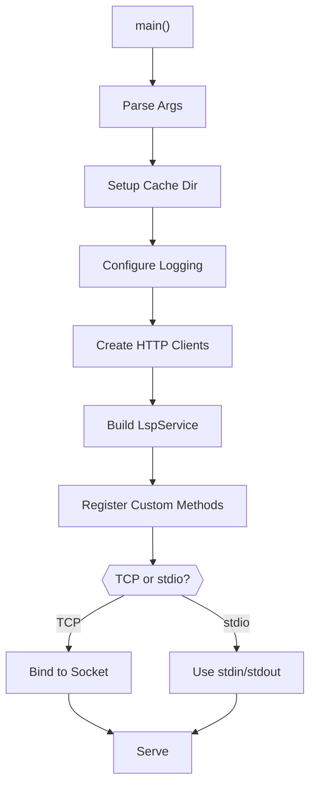

Sources: [crates/llm-ls/src/main.rs:715-795]()

## Supported Languages

The language server supports a wide range of programming languages through Tree-sitter parsers, as specified in the Cargo.toml dependencies:

| Language | Tree-sitter Parser |
|----------|-------------------|
| Rust | tree-sitter-rust |
| Python | tree-sitter-python |
| JavaScript | tree-sitter-javascript |
| TypeScript | tree-sitter-typescript |
| C/C++ | tree-sitter-c/tree-sitter-cpp |
| Java | tree-sitter-java |
| Go | tree-sitter-go |
| And many more | Various tree-sitter parsers |

Sources: [crates/llm-ls/Cargo.toml:36-58]()

---

# Page: Document Management

# Document Management

<details>
<summary>Relevant source files</summary>

The following files were used as context for generating this wiki page:

- [crates/llm-ls/src/document.rs](crates/llm-ls/src/document.rs)
- [crates/llm-ls/src/language_id.rs](crates/llm-ls/src/language_id.rs)

</details>


The Document Management system in the llm-ls Language Server provides the foundation for managing text content, parsing code syntax, and serving document context for LLM-powered code completion. This component acts as the bridge between raw text in the editor and the structured code representation needed for intelligent language model interactions.

## Core Components and Structure

The Document Management system centers around the `Document` struct which maintains the state of each file being edited:

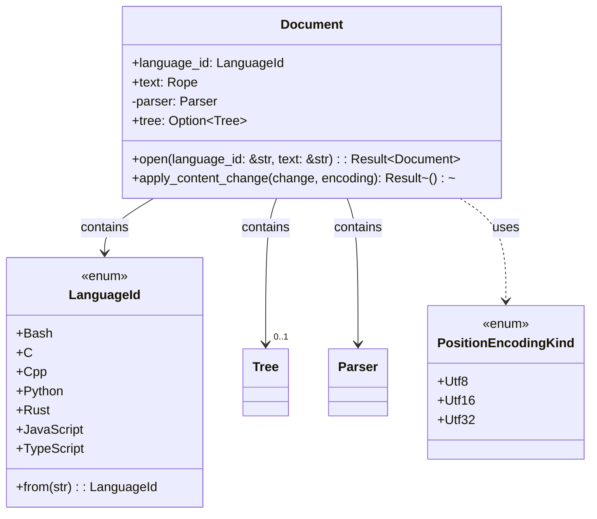

Sources: [crates/llm-ls/src/document.rs:180-185](), [crates/llm-ls/src/language_id.rs:4-31]()

### Rope Data Structure

The system uses the Rope data structure (from the `ropey` crate) for efficient text handling. Ropes offer significant advantages for text editing operations:

- O(log n) insertions and deletions anywhere in the text
- Fast access to any position in a document
- Memory-efficient representation of large documents

### Tree-sitter Integration

Each document maintains a Tree-sitter parser and syntax tree, which:
- Provides syntactic structure of the code (Abstract Syntax Tree)
- Enables context-aware code completion
- Supports structural code analysis

## Language Support

The Document Manager supports numerous programming languages via Tree-sitter grammars, determined by the document's `LanguageId`:

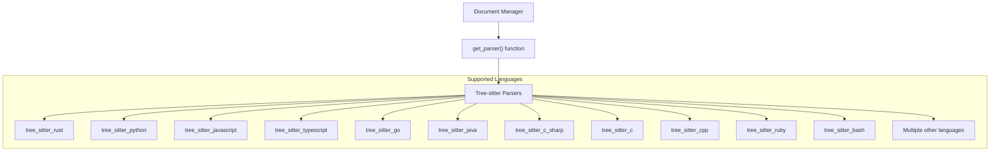

Sources: [crates/llm-ls/src/document.rs:8-127](), [crates/llm-ls/src/language_id.rs:4-31]()

## Document Operations

### Opening Documents

Documents are initialized and opened using the `Document::open` method, which:
1. Converts the language ID string to a `LanguageId` enum
2. Creates a Rope from the input text
3. Initializes a Tree-sitter parser for the specified language
4. Parses the text to create an initial syntax tree

Sources: [crates/llm-ls/src/document.rs:188-198]()

### Applying Content Changes

The core functionality is the `apply_content_change` method, which handles document modifications from the editor:

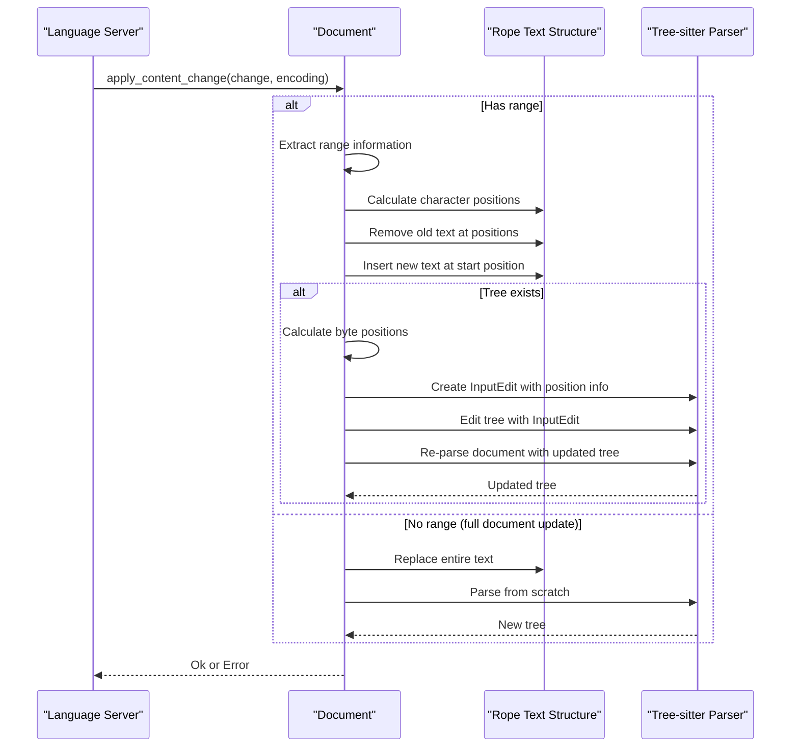

Sources: [crates/llm-ls/src/document.rs:201-353]()

The content change handling process:
1. Determines if the change applies to a specific range or the entire document
2. For ranged changes:
   - Calculates character positions based on the position encoding
   - Updates the Rope text structure
   - Creates a Tree-sitter InputEdit to update the syntax tree
   - Re-parses the document to maintain tree consistency
3. For full document updates:
   - Replaces the entire Rope content
   - Parses the new content from scratch

## Position Encoding

Document management handles different text encodings via the `PositionEncodingKind` enum:

| Encoding | Description | Usage |
|----------|-------------|-------|
| UTF-8 | Byte-based positions | Raw byte operations |
| UTF-16 | UTF-16 code unit positions | Most editor interfaces (VS Code, etc.) |
| UTF-32 | Unicode code point positions | Character-based operations |

The system includes conversion functions between these encoding schemes to ensure accurate position calculations regardless of the client editor's encoding.

Sources: [crates/llm-ls/src/document.rs:129-177]()

## Role in Code Completion

The Document Manager plays a critical role in the code completion workflow:

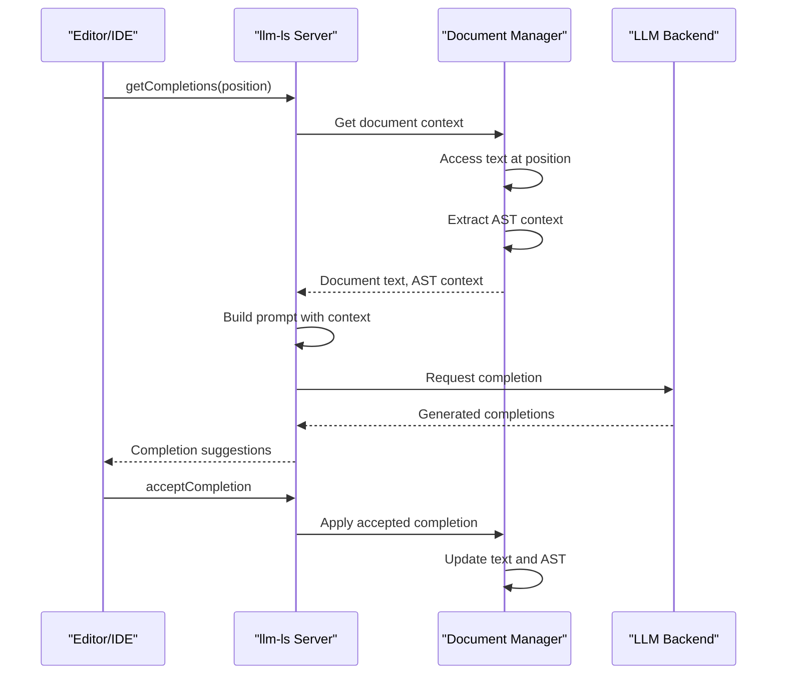

When a code completion is requested, the Document Manager:
1. Provides the text surrounding the cursor position
2. Supplies structural context from the AST
3. Helps determine the appropriate completion type
4. Updates the document state after a completion is accepted

## Error Handling

The Document Management system handles various error conditions:
- Invalid ranges (when start position is after end position)
- Out-of-bound line access
- Tree-sitter parsing failures
- Unknown encoding kinds

Errors are returned as `Result` values, with specific error types defined in the Error Handling system. For more details on error types and handling, see [Error Handling](#2.2).

Sources: [crates/llm-ls/src/document.rs:201-353]()

## Conclusion

The Document Management system forms the foundation of the llm-ls Language Server by efficiently handling text content and maintaining synchronized syntax trees. This enables the language server to provide intelligent, context-aware code completions powered by Large Language Models that respect the code's syntax and structure.

---

# Page: Error Handling

# Error Handling

<details>
<summary>Relevant source files</summary>

The following files were used as context for generating this wiki page:

- [crates/llm-ls/src/error.rs](crates/llm-ls/src/error.rs)
- [crates/lsp-client/src/error.rs](crates/lsp-client/src/error.rs)

</details>


## Purpose and Scope

This document describes the error handling system implemented in the llm-ls language server. It covers the error types, conversion mechanisms, and propagation patterns used throughout the codebase. The focus is on server-side error handling within the language server component.

## Core Error System

The error handling system in llm-ls is built around a central `Error` enum that provides a comprehensive set of error types that can occur during language server operation.

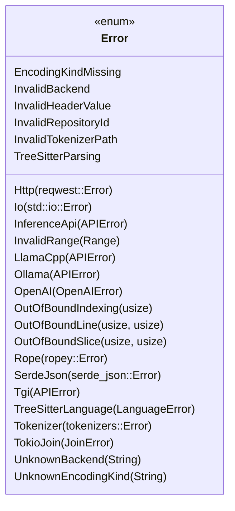

Sources: [crates/llm-ls/src/error.rs:16-66]()

The `Error` enum is implemented using the `thiserror` crate, which automatically generates appropriate implementations of the `Error` trait including error messages based on the attributes provided.

## Error Categories

The error variants can be categorized into several functional groups that align with the system components:

| Category | Error Variants | Description |
|----------|----------------|-------------|
| Backend Errors | `InferenceApi`, `InvalidBackend`, `LlamaCpp`, `Ollama`, `OpenAI`, `Tgi`, `UnknownBackend` | Errors relating to LLM backends |
| Document Errors | `InvalidRange`, `OutOfBoundIndexing`, `OutOfBoundLine`, `OutOfBoundSlice`, `Rope` | Errors in document management |
| Parsing Errors | `SerdeJson`, `TreeSitterParsing`, `TreeSitterLanguage` | Errors in parsing code or JSON |
| Network Errors | `Http`, `InvalidHeaderValue` | Errors in HTTP communication |
| System Errors | `Io`, `TokioJoin` | General I/O and concurrency errors |
| Configuration Errors | `EncodingKindMissing`, `InvalidRepositoryId`, `InvalidTokenizerPath`, `UnknownEncodingKind` | Errors in server configuration |
| Tokenization Errors | `Tokenizer` | Errors in the tokenization process |

Sources: [crates/llm-ls/src/error.rs:16-66]()

## Error Flow Architecture

The following diagram illustrates how errors flow through the language server system:

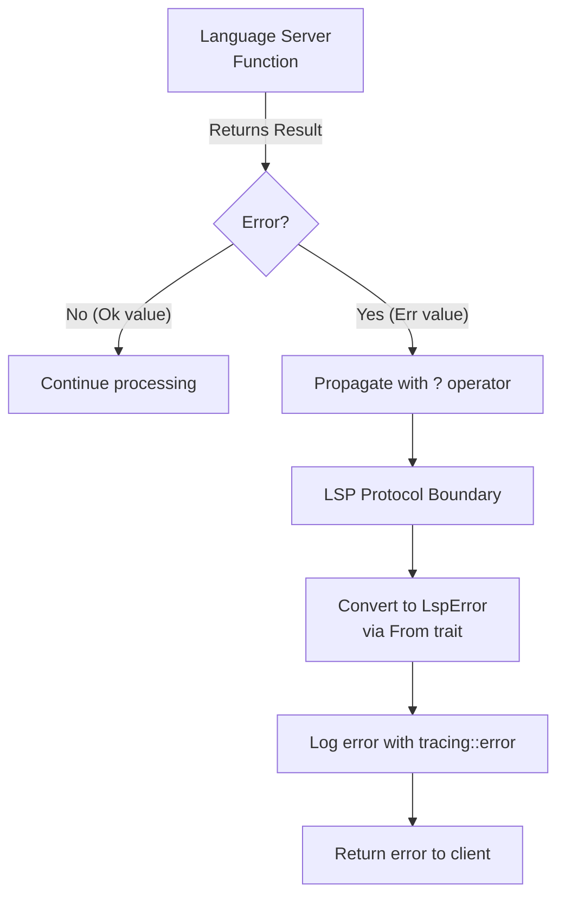

Sources: [crates/llm-ls/src/error.rs:6-14](), [crates/llm-ls/src/error.rs:70-74]()

## Result Type and Error Conversion

For convenience and consistency, llm-ls defines a `Result<T>` type alias:

```rust
pub(crate) type Result<T> = std::result::Result<T, Error>;
```

This alias is used throughout the codebase for functions that can fail.

When errors need to be communicated to the client through the LSP protocol, they are converted to `LspError` using the `From<Error> for LspError` trait implementation:

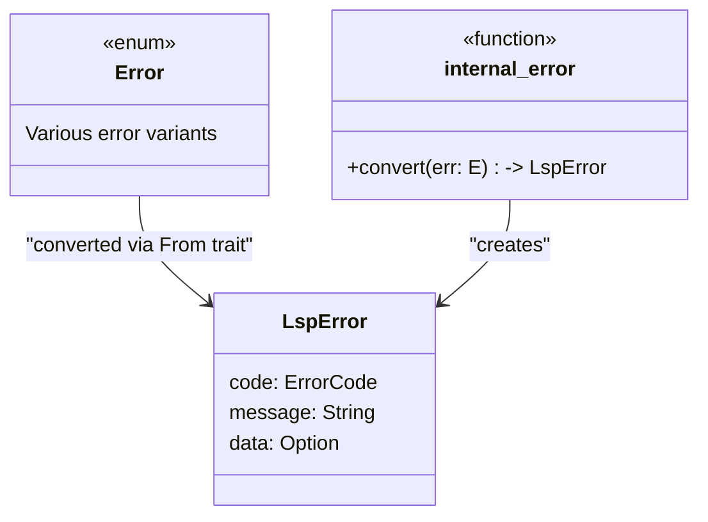

Sources: [crates/llm-ls/src/error.rs:6-14](), [crates/llm-ls/src/error.rs:70-74]()

The implementation uses the `internal_error` function, which:
1. Converts the error to a string message
2. Logs the error using the `tracing` crate
3. Creates a new `LspError` with the `InternalError` code

```rust
pub(crate) fn internal_error<E: Display>(err: E) -> LspError {
    let err_msg = err.to_string();
    error!(err_msg);
    LspError {
        code: tower_lsp::jsonrpc::ErrorCode::InternalError,
        message: err_msg.into(),
        data: None,
    }
}
```

Sources: [crates/llm-ls/src/error.rs:6-14]()

## Integration with System Components

The error handling system integrates with various components of the language server:

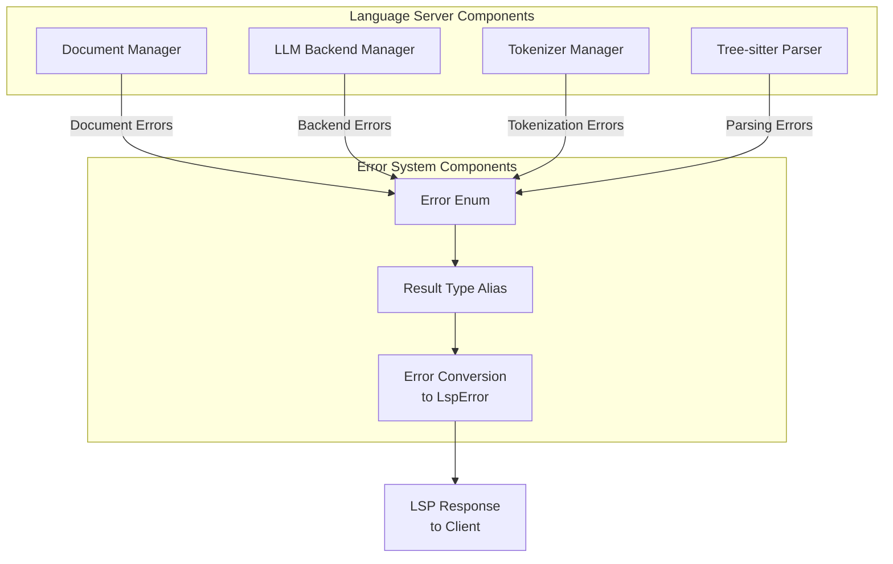

Sources: [crates/llm-ls/src/error.rs:16-66]()

Each component in the language server can produce specific types of errors:

1. **Document Manager**: Can produce `InvalidRange`, `OutOfBoundIndexing`, `OutOfBoundLine`, `OutOfBoundSlice`, and `Rope` errors.
2. **LLM Backend Manager**: Can produce `InferenceApi`, `InvalidBackend`, `LlamaCpp`, `Ollama`, `OpenAI`, `Tgi`, and `UnknownBackend` errors.
3. **Tokenizer Manager**: Can produce `Tokenizer` and `EncodingKindMissing` errors.
4. **Tree-sitter Parser**: Can produce `TreeSitterParsing` and `TreeSitterLanguage` errors.

## Best Practices for Error Handling in llm-ls

When extending or modifying the llm-ls codebase, follow these error handling practices:

1. **Use the `Error` enum**: Add new error variants to the central `Error` enum rather than creating new error types.
2. **Implement `From` traits**: For wrapping errors from external libraries.
3. **Use descriptive error messages**: With the `#[error("...")]` attribute.
4. **Use the `Result<T>` type alias**: For consistency throughout the codebase.
5. **Propagate errors using `?`**: Let errors bubble up until they can be properly handled.
6. **Log errors at appropriate levels**: Use the `tracing` crate's macros.

Sources: [crates/llm-ls/src/error.rs:16-66](), [crates/llm-ls/src/error.rs:68]()

## Client-Side Error Handling

The LSP client implements its own error handling system, defined separately from the server-side system:

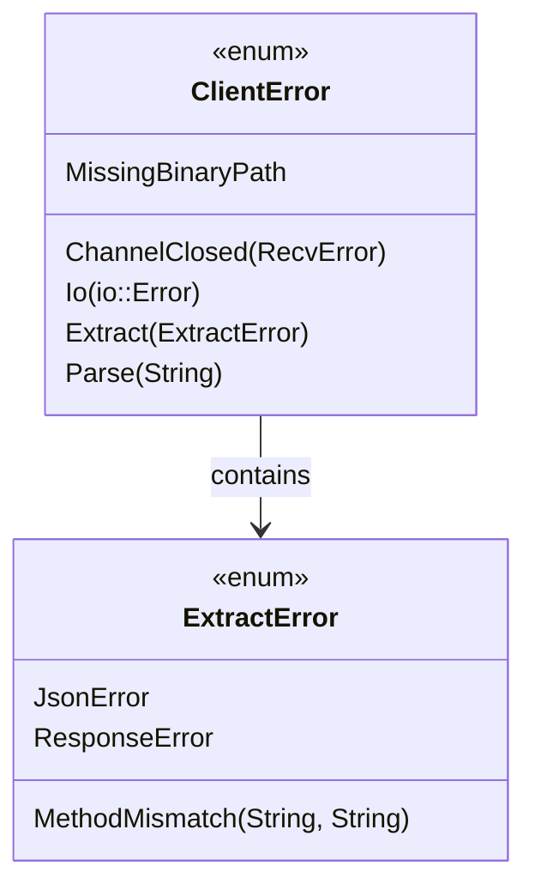

Sources: [crates/lsp-client/src/error.rs:64-86](), [crates/lsp-client/src/error.rs:19-62]()

The client error system is designed to handle failures in communicating with the language server, including protocol errors, message extraction issues, and IO problems.

## Summary

The error handling system in llm-ls provides a robust and consistent way to represent, propagate, and communicate errors. By centralizing errors in a single enum and providing convenient conversion mechanisms, the system makes error handling more uniform and predictable throughout the codebase.

The integration with the LSP protocol ensures that errors are properly communicated to clients, while the use of the `tracing` crate enables effective error logging and debugging.

---

# Page: LLM Backend System

# LLM Backend System

<details>
<summary>Relevant source files</summary>

The following files were used as context for generating this wiki page:

- [crates/custom-types/src/llm_ls.rs](crates/custom-types/src/llm_ls.rs)
- [crates/llm-ls/src/backend.rs](crates/llm-ls/src/backend.rs)

</details>


## Purpose and Scope

This document details the LLM Backend System within the llm-ls project, which provides a unified interface to communicate with different Large Language Model providers. The system handles connection, request formatting, response parsing, and error handling for multiple backend services. For information about how these backends are exposed through custom LSP protocol extensions, see [Custom LSP Protocol Extensions](#3.1).

## System Overview

The LLM Backend System enables the language server to interact with multiple LLM providers through a common interface. This abstraction allows clients to seamlessly switch between different backend services without changing the core code completion logic.

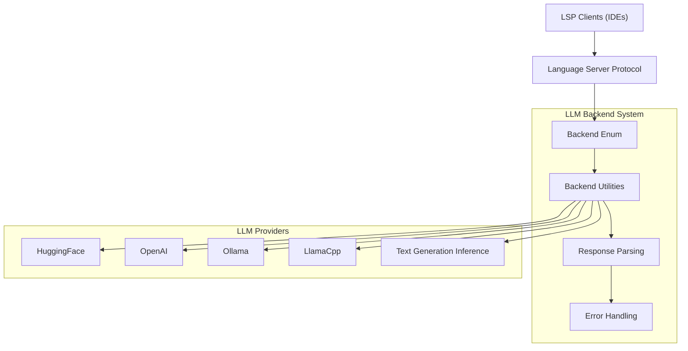

Sources: [crates/custom-types/src/llm_ls.rs:63-109](), [crates/llm-ls/src/backend.rs:1-33]()

## Backend Enum Implementation

The system defines a `Backend` enum representing the different supported LLM providers. Each variant contains the URL to connect to the service.

```mermaid
classDiagram
    class "Backend" {
        <<enum>>
        HuggingFace { url: String }
        LlamaCpp { url: String }
        Ollama { url: String }
        OpenAi { url: String }
        Tgi { url: String }
        +is_using_inference_api() bool
        +url() String
    }
```

Sources: [crates/custom-types/src/llm_ls.rs:63-109]()

The `Backend` enum provides these key methods:
- `is_using_inference_api()`: Determines if the backend is using the Hugging Face Inference API
- `url()`: Returns the URL configured for the backend

## Supported Backend Providers

The system currently supports five LLM backend providers:

| Backend | Description | URL Configuration |
|---------|-------------|------------------|
| HuggingFace | Hugging Face's Inference API | Default: `https://api-inference.huggingface.co` |
| LlamaCpp | Local LLama.cpp server | Custom URL required |
| Ollama | Ollama API for local models | Custom URL required |
| OpenAI | OpenAI API | Custom URL required |
| TGI | Text Generation Inference | Custom URL required |

Sources: [crates/custom-types/src/llm_ls.rs:63-109](), [crates/custom-types/src/llm_ls.rs:8-9]()

## Request/Response Flow

The LLM Backend System handles the full lifecycle of communicating with LLM providers:

```mermaid
sequenceDiagram
    participant LS as "Language Server"
    participant Backend as "Backend System"
    participant Provider as "LLM Provider"
    
    LS->>Backend: GetCompletionsParams
    Note over Backend: Select backend variant
    Backend->>Backend: build_headers()
    Backend->>Backend: build_body()
    Backend->>Provider: HTTP Request
    Provider-->>Backend: HTTP Response
    Backend->>Backend: parse_generations()
    Backend-->>LS: Vec<Generation>
```

Sources: [crates/llm-ls/src/backend.rs:210-260]()

## Request Construction

The system constructs appropriate HTTP requests for each backend provider. This includes building:

1. Request bodies with `build_body()`
2. HTTP headers with `build_headers()`

Each backend requires different request formats:

```mermaid
flowchart TD
    Request["Completion Request"]
    
    subgraph "build_body() Function"
        HfBody["HuggingFace/TGI Format<br/>{'inputs': prompt, 'parameters': {...}}"]
        LlamaBody["LlamaCpp Format<br/>{'prompt': prompt}"]
        OllamaBody["Ollama/OpenAI Format<br/>{'prompt': prompt, 'model': model, 'stream': false}"]
    end
    
    Request --> build_body
    build_body --> Backend["Backend Type"]
    Backend -->|HuggingFace/TGI| HfBody
    Backend -->|LlamaCpp| LlamaBody
    Backend -->|Ollama/OpenAI| OllamaBody
```

Sources: [crates/llm-ls/src/backend.rs:210-236]()

## Response Parsing

After receiving responses from the LLM providers, the system parses them into a common format using the `parse_generations()` function, which delegates to backend-specific parsers:

| Backend | Parser Function | Response Structure |
|---------|----------------|-------------------|
| HuggingFace | `parse_api_text()` | `Generation` or `Vec<Generation>` |
| LlamaCpp | `parse_llamacpp_text()` | `LlamaCppGeneration` → `Generation` |
| Ollama | `parse_ollama_text()` | `OllamaGeneration` → `Generation` |
| OpenAI | `parse_openai_text()` | `OpenAIGeneration.choices` → `Vec<Generation>` |
| TGI | `parse_tgi_text()` | `Generation` |

Sources: [crates/llm-ls/src/backend.rs:50-207](), [crates/llm-ls/src/backend.rs:252-260]()

## Error Handling

Each backend has specialized error handling to deal with service-specific error responses:

```mermaid
classDiagram
    class "APIError" {
        +error: String
        +description() &str
        +fmt() Result
    }
    
    class "OpenAIError" {
        +detail: Vec<OpenAIErrorDetail>
        +fmt() Result
    }
    
    class "OpenAIErrorDetail" {
        +loc: OpenAIErrorLoc
        +msg: String
        +type: String
    }
    
    class "APIResponse" {
        <<enum>>
        +Generation(Generation)
        +Generations(Vec<Generation>)
        +Error(APIError)
    }
    
    APIResponse --> APIError
    OpenAIError --> OpenAIErrorDetail
```

Sources: [crates/llm-ls/src/backend.rs:10-207]()

## Configuration

The system offers extensive configuration options through the `GetCompletionsParams` struct:

| Parameter | Description |
|-----------|-------------|
| `text_document_position` | Position in the document |
| `ide` | IDE being used |
| `fim` | Fill-in-the-Middle parameters |
| `api_token` | Authentication token |
| `model` | LLM model to use |
| `backend` | Backend provider configuration |
| `tokens_to_clear` | Tokens to remove from completions |
| `tokenizer_config` | Configuration for the tokenizer |
| `context_window` | Maximum context window size |
| `tls_skip_verify_insecure` | Flag to skip TLS verification |
| `request_body` | Additional request parameters |
| `disable_url_path_completion` | Flag to disable URL path completion |

Sources: [crates/custom-types/src/llm_ls.rs:136-156]()

## Integration with Language Server

The LLM Backend System is used by the language server to fulfill code completion requests. When a client requests completions, the server:

1. Constructs a `GetCompletionsParams` object
2. Sends a request to the appropriate backend
3. Parses the response into a list of completions
4. Returns the completions to the client

This integration enables the core functionality of the language server - providing code completions from large language models.

Sources: [crates/custom-types/src/llm_ls.rs:159-167]()

---

# Page: Custom LSP Protocol Extensions

# Custom LSP Protocol Extensions

<details>
<summary>Relevant source files</summary>

The following files were used as context for generating this wiki page:

- [crates/custom-types/Cargo.toml](crates/custom-types/Cargo.toml)
- [crates/custom-types/src/lib.rs](crates/custom-types/src/lib.rs)
- [crates/custom-types/src/llm_ls.rs](crates/custom-types/src/llm_ls.rs)
- [crates/custom-types/src/request.rs](crates/custom-types/src/request.rs)

</details>


This page describes the custom Language Server Protocol (LSP) extensions implemented by llm-ls to support LLM-powered code completions. The standard LSP specification does not include methods for requesting AI-generated code completions or providing feedback on those completions, so llm-ls extends the protocol with custom methods to enable these interactions.

For information about the overall Language Server architecture, see [Language Server (llm-ls)](#2). For details on how the system interacts with different LLM backends, see [LLM Backend System](#3).

## Custom LSP Request Types Overview

llm-ls extends the LSP with three custom request types:

```mermaid
classDiagram
    class Request {
        <<trait>>
        type Params
        type Result
        const METHOD: &'static str
    }
    
    class GetCompletions {
        Params: GetCompletionsParams
        Result: GetCompletionsResult
        METHOD: "llm-ls/getCompletions"
    }
    
    class AcceptCompletion {
        Params: AcceptCompletionParams
        Result: ()
        METHOD: "llm-ls/acceptCompletion"
    }
    
    class RejectCompletion {
        Params: RejectCompletionParams
        Result: ()
        METHOD: "llm-ls/rejectCompletion"
    }
    
    Request <|.. GetCompletions
    Request <|.. AcceptCompletion
    Request <|.. RejectCompletion
```

Sources: [crates/custom-types/src/request.rs:1-32]()

These custom requests form a complete interaction cycle:
1. Client requests completions with `getCompletions`
2. Server returns completion suggestions
3. Client either accepts a specific completion with `acceptCompletion` or rejects all completions with `rejectCompletion`

## GetCompletions Request

The `getCompletions` request is the primary method for obtaining code completions from an LLM.

### Request Definition

```
Method: llm-ls/getCompletions
Params: GetCompletionsParams
Result: GetCompletionsResult
```

Sources: [crates/custom-types/src/request.rs:8-14]()

### Parameters Structure

The `GetCompletionsParams` structure contains all the information needed to generate relevant code completions:

```mermaid
classDiagram
    class GetCompletionsParams {
        text_document_position: TextDocumentPositionParams
        ide: Ide
        fim: FimParams
        api_token: Option~String~
        model: String
        backend: Backend
        tokens_to_clear: Vec~String~
        tokenizer_config: Option~TokenizerConfig~
        context_window: usize
        tls_skip_verify_insecure: bool
        request_body: Map~String, Value~
        disable_url_path_completion: bool
    }
    
    class TextDocumentPositionParams {
        textDocument: TextDocumentIdentifier
        position: Position
    }
    
    class FimParams {
        enabled: bool
        prefix: String
        middle: String
        suffix: String
    }
    
    class Backend {
        <<enum>>
        HuggingFace {url: String}
        LlamaCpp {url: String}
        Ollama {url: String}
        OpenAi {url: String}
        Tgi {url: String}
    }
    
    class TokenizerConfig {
        <<enum>>
        Local {path: PathBuf}
        HuggingFace {repository: String, api_token: Option~String~}
        Download {url: String, to: PathBuf}
    }
    
    GetCompletionsParams --> TextDocumentPositionParams
    GetCompletionsParams --> FimParams
    GetCompletionsParams --> Backend
    GetCompletionsParams --> TokenizerConfig
```

Sources: [crates/custom-types/src/llm_ls.rs:135-156](), [crates/custom-types/src/llm_ls.rs:63-109](), [crates/custom-types/src/llm_ls.rs:111-117](), [crates/custom-types/src/llm_ls.rs:119-133]()

Key parameters include:

| Parameter | Type | Description |
|-----------|------|-------------|
| `text_document_position` | TextDocumentPositionParams | Standard LSP parameter identifying document and cursor position |
| `ide` | Ide | The editor/IDE making the request (VSCode, Neovim, etc.) |
| `fim` | FimParams | Fill-in-the-Middle parameters for prompt formatting |
| `api_token` | Option\<String\> | Optional token for LLM API authentication |
| `model` | String | The specific LLM model to use |
| `backend` | Backend | Which LLM backend to use (HuggingFace, OpenAI, etc.) |
| `context_window` | usize | Maximum context window size for the LLM |
| `tokenizer_config` | Option\<TokenizerConfig\> | Configuration for the tokenizer |

### Response Structure

The response to a `getCompletions` request is a `GetCompletionsResult` containing completion suggestions:

```
GetCompletionsResult {
    request_id: Uuid,
    completions: Vec<Completion>
}

Completion {
    generated_text: String
}
```

Sources: [crates/custom-types/src/llm_ls.rs:158-167]()

The `request_id` is a unique identifier for the completion request, which is used in subsequent `acceptCompletion` or `rejectCompletion` requests to reference the original completions.

## AcceptCompletion Request

The `acceptCompletion` request allows clients to indicate that a specific completion was accepted by the user.

### Request Definition

```
Method: llm-ls/acceptCompletion
Params: AcceptCompletionParams
Result: () (void)
```

Sources: [crates/custom-types/src/request.rs:16-23]()

### Parameters Structure

```
AcceptCompletionParams {
    request_id: Uuid,
    accepted_completion: u32,
    shown_completions: Vec<u32>
}
```

Sources: [crates/custom-types/src/llm_ls.rs:10-16]()

- `request_id`: The UUID of the original `getCompletions` request
- `accepted_completion`: The index of the completion that was accepted
- `shown_completions`: Indices of all completions that were shown to the user

This information can be used by the server for analytics and to improve future completions.

## RejectCompletion Request

The `rejectCompletion` request allows clients to indicate that all suggested completions were rejected.

### Request Definition

```
Method: llm-ls/rejectCompletion
Params: RejectCompletionParams
Result: () (void)
```

Sources: [crates/custom-types/src/request.rs:25-32]()

### Parameters Structure

```
RejectCompletionParams {
    request_id: Uuid,
    shown_completions: Vec<u32>
}
```

Sources: [crates/custom-types/src/llm_ls.rs:18-23]()

- `request_id`: The UUID of the original `getCompletions` request
- `shown_completions`: Indices of all completions that were shown to the user

## Completion Workflow

The following sequence diagram illustrates the complete workflow of a code completion cycle using the custom LSP extensions:

```mermaid
sequenceDiagram
    participant "Client" as Editor/IDE
    participant "Server" as llm-ls
    participant "Backend" as LLM Backend

    Client->>Server: llm-ls/getCompletions
    note over Client,Server: Includes document position, model, backend settings
    Server->>Server: Process document context
    Server->>Backend: Request completions
    Backend-->>Server: Return generated completions
    Server-->>Client: GetCompletionsResult
    note over Client,Server: Contains request_id and completions
    
    alt User accepts a completion
        Client->>Server: llm-ls/acceptCompletion
        note over Client,Server: Includes request_id and accepted index
        Server->>Server: Record acceptance (analytics)
        Server-->>Client: Acknowledge
    else User rejects all completions
        Client->>Server: llm-ls/rejectCompletion
        note over Client,Server: Includes request_id
        Server->>Server: Record rejection (analytics)
        Server-->>Client: Acknowledge
    end
```

Sources: [crates/custom-types/src/request.rs:1-32](), [crates/custom-types/src/llm_ls.rs:10-23](), [crates/custom-types/src/llm_ls.rs:135-167]()

## Integration with LLM Backend System

The custom LSP requests integrate with the LLM backend system (described in [LLM Backend System](#3)) through the parameters in the `getCompletions` request:

```mermaid
graph TD
    subgraph "LSP Protocol Extensions"
        GetCompletions["llm-ls/getCompletions"]
        AcceptCompletion["llm-ls/acceptCompletion"]
        RejectCompletion["llm-ls/rejectCompletion"]
    end
    
    subgraph "GetCompletionsParams"
        Backend["Backend"]
        Model["model"]
        ApiToken["api_token"]
        FIM["fim"]
        ContextWindow["context_window"]
    end
    
    subgraph "Backend Types"
        HF["HuggingFace {url}"]
        LlamaCpp["LlamaCpp {url}"]
        Ollama["Ollama {url}"]
        OpenAI["OpenAi {url}"]
        TGI["Tgi {url}"]
    end
    
    GetCompletions --> Backend
    GetCompletions --> Model
    GetCompletions --> ApiToken
    GetCompletions --> FIM
    GetCompletions --> ContextWindow
    
    Backend --> HF
    Backend --> LlamaCpp
    Backend --> Ollama
    Backend --> OpenAI
    Backend --> TGI
```

Sources: [crates/custom-types/src/llm_ls.rs:63-109](), [crates/custom-types/src/llm_ls.rs:135-156]()

The `Backend` enum in the parameters allows the client to specify which LLM backend to use, along with the required configuration (like URL endpoints).

## Summary

The custom LSP protocol extensions implemented by llm-ls enable:

1. Rich interactions between code editors and LLM backends
2. Request configurations tailored to different LLM providers
3. User feedback mechanism through accept/reject requests
4. A complete end-to-end workflow for LLM-powered code completions

These extensions are essential for the functionality of llm-ls, as they provide capabilities beyond what the standard LSP protocol offers, specifically designed for LLM-based code assistance.

---

# Page: Testbed Framework

# Testbed Framework

<details>
<summary>Relevant source files</summary>

The following files were used as context for generating this wiki page:

- [crates/testbed/README.md](crates/testbed/README.md)
- [crates/testbed/repositories.yaml](crates/testbed/repositories.yaml)
- [crates/testbed/src/main.rs](crates/testbed/src/main.rs)

</details>


## Purpose and Scope

The Testbed Framework provides a systematic approach for evaluating code completions generated by llm-ls. It creates "holes" in existing code from real-world repositories, requests completions from the language server, and validates them by checking if the completed code successfully builds and passes tests. This document covers the architecture, configuration, and workflow of the testbed system, explaining how it handles repositories, generates holes, processes completions, and analyzes results.

For information about the LLM Backend System that provides the completions, see [LLM Backend System](#3).

Sources: [crates/testbed/README.md:1-3]()

## Architecture Overview

```mermaid
flowchart TD
    subgraph "Testbed System"
        Config["repositories.yaml\nRepositoriesConfig struct"]
        TestbedApp["Testbed Application\ncrates/testbed/src/main.rs"]
        LSPClient["LSP Client\nLspClient struct"]
        LLM_LS["llm-ls Server"]
        
        subgraph "Repository Processing"
            RepoSetup["Repository Setup\nsetup_repo_dir function"]
            HoleGen["Hole Generation\ngenerate_holes function"]
            SetupCache["Setup Cache\nSetupCache struct"]
            Build["Build Process\nbuild function"]
            Test["Test Execution\nRunner enum"]
            Results["Results Collection\nHoleCompletionResult struct"]
        end
        
        Config --> TestbedApp
        TestbedApp --> LSPClient
        LSPClient <--> LLM_LS
        
        TestbedApp --> RepoSetup
        TestbedApp --> HoleGen
        TestbedApp --> SetupCache
        RepoSetup --> Build
        Build --> Test
        Test --> Results
        Results --> TestbedApp
    end
```

The Testbed Framework consists of several key components that work together to evaluate code completions:

1. **Configuration**: Defined in `repositories.yaml`, specifying repositories, language model parameters, and test settings.
2. **Testbed Application**: Coordinates the evaluation process, implemented in `main.rs`.
3. **LSP Client**: Interfaces with the llm-ls server using the Language Server Protocol.
4. **Repository Management**: Handles repository setup, hole generation, and caching.
5. **Build and Test**: Validates completions by building code and running tests.
6. **Results Collection**: Gathers metrics on completion quality and performance.

Sources: [crates/testbed/src/main.rs:1-50](), [crates/testbed/README.md:9-23]()

## Evaluation Workflow

```mermaid
sequenceDiagram
    participant User
    participant Testbed as "TestbedApp"
    participant LSP as "LSPClient"
    participant LLM as "llm-ls Server"
    participant Repo as "Repository"

    User->>Testbed: Run testbed
    Testbed->>Testbed: Parse repositories.yaml
    
    alt Generate Holes Mode (-g flag)
        Testbed->>Repo: Clone/copy repository
        Testbed->>Repo: Parse source files
        Testbed->>Testbed: Generate hole locations
        Testbed->>Testbed: Save holes to JSON file
    else Run Completion Tests
        Testbed->>LSP: Initialize LSP connection
        LSP->>LLM: Connect to server
        
        loop For each repository and hole
            Testbed->>Repo: Setup repository (setup_repo_dir)
            Testbed->>SetupCache: Create working copy (create_cache_copy)
            Testbed->>Repo: Create hole in code
            Testbed->>LSP: Request completion (GetCompletions)
            LSP->>LLM: Send request
            LLM-->>LSP: Return completions
            LSP-->>Testbed: Return best completion
            Testbed->>Repo: Apply completion
            Testbed->>Repo: Build code
            Testbed->>Repo: Run tests (run_test)
            Testbed->>Testbed: Record results (HoleCompletionResult)
        end
        
        Testbed->>Testbed: Aggregate results
        Testbed->>Testbed: Write results.json
        Testbed->>User: Report results
    end
```

The testbed operates in two modes:

1. **Hole Generation Mode**: Creates "holes" in code where completions will be tested.
2. **Completion Evaluation Mode**: Tests the language model's ability to fill those holes with working code.

The workflow is designed to parallelize the completion process, using a semaphore to control concurrency and a caching mechanism to avoid redundant repository setup.

Sources: [crates/testbed/src/main.rs:606-780](), [crates/testbed/README.md:35-38]()

## Repository Configuration

The Testbed Framework uses a YAML configuration file to define repositories and testing parameters.

```mermaid
classDiagram
    class RepositoriesConfig {
        context_window: usize
        fim: FimParams
        model: String
        backend: Backend
        repositories: Vec~Repository~
        tls_skip_verify_insecure: bool
        tokenizer_config: Option~TokenizerConfig~
        tokens_to_clear: Vec~String~
        request_body: Map~String, Value~
    }
    
    class Repository {
        build_command: String
        build_args: Vec~String~
        env: Option~Vec~String~~
        holes_file: String
        language: Language
        runner: Runner
        setup_commands: Option~Vec~Command~~
        source: RepoSource
    }
    
    class RepoSource {
        <<enum>>
        Local(LocalRepo)
        Github(GithubRepo)
    }
    
    class Runner {
        <<enum>>
        Cargo
        Jest
        Pytest
        Vitest
    }
    
    RepositoriesConfig "1" --> "*" Repository
    Repository "1" --> "1" RepoSource
    Repository "1" --> "1" Runner
```

### Global Configuration

The configuration file includes global settings for the language model and completion parameters:

| Parameter | Description |
|-----------|-------------|
| `context_window` | Maximum token context for the model |
| `fim` | Fill-in-the-Middle prompt parameters |
| `model` | Model identifier (e.g., "bigcode/starcoder") |
| `backend` | LLM backend (huggingface, openai, etc.) |
| `request_body` | Model-specific parameters (temperature, tokens, etc.) |

### Repository Configuration

Each repository in the configuration includes:

| Parameter | Description |
|-----------|-------------|
| `source` | Repository location (local or GitHub) |
| `build_command` | Command to build the code |
| `build_args` | Arguments for the build command |
| `language` | Programming language (rust, python, etc.) |
| `runner` | Test runner (cargo, pytest, jest, vitest) |
| `setup_commands` | Commands to prepare the environment |
| `holes_file` | JSON file storing hole locations |

Sources: [crates/testbed/repositories.yaml:1-133](), [crates/testbed/src/main.rs:92-166]()

## Hole Generation System

Holes represent locations in the code where text has been removed and needs to be completed. The testbed first generates these holes, then later tests completions at these locations.

```mermaid
flowchart TD
    Start["generate_holes function"] --> ReadConfig["Read repositories.yaml"]
    ReadConfig --> FilterRepos["Filter repositories (if specified)"]
    FilterRepos --> ProcessRepos["Process each repository"]
    
    ProcessRepos --> SetupRepo["Setup repository\nsetup_repo_dir"]
    SetupRepo --> ScanFiles["Scan source files\nLanguage-specific parsing"]
    ScanFiles --> SelectHoles["Select hole locations\nBased on AST"]
    SelectHoles --> WriteHoles["Write holes to JSON file"]
```

The `Hole` struct represents a specific location in code:

```rust
struct Hole {
    cursor: lsp_types::Position,  // Line and character position
    file: String,                 // Relative file path
}
```

The hole generation process:
1. Sets up each repository (local or GitHub)
2. Scans source files for suitable hole locations
3. Selects a specified number of locations (default: 100 per repository)
4. Writes hole locations to JSON files for later use

Sources: [crates/testbed/src/main.rs:168-192](), [crates/testbed/README.md:35-38]()

## Repository Setup and Caching

The testbed implements an efficient caching mechanism to avoid redundant repository setup operations.

```mermaid
classDiagram
    class SetupCache {
        cache: HashMap~String, OnceCell~(TempDir, PathBuf)~~
        new(repositories): SetupCache
        get_setup_cache(repos_dir_path, repo): &(TempDir, PathBuf)
        create_cache_copy(repos_dir_path, repo): TempDir
    }
    
    class RepoSource {
        <<enum>>
        Local(LocalRepo)
        Github(GithubRepo)
        source_type(): String
        src_path(): String
        exclude_paths(): Vec~String~
    }
```

The repository setup process:

1. **Initial Setup**: For each repository, creates a temporary directory with the repository contents.
   - For local repositories: copies files from the local path
   - For GitHub repositories: downloads and extracts the archive

2. **Setup Caching**: The `SetupCache` struct maintains a cache of set-up repositories.
   - First access: performs full setup and stores the result
   - Subsequent access: returns the cached result

3. **Working Copies**: For each hole completion, creates a fresh working copy from the cached setup.

This approach significantly improves performance by avoiding repetitive setup operations while ensuring isolated environments for each completion test.

Sources: [crates/testbed/src/main.rs:238-282](), [crates/testbed/src/main.rs:358-377](), [crates/testbed/README.md:39-49]()

## Completion Evaluation Process

The core of the testbed is the completion evaluation process, which tests how well the language model can fill code holes.

```mermaid
flowchart TD
    start["complete_holes function"] --> setup["Setup repository working copy"]
    setup --> readFile["Read file with hole"]
    readFile --> createHole["Create hole in code"]
    createHole --> sendToLS["Send to language server"]
    sendToLS --> getCompletions["Request completions via LSP"]
    getCompletions --> applyCompletion["Apply best completion"]
    applyCompletion --> buildCode["Build code (build function)"]
    buildCode --> runTests["Run tests (run_test function)"]
    runTests --> collectResults["Collect results (HoleCompletionResult)"]
```

The completion evaluation process follows these steps:

1. **Preparation**:
   - Creates a working copy of the repository
   - Reads the file containing the hole
   - Makes the hole by removing code at the specified position

2. **Completion**:
   - Opens the file in the language server
   - Sends a `GetCompletions` request to the specified position
   - Receives completion suggestions

3. **Validation**:
   - Applies the best completion to the file
   - Builds the code using the repository's build command
   - Runs tests using the specified test runner
   - Records the percentage of tests that pass

4. **Restoration**:
   - Restores the original file content
   - Returns results for aggregation

Sources: [crates/testbed/src/main.rs:471-604](), [crates/testbed/README.md:9-23]()

## Build and Test Execution

After applying a completion, the testbed validates it by building the code and running tests.

### Build Process

The `build` function executes the repository's build command and captures the result:

```rust
async fn build(
    command: &str,
    args: &Vec<String>,
    env: &Option<Vec<String>>,
    repo_path: impl AsRef<Path>,
) -> anyhow::Result<bool>
```

The function returns `true` if the build succeeds, `false` otherwise.

### Test Runners

The testbed supports four test runners:

| Runner | Description |
|--------|-------------|
| `cargo` | For Rust projects |
| `pytest` | For Python projects |
| `jest` | For JavaScript/TypeScript projects |
| `vitest` | For JavaScript/TypeScript projects |

The `run_test` function executes the appropriate test runner and calculates the percentage of tests that pass.

### Results Collection

Results are collected in the `HoleCompletionResult` struct:

```rust
struct HoleCompletionResult {
    repo_name: String,
    repo_source_type: String,
    pass_percentage: f32,
    completion_time_ms: u128,
}
```

The results are aggregated by repository and exported to a JSON file.

Sources: [crates/testbed/src/main.rs:434-462](), [crates/testbed/README.md:61-77]()

## Command Line Interface

The testbed provides a command-line interface with several options:

```mermaid
classDiagram
    class Args {
        api_token: Option~String~
        filter: Option~String~
        generate_holes: bool
        holes_dir_path: Option~String~
        holes_per_repo: usize
        llm_ls_bin_path: Option~String~
        parallel_hole_completions: usize
        repos_dir_path: Option~String~
        repos_file_path: Option~String~
    }
```

Key command-line options:

| Option | Description |
|--------|-------------|
| `-g, --generate-holes` | Generate holes instead of running completions |
| `-n, --holes-per-repo` | Number of holes to create per repository (default: 100) |
| `-f, --filter` | Comma-separated list of repositories to include |
| `-p, --parallel-hole-completions` | Number of concurrent completions (default: 8) |
| `-a, --api-token` | Hugging Face Inference API token |

Basic usage:

1. Generate holes:
   ```bash
   cargo run -p testbed -- -g -n 100
   ```

2. Run completion tests:
   ```bash
   cargo run -p testbed
   ```

Sources: [crates/testbed/src/main.rs:51-90](), [crates/testbed/README.md:25-34]()

## Results Analysis

The testbed collects metrics for each hole completion and aggregates them by repository:

```mermaid
flowchart TD
    collectResults["Collect HoleCompletionResults"] --> aggregateByRepo["Aggregate by repository"]
    aggregateByRepo --> calcAvgTime["Calculate average completion time"]
    calcAvgTime --> calcPassPercentage["Calculate pass percentage"]
    calcPassPercentage --> exportJSON["Export to results.json"]
    exportJSON --> displayResults["Display results to user"]
```

The final output includes:

1. **Repository-level metrics**:
   - Average pass percentage
   - Average completion time in milliseconds

2. **JSON output**:
   - Written to `results.json`
   - Contains detailed metrics for each repository
   - Can be used for further analysis or visualization

The performance of a language model is primarily measured by the percentage of completions that result in code that builds and passes tests.

Sources: [crates/testbed/src/main.rs:736-771]()

## Practical Usage Example

This is how a typical evaluation workflow would look:

1. **Create or modify repositories configuration**:
   ```yaml
   # repositories.yaml
   context_window: 2000
   fim:
     enabled: true
     prefix: <fim_prefix>
     middle: <fim_middle>
     suffix: <fim_suffix>
   model: bigcode/starcoder
   backend: huggingface
   request_body:
     max_new_tokens: 150
     temperature: 0.2
   repositories:
     - source:
         type: github
         owner: huggingface
         name: huggingface_hub
         revision: a48eb89d4186bc84bca67b117cf29a0ee0b69774
       build_command: huggingface_hub-venv/bin/python3
       build_args: ["-m", "compileall", "-q", "."]
       language: python
       runner: pytest
   ```

2. **Generate holes**:
   ```bash
   cargo run -p testbed -- -g -n 50
   ```

3. **Run completion evaluations**:
   ```bash
   cargo run -p testbed -- -p 16
   ```

4. **Analyze results in the generated JSON file**.

Sources: [crates/testbed/repositories.yaml:1-63](), [crates/testbed/README.md:25-34]()

## Limitations and Future Enhancements

The current testbed framework has some limitations:

1. **Line-level focus**: Currently optimized for single-line completions rather than multi-line blocks.
2. **Binary success metric**: Tests either pass or fail, with no nuance for code quality.
3. **Test dependency**: Effectiveness depends on the quality of the repository's test suite.
4. **Language support**: Limited by the languages supported by llm-ls.

Potential future enhancements:

1. **Multi-line completion support**: Evaluating more complex code completion scenarios.
2. **Qualitative metrics**: Measuring code style, efficiency, and maintainability.
3. **Expanded repository coverage**: Including more diverse codebases and languages.
4. **Interactive evaluation**: Allowing human reviewers to compare and rate completions.

Sources: [crates/testbed/README.md:81-83]()

---

# Page: Repository Configuration

# Repository Configuration

<details>
<summary>Relevant source files</summary>

The following files were used as context for generating this wiki page:

- [crates/testbed/repositories-ci.yaml](crates/testbed/repositories-ci.yaml)
- [crates/testbed/repositories.yaml](crates/testbed/repositories.yaml)

</details>


This document details how to configure repositories for testing in the llm-ls testbed framework. The testbed system evaluates code completions by creating "holes" in existing codebases, generating completions through the language server, and verifying if the generated code successfully builds and passes tests.

For information about the evaluation methodology and hole creation, see [Evaluation Methodology](#4.2).

## Overview of Repository Configuration

The repository configuration defines both global settings for the LLM and specific settings for each repository to be tested. This configuration is specified in a YAML file (typically `repositories.yaml` or `repositories-ci.yaml`) that serves as the primary input to the testbed application.

```mermaid
flowchart TD
    subgraph "Testbed Configuration"
        Config["repositories.yaml"]
        GlobalSettings["Global Settings\n- Model parameters\n- FIM settings\n- Context window"]
        RepoList["Repository List"]
        
        Config --> GlobalSettings
        Config --> RepoList
    end
    
    subgraph "Repository Processing"
        RepoList --> Repo1["Repository 1"]
        RepoList --> Repo2["Repository 2"]
        RepoList --> RepoN["Repository N"]
        
        Repo1 --> Build1["Build Process"]
        Repo2 --> Build2["Build Process"]
        RepoN --> BuildN["Build Process"]
        
        Build1 --> Test1["Test Execution"]
        Build2 --> Test2["Test Execution"]
        BuildN --> TestN["Test Execution"]
    end
    
    TestbedApp["Testbed Application"]
    Config --> TestbedApp
    TestbedApp --> RepoList
```

Sources: [crates/testbed/repositories.yaml:1-250](), [crates/testbed/repositories-ci.yaml:1-250]()

## Global Configuration Parameters

The first section of the repository configuration file contains global settings that apply to all repositories:

| Parameter | Description | Example Value |
|-----------|-------------|---------------|
| `context_window` | Maximum token context window size | `2000` |
| `fim.enabled` | Enable Fill-in-the-Middle format | `true` |
| `fim.prefix` | Prefix token for FIM prompt | `<PRE>` |
| `fim.middle` | Middle token for FIM prompt | `<MID>` |
| `fim.suffix` | Suffix token for FIM prompt | `<SUF>` |
| `model` | LLM model to use | `codellama/CodeLlama-13b-hf` |
| `backend` | LLM backend provider | `huggingface` |
| `request_body` | Parameters for the LLM request | |
| `tls_skip_verify_insecure` | Skip TLS verification | `false` |
| `tokenizer_config` | Configuration for the tokenizer | |
| `tokens_to_clear` | Tokens to remove from completions | `["<EOT>"]` |
| `disable_url_path_completion` | Disable URL path completion | `false` |

Example of global configuration:

```yaml
context_window: 2000
fim:
  enabled: true
  prefix: "<PRE> "
  middle: " <MID>"
  suffix: " <SUF>"
model: codellama/CodeLlama-13b-hf
backend: huggingface
request_body:
  max_new_tokens: 150
  temperature: 0.2
  do_sample: true
  top_p: 0.95
tls_skip_verify_insecure: false
tokenizer_config:
  repository: codellama/CodeLlama-13b-hf
tokens_to_clear: ["<EOT>"]
disable_url_path_completion: false
```

Sources: [crates/testbed/repositories.yaml:1-19](), [crates/testbed/repositories-ci.yaml:1-19]()

## Repository Definition Structure

Under the `repositories` key, a list of repository configurations is defined. Each repository entry contains detailed information about how to fetch, build, and test the codebase.

```mermaid
classDiagram
    class "Repository Configuration" {
        source: SourceConfig
        build_command: String
        build_args: String[]
        language: String
        runner: String
        runner_command: String
        runner_extra_args: String[]
        setup_commands: Command[]
        holes_file: String
        exclude_paths: String[]
    }
    
    class "SourceConfig" {
        type: "local" | "github"
        path: String
        src_path: String
        owner: String
        name: String
        revision: String
        exclude_paths: String[]
    }
    
    class "Command" {
        command: String
        args: String[]
    }
    
    "Repository Configuration" --> "SourceConfig" : contains
    "Repository Configuration" --> "Command" : contains many
```

Sources: [crates/testbed/repositories.yaml:20-250](), [crates/testbed/repositories-ci.yaml:20-250]()

## Source Configuration

Each repository requires a source configuration that defines where and how to fetch the code. Two types of sources are supported:

### Local Source

Used for testing with a local repository:

```yaml
source:
  type: local
  path: simple
  src_path: src
```

| Parameter | Description |
|-----------|-------------|
| `type` | Set to `local` for local repositories |
| `path` | Local path to the repository |
| `src_path` | Path to the source code within the repository |

### GitHub Source

Used for fetching repositories from GitHub:

```yaml
source:
  type: github
  owner: huggingface
  name: huggingface_hub
  revision: a48eb89d4186bc84bca67b117cf29a0ee0b69774
  src_path: src/huggingface_hub
  exclude_paths:
    - path1
    - path2
```

| Parameter | Description |
|-----------|-------------|
| `type` | Set to `github` for GitHub repositories |
| `owner` | GitHub repository owner |
| `name` | GitHub repository name |
| `revision` | Specific commit hash or branch to use |
| `src_path` | Path to the source code within the repository |
| `exclude_paths` | Optional list of paths to exclude |

Sources: [crates/testbed/repositories.yaml:21-36](), [crates/testbed/repositories.yaml:47-52](), [crates/testbed/repositories-ci.yaml:21-36](), [crates/testbed/repositories-ci.yaml:47-52]()

## Build and Test Configuration

For each repository, you need to specify how to build and test the code:

```mermaid
flowchart LR
    subgraph "Repository Processing"
        Setup["Setup Commands"] --> Build["Build Process"]
        Build --> Test["Test Execution"]
    end
    
    Setup --> |"setup_commands"| SC["- Install dependencies\n- Configure environment"]
    Build --> |"build_command\nbuild_args"| BC["- Compile code\n- Generate artifacts"]
    Test --> |"runner\nrunner_command\nrunner_args"| TC["- Run tests\n- Verify completions"]
```

### Build Configuration

| Parameter | Description | Example |
|-----------|-------------|---------|
| `build_command` | Command to build the repository | `cargo` |
| `build_args` | Arguments for the build command | `["build"]` |

### Test Configuration

| Parameter | Description | Example |
|-----------|-------------|---------|
| `runner` | Type of test runner | `pytest` |
| `runner_command` | Optional command to use for running tests | `picklescan-venv/bin/python3` |
| `runner_args` | Arguments for the test runner | `["test", "--", "--no-colors"]` |
| `runner_extra_args` | Additional arguments for the test runner | `["-k", "_utils_"]` |

Sources: [crates/testbed/repositories.yaml:36-40](), [crates/testbed/repositories.yaml:52-62](), [crates/testbed/repositories-ci.yaml:36-40](), [crates/testbed/repositories-ci.yaml:52-62]()

## Language Configuration

The `language` parameter specifies the programming language of the repository. This information is essential for the language server to provide accurate code completions. Supported languages include:

| Language | Value | Example Repository |
|----------|-------|-------------------|
| Rust | `rust` | lancedb, async-executor |
| Python | `python` | picklescan, huggingface_hub |
| TypeScript | `typescript` | io-ts, zod |

Example configuration for a Rust project:
```yaml
language: rust
runner: cargo
```

Example configuration for a Python project:
```yaml
language: python
runner: pytest
runner_command: picklescan-venv/bin/python3
```

Example configuration for a TypeScript project:
```yaml
language: typescript
runner: jest
runner_command: yarn
runner_args: ["test", "--", "--no-colors"]
```

Sources: [crates/testbed/repositories.yaml:38-39](), [crates/testbed/repositories.yaml:54-56](), [crates/testbed/repositories.yaml:181-183](), [crates/testbed/repositories-ci.yaml:38-39](), [crates/testbed/repositories-ci.yaml:54-56](), [crates/testbed/repositories-ci.yaml:181-183]()

## Setup Commands

Setup commands are executed before building and testing the repository. They prepare the environment, install dependencies, and perform any necessary setup steps:

```yaml
setup_commands:
  - ["python3", ["-m", "venv", "picklescan-venv"]]
  - ["picklescan-venv/bin/python3", ["-m", "pip", "install", "."]]
  - ["picklescan-venv/bin/python3", ["-m", "pip", "install", "-r", "requirements.txt"]]
```

Each setup command is an array where:
- The first element is the command to execute
- The second element is an array of arguments for the command

Common setup commands include:
- Creating virtual environments for Python projects
- Installing dependencies
- Configuring the build environment
- Performing one-time initialization tasks

Sources: [crates/testbed/repositories.yaml:41-44](), [crates/testbed/repositories.yaml:60-62](), [crates/testbed/repositories-ci.yaml:41-44](), [crates/testbed/repositories-ci.yaml:60-62]()

## Holes Configuration

Each repository requires a `holes_file` parameter that points to a JSON file containing definitions of "holes" to be created in the codebase:

```yaml
holes_file: picklescan.json
```

In the CI version, smaller hole sets are used:

```yaml
holes_file: picklescan-smol.json
```

These JSON files define specific locations in the code where content will be removed and replaced with completions generated by the language server. The evaluation process then verifies if these completions allow the code to build and pass tests.

```mermaid
flowchart TD
    RepoCfg["Repository Configuration"] --> HolesFile["holes_file: repo-name.json"]
    HolesFile --> HoleDefinitions["Hole Definitions\n- File paths\n- Line ranges\n- Context"]
    
    subgraph "Hole Processing"
        Codebase["Original Codebase"] --> ExtractCode["Extract Code at Hole Locations"]
        ExtractCode --> CreateHoles["Create Holes in Code"]
        CreateHoles --> GenCompletions["Generate Completions"]
        GenCompletions --> FillHoles["Fill Holes with Completions"]
        FillHoles --> TestResults["Test Results"]
    end
    
    HoleDefinitions --> ExtractCode
```

Sources: [crates/testbed/repositories.yaml:45](), [crates/testbed/repositories.yaml:63](), [crates/testbed/repositories-ci.yaml:45](), [crates/testbed/repositories-ci.yaml:63]()

## Exclusion Paths

For complex repositories, you can specify paths to exclude from processing. This is particularly useful for large repositories where only a subset of the code needs to be tested:

```yaml
exclude_paths:
  - .cargo
  - .github
  - book
  - contrib
  - docs
  - helix-core/tests
  - ...
```

Excluded paths are not processed when creating holes or evaluating completions. This can significantly improve performance by focusing only on relevant parts of the codebase.

Sources: [crates/testbed/repositories.yaml:117-122](), [crates/testbed/repositories.yaml:193](), [crates/testbed/repositories.yaml:208-242](), [crates/testbed/repositories-ci.yaml:117-122](), [crates/testbed/repositories-ci.yaml:193](), [crates/testbed/repositories-ci.yaml:208-242]()

## Complete Example

Below is a complete example of a repository configuration for a Python project:

```yaml
- source:
    type: github
    owner: huggingface
    name: huggingface_hub
    revision: a48eb89d4186bc84bca67b117cf29a0ee0b69774
    src_path: src/huggingface_hub
  build_command: huggingface_hub-venv/bin/python3
  build_args: ["-m", "compileall", "-q", "."]
  language: python
  runner: pytest
  runner_command: huggingface_hub-venv/bin/python3
  runner_extra_args:
    - "-k"
    - "_utils_ and not _utils_cache and not _utils_http and not paginate and not git"
  setup_commands:
    - ["python3", ["-m", "venv", "huggingface_hub-venv"]]
    - ["huggingface_hub-venv/bin/python3", ["-m", "pip", "install", ".[dev]"]]
  holes_file: huggingface_hub.json
```

Sources: [crates/testbed/repositories.yaml:46-63](), [crates/testbed/repositories-ci.yaml:46-63]()

## Repository Configuration Flow

The following diagram illustrates how repository configuration fits into the overall testbed workflow:

```mermaid
flowchart TD
    subgraph "Configuration"
        RepoYaml["repositories.yaml"]
        GlobalConfig["Global Configuration"]
        RepoConfig["Repository Configurations"]
        RepoYaml --> GlobalConfig
        RepoYaml --> RepoConfig
    end
    
    subgraph "Repository Processing"
        Checkout["Checkout Repository"]
        Setup["Run Setup Commands"]
        CreateHoles["Create Holes in Code"]
        GenCompletions["Generate Completions"]
        FillHoles["Fill Holes with Completions"]
        Build["Build Repository"]
        RunTests["Run Tests"]
        CollectResults["Collect Results"]
    end
    
    RepoConfig --> Checkout
    Checkout --> Setup
    Setup --> CreateHoles
    GlobalConfig --> GenCompletions
    CreateHoles --> GenCompletions
    GenCompletions --> FillHoles
    FillHoles --> Build
    Build --> RunTests
    RunTests --> CollectResults
```

Sources: [crates/testbed/repositories.yaml:1-250](), [crates/testbed/repositories-ci.yaml:1-250]()

---

# Page: Evaluation Methodology

# Evaluation Methodology

<details>
<summary>Relevant source files</summary>

The following files were used as context for generating this wiki page:

- [crates/testbed/holes/helix-smol.json](crates/testbed/holes/helix-smol.json)
- [crates/testbed/holes/helix.json](crates/testbed/holes/helix.json)
- [crates/testbed/src/main.rs](crates/testbed/src/main.rs)

</details>


## Purpose and Scope

This document describes the methodology used in the testbed framework to evaluate the effectiveness of code completions provided by llm-ls. It covers how test repositories are configured, how "code holes" are generated, how completions are evaluated through build and test execution, and how results are collected and reported. For information about repository configuration specifically, see [Repository Configuration](#4.1).

## Evaluation Process Overview

The testbed framework implements a systematic approach to evaluate code completion quality across different repositories. It creates "holes" (deliberate code omissions) in existing code, requests completions from the llm-ls server to fill these holes, and then verifies if the completed code builds successfully and passes tests.

```mermaid
flowchart TD
    subgraph "Evaluation Process"
        direction TB
        A["Repository Configuration"] --> B["Hole Generation"]
        B --> C["Completion Requests"]
        C --> D["Code Insertion"]
        D --> E["Build Verification"]
        E --> F["Test Execution"]
        F --> G["Results Collection"]
    end

    A1["repositories.yaml"] --> A
    A2["Command Line Arguments"] --> A

    B1["holes_generator.rs"] --> B
    B2["Hole JSON Files"] <--> B

    C1["LLM Language Server"] <--> C
    C2["LLM Backend"] <--> C1

    G --> H["results.json"]
```

Sources: [crates/testbed/src/main.rs:51-90](), [crates/testbed/src/main.rs:606-780]()

## Repository Setup and Configuration

The testbed uses a YAML configuration file to define repositories for testing and their associated build/test commands. Repositories can be local or sourced from GitHub. Each repository includes specific configuration for build commands, test runners, and code locations.

```mermaid
classDiagram
    class RepositoriesConfig {
        context_window: usize
        fim: FimParams
        model: String
        backend: Backend
        repositories: Vec~Repository~
        tls_skip_verify_insecure: bool
        tokenizer_config: Option~TokenizerConfig~
        tokens_to_clear: Vec~String~
        request_body: Map~String, Value~
    }

    class Repository {
        build_command: String
        build_args: Vec~String~
        env: Option~Vec~String~~
        holes_file: String
        language: Language
        runner: Runner
        runner_command: Option~String~
        runner_args: Option~Vec~String~~
        setup_commands: Option~Vec~~String, Vec~String~~~
        source: RepoSource
    }

    class RepoSource {
        <<enum>>
        Local
        Github
    }

    class LocalRepo {
        path: PathBuf
        src_path: String
        exclude_paths: Vec~String~
    }

    class GithubRepo {
        owner: String
        name: String
        revision: String
        src_path: String
        exclude_paths: Vec~String~
    }

    RepositoriesConfig "1" --> "*" Repository
    Repository "1" --> "1" RepoSource
    RepoSource <|-- LocalRepo
    RepoSource <|-- GithubRepo
```

Sources: [crates/testbed/src/main.rs:92-166](), [crates/testbed/src/main.rs:200-213]()

## Code Hole Generation

Holes represent specific points in code files where content is removed and later filled by the code completion system. The testbed can create these holes automatically using the `--generate-holes` flag or use previously generated hole files.

### Hole Structure

A hole is defined by:
- A file path relative to the repository
- A cursor position (line and character)
- The content to be removed (automatically determined during processing)

```mermaid
classDiagram
    class Hole {
        cursor: lsp_types::Position
        file: String
        new(line: u32, character: u32, file: String): Hole
    }

    class Position {
        line: u32
        character: u32
    }

    Hole "1" --> "1" Position: cursor
```

Sources: [crates/testbed/src/main.rs:168-182](), [crates/testbed/holes/helix.json:1-1]()

The hole files are stored as JSON arrays containing multiple hole definitions. Example of a hole file structure:

| Field | Type | Description |
|-------|------|-------------|
| cursor | Object | Contains line and character position |
| cursor.line | u32 | Line number (0-indexed) |
| cursor.character | u32 | Character position on line (0-indexed) |
| file | String | Relative file path within repository |

Sources: [crates/testbed/holes/helix.json:1-1](), [crates/testbed/holes/helix-smol.json:1-1]()

## Completion Evaluation Process

The evaluation process tests how well the llm-ls server can fill in the missing code. The process follows these steps:

```mermaid
sequenceDiagram
    participant TB as "Testbed Application"
    participant LS as "llm-ls Server"
    participant Repo as "Repository"
    participant Cache as "File Cache"
    participant Build as "Build Process"
    participant Tests as "Test Runner"

    TB->>Cache: Check if file exists in cache
    alt File in cache
        Cache-->>TB: Return cached file content
    else File not in cache
        TB->>Repo: Read file content
        Repo-->>TB: File content
        TB->>Cache: Store in cache
    end
    
    TB->>TB: Create hole (remove code)
    TB->>LS: Send DidOpenTextDocument notification
    TB->>LS: Request completion (GetCompletions)
    LS-->>TB: Return completion suggestions
    
    TB->>TB: Insert best completion
    TB->>Repo: Write modified file
    TB->>Build: Run build command
    
    alt Build successful
        Build-->>TB: Build passed
        TB->>Tests: Run tests
        Tests-->>TB: Test results
    else Build failed
        Build-->>TB: Build failed
        TB->>TB: Record 0% pass rate
    end
    
    TB->>Repo: Restore original file
    TB->>TB: Record results
```

Sources: [crates/testbed/src/main.rs:472-604]()

## Execution Environment

The testbed creates isolated environments for each repository to ensure consistency and prevent cross-contamination between tests:

1. For each repository, the testbed:
   - Creates a temporary directory
   - Copies or clones the repository
   - Runs setup commands if specified
   - Caches the prepared repository to improve performance

2. For each hole completion:
   - Creates a new working copy from the cached repository
   - Applies and evaluates the completion
   - Reports results

Sources: [crates/testbed/src/main.rs:238-356](), [crates/testbed/src/main.rs:472-604]()

## Result Collection and Reporting

Results are collected per hole and aggregated per repository. The metrics include:

| Metric | Description |
|--------|-------------|
| Pass Percentage | Percentage of tests that pass after completion |
| Average Completion Time | Average time (in ms) taken to generate and evaluate completions |
| Repository Source Type | Whether the repository is local or from GitHub |

The final results are output to the console and saved to a `results.json` file.

```mermaid
flowchart TD
    subgraph "Result Processing"
        A["Individual Hole Results"] --> B["Repository Aggregation"]
        B --> C["Calculate Metrics"]
        C --> D["JSON Output"]
        C --> E["Console Output"]
    end

    A1["HoleCompletionResult"] --> A
    A1 --> |"Contains"| A2["repo_name"]
    A1 --> |"Contains"| A3["repo_source_type"]
    A1 --> |"Contains"| A4["pass_percentage"]
    A1 --> |"Contains"| A5["completion_time_ms"]
    
    D --> F["results.json"]
```

Sources: [crates/testbed/src/main.rs:216-236](), [crates/testbed/src/main.rs:736-771]()

## Command-Line Options

The testbed supports various command-line options to configure the evaluation process:

| Option | Description |
|--------|-------------|
| `--api-token` | Hugging Face Inference API Token |
| `--filter` | Comma-separated list of repositories to evaluate |
| `--generate-holes` | Generate hole files instead of running evaluations |
| `--holes-dir-path` | Path to directory containing hole files |
| `--holes-per-repo` | Number of holes to create per repository |
| `--llm-ls-bin-path` | Path to llm-ls binary |
| `--parallel-hole-completions` | Number of concurrent hole completions |
| `--repos-dir-path` | Path to local repositories directory |
| `--repos-file-path` | Path to repositories.yaml configuration |

Sources: [crates/testbed/src/main.rs:51-90]()

## Parallelism and Performance

The testbed uses asynchronous processing and parallelism to improve performance:

1. Multiple hole completions can run in parallel (controlled by `--parallel-hole-completions`)
2. Each repository is set up only once and cached for subsequent holes
3. File contents are cached to minimize disk I/O
4. A semaphore controls resource usage to prevent overloading the system

Sources: [crates/testbed/src/main.rs:238-282](), [crates/testbed/src/main.rs:684-721]()

## Integration with llm-ls

The testbed interacts with the llm-ls language server through the Language Server Protocol (LSP):

1. Starts the llm-ls server as a child process
2. Communicates using standard LSP messages
3. Uses custom LSP extensions for retrieving completions
4. Provides the server with necessary context (file content, cursor position)

Sources: [crates/testbed/src/main.rs:666-676](), [crates/testbed/src/main.rs:544-562]()

---

# Page: Building and Deployment

# Building and Deployment

<details>
<summary>Relevant source files</summary>

The following files were used as context for generating this wiki page:

- [.github/workflows/release.yml](.github/workflows/release.yml)
- [.github/workflows/test.yml](.github/workflows/test.yml)
- [.gitignore](.gitignore)
- [crates/lsp-client/src/msg.rs](crates/lsp-client/src/msg.rs)

</details>


This document provides technical documentation on the build process, CI/CD pipeline, and release procedures for the llm-ls language server. It covers how to build the project locally and explains the automated systems that handle testing and release deployments.

## Local Build Process

The llm-ls project uses Cargo, Rust's package manager and build system. The repository produces a language server binary that can be integrated with code editors supporting the Language Server Protocol.

### Basic Build Commands

For development builds:
```bash
cargo build
```

For optimized release builds:
```bash
cargo build --release
```

Build artifacts are generated in the `target/` directory, which is excluded from version control as specified in [.gitignore:3]().

### Distribution Packaging

The project includes a custom xtask for creating distribution packages:

```bash
cargo xtask dist
```

This command creates distribution-ready binaries in the `dist/` directory, which is also excluded from version control per [.gitignore:2]().

## CI/CD Pipeline Overview

The project utilizes GitHub Actions for continuous integration and deployment with two primary workflows:

```mermaid
flowchart TD
    Dev["Developer"] -->|"Push to branch"| GitHub["GitHub Repository"]
    GitHub -->|"Trigger on push/PR"| TestWorkflow["Test Workflow
    (test.yml)"]
    GitHub -->|"Trigger on release/** branch"| ReleaseWorkflow["Release Workflow
    (release.yml)"]
    
    TestWorkflow -->|"Run testbed"| TestResults["Test Results
    (results.json)"]
    TestResults -->|"Comment on PR"| PullRequest["Pull Request"]
    
    ReleaseWorkflow -->|"cargo xtask dist"| BuildJobs["Build Jobs"]
    BuildJobs -->|"Upload artifacts"| Artifacts["Build Artifacts"]
    Artifacts -->|"Collect and publish"| GitHubRelease["GitHub Release"]
```

Sources: [.github/workflows/release.yml:1-181](), [.github/workflows/test.yml:1-211]()

## Test Workflow

The test workflow defined in [.github/workflows/test.yml]() is triggered on:
- Pushes to the main branch
- Pull requests
- Manual workflow dispatch

This workflow runs the testbed evaluation system against a configured set of repositories to validate code completion functionality:

```mermaid
sequenceDiagram
    participant Dev as "Developer"
    participant GH as "GitHub"
    participant Runner as "Self-hosted Runner"
    participant Testbed as "Testbed (cargo run --bin testbed)"
    participant Artifacts as "Artifact Storage"
    
    Dev->>GH: Create PR or push to main
    GH->>Runner: Trigger test workflow
    Runner->>Runner: Install dependencies
    Runner->>Runner: cargo build -r
    Runner->>Testbed: Run testbed on repositories
    Note over Testbed: Tests code completion across multiple repositories
    Testbed->>Runner: Generate results.json
    Runner->>Artifacts: Upload results.json
    Artifacts->>GH: Process results
    GH->>GH: Comment on PR with completion metrics
```

Sources: [.github/workflows/test.yml:13-97](), [.github/workflows/test.yml:98-211]()

The test workflow uses a matrix strategy to test against multiple repositories in parallel, with each repository configured with specific parameters for parallelism and environment requirements.

## Release Process

The release workflow defined in [.github/workflows/release.yml]() is triggered:
- Manually via workflow dispatch
- Automatically when pushing to branches with the prefix 'release/'

### Cross-Platform Build Matrix

The release process uses a build matrix to simultaneously compile binaries for multiple target platforms:

```mermaid
flowchart TD
    ReleaseTrigger["Release Trigger"] --> BuildMatrix["Build Matrix"]
    
    BuildMatrix --> Win64["Windows x86_64
    (x86_64-pc-windows-msvc)"]
    BuildMatrix --> Win32["Windows i686
    (i686-pc-windows-msvc)"]
    BuildMatrix --> LinuxAMD["Linux x86_64 GNU
    (x86_64-unknown-linux-gnu)"]
    BuildMatrix --> LinuxMusl["Linux x86_64 MUSL
    (x86_64-unknown-linux-musl)"]
    BuildMatrix --> LinuxARM64["Linux AArch64
    (aarch64-unknown-linux-gnu)"]
    BuildMatrix --> LinuxARM["Linux ARM
    (arm-unknown-linux-gnueabihf)"]
    BuildMatrix --> MacAMD["macOS x86_64
    (x86_64-apple-darwin)"]
    BuildMatrix --> MacARM["macOS AArch64
    (aarch64-apple-darwin)"]
    
    Win64 --> ArtifactCollection["Artifact Collection"]
    Win32 --> ArtifactCollection
    LinuxAMD --> ArtifactCollection
    LinuxMusl --> ArtifactCollection
    LinuxARM64 --> ArtifactCollection
    LinuxARM --> ArtifactCollection
    MacAMD --> ArtifactCollection
    MacARM --> ArtifactCollection
    
    ArtifactCollection --> GitHubRelease["GitHub Release"]
```

Sources: [.github/workflows/release.yml:19-47](), [.github/workflows/release.yml:88-116]()

### Build and Publish Process

Each job in the release workflow follows these steps:

1. Checks out the repository with the appropriate fetch depth to access tags
2. Installs the Rust toolchain for the target platform
3. For Linux targets, installs necessary cross-compilation tools
4. Runs `cargo xtask dist` to build the distribution package
5. Uploads the built artifacts

After all builds complete, the publish job:

1. Downloads all artifacts from the build jobs
2. Extracts the version tag from the branch name
3. Creates a GitHub release with the collected artifacts

```mermaid
sequenceDiagram
    participant Dev as "Developer"
    participant GH as "GitHub"
    participant BuildJobs as "Distribution Jobs"
    participant Publish as "Publish Job"
    participant Release as "GitHub Release"
    
    Dev->>GH: Push to release/v1.0.0
    GH->>BuildJobs: Trigger build matrix
    
    par Build for multiple platforms
        BuildJobs->>BuildJobs: Build for Windows (x86_64, i686)
        BuildJobs->>BuildJobs: Build for Linux (x86_64, aarch64, arm)
        BuildJobs->>BuildJobs: Build for macOS (x86_64, aarch64)
        BuildJobs->>BuildJobs: Build for Linux MUSL (x86_64)
    end
    
    BuildJobs->>GH: Upload build artifacts
    GH->>Publish: Trigger publish job
    Publish->>GH: Download all artifacts
    Publish->>Publish: Extract tag "v1.0.0"
    Publish->>Release: Create release with tag and artifacts
```

Sources: [.github/workflows/release.yml:55-116](), [.github/workflows/release.yml:118-181]()

## Binary Deployment and Integration

The produced binaries from the release process are standalone executable files that implement the Language Server Protocol. These can be integrated with any compatible code editor or IDE.

```mermaid
flowchart TD
    GitHubRelease["GitHub Release"] --> Binaries["Standalone llm-ls Binaries"]
    
    Binaries --> WinBinary["Windows Binary
    (win32-x64/ia32/arm64)"]
    Binaries --> LinuxBinary["Linux Binary
    (linux-x64/arm64/armhf)"]
    Binaries --> MacBinary["macOS Binary
    (darwin-x64/arm64)"]
    
    WinBinary --> Editor["Code Editor/IDE"]
    LinuxBinary --> Editor
    MacBinary --> Editor
    
    Editor <-->|"LSP Protocol"| LlmLS["llm-ls Language Server"]
    LlmLS -->|"Uses"| BackendManager["LLM Backend Manager"]
    LlmLS -->|"Uses"| DocManager["Document Manager"]
```

Sources: [.github/workflows/release.yml:19-47]()

### Integration Process

To deploy llm-ls with a compatible editor:

1. Download the appropriate binary for your platform from GitHub Releases
2. Place the binary in a location on your system's PATH or in a designated location for your editor's language server integrations
3. Configure your editor to use the `llm-ls` binary as the language server for supported file types
4. The server will handle the LSP communication, including the custom methods defined for LLM interactions

## Environment Variables and Configuration

The build process uses several environment variables to control the build behavior:

| Environment Variable | Purpose |
|----------------------|---------|
| `CARGO_INCREMENTAL` | Controls Rust's incremental compilation |
| `CARGO_NET_RETRY` | Number of retry attempts for network operations |
| `RUSTFLAGS` | Compiler flags, such as warnings and error handling |
| `RUSTUP_MAX_RETRIES` | Maximum number of retries for rustup operations |
| `FETCH_DEPTH` | Git fetch depth for accessing tags |
| `LLM_LS_TARGET` | Target platform for cross-compilation |

Sources: [.github/workflows/release.yml:9-16](), [.github/workflows/release.yml:48-50]()

## Conclusion

The build and deployment system for llm-ls provides a comprehensive pipeline for testing, building, and releasing the language server across multiple platforms. The automated GitHub Actions workflows ensure that the project is rigorously tested before release and that binaries are available for all supported platforms, making it easy for users to integrate the language server with their preferred code editors.

---

# Page: LSP Client Implementation

# LSP Client Implementation

<details>
<summary>Relevant source files</summary>

The following files were used as context for generating this wiki page:

- [crates/lsp-client/Cargo.toml](crates/lsp-client/Cargo.toml)
- [crates/lsp-client/src/client.rs](crates/lsp-client/src/client.rs)
- [crates/testbed/Cargo.toml](crates/testbed/Cargo.toml)

</details>


## Purpose and Scope

This document describes the LSP Client implementation used within the `llm-ls` project. The client provides a programmatic Rust interface for communicating with the Language Server Protocol (LSP) server. This client is primarily used for automated testing in the testbed framework and for integration testing, rather than being a client for end-users. For information about the Language Server core implementation, see [Language Server (llm-ls)](#2).

## Architecture Overview

The LSP Client implementation follows a straightforward client-server communication model that adheres to the Language Server Protocol specification, with specific adaptations for the needs of the `llm-ls` project.

```mermaid
graph TD
    subgraph "LSP Client Architecture"
        Client["LspClient"]
        Connection["Connection"]
        ResQueue["ResQueue"]
        Reader["Reader Thread"]
    end

    subgraph "Server Components"
        Server["Server"]
        ServerProcess["Server Process"]
    end

    Client -- "sends messages" --> Connection
    Connection -- "outgoing channel" --> Server
    Server -- "incoming channel" --> Connection
    Connection -- "incoming messages" --> Reader
    Reader -- "processes responses" --> ResQueue
    Client -- "registers requests" --> ResQueue
    Server -- "manages" --> ServerProcess

    style Client fill:#f0f0f0,stroke:#333,stroke-width:2px
    style Server fill:#f0f0f0,stroke:#333,stroke-width:2px
```

Sources:
- [crates/lsp-client/src/client.rs:13-47]()
- [crates/lsp-client/src/client.rs:58-73]()

## Key Components

### Connection

The `Connection` struct manages the bidirectional communication channels between the client and server:

- `sender`: Channel for outgoing messages from client to server
- `receiver`: Channel for incoming messages from server to client

### LspClient

The main client interface that provides methods for:

- Sending requests to the server
- Sending notifications
- Processing responses
- Managing server lifecycle (shutdown/exit)

### Request-Response System

The client implements an asynchronous request-response mechanism with request tracking:

```mermaid
sequenceDiagram
    participant App as "Application Code"
    participant Client as "LspClient"
    participant ResQueue as "Response Queue"
    participant Server as "LSP Server"
    
    App->>Client: send_request(params)
    Client->>ResQueue: register(method, params, sender)
    Client->>Server: send(request)
    Server-->>Client: process request
    Server-->>Client: send response
    Client->>ResQueue: complete_request(response)
    ResQueue-->>Client: resolve promise
    Client-->>App: return result
    
    note over Client,ResQueue: Response tracking using<br/>oneshot channels
```

Sources:
- [crates/lsp-client/src/client.rs:58-73]()
- [crates/lsp-client/src/client.rs:75-87]()

## Implementation Details

### Client Initialization

The client is created with a connection and server instance:

```mermaid
graph TD
    subgraph "Client Creation"
        CreateConnection["Create Connection channels"]
        CreateServer["Initialize Server"]
        CreateClient["Create LspClient"]
        CreateResQueue["Initialize Response Queue"]
        StartReaderThread["Start Reader Thread"]
    end

    CreateConnection --> CreateServer
    CreateServer --> CreateClient
    CreateClient --> CreateResQueue
    CreateResQueue --> StartReaderThread

    StartReaderThread -- "processes messages" --> MessageHandler["Message Handler"]

    subgraph "Message Processing"
        MessageHandler -- "Request" --> OnRequest["on_request()"]
        MessageHandler -- "Notification" --> OnNotification["on_notification()"]
        MessageHandler -- "Response" --> CompleteRequest["complete_request()"]
    end
```

Sources:
- [crates/lsp-client/src/client.rs:27-48]()

### Request Handling

The client supports sending typed LSP requests and handling their responses:

1. Creates a oneshot channel for the response
2. Registers the request with a unique ID in the response queue
3. Sends the request to the server
4. Awaits the response on the channel
5. Extracts and returns the result

Sources:
- [crates/lsp-client/src/client.rs:58-73]()

### Notification Handling

For notifications (messages that don't require a response):

1. Creates a notification object with the LSP method name and parameters
2. Sends it to the server
3. No response tracking is needed

Sources:
- [crates/lsp-client/src/client.rs:89-92]()

### Server Lifecycle Management

The client provides methods to properly shutdown and exit the LSP server:

- `shutdown()`: Sends the LSP shutdown request
- `exit()`: Sends the exit notification and joins all threads

This ensures clean termination of both the client and server processes.

Sources:
- [crates/lsp-client/src/client.rs:94-126]()

## Usage in the Testbed Framework

The LSP Client is a critical component in the testbed framework, where it's used to evaluate code completions through automated testing.

```mermaid
graph TD
    subgraph "Testbed Framework"
        Config["Configuration"]
        TestbedApp["Testbed Application"]
        CodeProcessor["Code Processor"]
    end
    
    subgraph "LSP Client Components"
        LSPClient["LspClient"]
        RequestSender["Request Sender"]
        NotificationSender["Notification Sender"]
    end
    
    subgraph "Server Connection"
        LLM_LS["llm-ls Server"]
        CompletionHandler["Completion Handler"]
    end
    
    TestbedApp --> Config
    TestbedApp --> CodeProcessor
    TestbedApp --> LSPClient
    
    LSPClient --> RequestSender
    LSPClient --> NotificationSender
    
    RequestSender -- "getCompletions" --> LLM_LS
    NotificationSender -- "acceptCompletion/<br/>rejectCompletion" --> LLM_LS
    
    LLM_LS --> CompletionHandler
    CompletionHandler -- "completion response" --> LSPClient
    LSPClient -- "completions" --> TestbedApp
```

In the testbed, the client is used to:

1. Connect to an `llm-ls` server instance
2. Request completions for code "holes"
3. Process and evaluate completion results
4. Send feedback (accept/reject) for completions

Sources:
- [crates/testbed/Cargo.toml:18]()

## Client Interface

The LSP Client provides a clean API for interacting with the server:

| Method | Purpose | LSP Method |
|--------|---------|------------|
| `send_request<R>` | Send a typed request and await response | Various (e.g., `textDocument/completion`) |
| `send_notification<N>` | Send a notification without response | Various (e.g., `textDocument/didOpen`) |
| `shutdown` | Request server shutdown | `shutdown` |
| `exit` | Notify server to exit and clean up resources | `exit` |

Sources:
- [crates/lsp-client/src/client.rs:58-130]()

## Error Handling

The client includes basic error handling for common scenarios:

1. Response tracking for unknown requests
2. Thread join errors when exiting
3. Server communication errors

When handling server responses, the client ensures that each response is matched to its corresponding request, reporting an error if a response arrives for an unknown request ID.

Sources:
- [crates/lsp-client/src/client.rs:75-87]()
- [crates/lsp-client/src/client.rs:103-126]()

## Dependencies

The LSP Client has minimal dependencies to maintain lightweight operation:

- `lsp-types`: For standard LSP protocol type definitions
- `tokio`: For asynchronous runtime and utilities
- `serde`/`serde_json`: For JSON serialization/deserialization
- `tracing`: For logging

Sources:
- [crates/lsp-client/Cargo.toml:10-15]()

## Integration with Custom LSP Extensions

While the LSP Client implements standard LSP protocol communication, it's also designed to work with the custom LSP extensions implemented by `llm-ls`. These extensions include:

- `llm-ls/getCompletions`
- `llm-ls/acceptCompletion`
- `llm-ls/rejectCompletion`

For more information about these custom extensions, see [Custom LSP Protocol Extensions](#3.1).

---

# Page: Mock Server

# Mock Server

<details>
<summary>Relevant source files</summary>

The following files were used as context for generating this wiki page:

- [crates/mock_server/.gitignore](crates/mock_server/.gitignore)
- [crates/mock_server/Cargo.toml](crates/mock_server/Cargo.toml)
- [crates/mock_server/src/main.rs](crates/mock_server/src/main.rs)
- [xtask/Cargo.toml](xtask/Cargo.toml)

</details>


The Mock Server is a lightweight HTTP server that simulates responses from various LLM backends. It serves as a testing utility for the llm-ls language server by providing predictable responses to API requests without requiring actual LLM services to be available. This allows for reliable and efficient testing of the language server's backend integration capabilities.

## Architecture Overview

The Mock Server is implemented as a standalone Rust application using the Axum web framework. It provides several endpoints that mimic different LLM backend responses, enabling testing of various scenarios including standard responses, response delays, and header validation.

```mermaid
flowchart TD
    subgraph "Testing Environment"
        Client["LSP Client"]
        LlmLs["llm-ls Server"]
        MockServer["Mock Server\n(port 4242)"]
    end
    
    Client <-->|"LSP Protocol"| LlmLs
    LlmLs <-->|"HTTP Requests"| MockServer
    
    subgraph "Mock Server Endpoints"
        Default["/\n(default endpoint)"]
        TGI["/tgi\n(TGI format)"]
        Headers["/headers\n(logs headers)"]
        Wait["/wait\n(delayed response)"]
    end
    
    MockServer --> Default
    MockServer --> TGI
    MockServer --> Headers
    MockServer --> Wait
```

Sources: [crates/mock_server/src/main.rs:57-77]()

## Components and Implementation

The Mock Server is built around a few simple components that work together to simulate an LLM backend service.

### Core Components

```mermaid
classDiagram
    class AppState {
        +counter: Arc<Mutex<u32>>
    }
    
    class GeneratedText {
        +generated_text: String
    }
    
    class Router {
        +route(path, handler)
        +with_state(state)
    }
    
    class RequestHandlers {
        +default()
        +tgi()
        +log_headers()
        +wait()
    }
    
    AppState --> Router : provides state to
    Router --> RequestHandlers : routes to
    RequestHandlers --> GeneratedText : returns
```

Sources: [crates/mock_server/src/main.rs:9-17](), [crates/mock_server/src/main.rs:57-67]()

### AppState

The `AppState` struct maintains a counter to track the number of requests received by the server. It uses an `Arc<Mutex<u32>>` to safely share the counter across multiple asynchronous request handlers.

```
struct AppState {
    counter: Arc<Mutex<u32>>,
}
```

Sources: [crates/mock_server/src/main.rs:9-12]()

### GeneratedText

The `GeneratedText` struct defines the format of responses returned by the Mock Server. It mimics the structure of responses from actual LLM services:

```
struct GeneratedText {
    generated_text: String,
}
```

Sources: [crates/mock_server/src/main.rs:14-17]()

## Endpoints and Functionality

The Mock Server exposes four endpoints, each simulating different behaviors of LLM backends:

| Endpoint | Handler | Purpose |
|----------|---------|---------|
| `/` | `default` | Returns a vector of `GeneratedText` objects, simulating multiple completions |
| `/tgi` | `tgi` | Returns a single `GeneratedText` object, mimicking Text Generation Inference format |
| `/headers` | `log_headers` | Logs all request headers and returns a dummy completion |
| `/wait` | `wait` | Introduces a 200ms delay before responding, simulating network latency |

Sources: [crates/mock_server/src/main.rs:19-55](), [crates/mock_server/src/main.rs:62-67]()

### Request Flow

```mermaid
sequenceDiagram
    participant Client as "llm-ls Server"
    participant Server as "Mock Server"
    participant Handler as "Request Handler"
    participant State as "AppState"
    
    Client->>Server: HTTP POST request
    Server->>State: Lock counter
    State->>State: Increment counter
    State-->>Handler: Provide counter value
    
    alt Default endpoint (/)
        Handler->>Client: Return array of GeneratedText
    else TGI endpoint (/tgi)
        Handler->>Client: Return single GeneratedText
    else Headers endpoint (/headers)
        Handler->>Handler: Log received headers
        Handler->>Client: Return GeneratedText
    else Wait endpoint (/wait)
        Handler->>Handler: Sleep for 200ms
        Handler->>Client: Return GeneratedText
    end
```

Sources: [crates/mock_server/src/main.rs:19-55]()

## Implementation Details

### Default Handler

The default handler increments the request counter, prints a log message, and returns a vector containing a single `GeneratedText` object with the content "dummy".

Sources: [crates/mock_server/src/main.rs:19-26]()

### TGI Handler

The TGI handler simulates the Text Generation Inference API format by returning a single `GeneratedText` object instead of an array.

Sources: [crates/mock_server/src/main.rs:28-34]()

### Headers Logger

The headers logging handler records all request headers along with the request counter, making it useful for debugging and validating that the correct headers are being sent by the llm-ls server.

Sources: [crates/mock_server/src/main.rs:36-45]()

### Delay Simulator

The wait handler introduces a 200ms delay before responding, allowing tests to verify how the llm-ls server handles delayed responses from LLM backends.

Sources: [crates/mock_server/src/main.rs:47-55]()

## Server Configuration

The Mock Server listens on all network interfaces (0.0.0.0) at port 4242. This configuration is hardcoded in the `main` function.

```mermaid
flowchart TD
    Start["main()"] --> CreateState["Create AppState"]
    CreateState --> SetupRouter["Set up Router with routes"]
    SetupRouter --> ConfigureAddr["Configure address: 0.0.0.0:4242"]
    ConfigureAddr --> StartServer["Start Axum server"]
    StartServer --> WaitForRequests["Wait for incoming requests"]
```

Sources: [crates/mock_server/src/main.rs:57-77]()

## Usage in Testing

To use the Mock Server for testing:

1. Start the Mock Server by running `cargo run --bin mock_server` from the project root or `cargo run` from the `crates/mock_server` directory
2. Configure the llm-ls server to send requests to `http://localhost:4242` instead of the actual LLM backend service
3. Proceed with testing the llm-ls functionality that requires LLM backend interaction

The Mock Server is especially useful for:

- Unit and integration testing of the llm-ls backend integration code
- Simulating different response scenarios, including errors and delays
- Verifying request formatting and header construction
- Testing without requiring access to potentially costly third-party LLM services

The Mock Server is intentionally minimal, providing just enough functionality to support testing while remaining simple and easy to understand.