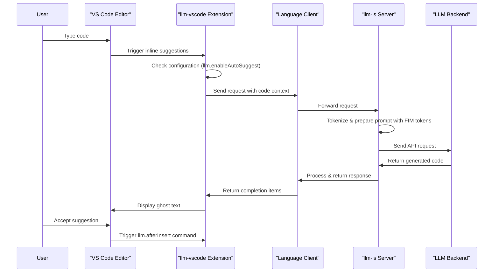

<!-- source: DeepWiki mcp.deepwiki.com · repo huggingface/llm-vscode · page 1 Overview · fetched 2026-10-26 -->

# Overview

<details>
<summary>Relevant source files</summary>

The following files were used as context for generating this wiki page:

- [README.md](README.md)
- [package.json](package.json)

</details>


The LLM-VS Code extension (llm-vscode) is a VS Code extension that provides LLM-powered code assistance and development tools. This extension uses the Language Server Protocol (LSP) to connect with the `llm-ls` language server, which handles communication with various LLM backends to provide AI-assisted code completion.

For detailed explanations of specific features, see [Features](#1.1). For installation and getting started information, see [Getting Started](#1.2).

Sources: [README.md:1-3](), [package.json:1-5]()

## Purpose and Scope

The core purpose of llm-vscode is to provide:

1. Code completion with "ghost-text" similar to GitHub Copilot
2. Flexibility in model selection from various providers 
3. Efficient management of context windows
4. Code attribution to verify originality of generated code

The extension supports multiple backend services including Hugging Face Inference API, OpenAI, Ollama, and Text Generation Inference (TGI).

Sources: [README.md:16-41](), [package.json:35-47]()

## High-Level Architecture

```mermaid
flowchart TD
    subgraph "User IDE"
        VSCode["VS Code Editor"]
        UserConfig["User Configuration
        (settings.json)"]
    end
    
    subgraph "llm-vscode Extension"
        ExtMain["extension.ts
        (Main Entry)"]
        ConfigSystem["Configuration System
        (configTemplates.ts)"]
        InlineProvider["Inline Completion Provider"]
        AuthManager["Authentication Manager"]
        AttributionSystem["Code Attribution"]
    end
    
    subgraph "LSP System"
        LangClient["Language Client"]
        LLMLS["llm-ls Language Server"]
    end
    
    subgraph "LLM Backends"
        HFInference["Hugging Face Inference API"]
        Ollama["Ollama"]
        OpenAI["OpenAI API"]
        TGI["Text Generation Inference"]
    end
    
    VSCode <--> ExtMain
    UserConfig --> ConfigSystem --> ExtMain
    ExtMain --> InlineProvider
    ExtMain --> AuthManager
    ExtMain --> AttributionSystem
    
    InlineProvider <--> LangClient
    LangClient <--> LLMLS
    LLMLS <--> HFInference
    LLMLS <--> Ollama
    LLMLS <--> OpenAI
    LLMLS <--> TGI
    
    AttributionSystem --> "stack.dataportraits.org"
```

The architecture of llm-vscode follows a modular design. The extension integrates with VS Code and communicates with an LSP language server (`llm-ls`), which handles interactions with LLM backends. The system components include the inline completion provider for generating code suggestions, authentication manager for handling API tokens, and the code attribution system.

Sources: [README.md:124-127](), [package.json:71-229]()

## Request Flow and User Interaction



When a user types in the editor, the extension prepares a request containing the code context. This is sent through the Language Client to the `llm-ls` server, which formats the prompt appropriately using Fill-in-the-Middle (FIM) tokens if needed. The LLM backend generates a completion which is then displayed as ghost text for the user to accept.

Sources: [README.md:69-97](), [package.json:53-70]()

## Configuration System

The extension provides extensive configuration options through VS Code's settings system, allowing users to:

1. Choose from predefined model templates or create custom configurations
2. Select different LLM backends (Hugging Face, Ollama, OpenAI, TGI)
3. Configure Fill-in-the-Middle settings
4. Set tokenizer options
5. Control suggestion behavior and keybindings

Here's a table of the key configuration templates available:

| Template | Description |
|----------|-------------|
| hf/bigcode/starcoder2-15b | Default model using Hugging Face's StarCoder 2 (15B parameters) |
| hf/codellama/CodeLlama-13b-hf | Meta's CodeLlama model (13B parameters) |
| hf/Phind/Phind-CodeLlama-34B-v2 | Phind's fine-tuned version of CodeLlama (34B parameters) |
| hf/WizardLM/WizardCoder-Python-34B-V1.0 | WizardLM's WizardCoder specialized for Python (34B parameters) |
| hf/deepseek-ai/deepseek-coder-6.7b-base | DeepSeek's code model (6.7B parameters) |
| ollama/codellama:7b | CodeLlama via Ollama (7B parameters) |
| Custom | Custom user configuration |

Sources: [package.json:71-229](), [README.md:56-186]()

## Model Integration and Backend Support

```mermaid
graph TD
    subgraph "Configuration Options"
        Config["llm.configTemplate
        (Model Selection)"]
        Backend["llm.backend
        (Backend Selection)"]
        ModelID["llm.modelId
        (Model Identifier)"]
        URL["llm.url
        (Endpoint URL)"]
    end
    
    subgraph "Request Formation"
        Context["Code Context"]
        FIM["Fill-in-the-Middle
        Processing"]
        PromptBuilder["Prompt Builder"]
        RequestBody["llm.requestBody
        (API Parameters)"]
    end
    
    subgraph "Backend Options"
        HF["huggingface
        (Inference API)"]
        Ollama["ollama
        (Local Models)"]
        OpenAI["openai
        (Compatible APIs)"]
        TGI["tgi
        (Text Generation Inference)"]
    end
    
    Config --> Backend
    Backend --> HF
    Backend --> Ollama
    Backend --> OpenAI
    Backend --> TGI
    
    Context --> FIM
    FIM --> PromptBuilder
    Backend --> PromptBuilder
    ModelID --> PromptBuilder
    RequestBody --> PromptBuilder
    
    PromptBuilder --> "API Request"
    URL --> "API Request"
```

The extension supports multiple LLM backends, with configuration options to select the appropriate model and endpoint. The request is formatted according to the selected backend's API requirements, with context window management to ensure the prompt fits within the model's capacity.

Sources: [README.md:56-109](), [package.json:71-229]()

## Additional Features

### Code Attribution

The extension provides a code attribution feature that checks if generated code matches content from [The Stack](https://huggingface.co/datasets/bigcode/the-stack), a large dataset of code. This allows users to verify the originality of the suggestions and identify potential sources. The attribution check is performed through an API endpoint at `stack.dataportraits.org`.

### Authentication

For Hugging Face models, the extension supports authentication via API tokens. Users can log in using the `Llm: Login` command, which allows accessing private models and higher rate limits.

Sources: [README.md:35-41](), [README.md:49-55](), [package.json:53-70]()

## Related Extensions

The llm-vscode extension is part of a family of LLM-powered development tools from Hugging Face, which also includes:
- llm.nvim for Neovim
- jupytercoder for Jupyter notebooks
- llm-intellij for IntelliJ IDEs

Sources: [README.md:3-10]()

---

