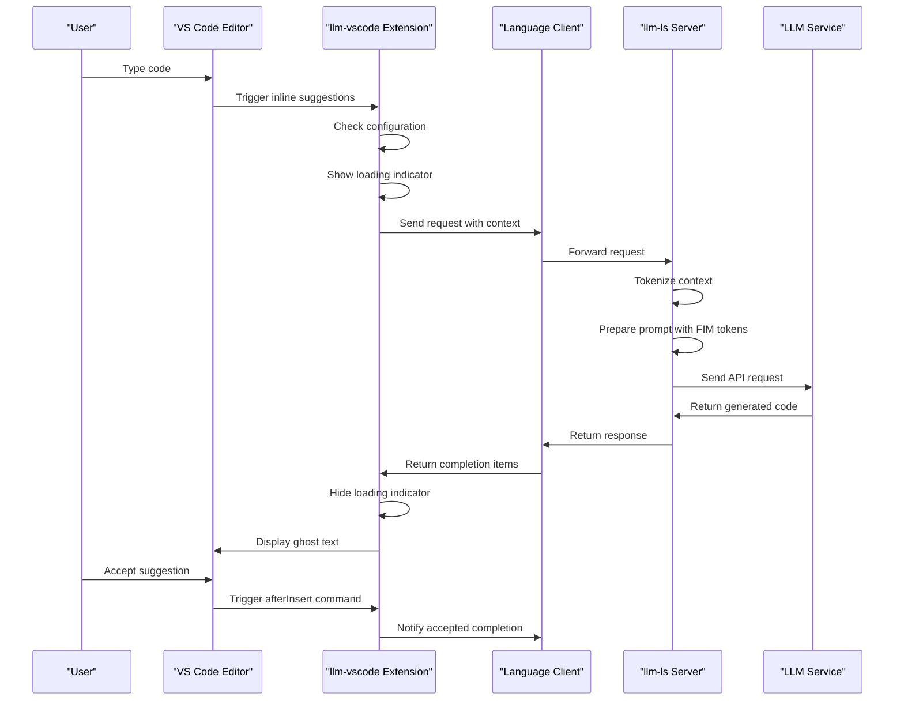
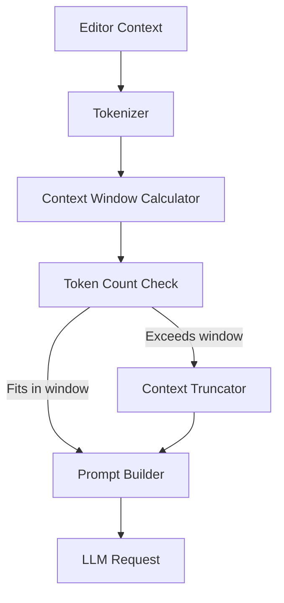
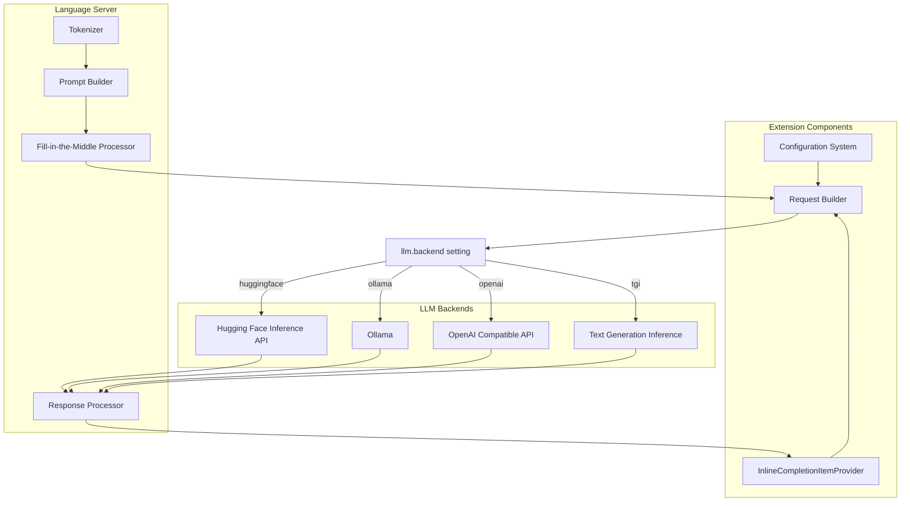
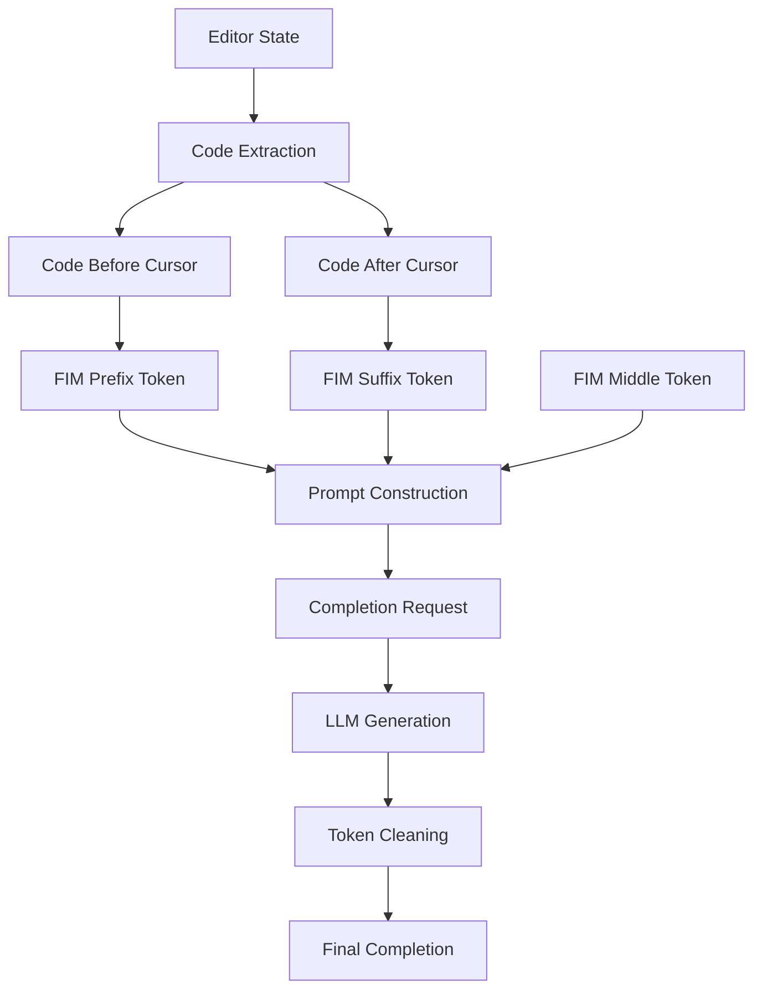

<!-- source: DeepWiki mcp.deepwiki.com · repo huggingface/llm-vscode · page 1.1 Features · fetched 2026-10-26 -->

# Features

<details>
<summary>Relevant source files</summary>

The following files were used as context for generating this wiki page:

- [README.md](README.md)
- [package.json](package.json)

</details>


This document provides a detailed explanation of the llm-vscode extension's capabilities and functionality. It covers the core features, supported backends, configuration options, and customization settings. For information about installing and setting up the extension, see [Getting Started](#1.2).

## Core Features

The llm-vscode extension offers several key features that enhance the coding experience using large language models.

### Code Completion

The extension provides "ghost-text" code completion similar to GitHub Copilot. As you type, the extension suggests code completions based on the current context of your file. These suggestions appear as ghost text that you can accept by pressing Tab or continue typing to dismiss.



Sources: [README.md:17-21](), [package.json:53-57]()

### Model Selection

The extension supports various pre-defined model templates that you can select through VS Code settings. Each template is configured with appropriate settings for that specific model.

Available model templates include:

| Model Template | Description |
|----------------|-------------|
| `hf/bigcode/starcoder2-15b` | StarCoder 2 (15B) - Default |
| `hf/codellama/CodeLlama-13b-hf` | CodeLlama (13B) |
| `hf/Phind/Phind-CodeLlama-34B-v2` | Phind-CodeLlama (34B) |
| `hf/WizardLM/WizardCoder-Python-34B-V1.0` | WizardCoder Python (34B) |
| `hf/deepseek-ai/deepseek-coder-6.7b-base` | DeepSeek Coder (6.7B) |
| `ollama/codellama:7b` | Ollama CodeLlama (7B) |

You can select a model template through the `llm.configTemplate` setting, which will automatically configure the other settings appropriately.

Sources: [package.json:85-97](), [README.md:169-186]()

### Context Window Management

The extension intelligently manages the context window to ensure the prompt fits within the model's capacity. It uses tokenizers to accurately count tokens and truncate the context when necessary while preserving the most relevant parts of the code.



The context window size can be configured through the `llm.contextWindow` setting, which defaults to 2048 tokens.

Sources: [package.json:154-158](), [README.md:32-33]()

### Code Attribution

The code attribution feature allows you to check if generated code matches content in "The Stack" dataset. This helps identify potential sources of the code suggestions and ensures proper attribution.

To use this feature, press `Cmd+Shift+A` (or the configured keybinding) to check the current selection or code near the cursor. The extension sends the code to the attribution service (default: `https://stack.dataportraits.org/overlap`).

This is a rapid first-pass attribution check using Bloom filters to identify sequences of at least 50 characters that match content in The Stack.

Sources: [package.json:67-69](), [README.md:35-41](), [package.json:169-178]()

## Backend Integration

The extension supports multiple backends for generating code completions, allowing you to choose the best option for your needs.



### Supported Backends

The extension supports the following backends:

1. **huggingface**: The Hugging Face Inference API (default)
2. **ollama**: Ollama local LLM server
3. **openai**: Any OpenAI compatible API
4. **tgi**: Text Generation Inference

The backend can be configured through the `llm.backend` setting.

Sources: [package.json:104-114](), [README.md:62-67]()

### URL Construction

The endpoint URL used to fetch suggestions is constructed based on the selected backend:

- For `huggingface` backend without a URL, it uses the default Inference API endpoint
- For other backends, a URL must be specified
- The extension automatically appends the correct path to the URL if needed (e.g., `/v1/completions` for OpenAI)
- This behavior can be disabled using the `llm.disableUrlPathCompletion` setting

Sources: [package.json:115-122](), [package.json:223-226](), [README.md:101-108]()

## Configuration Options

The extension provides numerous configuration options to customize its behavior according to your preferences.

### Fill-in-the-Middle (FIM)

Fill-in-the-Middle is a technique where the model is given both the code before and after the cursor position to provide more contextually appropriate completions.



FIM can be enabled or disabled through the `llm.fillInTheMiddle.enabled` setting, and the tokens used for marking the prefix, middle, and suffix can be configured through:
- `llm.fillInTheMiddle.prefix`: Default is `<fim_prefix>`
- `llm.fillInTheMiddle.middle`: Default is `<fim_middle>`
- `llm.fillInTheMiddle.suffix`: Default is `<fim_suffix>`

Sources: [package.json:123-142](), [README.md:78-80]()

### Suggestion Behavior

You can tune how suggestions behave through several settings:

- **Auto-suggest**: Enable or disable automatic suggestions as you type with the `llm.enableAutoSuggest` setting (default: true)
- **Request Delay**: Set the delay between typing and triggering a suggestion with the `llm.requestDelay` setting (default: 150ms)

Sources: [package.json:75-84](), [README.md:112-113]()

### Document Filtering

The `llm.documentFilter` setting allows you to enable suggestions only for specific files that match the provided pattern. Examples:

| Pattern | Description |
|---------|-------------|
| `{ pattern: "**" }` | Match all files (default) |
| `{ pattern: "/path/to/project/**" }` | Match all files in a specific directory |
| `{ pattern: "**/*.{py,rs}" }` | Match only Python and Rust files |

Sources: [package.json:213-222](), [README.md:114-117]()

### Tokenizer Configuration

The extension uses tokenizers to ensure prompts fit the context window. Configuration options include:

1. **No tokenization** (count characters instead):
   ```json
   {
     "llm.tokenizer": null
   }
   ```

2. **Local file**:
   ```json
   {
     "llm.tokenizer": {
       "path": "/path/to/my/tokenizer.json"
     }
   }
   ```

3. **Hugging Face repository**:
   ```json
   {
     "llm.tokenizer": {
       "repository": "myusername/myrepo",
       "api_token": null
     }
   }
   ```

4. **HTTP endpoint**:
   ```json
   {
     "llm.tokenizer": {
       "url": "https://my-endpoint.example.com/mytokenizer.json",
       "to": "/download/path/of/mytokenizer.json"
     }
   }
   ```

Sources: [package.json:205-212](), [README.md:130-167]()

## Other Features

### API Token Management

The extension provides commands to login and logout with your Hugging Face API token:
- `Llm: Login` - Set your HF API token for authentication
- `Llm: Logout` - Remove your stored API token

The extension will also automatically detect tokens set via `huggingface-cli login`.

Sources: [package.json:58-64](), [README.md:50-55]()

### Keybindings

The extension sets two default keybindings:

| Keybinding | Command | Description |
|------------|---------|-------------|
| `Alt+Shift+L` | `editor.action.inlineSuggest.trigger` | Trigger suggestions manually |
| `Cmd+Shift+A` | `llm.attribution` | Run code attribution check |

These keybindings can be customized through the VS Code keybindings settings.

Sources: [package.json:231-240](), [README.md:121-123]()

### TLS Configuration

For development or testing environments, the extension provides the `llm.tlsSkipVerifyInsecure` setting to skip TLS verification for insecure connections.

Sources: [package.json:179-183]()

---

