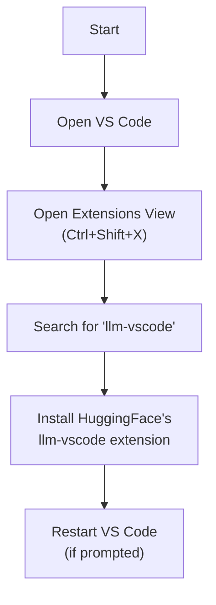
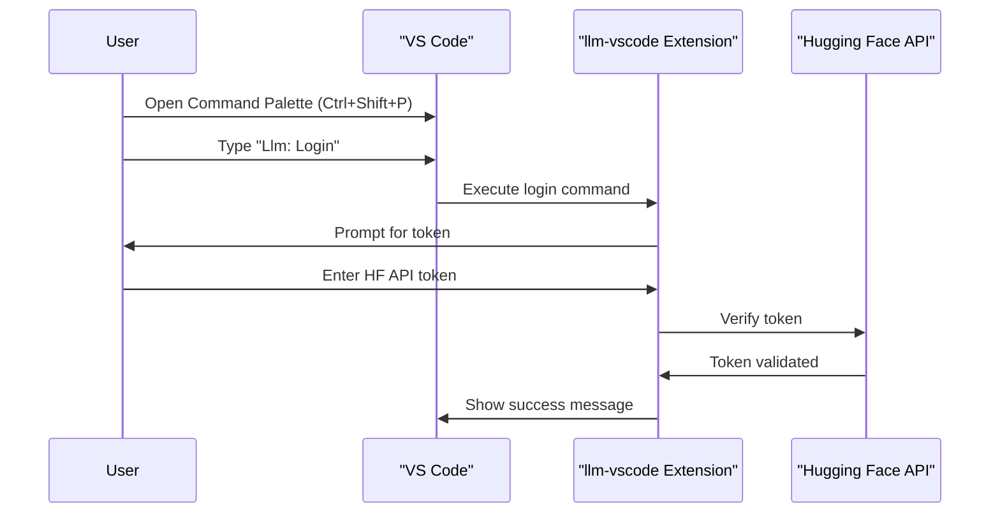
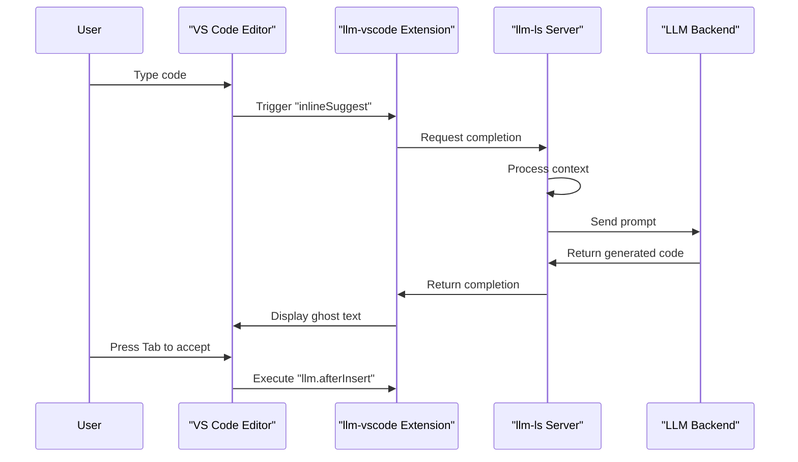
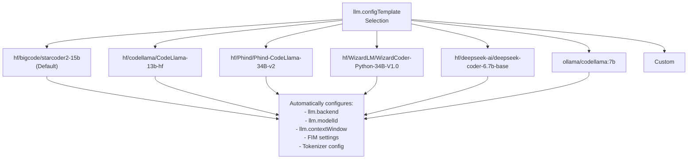
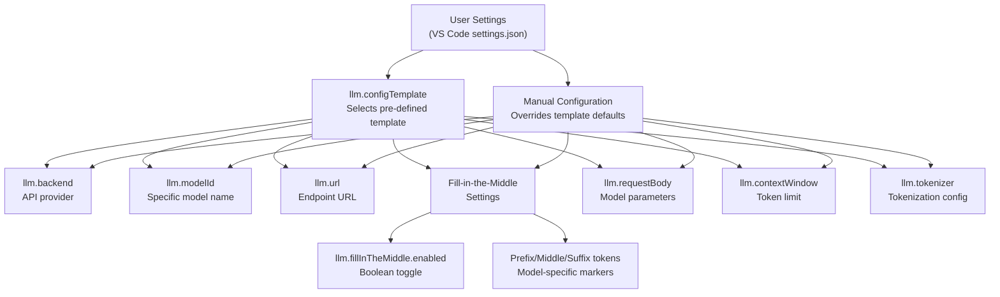

<!-- source: DeepWiki mcp.deepwiki.com · repo huggingface/llm-vscode · page 1.2 Getting Started · fetched 2026-10-26 -->

# Getting Started

Relevant source files

The following files were used as context for generating this wiki page:

- [README.md](README.md)
- [package.json](package.json)

This document provides a step-by-step guide for installing, configuring, and beginning to use the llm-vscode extension. This extension enables LLM-powered code completion directly within your VS Code editor. For more advanced topics, see [Architecture](#2) and [Configuration System](#3).

## Installation

The llm-vscode extension can be installed directly from the VS Code Marketplace like any other VS Code extension.

### Installation Flow

Sources: [package.json:1-10](), [README.md:43-47]()

### Prerequisites

- Visual Studio Code version 1.82.0 or higher (as specified in `engines.vscode`)
- Internet connection for accessing LLM backends

## Authentication

The default configuration uses the [bigcode/starcoder2-15b](https://huggingface.co/bigcode/starcoder2-15b) model via the Hugging Face Inference API, which requires authentication.

### Setting Up HF API Token

1. Obtain your Hugging Face API token from [hf.co/settings/token](https://huggingface.co/settings/token)
2. In VS Code:
   - Open Command Palette (`Ctrl+Shift+P` or `Cmd+Shift+P`)
   - Type and select "Llm: Login"
   - Enter your token when prompted

**Note**: If you've previously authenticated with `huggingface-cli login` on your system, the extension will automatically read the token from disk.

Sources: [README.md:49-56](), [package.json:59-64]()

## Basic Usage

Once installed and authenticated, you can immediately begin using the code completion feature.

### Code Completion

The extension provides "ghost-text" code completions similar to GitHub Copilot:

1. Start typing code in a supported file type
2. The extension will display suggestions as semi-transparent text
3. Press `Tab` to accept a suggestion or continue typing to ignore it

#### Triggering Suggestions

- **Automatic**: By default, suggestions appear as you type
- **Manual**: Press `Alt+Shift+L` to explicitly trigger suggestions

Sources: [package.json:54-57](), [package.json:231-235](), [README.md:17-21]()

### Code Attribution

The extension can check if generated code matches content from "The Stack" dataset:

1. Place your cursor on or select the code you want to check
2. Press `Cmd+Shift+A` (macOS) or `Ctrl+Shift+A` (Windows/Linux)
3. The extension will check the code against The Stack dataset and display attribution information

Sources: [README.md:35-41](), [package.json:67-69](), [package.json:236-239]()

## Selecting a Model

The extension comes with several pre-configured model templates that you can choose from.

### Changing the Model Template

1. Open VS Code Settings (`Ctrl+,` or `Cmd+,`)
2. Search for "Llm: Config Template"
3. Select one of the available models from the dropdown:

| Model Template | Description |
|----------------|-------------|
| hf/bigcode/starcoder2-15b | Default model, general purpose code completion |
| hf/codellama/CodeLlama-13b-hf | Meta's CodeLlama 13B model |
| hf/Phind/Phind-CodeLlama-34B-v2 | Phind's specialized version of CodeLlama |
| hf/WizardLM/WizardCoder-Python-34B-V1.0 | Python-specialized coding model |
| hf/deepseek-ai/deepseek-coder-6.7b-base | DeepSeek's compact coding model |
| ollama/codellama:7b | Local CodeLlama via Ollama |
| Custom | For advanced manual configuration |

Sources: [package.json:85-96](), [README.md:169-186]()

## Supported Backends

The extension supports multiple LLM backends:

| Backend | Description | URL Configuration |
|---------|-------------|------------------|
| huggingface | Hugging Face Inference API (default) | Optional, uses default API URL if not specified |
| ollama | Local Ollama instance | Required |
| openai | OpenAI compatible API | Required |
| tgi | Text Generation Inference | Required |

To change the backend:

1. Open VS Code Settings
2. Search for "Llm: Backend"
3. Select your preferred backend

For non-HuggingFace backends, you'll need to configure the URL:

1. Search for "Llm: URL" in settings
2. Enter the appropriate URL for your backend

Sources: [package.json:104-122](), [README.md:62-108]()

## Configuration System Overview

While the extension works with minimal configuration, you may want to adjust settings for optimal performance. Here's a high-level overview of the configuration system:

For detailed configuration options, see [Configuration System](#3).

Sources: [package.json:71-228](), [README.md:57-167]()

## Adjusting Suggestion Behavior

You can customize how and when suggestions appear:

- **Enable/Disable Auto-suggest**: Set `llm.enableAutoSuggest` to true/false
- **Filter Documents**: Configure `llm.documentFilter` to enable suggestions only for specific files
- **Adjust Request Delay**: Set `llm.requestDelay` to control how quickly suggestions appear

Sources: [package.json:75-79](), [package.json:80-84](), [package.json:213-222](), [README.md:110-118]()

## Next Steps

Now that you have the extension set up, you might want to explore:

- [Architecture](#2) for understanding how the extension works
- [Configuration System](#3) for detailed configuration options
- [LLM Backends](#3.2) for configuring specific backends
- [Fill-in-the-Middle](#3.3) for understanding this feature
- [Troubleshooting](#6) for resolving common issues

---

