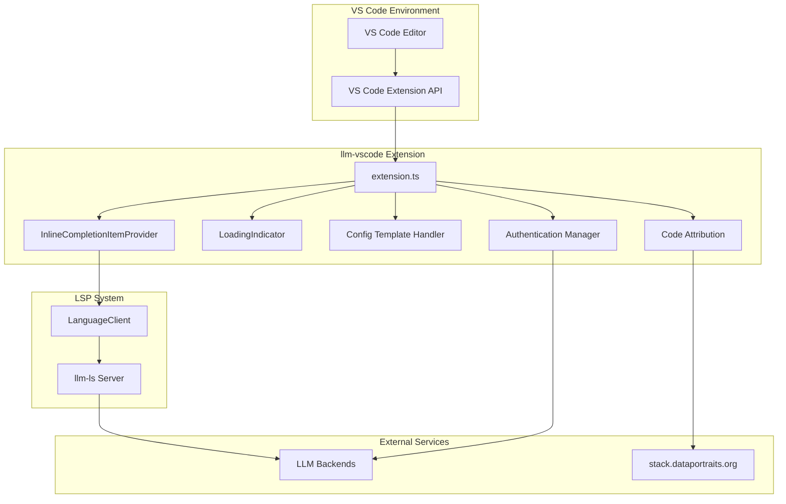
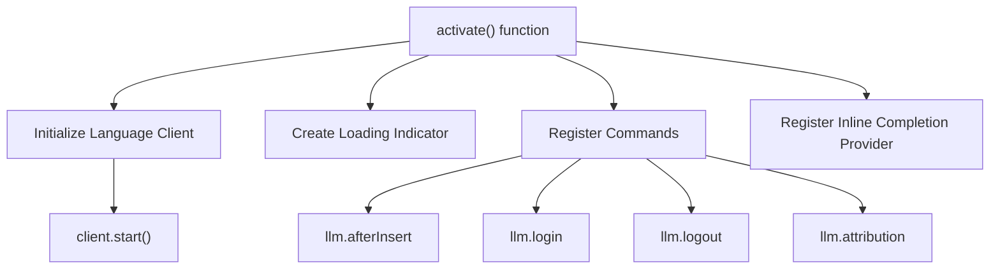
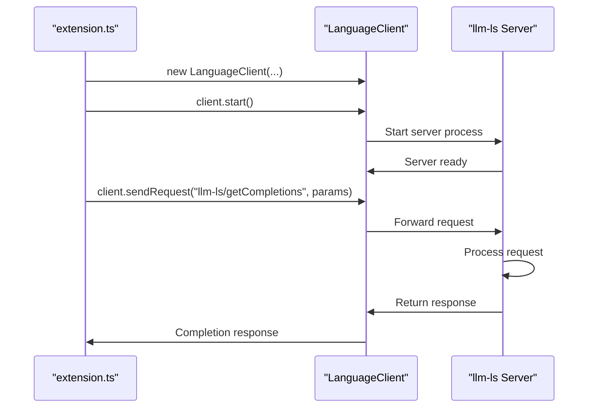
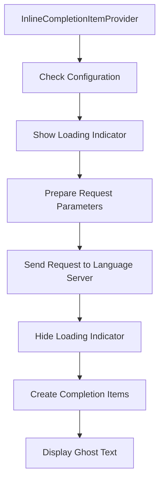
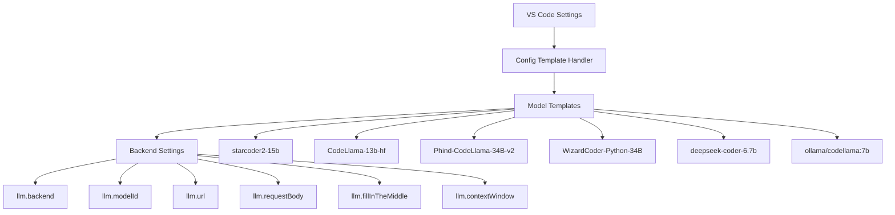
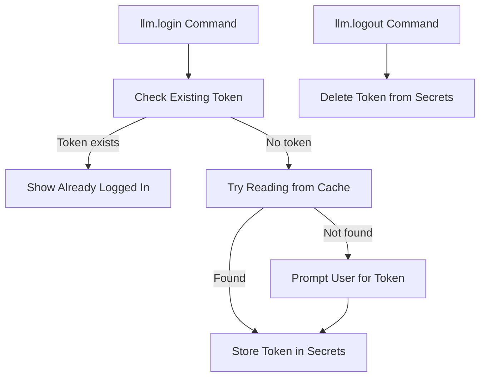
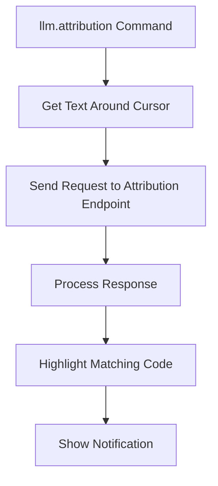
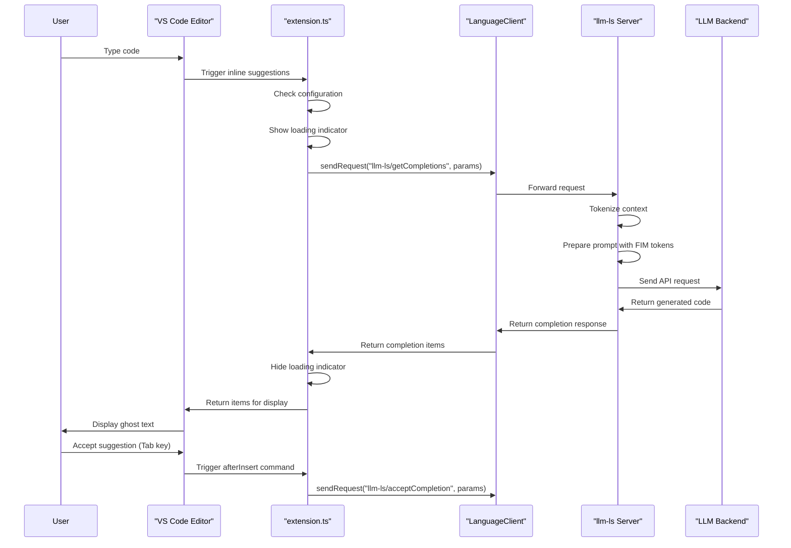
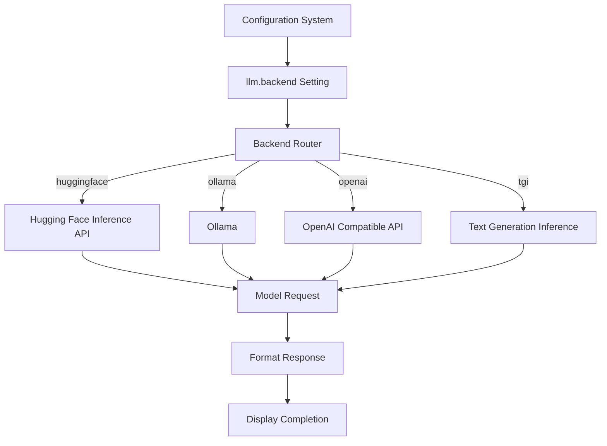

<!-- source: DeepWiki mcp.deepwiki.com · repo huggingface/llm-vscode · page 2 Architecture · fetched 2026-10-26 -->

# Architecture

Relevant source files

The following files were used as context for generating this wiki page:

- [README.md](README.md)
- [package.json](package.json)
- [src/extension.ts](src/extension.ts)

## Purpose and Scope

This document provides a technical overview of the internal architecture of the llm-vscode extension. It explains the main components, their relationships, and how data flows through the system during code completion operations. The focus is on the structural design of the system rather than implementation details.

For information about using the extension's features, refer to [Features](#1.1), and for configuration details, see [Configuration System](#3).

## System Overview

The llm-vscode extension follows a client-server architecture using the Language Server Protocol (LSP). The VS Code extension serves as the client, which communicates with a dedicated language server (`llm-ls`) that handles the core language processing tasks. This separation allows for better performance, maintainability, and cross-editor compatibility.

### High-Level Architecture Diagram

Sources: [src/extension.ts:35-214](), [package.json:48-50]()

## Core Components

### Extension Entry Point

The extension's entry point is the `activate` function in the main file. This function initializes all components and registers the necessary commands and providers.

Sources: [src/extension.ts:35-214]()

The `activate` function handles:
- Setting up the Language Server Protocol client
- Creating a status bar loading indicator
- Registering commands (afterInsert, login, logout, attribution)
- Setting up the inline completion provider
- Initializing configuration template handling

### Language Server Protocol Integration

The extension communicates with the `llm-ls` language server using the Language Server Protocol (LSP). The server runs as a separate process, which improves stability and performance.

Sources: [src/extension.ts:52-83](), [src/extension.ts:78-87]()

The language client is initialized with:
- Server options that specify how to start and connect to the `llm-ls` binary
- Client options that specify which documents the server should handle
- Output channel for logging

### Inline Completion Provider

The inline completion provider is responsible for generating and displaying code suggestions as ghost text in the editor.

Sources: [src/extension.ts:142-211](), [src/extension.ts:28-33]()

The provider's main functionality is in the `provideInlineCompletionItems` method, which:
1. Checks if auto-suggest is enabled
2. Shows a loading indicator
3. Constructs request parameters from the configuration
4. Sends a request to the language server
5. Creates completion items from the response
6. Returns the items to VS Code for display

### Configuration System

The configuration system manages all the settings that control the extension's behavior, including model selection, backend configuration, and tokenizer settings.

Sources: [src/extension.ts:223-236](), [package.json:71-228]()

The configuration template handler listens for changes to the `llm.configTemplate` setting and updates all relevant settings when a new template is selected. This allows users to quickly switch between different pre-configured models.

### Authentication

The authentication component manages the Hugging Face API token, which is required for accessing the Hugging Face Inference API.

Sources: [src/extension.ts:101-136]()

The authentication component provides:
- A login command that tries to read the token from cache or prompts the user
- A logout command that removes the stored token
- Access to the stored token for API requests

### Code Attribution

The code attribution feature allows users to check if code snippets exist in the Stack dataset.

Sources: [src/extension.ts:239-324]()

The code attribution component:
1. Gets the text around the current cursor position
2. Sends it to the attribution service
3. Highlights any matching spans in the editor
4. Shows a notification with the results

## Request Flow

The following diagram illustrates how a code completion request flows through the system:

Sources: [src/extension.ts:142-211](), [src/extension.ts:89-98]()

## Backend Integration

The extension can integrate with multiple LLM backends for code generation:

Sources: [package.json:104-111](), [src/extension.ts:163-178]()

The backend integration:
1. Determines which backend to use based on configuration
2. Constructs appropriate request parameters for that backend
3. Sends the request with the necessary authentication
4. Processes the response into a standard format

## Data Flow

A typical data flow for code completion follows this path:

```mermaid
graph LR
    UserInput["User Input"] --> EditorContext["Editor Context"]
    EditorContext --> RequestParams["Request Parameters"]
    RequestParams --> LSPRequest["LSP Request"]
    LSPRequest --> ServerProcess["Server Processing"]
    ServerProcess --> LLMRequest["LLM API Request"]
    LLMRequest --> GeneratedText["Generated Text"]
    GeneratedText --> CompletionItems["Completion Items"]
    CompletionItems --> GhostText["Ghost Text"]
    GhostText --> AcceptedCompletion["Accepted Completion"]
    AcceptedCompletion --> FinalCode["Final Code"]
```

Sources: [src/extension.ts:142-211]()

## Summary

The llm-vscode extension uses a client-server architecture with the Language Server Protocol to provide LLM-powered code completions in VS Code. The main components include:

1. A VS Code extension that handles UI interactions and configuration
2. A language server (llm-ls) that processes code contexts and communicates with LLM backends
3. Integration with multiple LLM backends for code generation
4. A configuration system with pre-defined model templates
5. Authentication handling for Hugging Face API access
6. Code attribution features for checking code sources

This architecture provides flexibility, scalability, and good performance while allowing the extension to support multiple LLM backends and models.

Sources: [src/extension.ts:1-351](), [package.json:1-268]()

---

