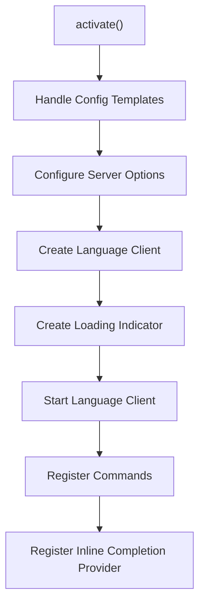
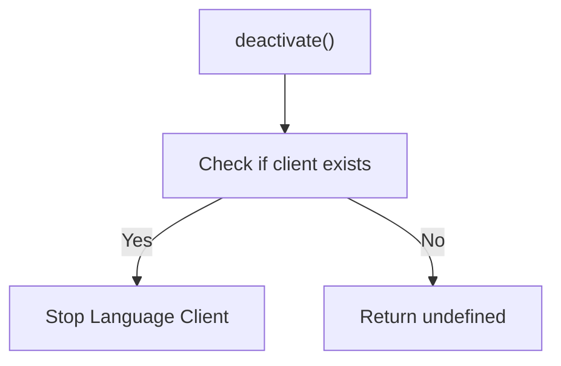
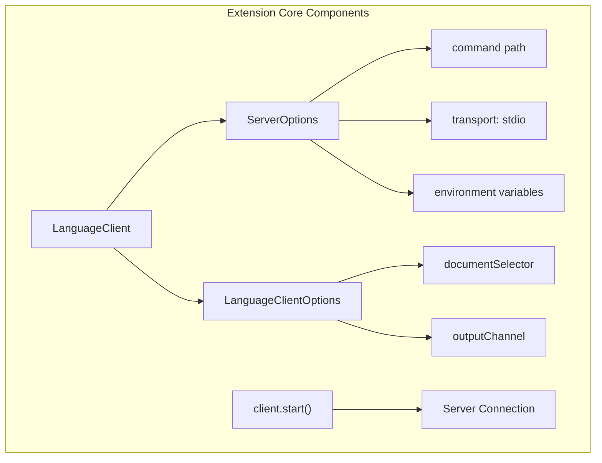
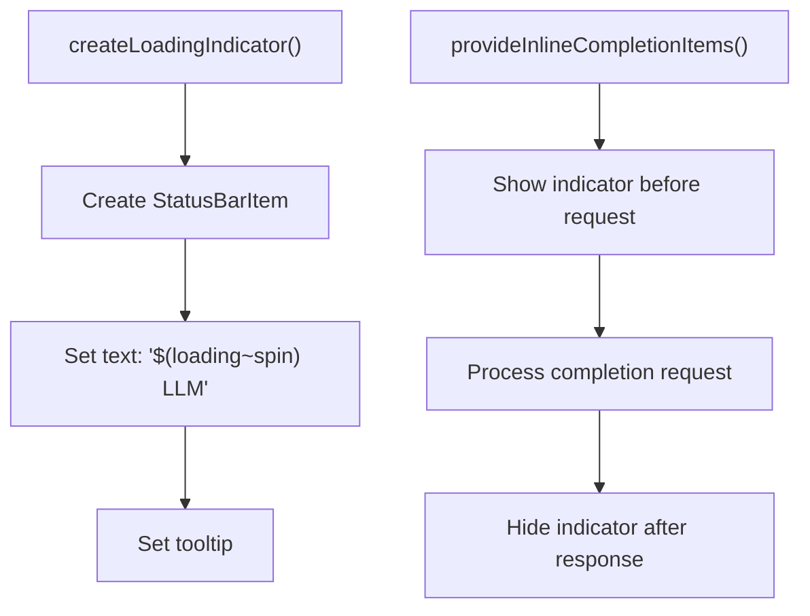
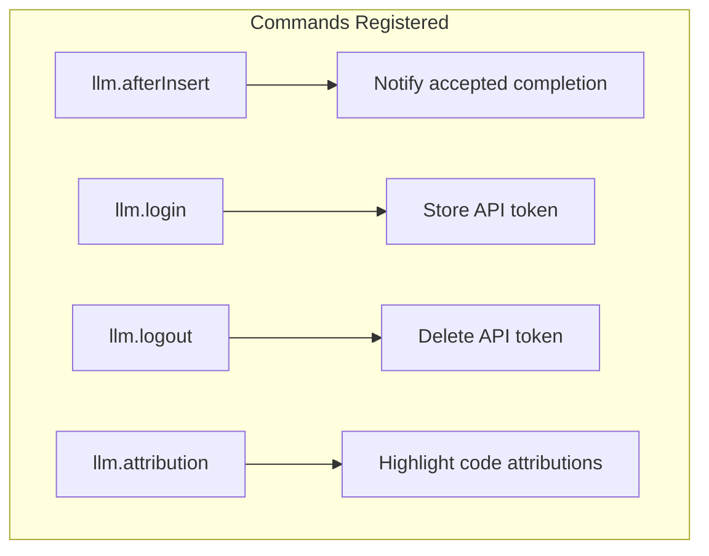
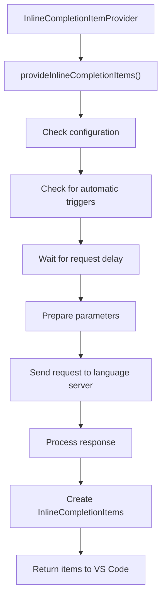
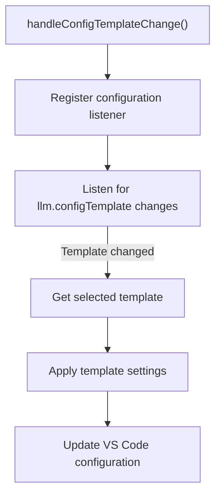
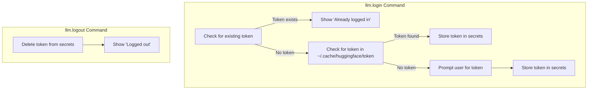
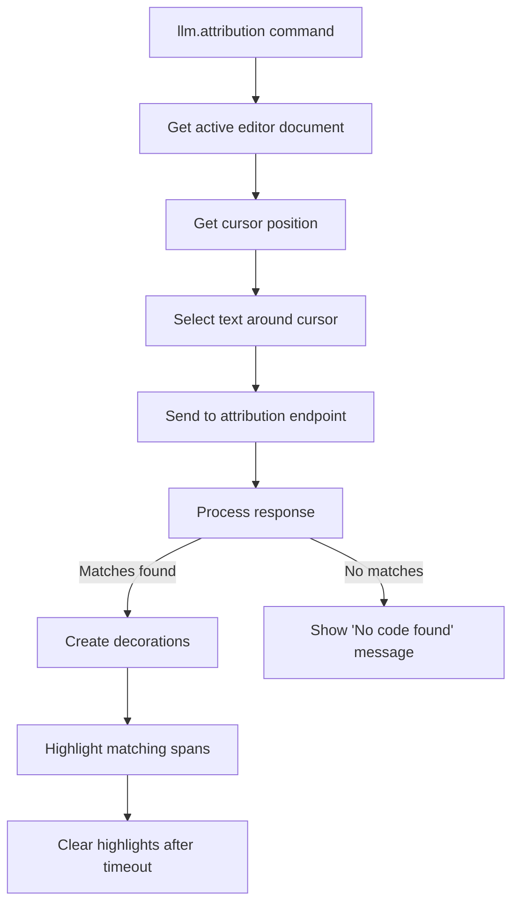
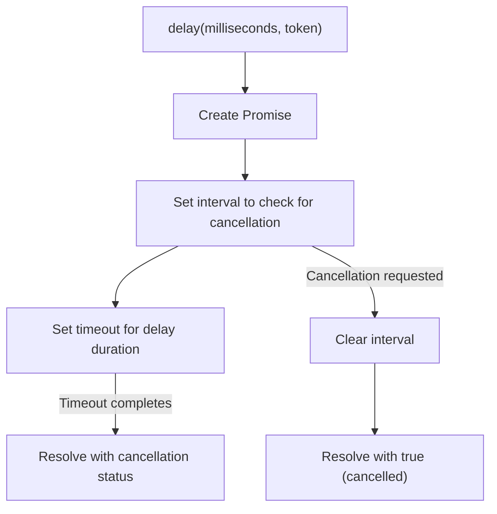

<!-- source: DeepWiki mcp.deepwiki.com · repo huggingface/llm-vscode · page 2.1 VS Code Extension Core · fetched 2026-10-26 -->

# VS Code Extension Core

Relevant source files

The following files were used as context for generating this wiki page:

- [package.json](package.json)
- [src/extension.ts](src/extension.ts)

This document details the main extension component of LLM-VS Code and its activation process. The VS Code Extension Core is responsible for initializing the extension, setting up communication with the language server, registering commands and providers, and handling configuration changes.

For information about how the extension communicates with the Language Server, see [Language Server Protocol Integration](#2.2). For details about the Inline Completion Provider, see [Inline Completion Provider](#2.3).

## Extension Lifecycle

The LLM-VS Code extension follows the standard VS Code extension lifecycle, with defined activation and deactivation functions.

### Activation Process

When VS Code loads the extension, the `activate` function in [src/extension.ts:35-214]() is called with a context object. The activation process:

1. Initializes configuration template handling
2. Reads configuration settings from VS Code
3. Determines the language server binary path
4. Creates and starts the Language Client
5. Sets up the loading indicator
6. Registers commands (login, logout, attribution, afterInsert)
7. Registers the inline completion provider

Sources: [src/extension.ts:35-214]()

### Deactivation Process

The `deactivate` function in [src/extension.ts:216-221]() is called when the extension is deactivated. It stops the language client if it exists.

Sources: [src/extension.ts:216-221]()

## Core Components

### Language Client Setup

The extension creates a Language Client that communicates with the Language Server:

1. **ServerOptions**: Defines how to start and communicate with the server:
   - **Command**: Path to the `llm-ls` binary (either from user configuration or bundled with the extension)
   - **Transport**: Uses stdio for communication
   - **Environment Variables**: Sets `RUST_BACKTRACE` and `LLM_LOG_LEVEL`

2. **ClientOptions**: Configures client behavior:
   - **Document Selector**: Specifies which documents the client handles
   - **Output Channel**: Where server logs are displayed

Sources: [src/extension.ts:39-83]()

### Loading Indicator

The extension creates a status bar item to indicate when it's generating completions. The loading indicator is:
- Created in the `createLoadingIndicator` function [src/extension.ts:28-33]()
- Shown before sending a request to the language server
- Hidden after receiving the response

Sources: [src/extension.ts:28-33](), [src/extension.ts:180-182]()

### Command Registration

The extension registers several VS Code commands:

1. **llm.afterInsert**: Called when a user accepts a suggestion, notifies the language server [src/extension.ts:89-99]()
2. **llm.login**: Manages authentication with Hugging Face [src/extension.ts:101-131]()
3. **llm.logout**: Removes stored authentication token [src/extension.ts:132-136]()
4. **llm.attribution**: Identifies and highlights code that might be found in public code repositories [src/extension.ts:138-141]()

Sources: [src/extension.ts:89-141]()

### Inline Completion Provider

The extension registers an `InlineCompletionItemProvider` that generates code suggestions:

1. Checks if automatic suggestions are enabled and applies request delay
2. Prepares parameters including position, model, backend, and configuration
3. Shows the loading indicator
4. Sends request to the language server
5. Processes the response and creates inline completion items
6. Returns the items to VS Code for display

Sources: [src/extension.ts:142-213]()

## Configuration System

The extension manages configuration through:

1. **Configuration Listener**: Monitors changes to the `llm.configTemplate` setting
2. **Template Application**: When the template changes, applies the corresponding settings
3. **Global Updates**: Updates are applied at the global level

The configuration system is defined in [src/extension.ts:223-236]() and uses templates from the imported `configTemplates.ts` file.

Sources: [src/extension.ts:223-236](), [package.json:71-229]()

## Authentication Management

The extension manages Hugging Face API tokens:

1. **Token Storage**: Uses VS Code's `secrets` API to securely store API tokens
2. **Login Sources**:
   - Checks for existing token in secrets
   - Looks for token in `~/.cache/huggingface/token`
   - Prompts user to enter token manually
3. **Token Usage**: The stored token is used for authenticated requests to Hugging Face

Sources: [src/extension.ts:101-136]()

## Code Attribution Feature

The extension provides a feature to identify code that might be found in public code repositories:

1. **Selection**: Selects text around the cursor (configurable window size)
2. **Attribution Request**: Sends the selected text to an attribution endpoint
3. **Highlighting**: Creates text decorations to highlight matching spans
4. **User Feedback**: Shows messages about the attribution results
5. **Cleanup**: Clears highlights after a timeout

Sources: [src/extension.ts:239-324]()

## Extension Configuration

The extension exposes numerous configuration options in the `package.json` file:

| Category | Configuration Options |
|----------|----------------------|
| General | `llm.requestDelay`, `llm.enableAutoSuggest` |
| Models | `llm.configTemplate`, `llm.modelId`, `llm.backend` |
| Server | `llm.url`, `llm.tlsSkipVerifyInsecure` |
| Fill-in-the-Middle | `llm.fillInTheMiddle.enabled`, `llm.fillInTheMiddle.prefix`, `llm.fillInTheMiddle.middle`, `llm.fillInTheMiddle.suffix` |
| Request | `llm.requestBody`, `llm.contextWindow`, `llm.tokensToClear` |
| Attribution | `llm.attributionWindowSize`, `llm.attributionEndpoint` |
| LSP | `llm.lsp.binaryPath`, `llm.lsp.port`, `llm.lsp.logLevel` |
| Advanced | `llm.tokenizer`, `llm.documentFilter`, `llm.disableUrlPathCompletion` |

Sources: [package.json:71-229]()

## Utilities

### Request Delay

The extension implements a delay function to debounce requests to the language server:

The `delay` function [src/extension.ts:326-350]() is used to wait for a specified time before sending a request, unless the operation is cancelled.

Sources: [src/extension.ts:326-350]()

---

