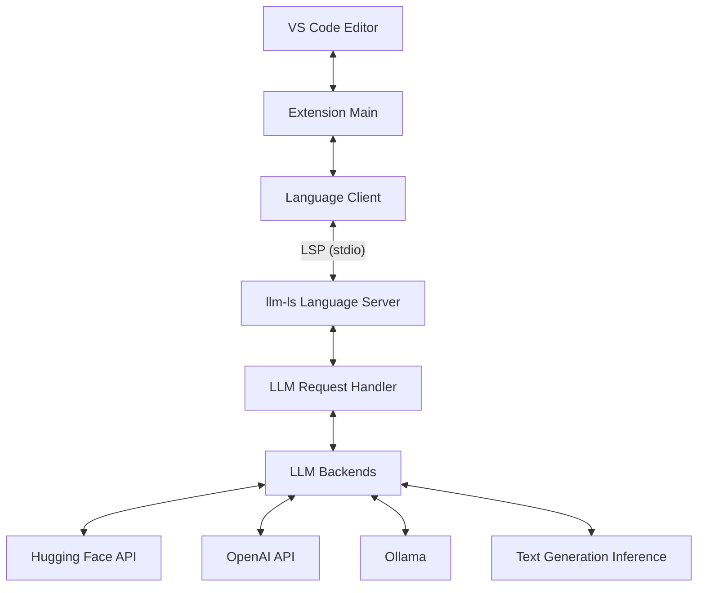
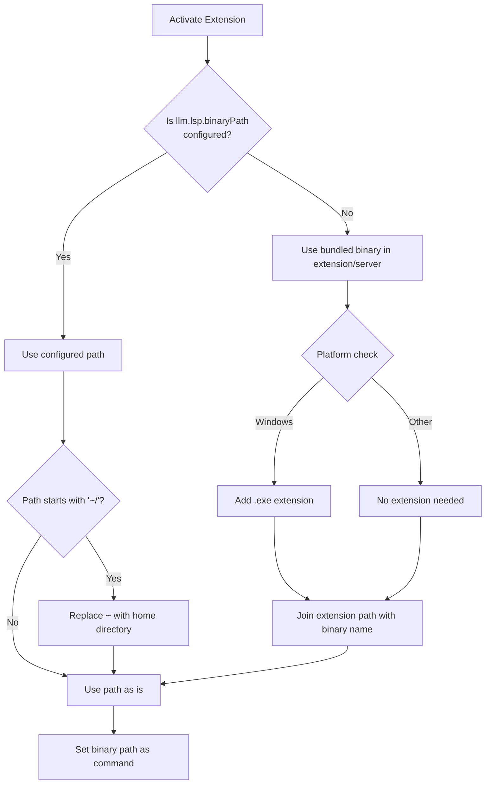
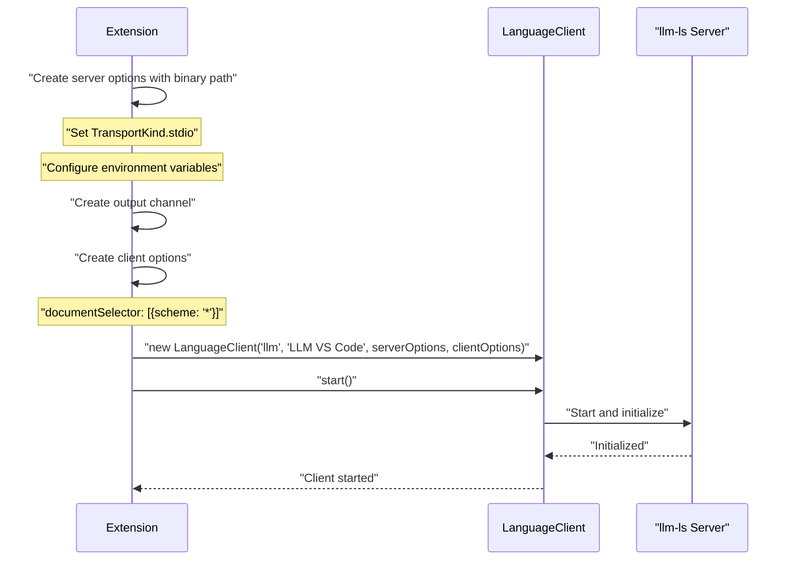
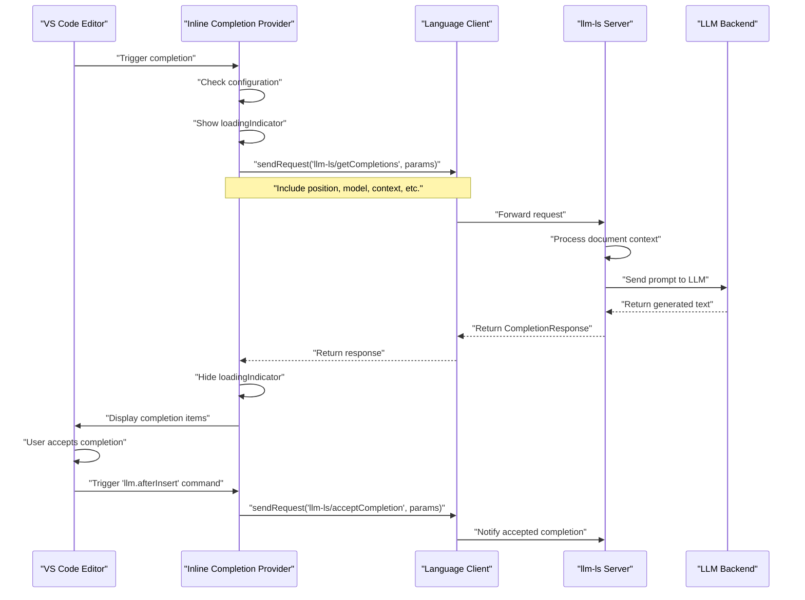
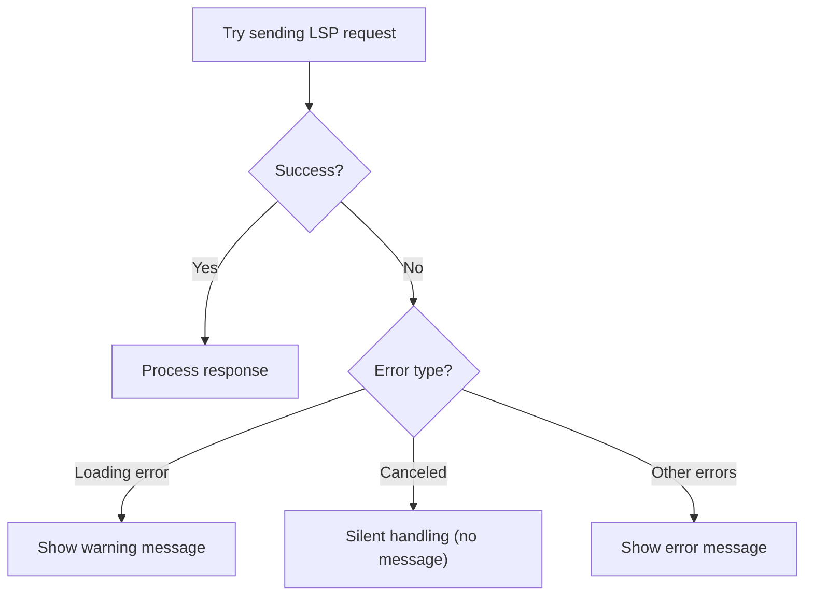
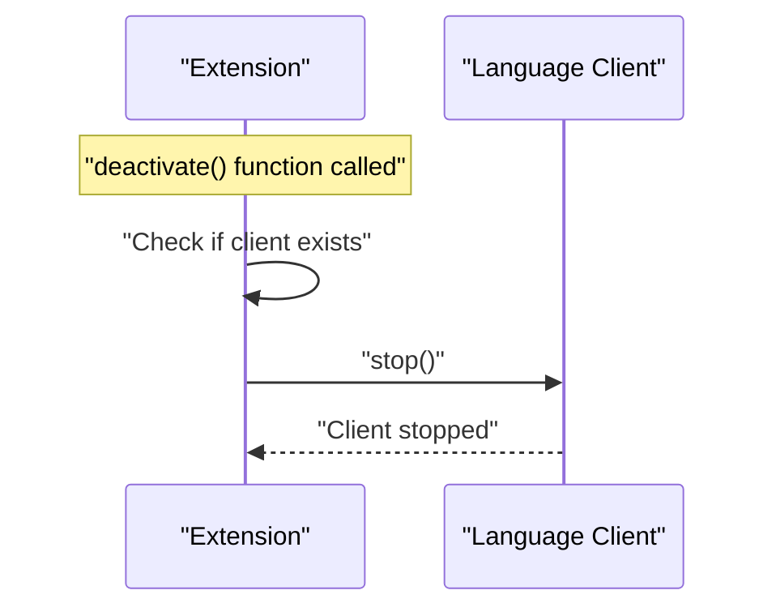
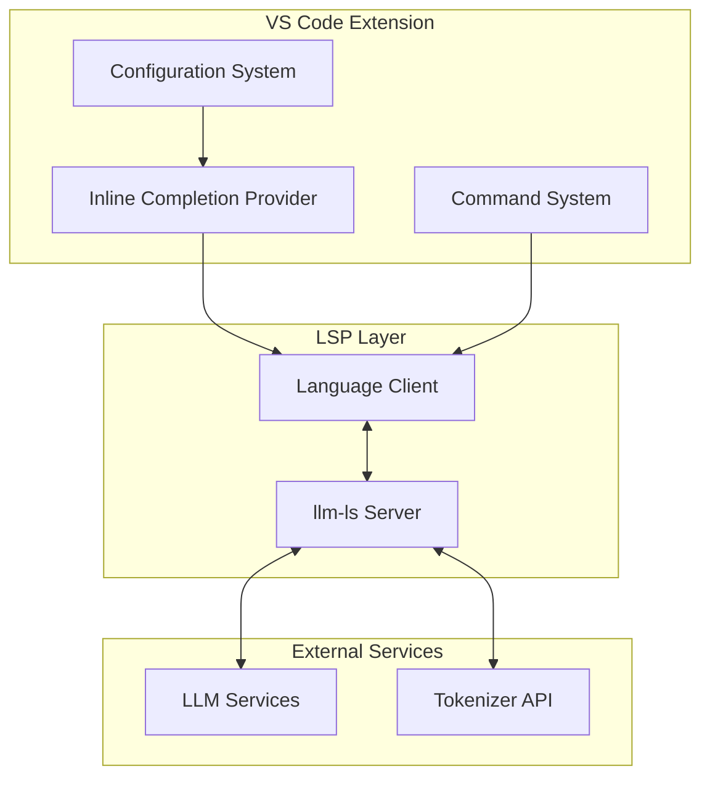

<!-- source: DeepWiki mcp.deepwiki.com · repo huggingface/llm-vscode · page 2.2 Language Server Protocol Integration · fetched 2026-10-26 -->

# Language Server Protocol Integration

<details>
<summary>Relevant source files</summary>

The following files were used as context for generating this wiki page:

- [README.md](README.md)
- [src/extension.ts](src/extension.ts)

</details>


This document explains how the llm-vscode extension communicates with the llm-ls language server through the Language Server Protocol (LSP). We'll cover the setup, communication flow, and key interactions between the extension and the language server.

For information about the core extension functionality, see [VS Code Extension Core](#2.1). For details about providing inline completions to the editor, see [Inline Completion Provider](#2.3).

## Overview of LSP in llm-vscode

The Language Server Protocol (LSP) is a standardized protocol that enables VS Code extensions to communicate with language servers. In llm-vscode, LSP enables the separation of concerns between:

1. The VS Code-specific code (UI, extension activation, settings management)
2. The language processing capabilities (prompt handling, tokenization, LLM interaction)

LSP Architecture Diagram:


Sources: [src/extension.ts:4-7](), [src/extension.ts:24](), [src/extension.ts:78-83]()

## Language Client Setup

When the extension is activated, it establishes a connection with the language server through a language client. This client sends requests to and receives responses from the server.

### Finding the Language Server Binary

The extension determines the path to the llm-ls binary as follows:



Sources: [src/extension.ts:40-50]()

### Configuring the Language Client

The extension creates server options and client options, then initializes the language client:



Sources: [src/extension.ts:52-87]()

The key configuration in the server options:

| Setting | Value | Purpose |
|---------|-------|---------|
| Transport | TransportKind.stdio | Communication method between client and server |
| Environment | RUST_BACKTRACE=1 | Enable stack traces for debugging |
| Environment | LLM_LOG_LEVEL | Set log level from configuration |

Sources: [src/extension.ts:52-71]()

## LSP Communication Flow

Once the language client is established, the extension communicates with the language server through custom LSP requests.

### Code Completion Request Sequence

The primary communication flow is requesting and displaying code completions:



Sources: [src/extension.ts:142-211](), [src/extension.ts:89-98]()

### Request Parameters

When sending the `getCompletions` request, the extension includes a comprehensive set of parameters:

```mermaid
graph TD
    Params["getCompletions Request Parameters"] --- Position["position: current cursor position"]
    Params --- Document["textDocument: document identifier"]
    Params --- Model["model: configured modelId"]
    Params --- Backend["backend: huggingface/openai/ollama/tgi"]
    Params --- URL["url: backend URL"]
    Params --- TokensToClear["tokensToClear: tokens to remove"]
    Params --- ApiToken["apiToken: from secrets storage"]
    Params --- RequestBody["requestBody: custom parameters"]
    Params --- FIM["fim: fill-in-the-middle setting"]
    Params --- ContextWindow["contextWindow: token limit"]
    Params --- TokenizerConfig["tokenizerConfig: tokenizer settings"]
```



Sources: [src/extension.ts:163-178]()

## Custom LSP Requests

The extension defines two custom LSP requests that extend the standard protocol:

### 1. llm-ls/getCompletions

This request fetches code completions from the language server.

**Request parameters:** Document context, model configuration, and other parameters shown above.

**Response structure:**
```typescript
interface CompletionResponse {
    request_id: String,
    completions: Completion[],
}

interface Completion {
    generated_text: string;
}
```

Sources: [src/extension.ts:15-22](), [src/extension.ts:181]()

### 2. llm-ls/acceptCompletion

This request notifies the language server when a completion is accepted by the user.

**Request parameters:**
```typescript
const params = {
    requestId: request_id,
    acceptedCompletion: 0,
    shownCompletions: [0],
    completions,
};
```

Sources: [src/extension.ts:89-98]()

## Error Handling

The extension implements comprehensive error handling for LSP communication:



Sources: [src/extension.ts:200-208]()

## Extension Deactivation

When the extension is deactivated, it properly cleans up the language client:



Sources: [src/extension.ts:216-221]()

## Connection with Other Extension Components

The LSP integration is a central component that connects various parts of the llm-vscode extension:



Sources: [src/extension.ts:142-211](), [src/extension.ts:89-98]()

## Conclusion

The Language Server Protocol integration is a fundamental architectural component of the llm-vscode extension. It:

1. Separates editor-specific code from language processing logic
2. Enables standardized communication between the extension and the llm-ls server
3. Provides a clean interface for requesting and handling code completions
4. Supports multiple LLM backends through a unified protocol

This separation of concerns makes the extension more maintainable and allows the language server to be potentially reused in other editors that support LSP.

---

