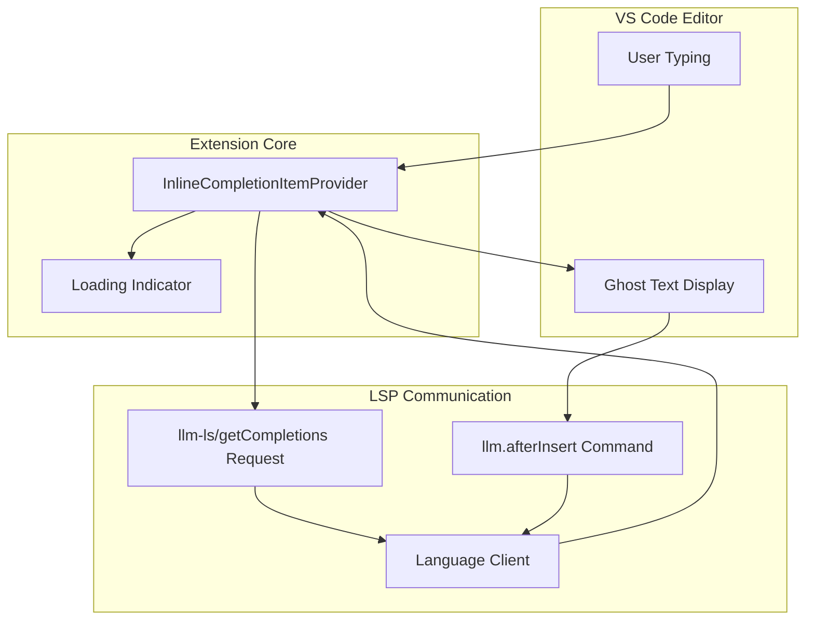
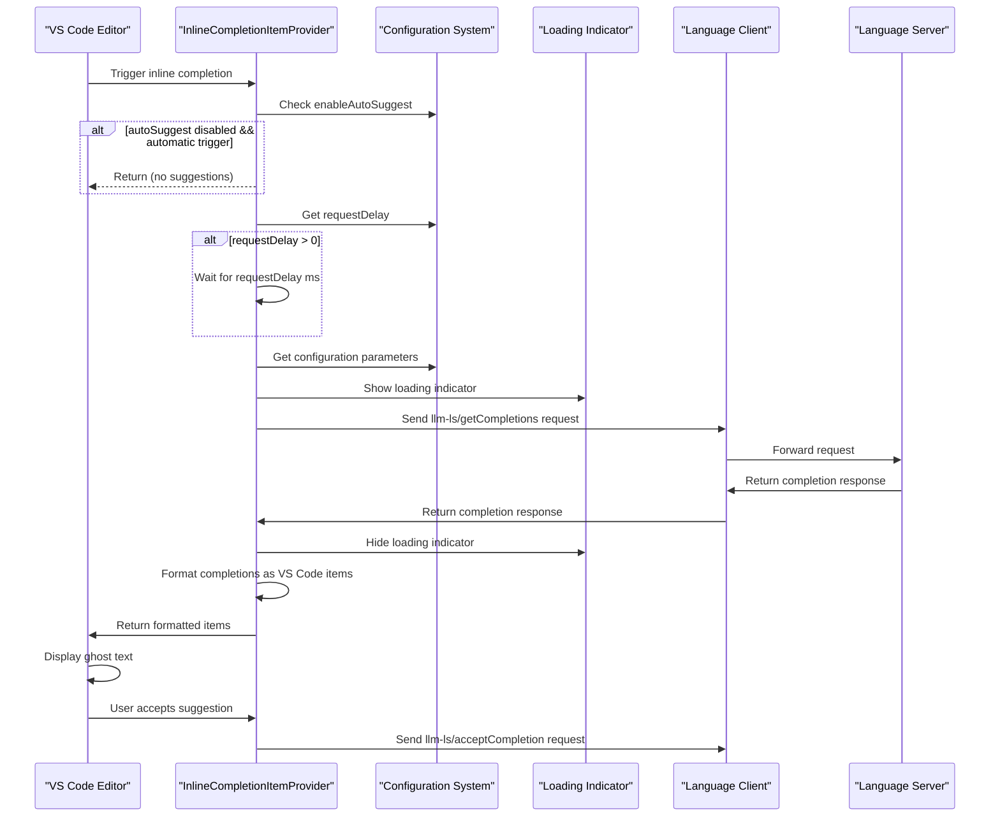

<!-- source: DeepWiki mcp.deepwiki.com · repo huggingface/llm-vscode · page 2.3 Inline Completion Provider · fetched 2026-10-26 -->

# Inline Completion Provider

<details>
<summary>Relevant source files</summary>

The following files were used as context for generating this wiki page:

- [package.json](package.json)
- [src/extension.ts](src/extension.ts)

</details>


The Inline Completion Provider is a core component of the llm-vscode extension that integrates with VS Code's InlineCompletionItemProvider API to deliver AI-powered code suggestions as you type. It handles the process of requesting, formatting, and displaying code completions directly in the editor as "ghost text" that can be accepted or ignored.

For information about how the Language Server Protocol integrates with this system, see [Language Server Protocol Integration](#2.2).

## Architecture

The Inline Completion Provider sits between the VS Code editor interface and the Language Server, acting as a bridge that transforms user actions into completion requests and displays the results back to the user.



Sources: [src/extension.ts:142-213](), [src/extension.ts:89-98]()

## Provider Implementation

The Inline Completion Provider is implemented as an object conforming to the `vscode.InlineCompletionItemProvider` interface. Its primary function is the `provideInlineCompletionItems` method, which is invoked whenever VS Code needs to display inline suggestions.

Here's the flow of operations within the provider:



Sources: [src/extension.ts:142-213](), [src/extension.ts:89-98]()

## Key Components

### 1. Provider Registration

The Inline Completion Provider is registered with VS Code during extension activation, specifying which document types it should provide completions for:

```typescript
const documentFilter = config.get("documentFilter") as DocumentFilter | DocumentFilter[];
vscode.languages.registerInlineCompletionItemProvider(documentFilter, provider);
```

Sources: [src/extension.ts:212-213]()

### 2. Completion Request Parameters

When requesting completions, the provider assembles a comprehensive set of parameters including:

- Current cursor position
- Document identifier
- Model configuration
- Backend selection
- API tokens for authentication
- Fill-in-the-Middle settings
- Context window size
- Tokenizer configuration

Sources: [src/extension.ts:163-177]()

### 3. Loading Indicator

The provider manages a loading indicator in the VS Code status bar to give visual feedback during completion requests:

```typescript
loadingIndicator = createLoadingIndicator();
// ...
loadingIndicator.show()
// Request processing...
loadingIndicator.hide()
```

Sources: [src/extension.ts:26-32](), [src/extension.ts:180-182]()

### 4. Completion Acceptance

After a user accepts a suggestion, the `llm.afterInsert` command is executed, which notifies the Language Server about the accepted completion:

```typescript
const afterInsert = vscode.commands.registerCommand('llm.afterInsert', async (response: CompletionResponse) => {
    const { request_id, completions } = response;
    const params = {
        requestId: request_id,
        acceptedCompletion: 0,
        shownCompletions: [0],
        completions,
    };
    await client.sendRequest("llm-ls/acceptCompletion", params);
});
```

This tracking enables the Language Server to record which completions were accepted for potential model improvements.

Sources: [src/extension.ts:89-98]()

## Configuration Options

The Inline Completion Provider's behavior can be customized through several VS Code settings:

| Setting | Type | Default | Description |
|---------|------|---------|-------------|
| `llm.enableAutoSuggest` | boolean | true | Enables or disables automatic suggestions while typing |
| `llm.requestDelay` | integer | 150 | Delay in milliseconds before requesting completions |
| `llm.documentFilter` | object/array | `{ "pattern": "**" }` | Filter for documents to enable suggestions for |
| `llm.contextWindow` | integer | 2048 | Maximum context window size for the model |
| `llm.modelId` | string | "bigcode/starcoder" | Model ID for generating completions |
| `llm.backend` | string | "huggingface" | Backend service (huggingface, ollama, openai, tgi) |

Sources: [package.json:74-222]()

## Request Flow and Data Processing

When the provider is triggered, it follows this process:

1. **Validation checks**:
   - Verifies if auto-suggest is enabled for automatic triggers
   - Ensures the cursor position is valid
   - Applies configured request delay to prevent excessive requests

2. **Parameter preparation**:
   - Collects configuration settings
   - Retrieves API tokens securely from VS Code secrets storage
   - Assembles the request payload

3. **Request handling**:
   - Shows loading indicator
   - Sends request to Language Server through Language Client
   - Processes response and formats it as VS Code completion items
   - Hides loading indicator when complete

4. **Error handling**:
   - Special handling for "model loading" warnings
   - Proper cancellation support
   - User-friendly error messages

Sources: [src/extension.ts:143-207]()

## Completion Response Processing

The Language Server response contains one or more completion suggestions in the following format:

```typescript
interface CompletionResponse {
    request_id: String,
    completions: Completion[],
}

interface Completion {
    generated_text: string;
}
```

The provider transforms these into VS Code's `InlineCompletionItem` format, attaching the `llm.afterInsert` command to be executed when the user accepts a suggestion:

```typescript
const items = [];
for (const completion of response.completions) {
    items.push({
        insertText: completion.generated_text,
        range: new vscode.Range(position, position),
        command: {
            title: 'afterInsert',
            command: 'llm.afterInsert',
            arguments: [response],
        }
    });
}
```

Sources: [src/extension.ts:15-22](), [src/extension.ts:184-195]()

## Debouncing and Performance

To prevent excessive requests while the user is actively typing, the provider implements a custom debounce mechanism using the `delay` function. This function waits for the configured delay period while respecting cancellation tokens:

```typescript
async function delay(milliseconds: number, token: vscode.CancellationToken): Promise<boolean> {
    // Wait for a number of milliseconds, unless the token is cancelled
    // ...
}
```

Sources: [src/extension.ts:326-350]()

## Key Dependencies

The Inline Completion Provider depends on:

1. **VS Code API**: For UI integration and providing completion items
2. **Language Client**: To communicate with the Language Server
3. **Configuration System**: To determine behavior based on user settings
4. **Secret Storage**: For securely managing API tokens

Sources: [src/extension.ts:1-8]()

---

