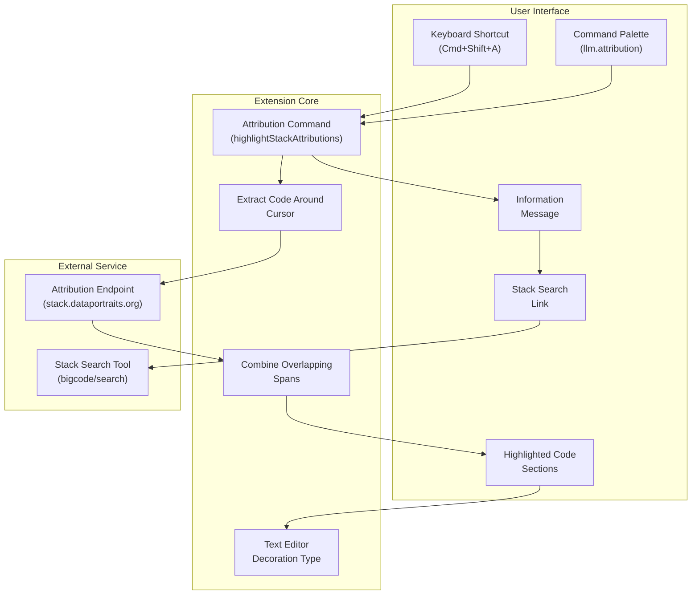
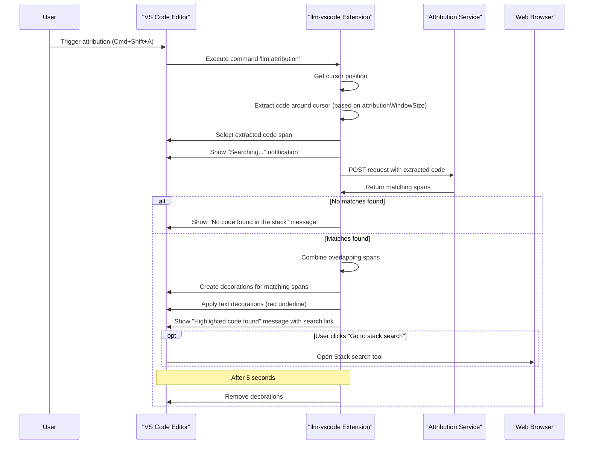
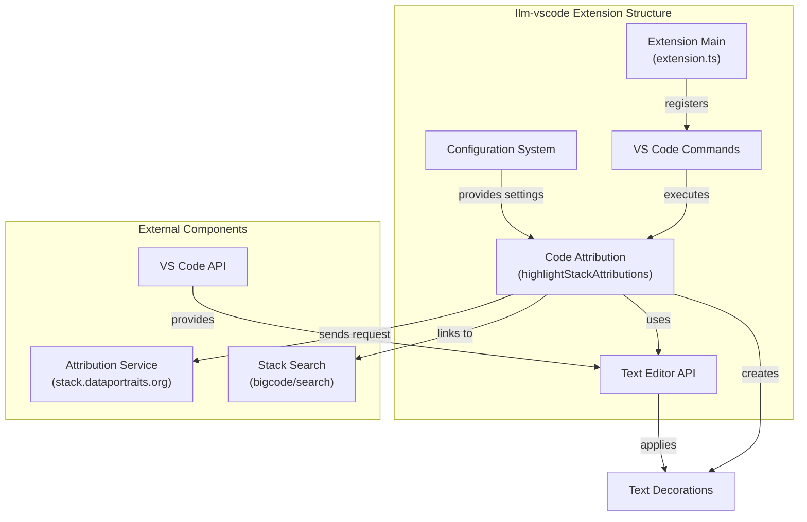

<!-- source: DeepWiki mcp.deepwiki.com · repo huggingface/llm-vscode · page 2.4 Code Attribution · fetched 2026-10-26 -->

# Code Attribution

<details>
<summary>Relevant source files</summary>

The following files were used as context for generating this wiki page:

- [README.md](README.md)
- [package.json](package.json)
- [src/extension.ts](src/extension.ts)

</details>


This document explains the Code Attribution feature in the llm-vscode extension, which allows users to check if code in their editor matches content found in "The Stack" dataset. This feature helps identify the potential source of code snippets and supports code transparency.

## Overview

The Code Attribution feature performs a rapid first-pass attribution check by sending the code currently visible in the editor to a specialized service that compares it against a dataset of code repositories. When matches are found, the extension highlights these code sections and provides an option to perform a more detailed search.

Sources: [README.md:35-41](), [package.json:66-69]()

## Implementation Architecture

The Code Attribution feature is implemented as a text editor command that can be triggered via a keyboard shortcut or command palette. It extracts code around the cursor position, sends it to an attribution service, and highlights any matching spans.



Sources: [extension.ts:138-141](), [extension.ts:239-324]()

## Attribution Process

When triggered, the Code Attribution feature executes a well-defined process to identify and highlight code sections that match content in The Stack dataset.



Sources: [extension.ts:239-324]()

## Extension Integration

The Code Attribution feature is registered during extension activation and integrates with other extension components.



Sources: [extension.ts:138-141](), [extension.ts:239-324]()

## Configuration Options

The Code Attribution feature can be configured through the following settings:

| Setting | Type | Default | Description |
|---------|------|---------|-------------|
| `llm.attributionWindowSize` | integer | 250 | Number of characters to scan before and after the cursor position |
| `llm.attributionEndpoint` | string | "https://stack.dataportraits.org/overlap" | Endpoint to which attribution requests will be sent |

Sources: [package.json:169-178](), [extension.ts:243-245]()

## Feature Implementation Details

The implementation of the Code Attribution feature is contained primarily in the `highlightStackAttributions` function in the extension's main file.

1. **Command Registration**: The attribution command is registered during extension activation
   ```typescript
   const attribution = vscode.registerTextEditorCommand('llm.attribution', () => {
     void highlightStackAttributions();
   });
   ctx.subscriptions.push(attribution);
   ```

2. **Extracting Code**: The function extracts a window of code around the cursor position
   ```typescript
   const start = Math.max(0, cursorOffset - attributionWindowSize);
   const end = Math.min(document.getText().length, cursorOffset + attributionWindowSize);
   const textAroundCursor = text.slice(start, end);
   ```

3. **API Request**: The extracted code is sent to the attribution service
   ```typescript
   const resp = await fetch(attributionEndpoint, {
     method: "POST",
     body: JSON.stringify(body),
     headers: { "Content-Type": "application/json" },
   });
   ```

4. **Highlighting Matches**: Matching code spans are highlighted in the editor
   ```typescript
   const decorationType = vscode.window.createTextEditorDecorationType({
     color: 'red',
     textDecoration: 'underline',
   });
   
   vscode.window.activeTextEditor?.setDecorations(decorationType, decorations);
   ```

5. **Temporary Highlighting**: Highlights are automatically removed after 5 seconds
   ```typescript
   setTimeout(() => {
     vscode.window.activeTextEditor?.setDecorations(decorationType, []);
   }, 5000);
   ```

Sources: [extension.ts:239-324]()

## Workflow Example

When a developer wants to check if their code might be derived from open-source repositories:

1. They position their cursor near the code they want to check
2. They press `Cmd+Shift+A` or run the command "Llm: Show Code Attribution"
3. The extension selects and scans the code around the cursor position
4. If matches are found, they are highlighted with red underlines
5. A notification appears, providing a link to the Stack search tool for detailed investigation
6. The highlights automatically disappear after 5 seconds

Sources: [README.md:35-41](), [extension.ts:239-324](), [package.json:66-69]()

## Technical Limitations

It's important to note that the attribution check has some technical limitations:

1. **First-pass check**: This is a rapid check using a Bloom filter technique
2. **False positives**: The check may sometimes indicate matches that aren't actual copies
3. **Sequence length**: The check requires sufficiently long sequences (at least 50 characters)
4. **Window size**: Only code within the configured window size around the cursor is checked

For more comprehensive checks, users should utilize the dedicated Stack search tool linked in the notification.

Sources: [README.md:35-41]()

---

