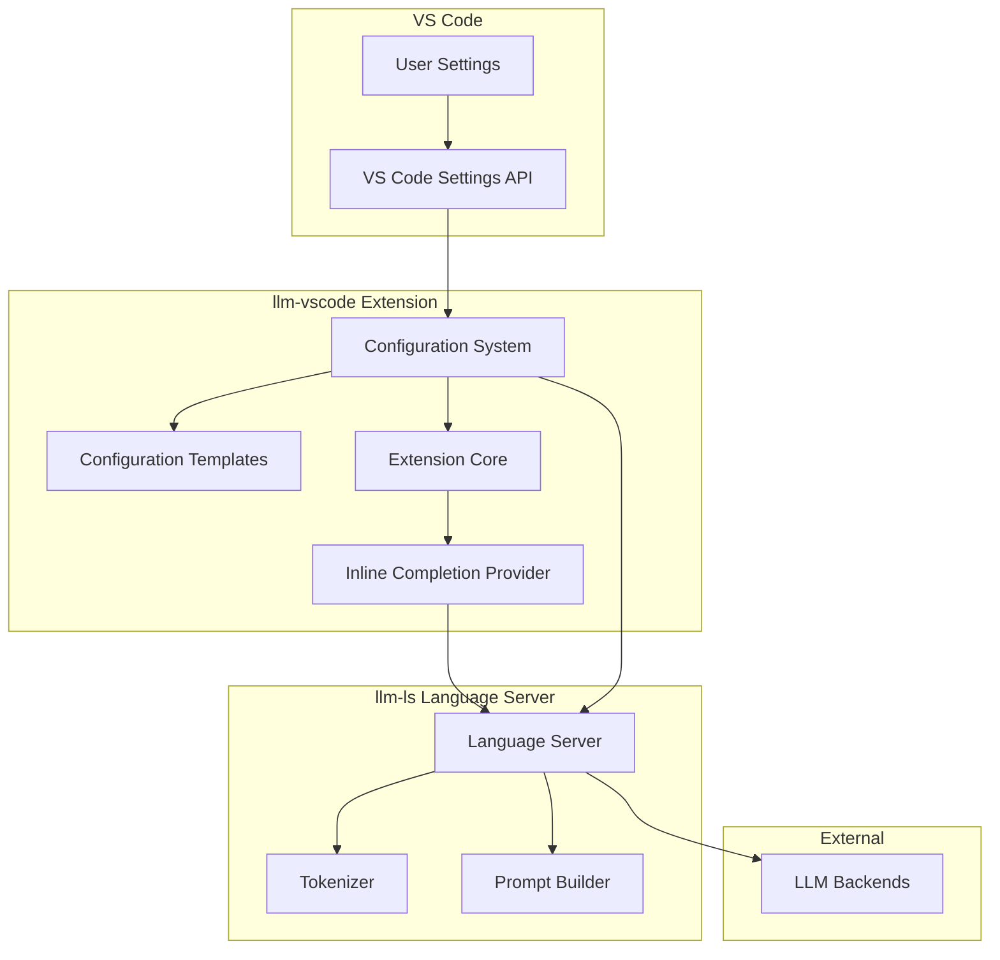
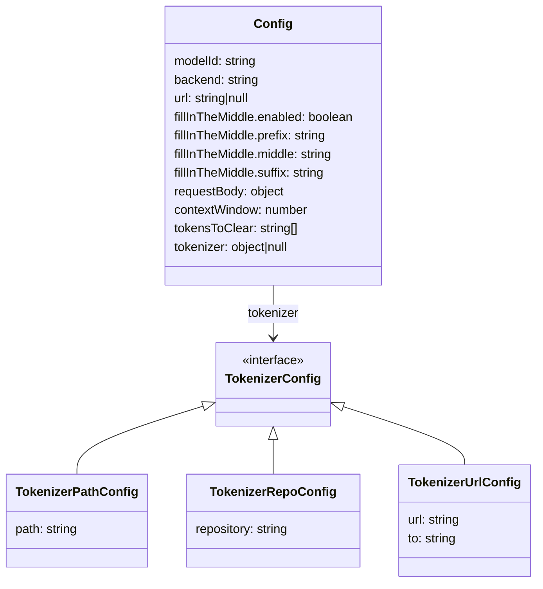
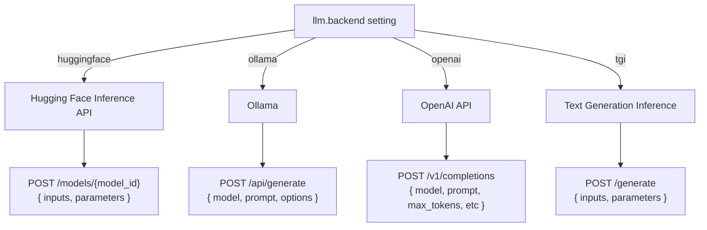
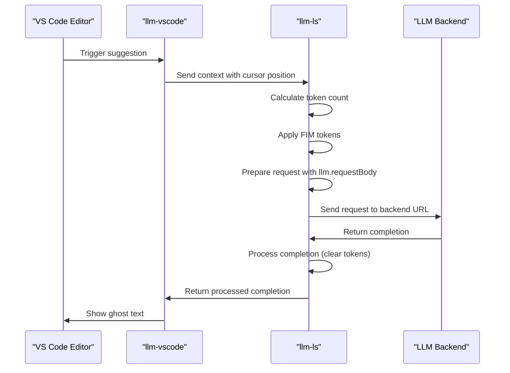
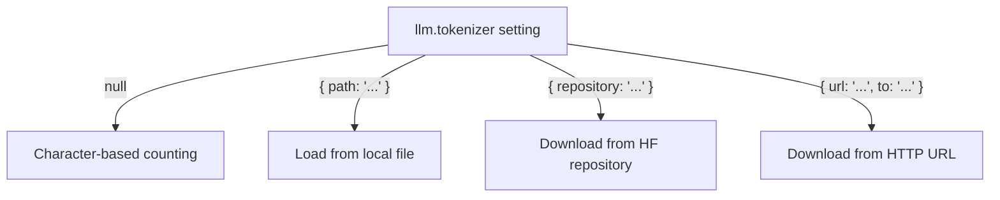

<!-- source: DeepWiki mcp.deepwiki.com · repo huggingface/llm-vscode · page 3 Configuration System · fetched 2026-10-26 -->

# Configuration System

<details>
<summary>Relevant source files</summary>

The following files were used as context for generating this wiki page:

- [README.md](README.md)
- [package.json](package.json)
- [src/configTemplates.ts](src/configTemplates.ts)

</details>


This document explains the configuration system in the llm-vscode extension, which allows users to customize how code suggestions work, select language models, and configure connections to different LLM backends. For information about extending or modifying the configuration system, see [Build and Deployment](#4).

The configuration system provides both predefined templates for popular code models and fine-grained controls for advanced customization. This system bridges VS Code settings with the language server that handles model communication.

## Overview

The llm-vscode configuration system consists of:

1. VS Code settings - Defined in package.json
2. Configuration templates - Predefined in configTemplates.ts
3. Configuration interface - TypeScript interface that defines the structure



**Configuration Flow Diagram: From VS Code Settings to LLM Request**

Sources: [package.json:71-229](), [src/configTemplates.ts:1-140]()

## Configuration Templates

The extension provides predefined templates for popular code models. These templates configure all necessary settings for optimal performance with each model.

### Available Templates

Templates are defined in `configTemplates.ts` and exposed through the `llm.configTemplate` setting:

| Template Key | Model | Backend | Context Window |
|--------------|-------|---------|---------------|
| hf/bigcode/starcoder2-15b | StarCoder2 15B | Hugging Face | 1024 |
| hf/codellama/CodeLlama-13b-hf | CodeLlama 13B | Hugging Face | 1024 |
| hf/Phind/Phind-CodeLlama-34B-v2 | Phind CodeLlama 34B | Hugging Face | 1024 |
| hf/WizardLM/WizardCoder-Python-34B-V1.0 | WizardCoder Python 34B | Hugging Face | 1024 |
| hf/deepseek-ai/deepseek-coder-6.7b-base | DeepSeek Coder 6.7B | Hugging Face | 1024 |
| ollama/codellama:7b | CodeLlama 7B | Ollama | 1024 |
| Custom | User-defined | User-defined | User-defined |

Sources: [src/configTemplates.ts:1-2](), [src/configTemplates.ts:133-140](), [package.json:85-94]()

### Template Structure

Each template is an implementation of the `Config` interface, which defines the structure for all configuration options:



**Template Configuration Structure Diagram**

Sources: [src/configTemplates.ts:4-29]()

### Selecting a Template

Users can select a template through VS Code settings:

1. Open VS Code Settings (`Cmd+,` or `Ctrl+,`)
2. Search for `llm.configTemplate`
3. Select a template from the dropdown

When a template is selected, all its settings are applied automatically, but can still be individually overridden.

Sources: [package.json:85-94](), [README.md:173-175]()

## Backend Configuration

The extension supports multiple LLM backends, each with its own configuration requirements.

### Supported Backends



**Backend Selection Diagram**

Sources: [package.json:104-113](), [README.md:62-68]()

### URL Construction

The endpoint URL is constructed based on the selected backend:

1. If `llm.url` is not set:
   - For `huggingface` backend, it uses the default Hugging Face Inference API URL
   - For other backends, it will error as there is no default URL

2. If `llm.url` is set:
   - The extension tries to append the correct path to the URL if needed (e.g., `/v1/completions` for OpenAI)
   - This behavior can be disabled using `llm.disableUrlPathCompletion`

Sources: [README.md:101-108](), [package.json:115-122](), [package.json:223-227]()

## Model Configuration

The model configuration controls which model is used and how requests are formatted.

### Core Model Settings

| Setting | Purpose | Example |
|---------|---------|---------|
| llm.modelId | Identifies the model | "bigcode/starcoder2-15b" |
| llm.contextWindow | Maximum context window size | 1024 |
| llm.requestBody | Request parameters (temperature, etc.) | { "parameters": { "max_new_tokens": 60 } } |
| llm.tokensToClear | Tokens to remove from output | ["<\|endoftext\|>"] |

Sources: [package.json:99-102](), [package.json:143-153](), [package.json:154-157](), [package.json:159-168]()

### Request Flow



**Request Flow Diagram**

Sources: [README.md:69-97]()

## Fill-in-the-Middle (FIM) Configuration

Fill-in-the-Middle is a technique that allows models to generate code by considering both the code before and after the cursor position.

### FIM Settings

| Setting | Purpose | Example (StarCoder2) |
|---------|---------|----------------------|
| llm.fillInTheMiddle.enabled | Enable/disable FIM | true |
| llm.fillInTheMiddle.prefix | Token marking prefix text | "<fim_prefix>" |
| llm.fillInTheMiddle.middle | Token marking middle text | "<fim_middle>" |
| llm.fillInTheMiddle.suffix | Token marking suffix text | "<fim_suffix>" |

Different models require different FIM tokens:

| Model | Prefix | Middle | Suffix |
|-------|--------|--------|--------|
| StarCoder2 | <fim_prefix> | <fim_middle> | <fim_suffix> |
| CodeLlama | <PRE> | <MID> | <SUF> |
| DeepSeek | <｜fim▁begin｜> | <｜fim▁end｜> | <｜fim▁hole｜> |

Sources: [package.json:123-142](), [src/configTemplates.ts:35-38](), [src/configTemplates.ts:58-60](), [src/configTemplates.ts:80-84]()

## Tokenizer Configuration

The tokenizer is used to ensure prompts fit within the model's context window. Several configuration options are available:

### Tokenizer Options



**Tokenizer Configuration Options Diagram**

Sources: [README.md:134-167](), [package.json:205-212](), [src/configTemplates.ts:4-15]()

### Template Tokenizer Examples

The tokenizer configuration in predefined templates typically references the model's repository:

```json
{
  "tokenizer": {
    "repository": "bigcode/starcoder2-15b"
  }
}
```

Sources: [src/configTemplates.ts:48-50](), [src/configTemplates.ts:70-72](), [src/configTemplates.ts:90-91]()

## Other Configuration Options

### Document Filtering

The `llm.documentFilter` setting controls which files will receive code suggestions, using VS Code's DocumentFilter pattern syntax:

```json
{
  "llm.documentFilter": { "pattern": "**/*.{py,js}" }
}
```

Sources: [package.json:213-222](), [README.md:113-117]()

### Performance Settings

| Setting | Purpose | Default |
|---------|---------|---------|
| llm.requestDelay | Delay between requests (ms) | 150 |
| llm.enableAutoSuggest | Enable/disable auto suggestions | true |

Sources: [package.json:75-84]()

### Attribution Settings

| Setting | Purpose | Default |
|---------|---------|---------|
| llm.attributionWindowSize | Characters to scan for attribution | 250 |
| llm.attributionEndpoint | Attribution service endpoint | "https://stack.dataportraits.org/overlap" |

Sources: [package.json:169-178]()

### LSP Settings

| Setting | Purpose | Default |
|---------|---------|---------|
| llm.lsp.binaryPath | Path to llm-ls binary | null |
| llm.lsp.port | Port for llm-ls server | null | 
| llm.lsp.logLevel | Log level | "warn" |

Sources: [package.json:184-204]()

---

