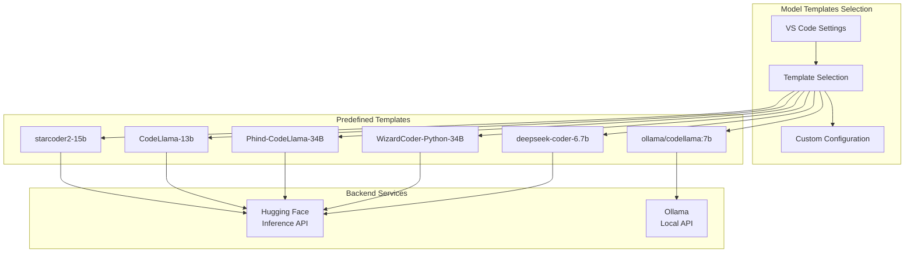
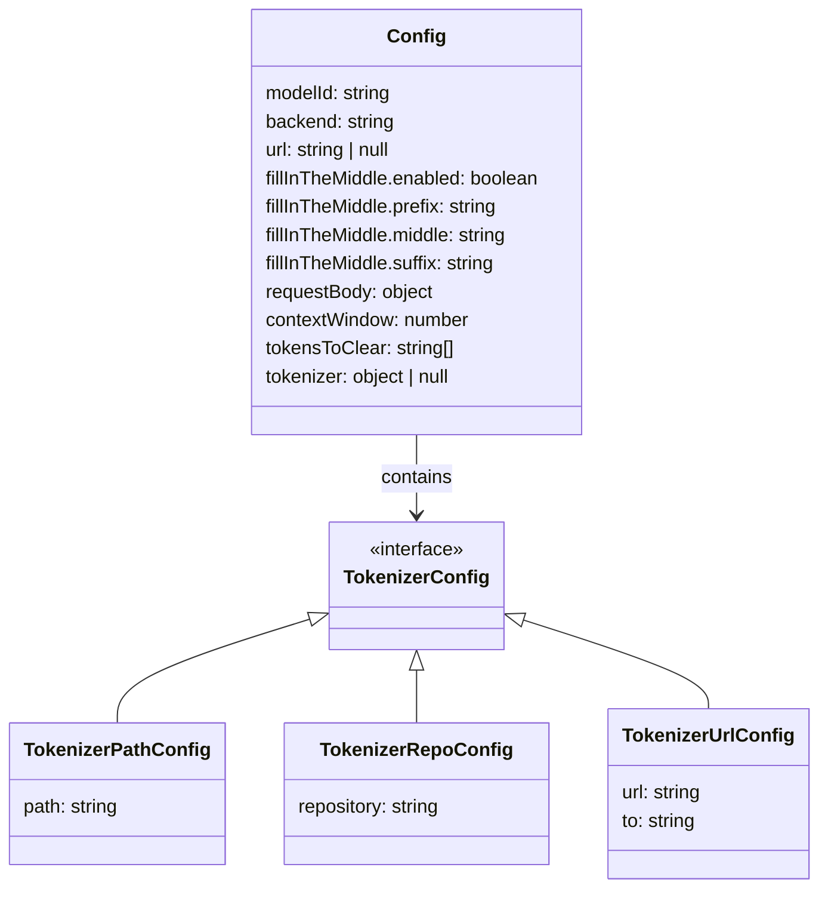
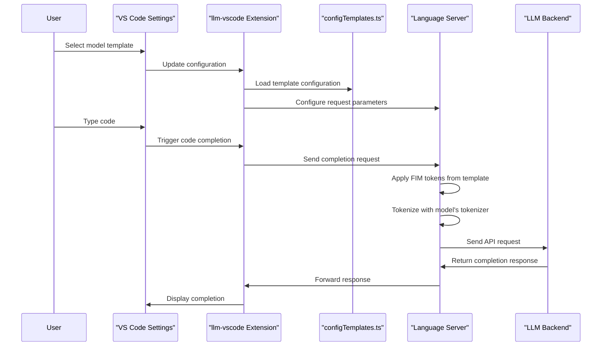
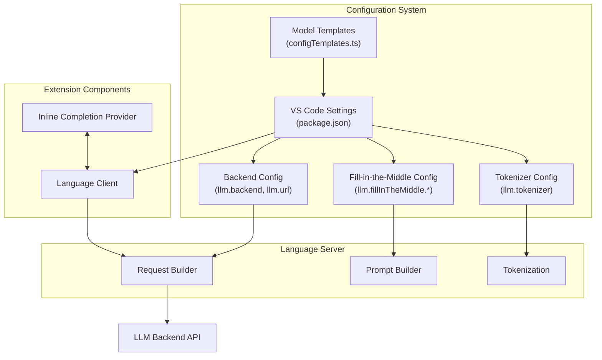

<!-- source: DeepWiki mcp.deepwiki.com · repo huggingface/llm-vscode · page 3.1 Model Templates · fetched 2026-10-26 -->

# Model Templates

<details>
<summary>Relevant source files</summary>

The following files were used as context for generating this wiki page:

- [README.md](README.md)
- [package.json](package.json)
- [src/configTemplates.ts](src/configTemplates.ts)

</details>


This page documents the predefined model templates system in the llm-vscode extension, which simplifies the configuration process when using different large language models (LLMs) for code completion. Model templates provide optimized settings for specific models, enabling users to quickly switch between different LLM backends without manually configuring all parameters. For information about configuring specific LLM backends, see [LLM Backends](#3.2).

## Purpose and Scope

Model templates serve several important functions in the llm-vscode extension:

1. Provide out-of-the-box configurations for popular code generation models
2. Set appropriate parameters like context window size, temperature, and Fill-in-the-Middle (FIM) tokens
3. Configure the correct tokenizer for each model
4. Establish default request parameters for optimal code completion results

Sources: [src/configTemplates.ts:1-140](), [package.json:85-97]()

## Available Model Templates

The extension offers several predefined model templates that users can select from the VS Code settings. Each template is optimized for a specific model and backend combination.



The following table lists all available model templates with their key characteristics:

| Template Key | Model | Backend | Context Window | FIM Support | Description |
|--------------|-------|---------|---------------|-------------|-------------|
| hf/bigcode/starcoder2-15b | bigcode/starcoder2-15b | huggingface | 1024 | Yes | Default model, general-purpose code completion |
| hf/codellama/CodeLlama-13b-hf | codellama/CodeLlama-13b-hf | huggingface | 1024 | Yes | Meta's CodeLlama model for code generation |
| hf/Phind/Phind-CodeLlama-34B-v2 | Phind/Phind-CodeLlama-34B-v2 | huggingface | 1024 | Yes | Phind's fine-tuned version of CodeLlama |
| hf/WizardLM/WizardCoder-Python-34B-V1.0 | WizardLM/WizardCoder-Python-34B-V1.0 | huggingface | 1024 | Yes | Specialized for Python code generation |
| hf/deepseek-ai/deepseek-coder-6.7b-base | deepseek-ai/deepseek-coder-6.7b-base | huggingface | 1024 | Yes | DeepSeek's code model with specialized FIM tokens |
| ollama/codellama:7b | codellama:7b | ollama | 1024 | Yes | CodeLlama running locally via Ollama |

Sources: [src/configTemplates.ts:1-1](), [src/configTemplates.ts:134-140](), [package.json:85-97]()

## Model Template Configuration Structure

Each model template defines a comprehensive configuration that controls how the extension interacts with the model. The template structure is implemented through the `Config` interface in the code.



Key configuration properties include:

| Property | Description |
|----------|-------------|
| `modelId` | The identifier for the model (e.g., "bigcode/starcoder2-15b") |
| `backend` | The LLM backend to use ("huggingface", "ollama", "openai", or "tgi") |
| `url` | The URL endpoint for the backend (null for default Hugging Face API) |
| `fillInTheMiddle` settings | Configuration for the Fill-in-the-Middle tokens and behavior |
| `requestBody` | Parameters for the API request (temperature, top_p, max_new_tokens, etc.) |
| `contextWindow` | Maximum number of tokens the model can process in a prompt |
| `tokensToClear` | Tokens to remove from the generated output |
| `tokenizer` | Configuration for the tokenizer used to count tokens |

Sources: [src/configTemplates.ts:4-29]()

## How Model Templates Are Used

When a user selects a model template in the VS Code settings, the extension applies all the associated configuration values. This process flows from the template selection to the actual code completion behavior.



To select a model template:

1. Open VS Code Settings (Cmd/Ctrl+,)
2. Search for "Llm: Config Template"
3. Choose a template from the dropdown menu
4. The extension will automatically apply all configuration settings from the selected template

Sources: [README.md:173-177](), [README.md:181-186](), [package.json:85-97]()

## Template Inheritance

Some model templates inherit settings from others to avoid duplicating common configuration values. For example, the Phind and WizardCoder templates extend the CodeLlama template:

```mermaid
flowchart TD
    subgraph "Template Inheritance"
        CodeLlama13B["HfCodeLlama13BConfig"]
        PhindCodeLlama["HfPhindCodeLlama34Bv2Config"]
        WizardCoder["HfWizardCoderPython34Bv1Config"]
        OllamaCodeLlama["OllamaCodeLlama7BConfig"]
    end

    CodeLlama13B --> PhindCodeLlama : "...HfCodeLlama13BConfig"
    CodeLlama13B --> WizardCoder : "...HfCodeLlama13BConfig"
    CodeLlama13B --> OllamaCodeLlama : "...HfCodeLlama13BConfig"

    PhindCodeLlama --> PhindModelId["modelId: Phind/Phind-CodeLlama-34B-v2"]
    WizardCoder --> WizardModelId["modelId: WizardLM/WizardCoder-Python-34B-V1.0"]
    WizardCoder --> WizardTokenizer["tokenizer: { repository: WizardLM/WizardCoder-Python-34B-V1.0 }"]
    OllamaCodeLlama --> OllamaSettings["backend: ollama\nurl: http://localhost:11434/api/generate\nmodelId: codellama:7b\nrequestBody: { options: { ... } }"]
```

This inheritance pattern simplifies the maintenance of model templates and ensures consistency across related models.

Sources: [src/configTemplates.ts:101-130]()

## Creating a Custom Configuration

To use a custom configuration:

1. Select "Custom" from the "Llm: Config Template" dropdown
2. Manually configure the following settings:
   - `llm.modelId`: The model identifier
   - `llm.backend`: The backend to use
   - `llm.url`: The backend URL (if applicable)
   - FIM settings (`llm.fillInTheMiddle.*`)
   - `llm.requestBody`: Parameters for the API request
   - `llm.contextWindow`: Context window size
   - `llm.tokenizer`: Tokenizer configuration

Custom configurations are useful when working with models not covered by the predefined templates or when you need specific parameter adjustments.

Sources: [package.json:71-228]()

## Relationship with Other Configuration Components

Model templates form a core part of the extension's configuration system, which includes several interconnected components.



For more detailed information about specific configuration components:

- For backend-specific configuration, see [LLM Backends](#3.2)
- For Fill-in-the-Middle configuration, see [Fill-in-the-Middle (FIM)](#3.3)
- For tokenizer configuration, see [Tokenizer Configuration](#3.4)

Sources: [src/configTemplates.ts:1-140](), [package.json:71-228]()

---

