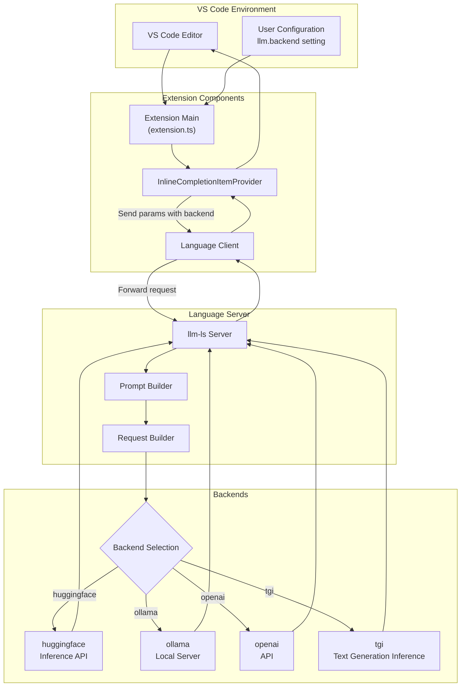
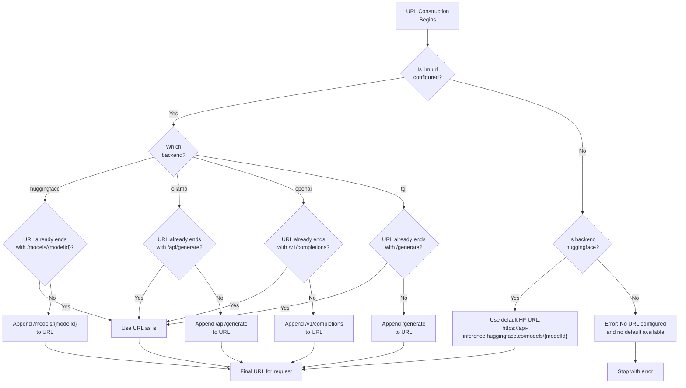
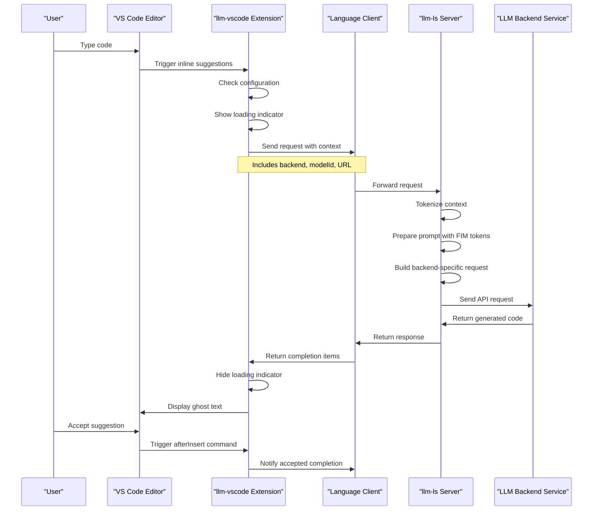

<!-- source: DeepWiki mcp.deepwiki.com · repo huggingface/llm-vscode · page 3.2 LLM Backends · fetched 2026-10-26 -->

# LLM Backends

<details>
<summary>Relevant source files</summary>

The following files were used as context for generating this wiki page:

- [README.md](README.md)
- [package.json](package.json)
- [src/extension.ts](src/extension.ts)

</details>


This page documents the supported LLM (Large Language Model) backends in the llm-vscode extension and explains how to configure them for code completion. For information about predefined model configurations, see [Model Templates](#3.1). For details about configuring the Fill-in-the-Middle feature, see [Fill-in-the-Middle (FIM)](#3.3).

## Supported Backends

The llm-vscode extension can connect to various LLM backends to generate code suggestions. These backends are specified through the `llm.backend` setting.

| Backend | Description | Default URL | 
|---------|-------------|-------------|
| `huggingface` | Hugging Face Inference API (default) | https://api-inference.huggingface.co/models/{modelId} |
| `ollama` | Local Ollama server | No default (must be provided) |
| `openai` | OpenAI API or compatible services | No default (must be provided) |
| `tgi` | Text Generation Inference | No default (must be provided) |

Sources: [package.json:104-114](), [README.md:62-67]()

## Backend Configuration Flow

The diagram below illustrates how backend configuration flows through the system:



Sources: [extension.ts:142-213](), [package.json:104-114]()

## Basic Configuration Settings

The primary settings for configuring LLM backends are:

| Setting | Description | Default | Type |
|---------|-------------|---------|------|
| `llm.backend` | The LLM backend to use | `huggingface` | string (enum) |
| `llm.modelId` | Model ID for the selected backend | `bigcode/starcoder` | string |
| `llm.url` | URL of the backend service | `null` | string \| null |
| `llm.requestBody` | Parameters sent to the model | See below | object |

Default request body:
```json
{
  "parameters": {
    "max_new_tokens": 60,
    "temperature": 0.2,
    "top_p": 0.95
  }
}
```

Sources: [package.json:104-122](), [package.json:143-153]()

## URL Construction

When making requests to a backend, the extension constructs the URL based on the backend type:



The URL path appending behavior can be disabled by setting `llm.disableUrlPathCompletion` to `true`.

Sources: [README.md:101-108](), [package.json:223-227]()

## Backend-Specific Configurations

### Hugging Face Inference API

The Hugging Face Inference API is the default backend:

1. Set `llm.backend` to `huggingface`
2. Set `llm.modelId` to the desired model ID (e.g., `bigcode/starcoder2-15b`)
3. Optionally set `llm.url` to override the default URL
4. Use the `Llm: Login` command to authenticate with your HF token

Example configuration:
```json
{
  "llm.backend": "huggingface",
  "llm.modelId": "bigcode/starcoder2-15b",
  "llm.requestBody": {
    "parameters": {
      "max_new_tokens": 60,
      "temperature": 0.2,
      "top_p": 0.95
    }
  }
}
```

Sources: [package.json:104-122](), [extension.ts:101-136]()

### Ollama

To use Ollama:

1. Set `llm.backend` to `ollama`
2. Set `llm.modelId` to the desired model name (e.g., `codellama:7b`)
3. Set `llm.url` to your Ollama server URL (e.g., `http://localhost:11434`)

Example configuration:
```json
{
  "llm.backend": "ollama",
  "llm.modelId": "codellama:7b",
  "llm.url": "http://localhost:11434",
  "llm.requestBody": {
    "parameters": {
      "max_new_tokens": 60,
      "temperature": 0.2
    }
  }
}
```

Sources: [package.json:104-114](), [README.md:66]()

### OpenAI

To use OpenAI or compatible API:

1. Set `llm.backend` to `openai`
2. Set `llm.modelId` to the desired model name
3. Set `llm.url` to your API endpoint
4. Configure authentication in your request body

Example configuration:
```json
{
  "llm.backend": "openai",
  "llm.modelId": "gpt-3.5-turbo",
  "llm.url": "https://api.openai.com",
  "llm.requestBody": {
    "parameters": {
      "max_new_tokens": 60,
      "temperature": 0.2
    }
  }
}
```

Sources: [package.json:104-114](), [README.md:66]()

### Text Generation Inference (TGI)

To use TGI:

1. Set `llm.backend` to `tgi`
2. Set `llm.modelId` to the desired model name
3. Set `llm.url` to your TGI server URL

Example configuration:
```json
{
  "llm.backend": "tgi",
  "llm.modelId": "codellama/CodeLlama-13b-hf",
  "llm.url": "http://localhost:8080",
  "llm.requestBody": {
    "parameters": {
      "max_new_tokens": 60,
      "temperature": 0.2
    }
  }
}
```

Sources: [package.json:104-114](), [README.md:67]()

## Request Lifecycle

This diagram shows the complete lifecycle of a code completion request:



The extension adds the appropriate authentication when needed, such as the Hugging Face API token for the Hugging Face Inference API backend.

Sources: [extension.ts:142-213](), [extension.ts:89-98]()

## Authentication

Different backends have different authentication requirements:

- **Hugging Face**: Use the `Llm: Login` command to securely store your API token
- **Ollama**: Typically no authentication required for local instances
- **OpenAI**: Include your API key in the request body or headers
- **TGI**: Depends on your TGI server configuration

The extension securely stores authentication tokens using the VS Code secrets storage and sends them with requests when needed.

Sources: [extension.ts:101-136](), [extension.ts:166-169]()

## TLS Verification

For self-hosted services with self-signed certificates, you can disable TLS verification by setting `llm.tlsSkipVerifyInsecure` to `true`. Note that this is insecure and should only be used in trusted environments.

Sources: [package.json:179-183](), [extension.ts:174]()

---

