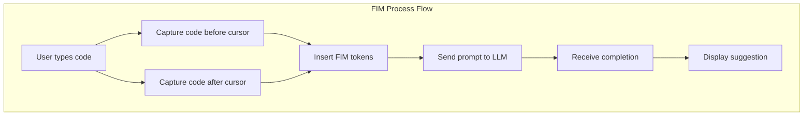
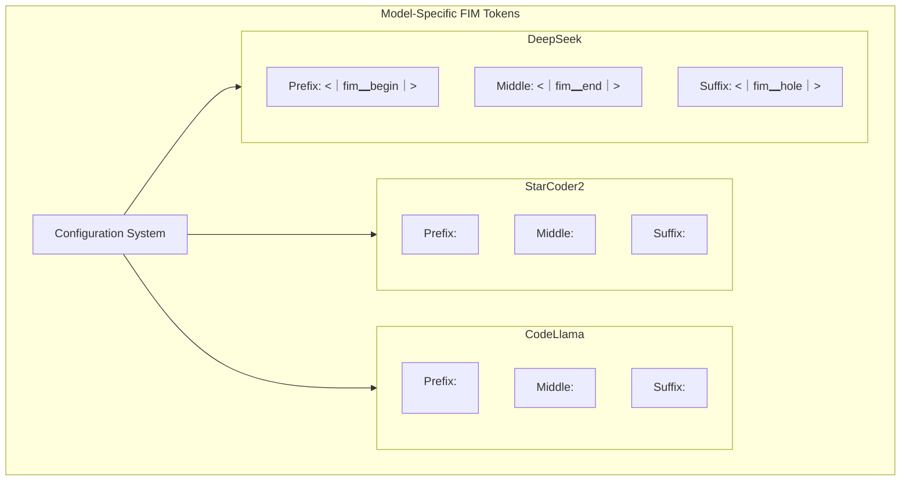
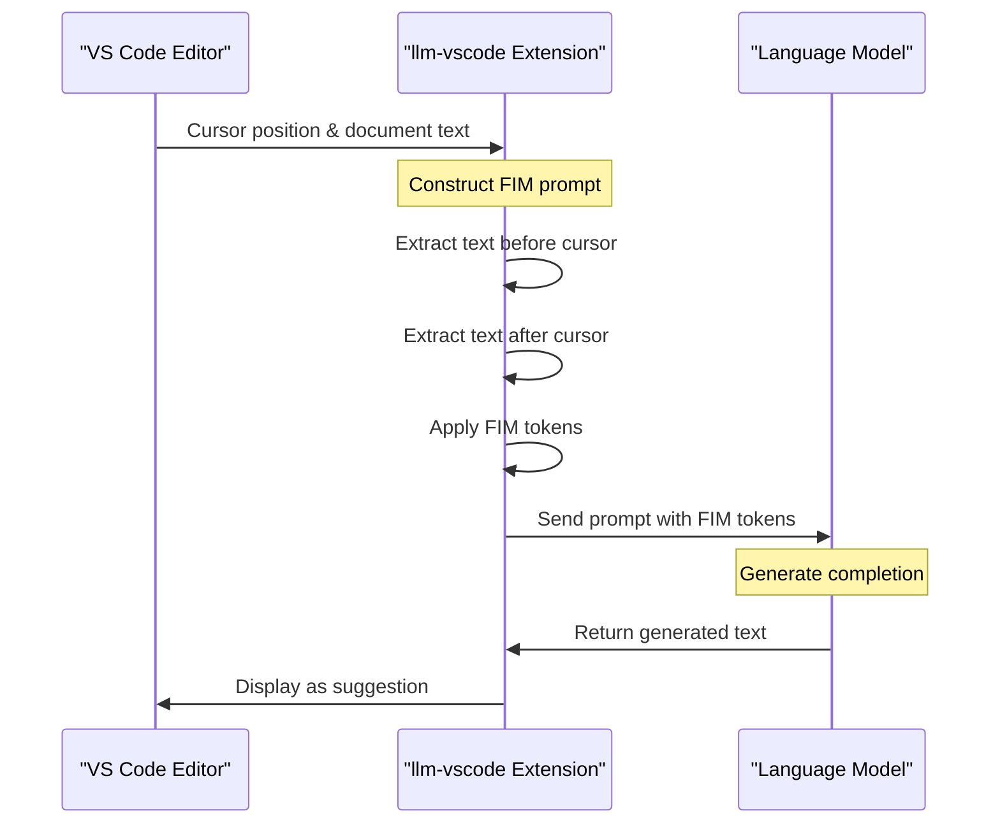

<!-- source: DeepWiki mcp.deepwiki.com · repo huggingface/llm-vscode · page 3.3 Fill-in-the-Middle (FIM) · fetched 2026-10-26 -->

# Fill-in-the-Middle (FIM)

<details>
<summary>Relevant source files</summary>

The following files were used as context for generating this wiki page:

- [README.md](README.md)
- [package.json](package.json)
- [src/configTemplates.ts](src/configTemplates.ts)

</details>


Fill-in-the-Middle (FIM) is a specialized code completion technique implemented in the llm-vscode extension that enables language models to generate code by considering both the preceding and following context. This approach differs from traditional autocompletion by instructing the model to generate text that fits seamlessly between existing code sections, resulting in more contextually appropriate suggestions.

This document explains how FIM works in the llm-vscode extension, its configuration options, and how it's implemented across different supported models.

For information about model templates that use FIM, see [Model Templates](#3.1). For details about tokenizer configuration which affects FIM context handling, see [Tokenizer Configuration](#3.4).

## How FIM Works

Fill-in-the-Middle operates by capturing the code context around the cursor position and constructing a prompt that includes special tokens to delineate the sections:



Sources: [package.json:123-142](), [README.md:69-96]()

When a user positions their cursor in the editor, the extension:

1. Captures code before the cursor (prefix)
2. Captures code after the cursor (suffix)
3. Creates a prompt using special FIM tokens to indicate where the model should generate code
4. Sends the prompt to the LLM
5. Displays the generated completion as a suggestion

## FIM Configuration Options

The extension provides several configuration options for FIM in the VS Code settings:

| Setting | Type | Default | Description |
|---------|------|---------|-------------|
| `llm.fillInTheMiddle.enabled` | boolean | true | Enable/disable FIM functionality |
| `llm.fillInTheMiddle.prefix` | string | `<fim_prefix>` | Token marking the start of context |
| `llm.fillInTheMiddle.middle` | string | `<fim_middle>` | Token marking where to insert code |
| `llm.fillInTheMiddle.suffix` | string | `<fim_suffix>` | Token marking the end of context |

Sources: [package.json:123-142]()

The exact tokens used depend on the model's training. The extension includes default tokens appropriate for the StarCoder2 model but allows customization for other models.

## Model-Specific FIM Configurations

Different code generation models use different FIM tokens. The extension provides pre-configured templates for popular models:



Sources: [src/configTemplates.ts:31-140]()

### StarCoder2

The default configuration uses:
- Prefix token: `<fim_prefix>`
- Middle token: `<fim_middle>`
- Suffix token: `<fim_suffix>`

### CodeLlama Family

Models like CodeLlama, Phind-CodeLlama, and WizardCoder use:
- Prefix token: `<PRE> `
- Middle token: ` <MID>`
- Suffix token: ` <SUF>`

### DeepSeek

The DeepSeek model uses different tokens and has a different token order:
- Prefix token: `<｜fim▁begin｜>`
- Middle token: `<｜fim▁end｜>`
- Suffix token: `<｜fim▁hole｜>`

Note that unlike other models, DeepSeek puts the suffix (hole) token between the prefix and middle tokens in the prompt structure.

Sources: [src/configTemplates.ts:75-99]()

## FIM Prompt Construction

When constructing a prompt with FIM, the extension arranges the tokens and context in a specific pattern:



For example, with a cursor position marked by `|`:

```python
def calculate_average(numbers):
    |
print(calculate_average([1, 2, 3, 4, 5]))
```

The extension would construct a prompt like this (using StarCoder2 tokens):

```
<fim_prefix>def calculate_average(numbers):
    <fim_middle>print(calculate_average([1, 2, 3, 4, 5]))<fim_suffix>
```

The model then generates text to replace the `<fim_middle>` token, such as:

```python
    total = sum(numbers)
    return total / len(numbers)

```

Sources: [README.md:69-96]()

## Tokenizer Integration

FIM works closely with the tokenizer to ensure the prompt fits within the model's context window. The extension:

1. Tokenizes the entire context (prefix and suffix)
2. Truncates if needed to fit the model's context window
3. Inserts FIM tokens at the appropriate positions
4. Sends the tokenized prompt to the model

The extension also provides the option to clear specific tokens from the generated output using the `llm.tokensToClear` setting, which is often used to remove any residual FIM tokens from the resulting completion.

Sources: [package.json:159-168](), [src/configTemplates.ts:47-48](), [src/configTemplates.ts:69-70](), [src/configTemplates.ts:88-89]()

## Customizing FIM

If you're using a custom model or need to adjust FIM behavior:

1. Open VS Code settings (Cmd/Ctrl+,)
2. Search for "llm.fillInTheMiddle"
3. Adjust the enabled status and token values to match your model's requirements

For models trained without FIM capabilities, you can disable the feature by setting `llm.fillInTheMiddle.enabled` to `false`.

Sources: [package.json:123-127]()

---

