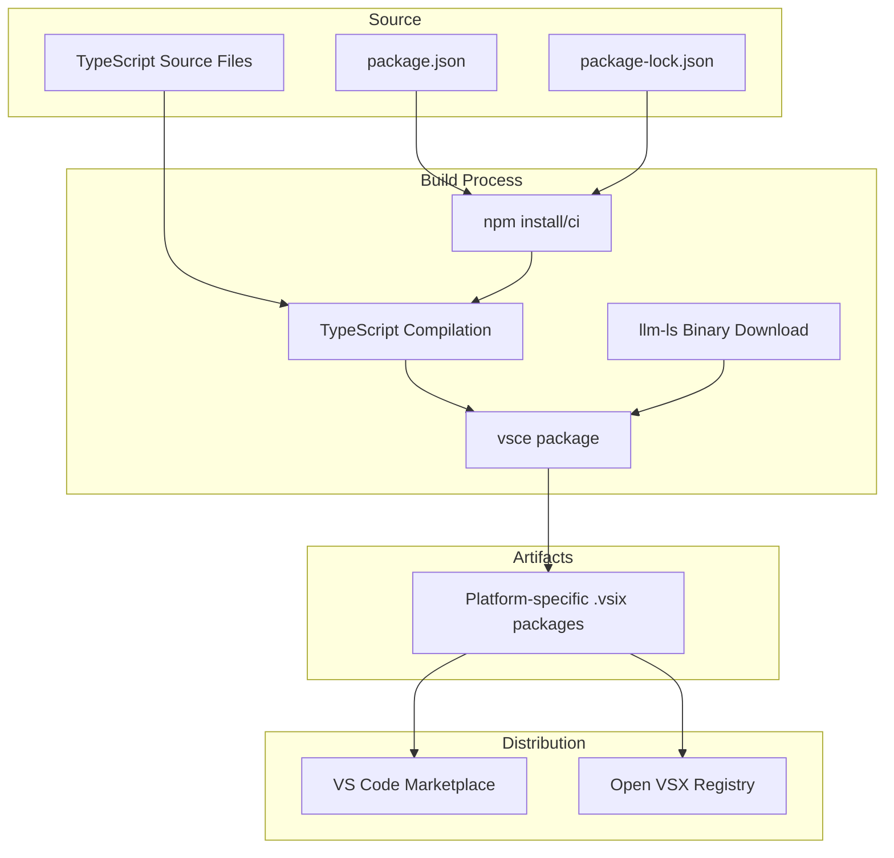
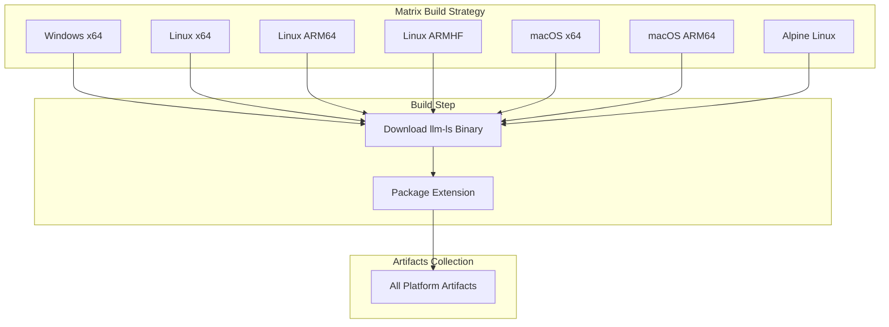
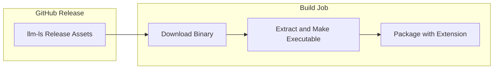
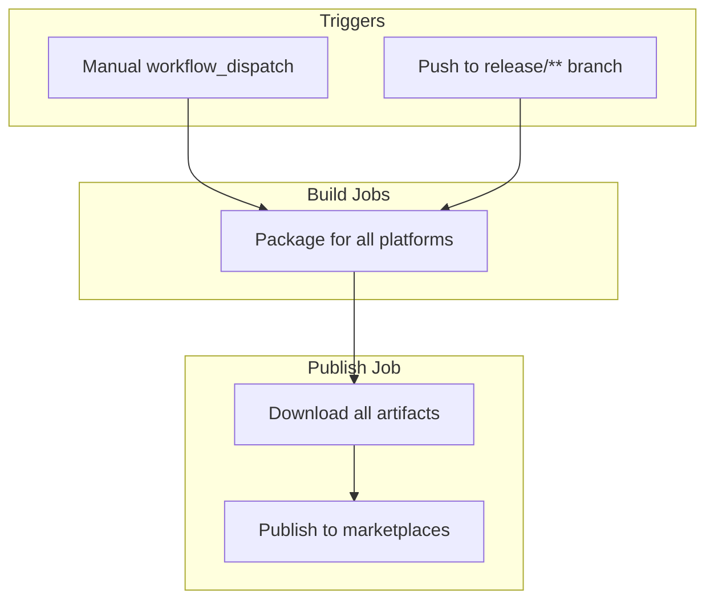
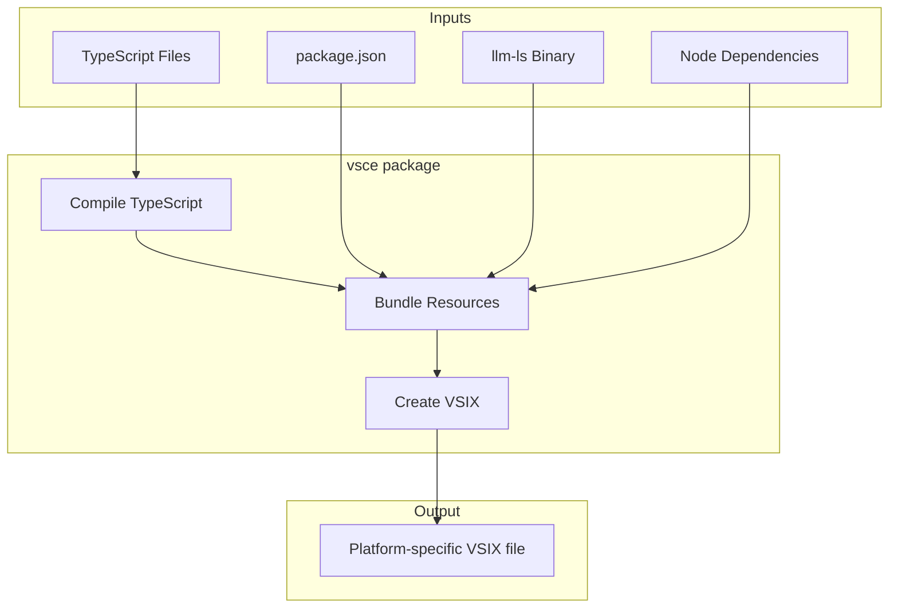
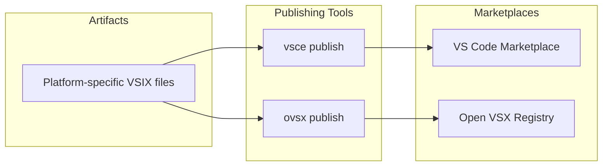
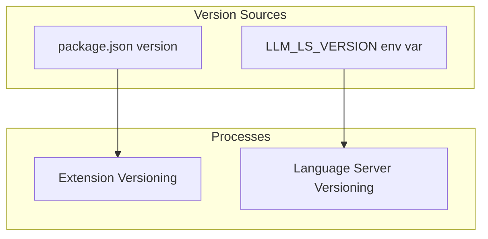

<!-- source: DeepWiki mcp.deepwiki.com · repo huggingface/llm-vscode · page 4 Build and Deployment · fetched 2026-10-26 -->

# Build and Deployment

<details>
<summary>Relevant source files</summary>

The following files were used as context for generating this wiki page:

- [.github/workflows/release.yml](.github/workflows/release.yml)
- [package-lock.json](package-lock.json)

</details>


This document describes the build and deployment processes for the LLM VS Code extension. It covers how the extension is built, packaged, and distributed to extension marketplaces. For detailed information about setting up a local development environment, see [Local Development Setup](#4.1).

## Overview

The LLM VS Code extension uses a sophisticated build and deployment pipeline to compile TypeScript code, bundle it with the language server binary (llm-ls), and create platform-specific packages that are distributed to extension marketplaces.



Sources: [.github/workflows/release.yml:1-145]()

## Build System Components

The build system consists of several key components that work together to create the extension package:

1. **Source Code**: TypeScript files that implement the extension functionality
2. **Dependencies**: Node.js packages specified in package.json
3. **Language Server**: The llm-ls binary, which is downloaded during the build process
4. **Packaging Tools**: Tools like vsce for creating VS Code extension packages

### Project Dependencies

The project relies on the following key dependencies:

| Dependency | Purpose |
|------------|---------|
| `vscode-languageclient` | Communication with the language server |
| `@vscode/vsce` | Packaging VS Code extensions |
| `typescript` | Compiling TypeScript code |
| `ovsx` | Publishing to Open VSX Registry |

Sources: [package-lock.json:1-32](), [package-lock.json:491-530]()

## Cross-Platform Build Process

One of the key aspects of the build system is the cross-platform approach. The extension is built for multiple platforms and architectures using a matrix build strategy in GitHub Actions.



The matrix includes the following targets:

| Code Target | Architecture | Description |
|-------------|--------------|-------------|
| win32-x64 | x86_64-pc-windows-msvc | Windows 64-bit |
| linux-x64 | x86_64-unknown-linux-gnu | Linux 64-bit |
| linux-arm64 | aarch64-unknown-linux-gnu | Linux ARM 64-bit |
| linux-armhf | arm-unknown-linux-gnueabihf | Linux ARM 32-bit |
| darwin-x64 | x86_64-apple-darwin | macOS Intel |
| darwin-arm64 | aarch64-apple-darwin | macOS Apple Silicon |
| alpine-x64 | x86_64-unknown-linux-musl | Alpine Linux 64-bit |

Sources: [.github/workflows/release.yml:14-34]()

## Language Server Integration

The extension depends on the llm-ls language server, which is a separate Rust project. During the build process, pre-compiled binaries of the language server are downloaded for each target platform.



The workflow downloads the language server binary from the llm-ls GitHub repository's release assets using the version specified in the workflow's environment variables.

Sources: [.github/workflows/release.yml:11-11](), [.github/workflows/release.yml:53-65]()

## Release Process

The release process is automated using GitHub Actions. The workflow can be triggered either manually or by pushing to a branch matching the pattern `release/**`.



The release workflow consists of two main stages:

1. **Package Stage**: Builds the extension for all target platforms in parallel
2. **Publish Stage**: Collects all packages and publishes them to VS Code Marketplace and Open VSX Registry

Sources: [.github/workflows/release.yml:1-8](), [.github/workflows/release.yml:79-145]()

## Extension Packaging Process

The extension is packaged using the `vsce` tool (Visual Studio Code Extensions). The packaging process includes:

1. Downloading the appropriate llm-ls binary for the target platform
2. Installing Node.js dependencies
3. Creating a `.vsix` package file that includes:
   - Compiled JavaScript code
   - Extension metadata
   - Language server binary
   - Node modules and other assets



The final VSIX file is a ZIP archive that contains everything needed to run the extension on the target platform.

Sources: [.github/workflows/release.yml:70-77]()

## Publishing

The extension is published to two main marketplaces:

1. **Visual Studio Code Marketplace**: The official marketplace for VS Code extensions
2. **Open VSX Registry**: An open-source alternative registry that's used by VS Codium and other VS Code-compatible editors

The publishing process uses authentication tokens stored as GitHub secrets to authorize the uploads.



Sources: [.github/workflows/release.yml:139-145]()

## Version Management

The extension's version is defined in the package.json file. The release workflow uses this version when publishing the extension.

The language server version is specified as an environment variable in the workflow file, allowing the build to fetch the correct version of the language server binary.



Sources: [.github/workflows/release.yml:11-11]()

## Local vs CI Builds

The extension can be built both locally and via CI:

| Aspect | Local Build | CI Build |
|--------|-------------|----------|
| Trigger | Manual command | GitHub event or manual dispatch |
| Platform | Developer's local machine | GitHub Actions runners |
| Output | Single VSIX for developer's platform | Multiple platform-specific VSIXs |
| Purpose | Testing and development | Release and distribution |
| Tools | npm, vsce | GitHub Actions, npm, vsce |

For local development, developers typically use:

```bash
npm install           # Install dependencies
npm run compile       # Compile TypeScript
npm run package       # Create VSIX package
```

While CI uses the matrix build strategy to create packages for all supported platforms in parallel.

Sources: [.github/workflows/release.yml:1-145]()

---

