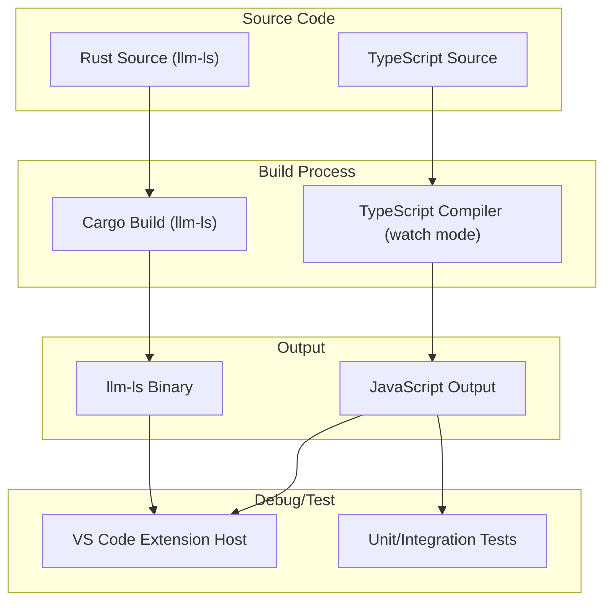
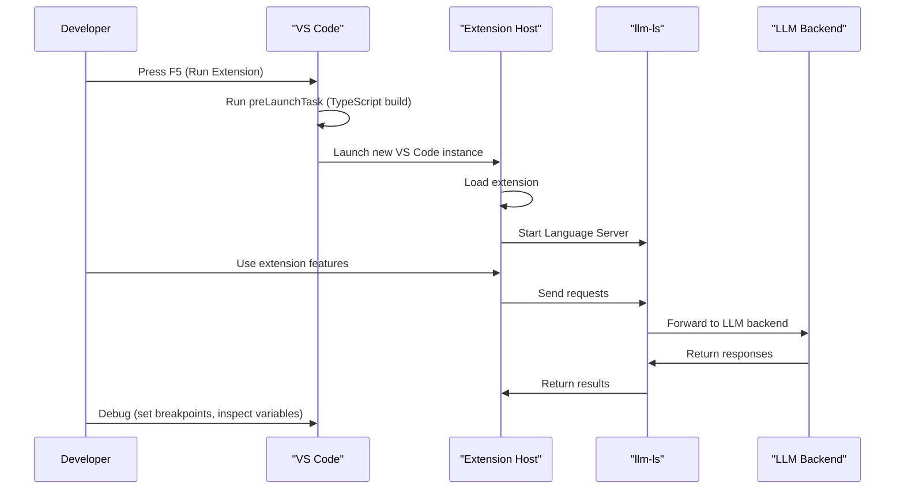
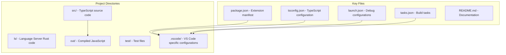
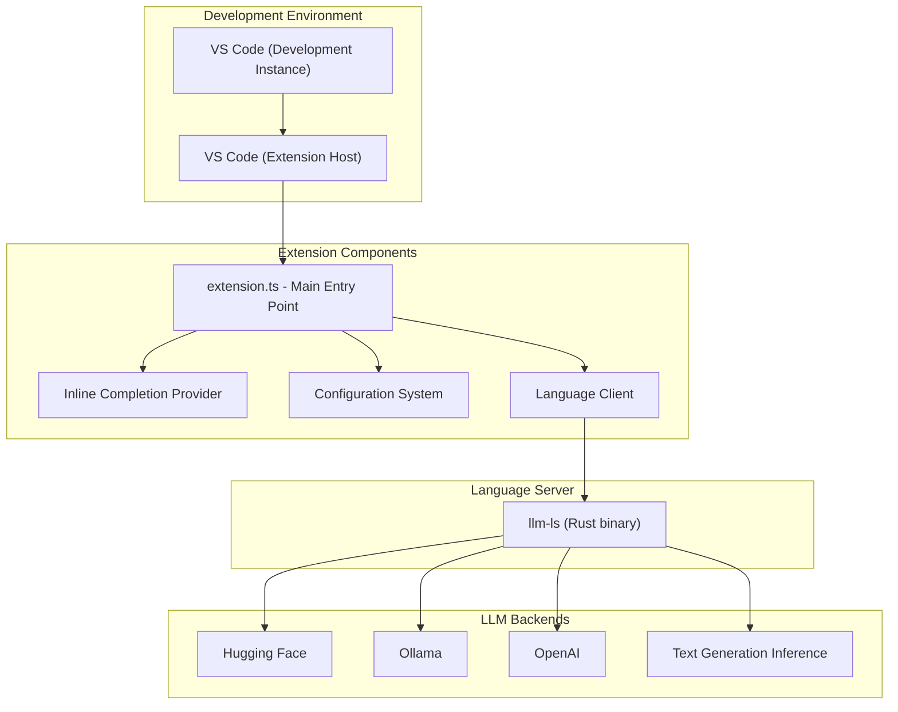

<!-- source: DeepWiki mcp.deepwiki.com · repo huggingface/llm-vscode · page 4.1 Local Development Setup · fetched 2026-10-26 -->

# Local Development Setup

<details>
<summary>Relevant source files</summary>

The following files were used as context for generating this wiki page:

- [.vscode/launch.json](.vscode/launch.json)
- [.vscode/tasks.json](.vscode/tasks.json)
- [package-lock.json](package-lock.json)

</details>


This document provides instructions for setting up and running the llm-vscode extension in a local development environment. It covers the prerequisites, repository setup, building, debugging, and testing workflows necessary for contributors. For information about the CI/CD pipeline, see [CI/CD Pipeline](#4.2), and for cross-platform distribution details, see [Cross-Platform Distribution](#4.3).

## Prerequisites

Before starting development on the llm-vscode extension, ensure you have the following software installed:

| Requirement | Version | Notes |
|-------------|---------|-------|
| Node.js | >=16.x (recommended) | Required for TypeScript compilation and package management |
| npm or yarn | Latest stable | For dependency management |
| Visual Studio Code | >=1.82.0 | Both as development environment and for testing |
| Git | Latest stable | For source control |
| Rust | Latest stable | Required for building the Language Server (llm-ls) component |

Sources: [package-lock.json:27-31]()

## Development Environment Setup

### Getting the Source Code

```bash
# Clone the repository
git clone https://github.com/huggingface/llm-vscode.git

# Navigate into the project directory
cd llm-vscode
```

### Installing Dependencies

The project uses npm for package management. Run the following command to install all required dependencies:

```bash
npm install
```

This will install all the dependencies listed in package.json, including development dependencies needed for building and testing.

Sources: [package-lock.json:11-27]()

## Development Workflow

The development workflow for llm-vscode involves two main components: the VS Code extension (TypeScript) and the Language Server (Rust). The diagram below illustrates the development workflow:



Sources: [.vscode/tasks.json:1-18](), [.vscode/launch.json:1-30]()

### Building the Extension

The project uses TypeScript which needs to be compiled to JavaScript. The build configuration is set up to use the TypeScript compiler in watch mode for development:

```bash
# Start the TypeScript compiler in watch mode
npm run watch
```

This will continuously compile your TypeScript code as you make changes, making the development process more efficient.

Sources: [.vscode/tasks.json:4-15]()

### Running and Debugging

VS Code's launch configurations are set up for running and debugging the extension:



To run and debug the extension:

1. Open the project in VS Code
2. Press F5 or select "Run Extension" from the Run and Debug view
3. A new VS Code window will open with the extension loaded
4. You can set breakpoints in your code and use VS Code's debugging features

Sources: [.vscode/launch.json:4-15]()

### Running Tests

The project includes configurations for running tests:

```bash
# Run the extension tests
npm test
```

Or you can use the launch configuration "Extension Tests" to run the tests with debugging capabilities.

Sources: [.vscode/launch.json:16-28]()

## Project Structure

Understanding the project structure is essential for effective development. Here's an overview of the key directories and files:



Sources: [.vscode/launch.json:1-30](), [.vscode/tasks.json:1-18]()

## Extension Architecture in Development Mode

When developing the extension, it's important to understand how the components interact:



Sources: [.vscode/launch.json:4-15]()

## Development Configuration

### Extension Manifest

The extension's configuration is primarily defined in `package.json`, which specifies:

- Extension metadata
- Activation events
- Contribution points (commands, configuration settings)
- Dependencies

During development, you may need to modify this file when adding new features that require new commands, configuration options, or dependencies.

Sources: [package-lock.json:1-32]()

### TypeScript Configuration

The TypeScript configuration in `tsconfig.json` defines how the TypeScript compiler should process your code. Key settings include:

- Target JavaScript version
- Module system
- Include and exclude patterns
- Compiler options

### VS Code-specific Configuration

The `.vscode` directory contains VS Code-specific configurations that are particularly important for development:

- `launch.json`: Defines how to launch the extension for debugging
- `tasks.json`: Defines build tasks that can be run within VS Code

Sources: [.vscode/launch.json:1-30](), [.vscode/tasks.json:1-18]()

## Common Development Tasks

### Adding a New Feature

1. Create or modify TypeScript files in the `src/` directory
2. If necessary, update the Language Server implementation in the `ls/` directory
3. Test your changes by running the extension (F5)
4. Add tests for your feature
5. Run the tests to verify your implementation

### Debugging Tips

- Use console.log statements or breakpoints to debug issues
- The VS Code Developer Tools (Help > Toggle Developer Tools) can be useful for debugging the extension
- For Language Server issues, add logging to the Rust code and check the output

## Conclusion

This setup enables a streamlined development workflow for the llm-vscode extension. The combination of TypeScript for the extension UI and Rust for the Language Server provides a powerful foundation for implementing LLM-powered code assistance features in VS Code.

Remember that changes to the Language Server component require rebuilding the Rust code, while changes to the TypeScript code will be automatically compiled if you're running the TypeScript compiler in watch mode.

---

