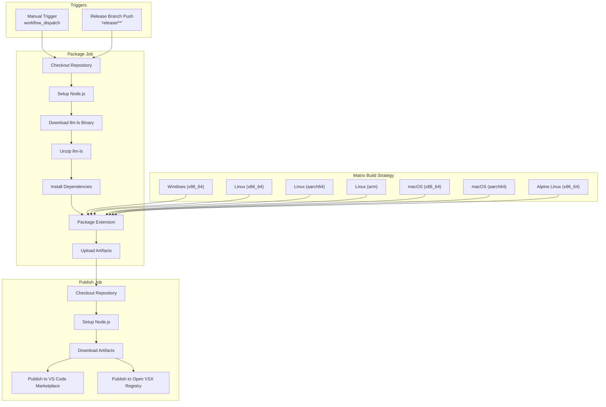
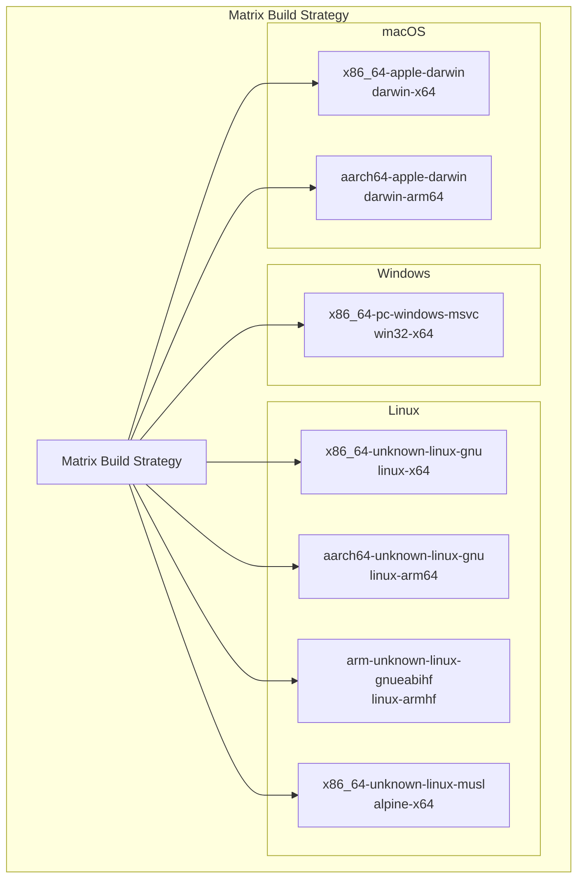
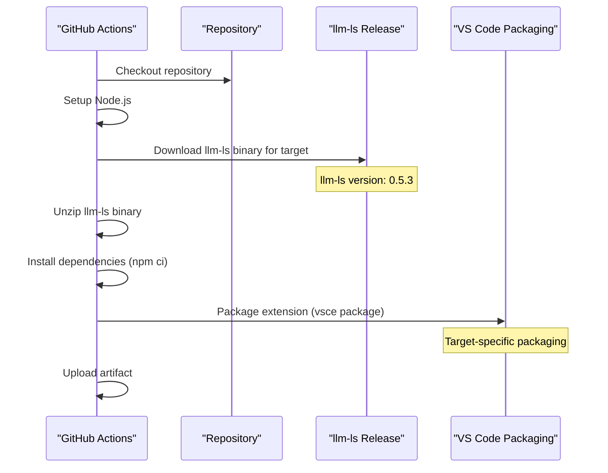
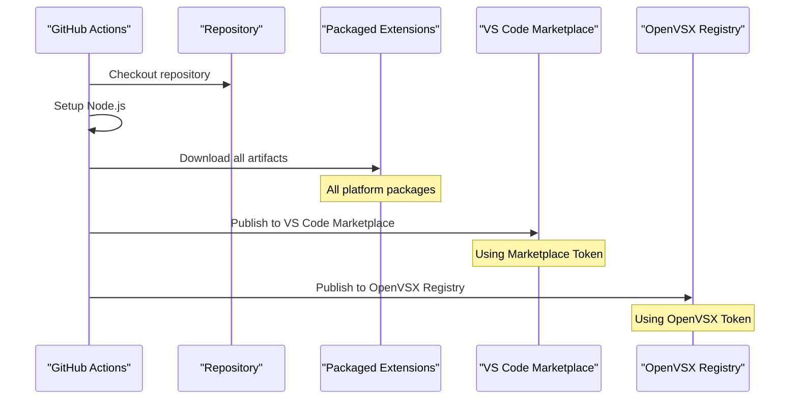

<!-- source: DeepWiki mcp.deepwiki.com · repo huggingface/llm-vscode · page 4.2 CI/CD Pipeline · fetched 2026-10-26 -->

# CI/CD Pipeline

<details>
<summary>Relevant source files</summary>

The following files were used as context for generating this wiki page:

- [.github/workflows/release.yml](.github/workflows/release.yml)
- [package-lock.json](package-lock.json)

</details>


This page documents the Continuous Integration and Continuous Deployment (CI/CD) pipeline for the LLM VS Code extension. The pipeline automates the process of building, packaging, and publishing the extension across multiple platforms and architectures. For information about the local development setup, see [Local Development Setup](#4.1).

## Pipeline Overview

The CI/CD pipeline for LLM VS Code is implemented using GitHub Actions. It automates the process of:
1. Building packages for multiple platforms and architectures
2. Downloading the appropriate language server binaries
3. Packaging the extension with platform-specific binaries
4. Publishing the packaged extensions to marketplaces

### Pipeline Workflow Diagram



Sources: [.github/workflows/release.yml:1-146]()

## Pipeline Triggers

The CI/CD pipeline can be triggered in two ways:

1. **Manual Trigger**: Using the GitHub Actions workflow_dispatch event
2. **Automated Trigger**: When changes are pushed to branches matching the pattern `release/**`

This allows for both on-demand releases and automated releases based on branch naming conventions.

Sources: [.github/workflows/release.yml:1-9]()

## Matrix Build Strategy

The pipeline employs a matrix build strategy to build the extension for multiple target platforms and architectures in parallel. This approach enables efficient cross-platform distribution of the extension.

### Supported Platforms and Architectures

| Target | VS Code Target | Platform |
|--------|---------------|----------|
| x86_64-pc-windows-msvc | win32-x64 | Windows (x64) |
| x86_64-unknown-linux-gnu | linux-x64 | Linux (x64) |
| aarch64-unknown-linux-gnu | linux-arm64 | Linux (ARM64) |
| arm-unknown-linux-gnueabihf | linux-armhf | Linux (ARM) |
| x86_64-apple-darwin | darwin-x64 | macOS (x64) |
| aarch64-apple-darwin | darwin-arm64 | macOS (ARM64) |
| x86_64-unknown-linux-musl | alpine-x64 | Alpine Linux (x64) |



Sources: [.github/workflows/release.yml:14-34]()

## Pipeline Jobs

The pipeline consists of two main jobs:

1. **Package Job**: Builds and packages the extension for each target platform
2. **Publish Job**: Publishes the packaged extensions to marketplaces

### Package Job

The package job handles the building and packaging of the extension for each target platform:

1. Checkout the repository
2. Setup Node.js environment
3. Download the appropriate llm-ls binary for the target
4. Unzip the llm-ls binary
5. Install dependencies
6. Package the extension with vsce
7. Upload the packaged extension as an artifact



Sources: [.github/workflows/release.yml:14-77]()

### Publish Job

The publish job handles the publication of the packaged extensions:

1. Checkout the repository
2. Setup Node.js environment
3. Download all packaged artifacts
4. Publish to VS Code Marketplace
5. Publish to OpenVSX Registry

The publish job is dependent on the successful completion of all package jobs to ensure all platform-specific extensions are available for publication.



Sources: [.github/workflows/release.yml:79-145]()

## Integration with Language Server

A key aspect of the CI/CD pipeline is the integration with the llm-ls (Language Server) component. The pipeline downloads the appropriate llm-ls binary for each target platform and packages it with the extension.

The llm-ls version is specified as an environment variable at the top of the workflow file:

```
LLM_LS_VERSION: 0.5.3
```

For each target platform, the pipeline:
1. Downloads the appropriate llm-ls binary from the huggingface/llm-ls repository
2. Unzips the binary and places it in the server directory
3. Makes the binary executable
4. Packages it with the extension

This ensures that each platform-specific extension package includes the correct llm-ls binary for that platform.

Sources: [.github/workflows/release.yml:11-11](), [.github/workflows/release.yml:53-65]()

## Packaging Process

The extension packaging is handled by the `vsce` tool (Visual Studio Code Extensions):

```
npx vsce package -o "./llm-ls-${{ matrix.code-target }}.vsix" --target ${{ matrix.code-target }}
```

This command creates a `.vsix` file for each target platform, which is the package format used by VS Code extensions.

Sources: [.github/workflows/release.yml:71-71]()

## Publishing Process

The extension is published to two marketplaces:

1. **VS Code Marketplace**: Used by standard VS Code installations
2. **OpenVSX Registry**: Used by open-source alternatives like VSCodium

The publishing commands use secrets stored in GitHub for authentication:

```
npx vsce publish --pat ${{ secrets.MARKETPLACE_TOKEN }} --packagePath ./pkg/llm-ls-*.vsix
npx ovsx publish --pat ${{ secrets.OPENVSX_TOKEN }} --packagePath ./pkg/llm-ls-*.vsix
```

These commands publish all the platform-specific packages to their respective marketplaces.

Sources: [.github/workflows/release.yml:139-145]()

## Environment and Dependencies

The pipeline uses the following tools and dependencies:

- Node.js 20 for building and packaging
- GitHub Actions for workflow automation
- vsce for packaging VS Code extensions
- ovsx for publishing to the OpenVSX Registry
- llm-ls binaries from the huggingface/llm-ls repository

The full list of dependencies can be found in the package-lock.json file, which tracks the exact versions of all dependencies used in the project.

Sources: [.github/workflows/release.yml:47-52](), [package-lock.json:1-32]()

---

