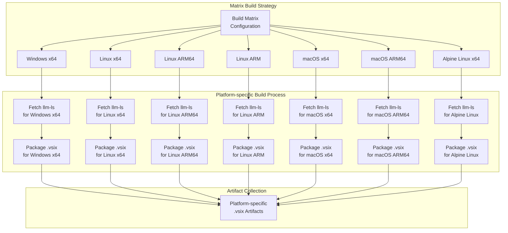
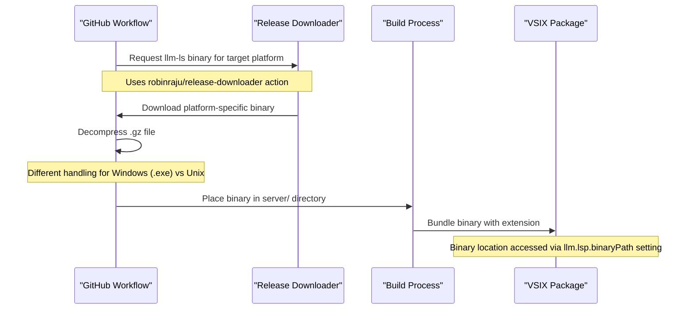
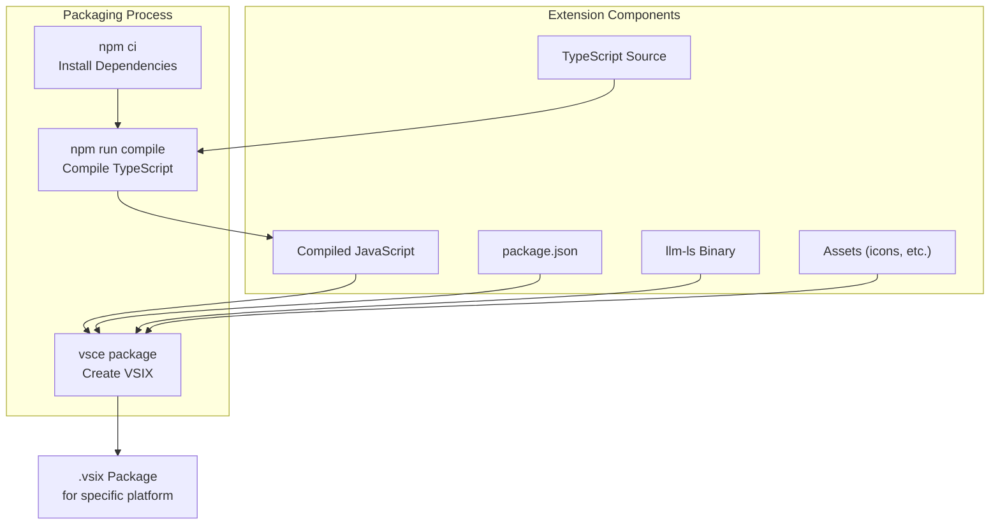
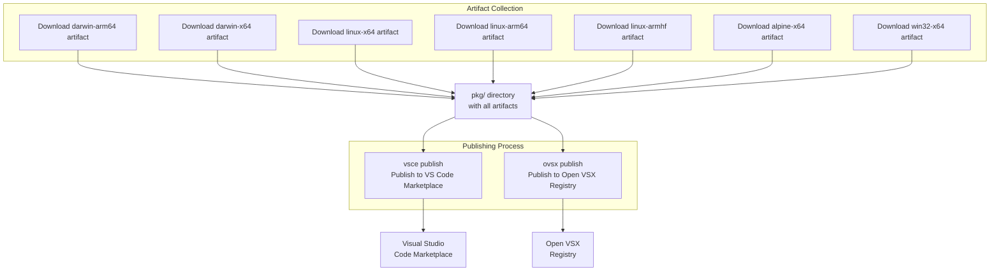
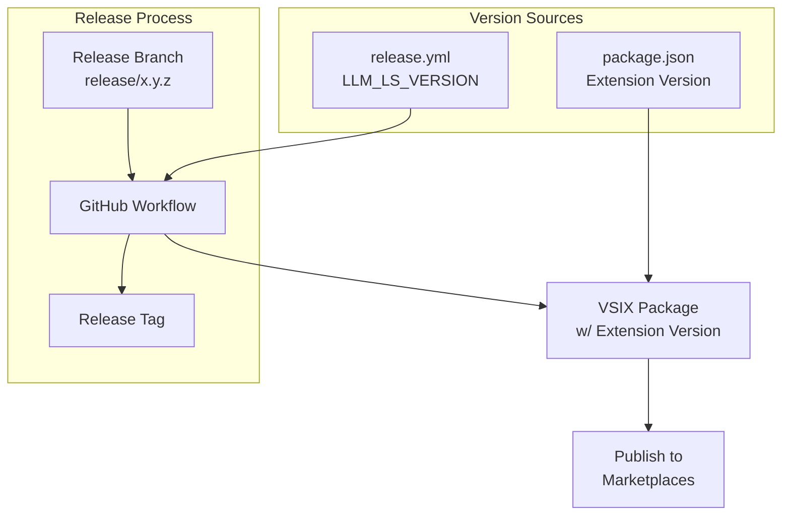

<!-- source: DeepWiki mcp.deepwiki.com · repo huggingface/llm-vscode · page 4.3 Cross-Platform Distribution · fetched 2026-10-26 -->

# Cross-Platform Distribution

Relevant source files

The following files were used as context for generating this wiki page:

- [.github/workflows/release.yml](.github/workflows/release.yml)
- [package.json](package.json)

This document explains how the llm-vscode extension is packaged and distributed for different operating systems and architectures. It covers the build matrix setup, language server binary integration, packaging process, and distribution channels used to ensure the extension works across various platforms.

For information about local development setup, refer to [Local Development Setup](#4.1), and for details on the CI/CD pipeline configuration, see [CI/CD Pipeline](#4.2).

## 1. Supported Platforms

The llm-vscode extension supports multiple platforms through a matrix build strategy, ensuring that users can install and use the extension regardless of their operating system or CPU architecture.

### Currently Supported Platforms

| Platform | Architecture | Target Identifier | VS Code Target |
|----------|-------------|-------------------|----------------|
| Windows  | x64         | x86_64-pc-windows-msvc | win32-x64 |
| Linux    | x64         | x86_64-unknown-linux-gnu | linux-x64 |
| Linux    | ARM64       | aarch64-unknown-linux-gnu | linux-arm64 |
| Linux    | ARM         | arm-unknown-linux-gnueabihf | linux-armhf |
| macOS    | x64         | x86_64-apple-darwin | darwin-x64 |
| macOS    | ARM64       | aarch64-apple-darwin | darwin-arm64 |
| Alpine Linux | x64     | x86_64-unknown-linux-musl | alpine-x64 |

Sources: [.github/workflows/release.yml:15-34]()

## 2. Build Matrix Architecture

The extension employs a matrix build strategy in GitHub Actions to create platform-specific packages. This approach ensures that each platform gets the appropriate binary of the language server (`llm-ls`) bundled with the extension.

### Matrix Build Pipeline Diagram

Sources: [.github/workflows/release.yml:14-77]()

## 3. Language Server Binary Integration

The extension relies on a Rust-based language server (`llm-ls`) that needs to be distributed as a platform-specific binary. Each platform-specific package includes the appropriate binary for that platform.

### Language Server Integration Flow

Sources: [.github/workflows/release.yml:52-65]()

### Binary Handling Details

When packaging the extension, the workflow downloads the pre-built `llm-ls` binary for each target platform from the llm-ls GitHub repository. The binary is then uncompressed and placed in the `server/` directory within the extension package.

For Windows targets, the binary is named `llm-ls.exe`, while for other platforms it's named `llm-ls`. The workflow ensures the binary has executable permissions set.

## 4. Packaging Process

The extension is packaged using the VS Code Extension Manager (`vsce`) tool, which creates `.vsix` packages that can be installed in VS Code.

### VSIX Packaging Diagram

Sources: [.github/workflows/release.yml:67-71](), [package.json:242-249]()

Each platform-specific package is created with the name format `llm-ls-{platform-target}.vsix` (e.g., `llm-ls-darwin-arm64.vsix` for macOS ARM64). The `--target` flag is passed to the `vsce` command to specify the target platform.

## 5. Distribution Channels

The llm-vscode extension is distributed through two main channels:

1. **Visual Studio Code Marketplace**: The official marketplace for VS Code extensions
2. **Open VSX Registry**: An alternative marketplace for VS Code extensions, primarily used by open-source VS Code derivatives like VSCodium

### Distribution Workflow

Sources: [.github/workflows/release.yml:103-145]()

The workflow downloads all platform-specific artifacts, places them in a `pkg/` directory, and then publishes them to both marketplaces. The publication is authenticated using secret tokens stored in the GitHub repository.

## 6. Version Management

Version management is a critical aspect of cross-platform distribution. The extension version is defined in `package.json`, while the language server version is defined in the workflow file.

### Version Dependencies

Sources: [package.json:5](), [.github/workflows/release.yml:11]()

The version of the extension is defined in `package.json` (currently 0.2.2), while the language server version is defined in the `release.yml` workflow file as an environment variable (currently 0.5.3). When a new release is created, both versions need to be updated accordingly.

## 7. User Installation Experience

When a user installs the extension via VS Code, the appropriate platform-specific package is automatically selected and installed based on the user's operating system and architecture. This process is handled by the VS Code extension marketplace, which uses the platform information provided during the publishing process.

Users can also manually install the extension by downloading the appropriate `.vsix` file for their platform and using the "Install from VSIX" option in VS Code.

Sources: [package.json:8-10]()

---

