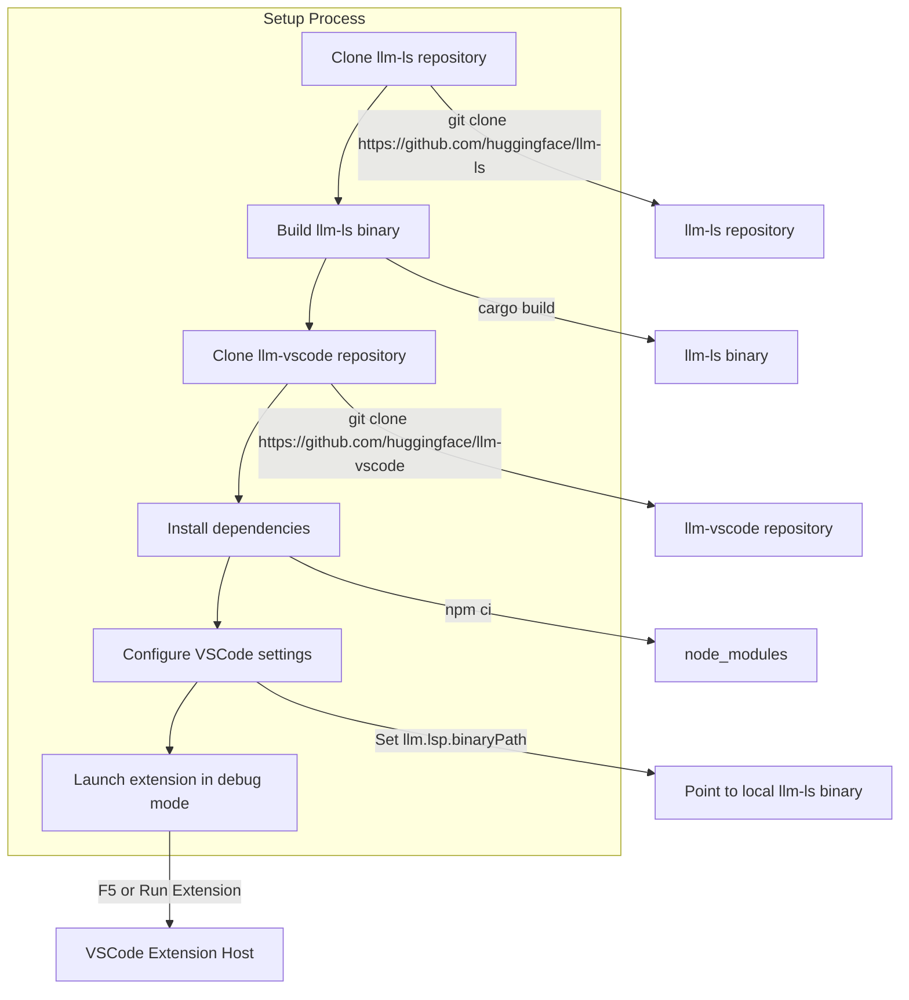
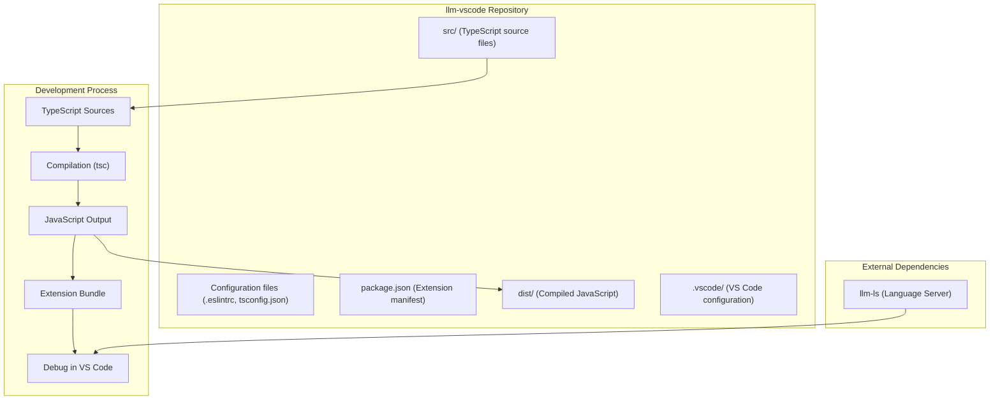
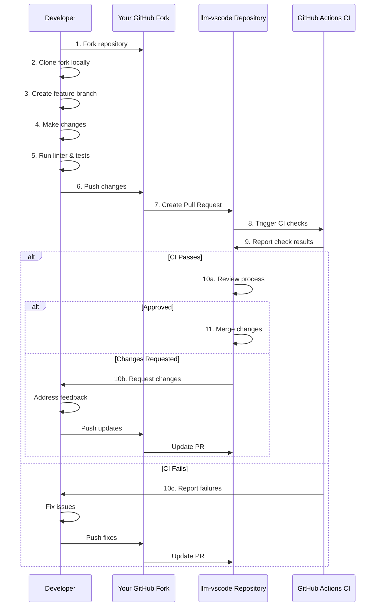
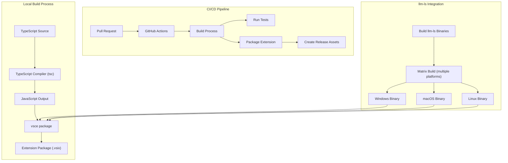

<!-- source: DeepWiki mcp.deepwiki.com · repo huggingface/llm-vscode · page 5 Contributing · fetched 2026-10-26 -->

# Contributing

<details>
<summary>Relevant source files</summary>

The following files were used as context for generating this wiki page:

- [.eslintrc.js](.eslintrc.js)
- [.eslintrc.json](.eslintrc.json)
- [.gitignore](.gitignore)
- [README.md](README.md)

</details>


This page provides comprehensive guidance for developers interested in contributing to the llm-vscode extension. It covers the development environment setup, contribution workflow, code style guidelines, and release processes. For information about using the extension as an end user, see [Getting Started](#1.2).

## Development Environment Setup

Setting up a local development environment for llm-vscode requires configuring both the extension itself and its backend language server (llm-ls).



### Prerequisites

* [Node.js](https://nodejs.org/) (LTS version recommended)
* [npm](https://www.npmjs.com/) or [yarn](https://yarnpkg.com/)
* [Rust](https://www.rust-lang.org/) and Cargo (for building llm-ls)
* [Visual Studio Code](https://code.visualstudio.com/)
* Git

### Step-by-Step Setup

1. Clone and build the llm-ls backend:
   ```bash
   git clone https://github.com/huggingface/llm-ls
   cd llm-ls
   cargo build
   # For a release build: cargo build --release
   ```

2. Clone the llm-vscode repository:
   ```bash
   git clone https://github.com/huggingface/llm-vscode
   cd llm-vscode
   ```

3. Install extension dependencies:
   ```bash
   npm ci  # Use this instead of npm install to ensure exact versions
   ```

4. Open the project in VS Code:
   ```bash
   code .
   ```

5. In VS Code, open the "Run and Debug" sidebar and click "Launch Extension"

6. In the newly opened VS Code window, set the `llm.lsp.binaryPath` setting to point to your locally built llm-ls binary:
   - Path example: `/path/to/llm-ls/target/debug/llm-ls`

7. Close and relaunch the extension debug session (press F5) for the settings to take effect

Sources: [README.md:190-197]()

## Project Structure

The llm-vscode project follows the standard structure for VS Code extensions with TypeScript.



### Key Project Files and Directories

| Path | Description |
|------|-------------|
| `src/` | Contains all TypeScript source code |
| `src/extension.ts` | Main extension entry point |
| `package.json` | Extension manifest, defines commands, configuration, and dependencies |
| `.vscode/` | VS Code configurations for development |
| `.eslintrc.js` | ESLint configuration for code quality |
| `tsconfig.json` | TypeScript compiler configuration |
| `dist/` | Output directory for compiled code (generated during build) |

Sources: [README.md:190-197](), [.eslintrc.js:1-64]()

## Contribution Workflow

The typical workflow for contributing to llm-vscode follows the standard GitHub flow.



### Step-by-Step Contribution Process

1. **Fork the Repository**: Create your own fork of the [llm-vscode repository](https://github.com/huggingface/llm-vscode)

2. **Clone Your Fork**:
   ```bash
   git clone https://github.com/YOUR-USERNAME/llm-vscode
   cd llm-vscode
   git remote add upstream https://github.com/huggingface/llm-vscode
   ```

3. **Create a Feature Branch**:
   ```bash
   git checkout -b feature/your-feature-name
   ```

4. **Make Changes**: Implement your feature or fix the bug

5. **Test Locally**:
   - Ensure your changes work as expected
   - Run the linter to validate code style compliance:
     ```bash
     npm run lint
     ```

6. **Commit Changes**:
   ```bash
   git add .
   git commit -m "Add feature: brief description"
   ```

7. **Push to Your Fork**:
   ```bash
   git push origin feature/your-feature-name
   ```

8. **Create a Pull Request**: Through the GitHub interface

Sources: [.eslintrc.js:1-64](), [.eslintrc.json:1-24]()

## Code Style Guidelines

The project uses ESLint to enforce code style and quality. The configuration is defined in the `.eslintrc.js` file.

### Key Code Style Rules

- Uses the Airbnb TypeScript style guide as a base
- Enforces TypeScript recommended practices
- Ensures proper import ordering and avoids extraneous dependencies
- Requires type checking for TypeScript code

### Running the Linter

To run the linter and check for code style issues:

```bash
npm run lint
```

To automatically fix linting issues where possible:

```bash
npm run lint:fix
```

Sources: [.eslintrc.js:1-64](), [.eslintrc.json:1-24]()

## Building and Packaging

The build process compiles TypeScript code to JavaScript and packages the extension for distribution.



### Local Build

To build the extension locally:

1. Compile TypeScript to JavaScript:
   ```bash
   npm run compile
   ```

2. Package the extension:
   ```bash
   npm run package
   ```
   This creates a `.vsix` file that can be installed in VS Code.

### CI/CD Pipeline

The project uses GitHub Actions for continuous integration and delivery. When a pull request is created or merged to the main branch, the workflow:

1. Builds the extension for multiple platforms
2. Runs tests to ensure everything works
3. Creates release assets for distribution

Sources: [README.md:190-197](), [.gitignore:1-19]()

## Debugging the Extension

VS Code provides excellent tools for debugging extensions during development.

### Using the Debug Configuration

1. Open the project in VS Code
2. Press F5 or use the "Run and Debug" panel to start debugging
3. A new VS Code window will open with the extension running in debug mode
4. Use breakpoints to pause execution at specific points in your code

### Extension Development Host

When debugging, you'll be working in an "Extension Development Host" window:

- This is a separate VS Code instance with your extension loaded
- Changes to your code require restarting the debug session to take effect
- The Debug Console in your original VS Code window shows logs and errors

Sources: [README.md:190-197]()

## Submitting a Pull Request

When your changes are ready for review:

1. Ensure your code passes all linting and tests
2. Write a clear PR description explaining:
   - What the change does
   - Why it's needed
   - How it has been tested
3. Submit the PR to the main repository
4. Address any feedback from the maintainers during the review process

Sources: [README.md:190-197]()

## Working with llm-ls

Since llm-vscode depends on the llm-ls language server, you may need to work on both projects simultaneously.

### Coordinating Changes

If your feature requires changes to both repositories:

1. First implement and test the changes in llm-ls
2. Create a PR for llm-ls and get it merged
3. Update your llm-vscode code to work with the new llm-ls version
4. Create a separate PR for llm-vscode

### Testing with a Local llm-ls Build

To test llm-vscode with your local llm-ls changes:

1. Build llm-ls with your changes
2. Set the `llm.lsp.binaryPath` setting in the VS Code development host to point to your local build
3. Test the combined behavior of both components

Sources: [README.md:190-197](), [README.md:124-127]()

---

