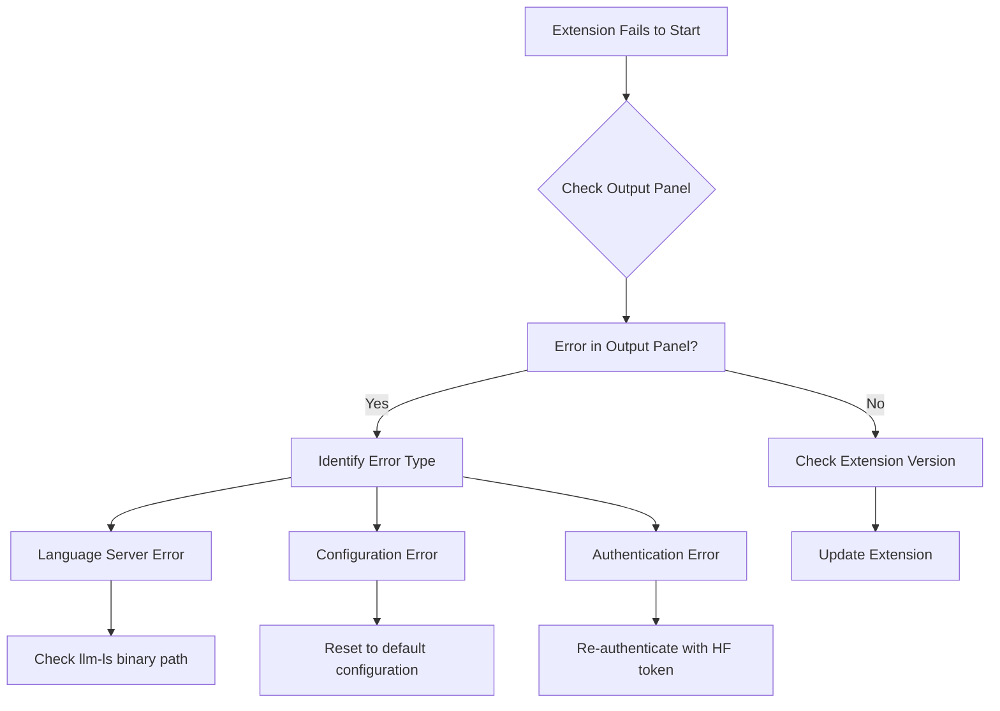
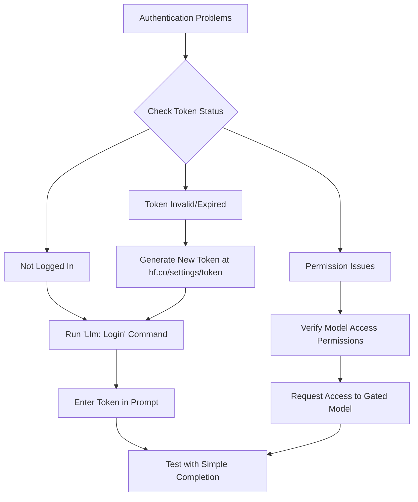
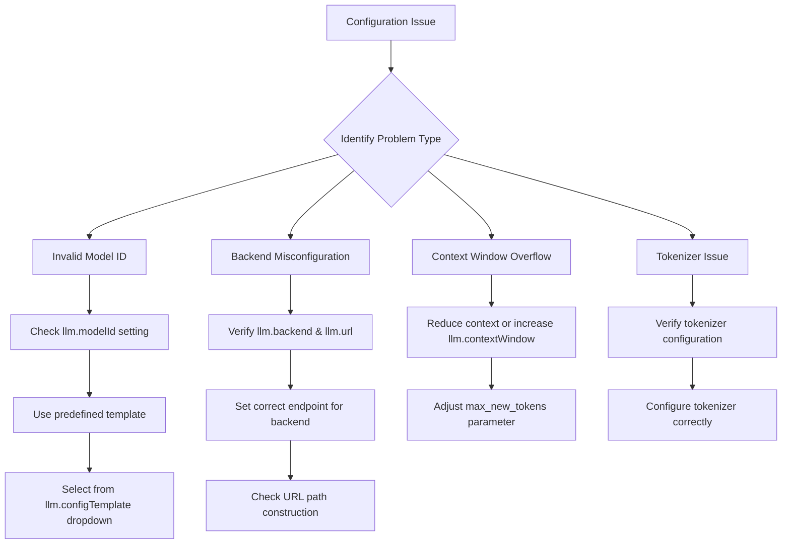
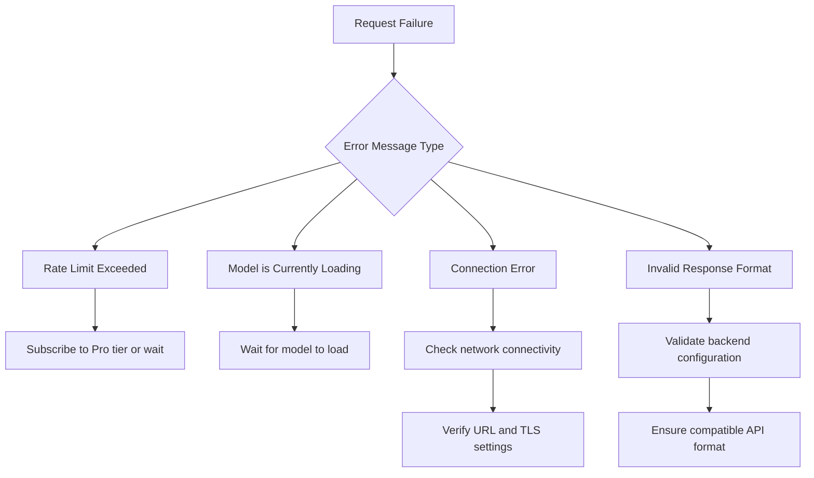
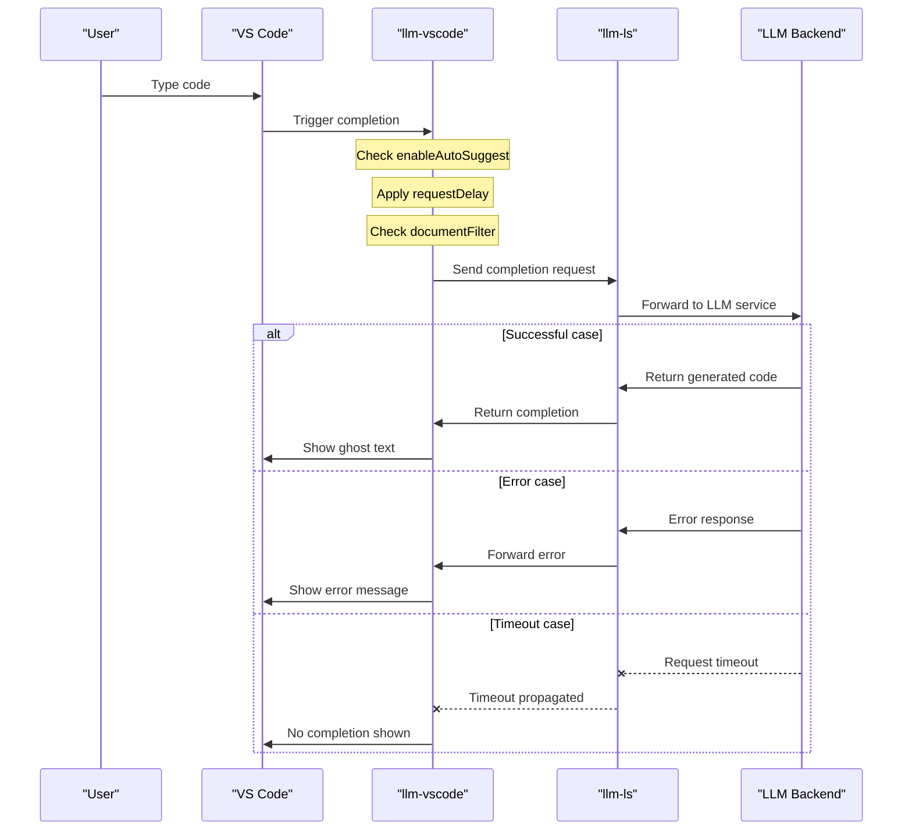
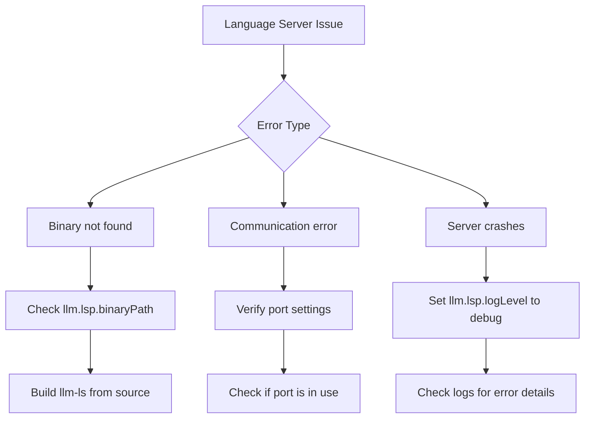
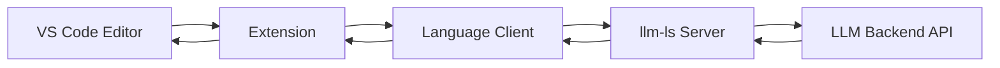

<!-- source: DeepWiki mcp.deepwiki.com · repo huggingface/llm-vscode · page 6 Troubleshooting · fetched 2026-10-26 -->

# Troubleshooting

Relevant source files

The following files were used as context for generating this wiki page:

- [README.md](README.md)
- [package.json](package.json)
- [src/extension.ts](src/extension.ts)

This page provides a comprehensive guide to diagnosing and resolving common issues with the `llm-vscode` extension. It covers configuration problems, request failures, authentication issues, and other common errors that might occur during usage.

For general usage instructions, see [Getting Started](#1.2) or [Architecture](#2) for technical details about how the extension works.

## Common Issues and Solutions

### Extension Not Starting or Crashing

If the extension fails to activate or crashes during operation:

1. Check the VS Code output panel for error messages (View → Output, select "LLM VS Code" from dropdown)
2. Verify the extension is properly installed and enabled
3. Restart VS Code after any configuration changes
4. Check if the language server (`llm-ls`) is properly installed and accessible

Sources: [src/extension.ts:35-87](), [package.json:48-51]()

### Authentication Problems

#### Token-Related Issues

If you encounter authentication issues:

1. Verify you're logged in by running the `Llm: Login` command from the command palette
2. Check if your Hugging Face token is valid at [hf.co/settings/token](https://hf.co/settings/token)
3. If the extension says "Already logged in" but requests still fail, run `Llm: Logout` and login again
4. For models requiring specific access permissions, verify you have access to the model on Hugging Face

Error message: `"You're not logged in, please login"` indicates you need to provide your Hugging Face API token.

Sources: [src/extension.ts:101-136](), [README.md:49-57]()

### Configuration Issues

#### Model and Backend Configuration

Most configuration issues happen when there's a mismatch between your selected model, backend, and configuration parameters:

Common configuration errors:

1. **Model ID issues**: Incorrect model ID in `llm.modelId` setting
   - Solution: Select an appropriate model template from `llm.configTemplate` dropdown

2. **Backend issues**: Incorrect backend specified or URL not provided
   - Solution: Set `llm.backend` appropriately and provide `llm.url` when needed

3. **Context window issues**: Input too large for model's context window
   - Error message: `"Input is too long, model's context window is X tokens"`
   - Solution: Reduce input size or increase `llm.contextWindow` setting

4. **Tokenizer issues**: Incorrect tokenizer configuration
   - Error message: `"Failed to tokenize input"`
   - Solution: Verify your tokenizer settings match your model

Sources: [package.json:71-228](), [src/extension.ts:223-236](), [README.md:58-167]()

### Request Failures

When code completion requests fail:

1. **Rate limiting**: `"Rate limit exceeded"` or similar message
   - Solution: Subscribe to a Pro tier on Hugging Face or adjust request frequency

2. **Model loading**: `"Model is currently loading"` message
   - Solution: Wait for the model to finish loading on the backend

3. **Connection issues**: Network-related errors 
   - Solution: Check network connectivity, proxy settings, or try `llm.tlsSkipVerifyInsecure` for TLS issues

4. **Response format issues**: Unexpected response from backend
   - Solution: Ensure the backend returns the expected format for completions

Sources: [src/extension.ts:179-207](), [README.md:10-15]()

### Slow or No Completions

If completions are slow to appear or don't appear at all:

1. Check `llm.requestDelay` setting (default: 150ms) - increasing may improve performance
2. Verify `llm.enableAutoSuggest` is set to `true` for automatic suggestions
3. Check if the current file matches the `llm.documentFilter` pattern
4. Try manually triggering completions with `Alt+Shift+L`

Sources: [src/extension.ts:142-213](), [package.json:75-79](), [package.json:80-84]()

### Language Server Issues

Problems with the `llm-ls` language server:

1. **Binary path issues**: If using a custom binary, verify `llm.lsp.binaryPath` points to a valid executable
2. **Port conflicts**: If using `llm.lsp.port`, ensure the port isn't in use by another application
3. **Log level**: Adjust `llm.lsp.logLevel` to `"debug"` for more detailed logs
4. **Binary not found**: On some platforms, the bundled binary might not work

Sources: [package.json:184-204](), [src/extension.ts:39-70](), [README.md:125-127]()

## Error Message Reference Table

Below is a reference table of common error messages and their resolutions:

| Error Message | Likely Cause | Solution |
|---------------|--------------|----------|
| "Failed to start language server" | Binary path incorrect or incompatible | Check `llm.lsp.binaryPath` or build from source |
| "Model is currently loading" | The model is being loaded by backend | Wait for the model to load completely |
| "You're not logged in" | Missing Hugging Face API token | Use `Llm: Login` command to provide token |
| "Rate limit exceeded" | Too many requests to free tier | Subscribe to Pro tier or reduce requests |
| "Input is too long" | Context window exceeded | Reduce input size or increase window setting |
| "Failed to tokenize input" | Incorrect tokenizer configuration | Verify tokenizer settings for your model |
| "Error connecting to URL" | Network or URL configuration issue | Check URL and network connectivity |
| "Timed out waiting for response" | Backend server too slow or overloaded | Try again later or use different backend |

Sources: [src/extension.ts:179-207](), [README.md:10-15]()

## Advanced Troubleshooting

### Debugging Request/Response Cycle

To debug the request/response cycle:

1. Set `llm.lsp.logLevel` to `"debug"`
2. Open the VS Code output panel and select "LLM VS Code"
3. Trigger a completion and review the logs

The request/response data flow follows this pattern:

Sources: [package.json:200-204](), [src/extension.ts:73-87]()

### Building Language Server from Source

If the bundled `llm-ls` binary doesn't work on your platform, you can build it from source:

1. Clone the repository: `git clone https://github.com/huggingface/llm-ls`
2. Build the binary: `cd llm-ls && cargo build --release`
3. Set `llm.lsp.binaryPath` to the path of the built binary

Sources: [README.md:189-197]()

### Troubleshooting Fill-in-the-Middle (FIM) Issues

If completions are not appearing in the middle of existing code:

1. Check that `llm.fillInTheMiddle.enabled` is set to `true`
2. Verify that the model supports FIM (not all models do)
3. Ensure the FIM tokens (`prefix`, `middle`, `suffix`) match the model's expected tokens

Sources: [package.json:123-142](), [README.md:78-80]()

### Ollama-Specific Issues

When using Ollama as a backend:

1. Ensure Ollama is running locally
2. Verify the model is pulled with `ollama pull codellama:7b` or similar
3. Set `llm.url` to `http://localhost:11434/api` if not automatically detected

Sources: [package.json:93](), [README.md:66]()