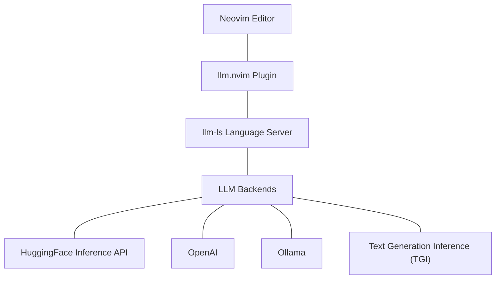
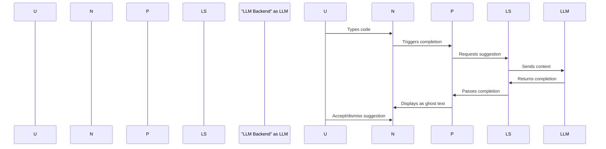
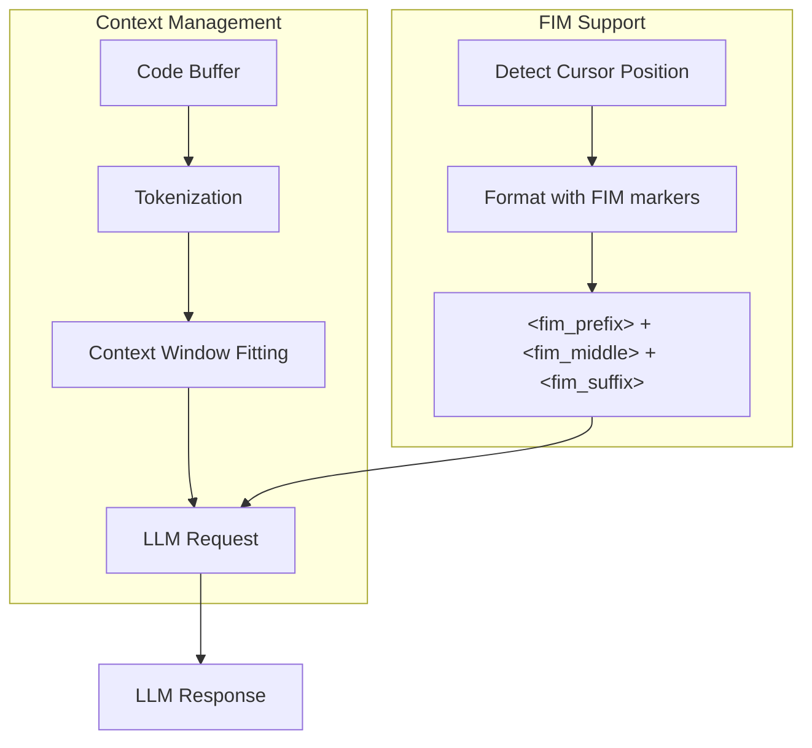
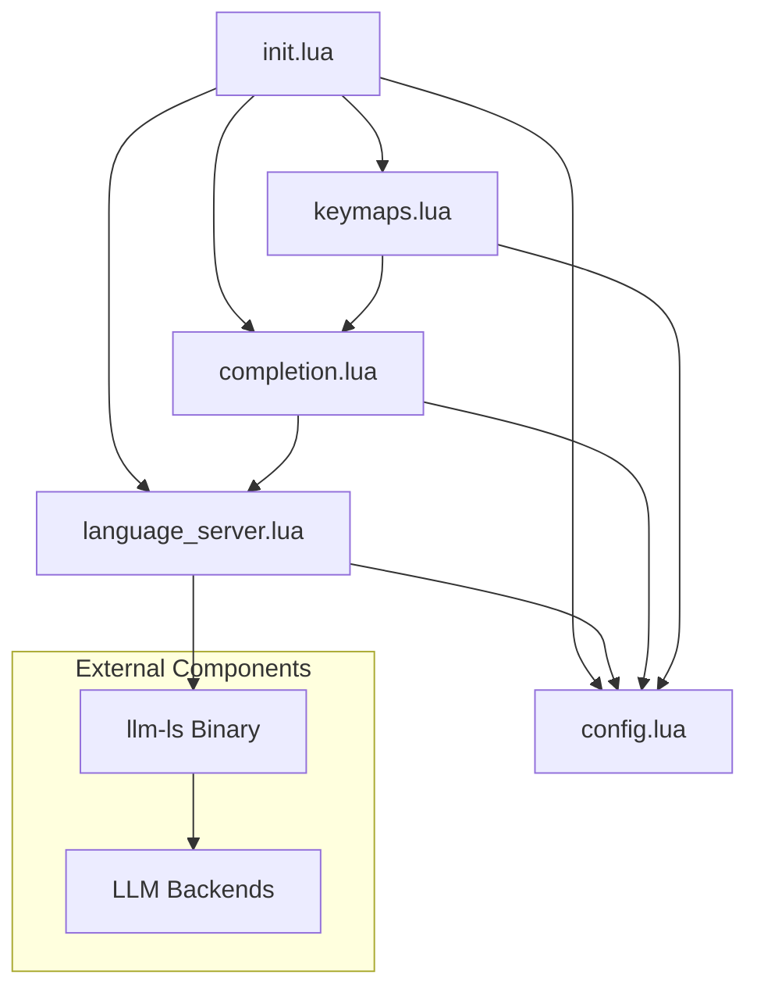
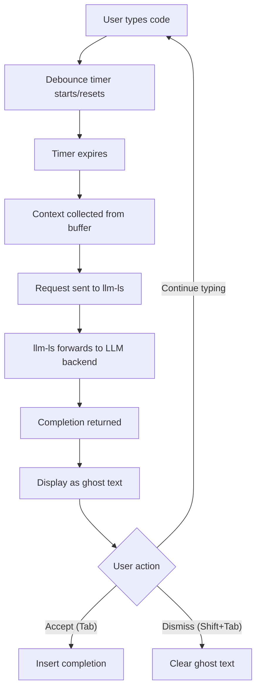
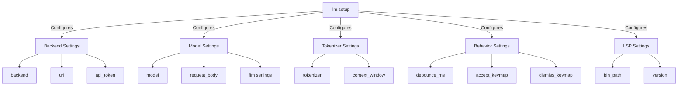

<!-- source: DeepWiki mcp.deepwiki.com · repo huggingface/llm.nvim · page 1 Overview · fetched 2026-10-26 -->

# Overview

Relevant source files

The following files were used as context for generating this wiki page:

- [README.md](README.md)
- [lua/llm/init.lua](lua/llm/init.lua)

This page provides a high-level introduction to llm.nvim, a Neovim plugin that enables LLM-powered code completion directly in your editor. llm.nvim uses language models to generate context-aware code suggestions that appear as "ghost text" as you type, similar to GitHub Copilot. For detailed installation instructions, see [Installation](#1.1), and for getting started quickly, see [Quick Start](#1.2).

## What is llm.nvim?

llm.nvim is a Neovim plugin that integrates with large language models (LLMs) to provide intelligent code completions. It uses the Language Server Protocol (LSP) and connects to various LLM backends via the standalone llm-ls language server.

Sources: [README.md:1-9](), [README.md:16-31]()

## Core Features

### Code Completion with Ghost Text

llm.nvim provides "ghost-text" style code completion, displaying suggestions inline as you type. These suggestions can be accepted or dismissed with configurable keybindings.

Sources: [README.md:16-20](), [lua/llm/init.lua:8-16]()

### Multiple Backend Support

llm.nvim can connect to various LLM backends:

1. **Hugging Face Inference API** - Cloud-hosted models from Hugging Face
2. **Ollama** - Self-hosted models via Ollama
3. **OpenAI** - OpenAI's API and compatible servers
4. **TGI (Text Generation Inference)** - Hugging Face's optimized inference server

This flexibility allows you to choose the best solution for your specific needs, whether you prefer cloud-based models or local deployment.

Sources: [README.md:34-129]()

### Context-Aware Suggestions

The plugin ensures completions are relevant to your code by:

1. Sending appropriate context to the model
2. Fitting everything within the model's context window using tokenization
3. Supporting Fill-in-the-Middle (FIM) for applicable models

Sources: [README.md:30-31](), [README.md:136-173](), [README.md:211-245]()

## System Architecture

llm.nvim follows a modular design pattern that separates concerns into distinct components:

The plugin is initialized through `init.lua`, which sets up the other components:

1. **Configuration** (`config.lua`) - Manages user settings and preferences
2. **Language Server** (`language_server.lua`) - Handles communication with llm-ls
3. **Completion** (`completion.lua`) - Processes suggestions and displays them
4. **Keymaps** (`keymaps.lua`) - Sets up keyboard shortcuts for interacting with suggestions

Sources: [lua/llm/init.lua:1-5](), [lua/llm/init.lua:18-35]()

## Workflow

When using llm.nvim, the typical workflow follows these steps:

1. User types code in Neovim
2. After a configurable debounce period, llm.nvim requests a completion
3. The request is sent through llm-ls to the configured LLM backend
4. The response is processed and displayed as ghost text
5. User accepts or dismisses the suggestion

Sources: [README.md:246-264](), [README.md:306-351]()

## Configuration

llm.nvim offers extensive configuration options, which are covered in detail in the [Configuration](#2) page. Key configuration areas include:

1. **Backend configuration** - Choose and configure your LLM provider
2. **Model settings** - Select the model and its parameters
3. **Tokenizer configuration** - Control how the context is tokenized
4. **Behavior settings** - Customize debounce time, keymaps, and more
5. **Language server settings** - Configure the llm-ls binary

Sources: [README.md:32-351]()

## Commands

llm.nvim provides several commands for controlling its behavior:

| Command | Description |
|---------|-------------|
| `LLMToggleAutoSuggest` | Enables or disables automatic suggestions as you type |
| `LLMSuggestion` | Manually requests a suggestion at the current cursor position |

Sources: [README.md:257-263](), [lua/llm/init.lua:8-16]()

## Summary

llm.nvim provides a powerful, flexible interface to LLM-powered code completion directly in Neovim. Its modular architecture and extensive configuration options make it adaptable to various workflows and preferences. Whether you're using cloud-based models or running your own inference server, llm.nvim offers a seamless integration with your editing environment.

For next steps:
- See [Installation](#1.1) for detailed setup instructions
- Follow the [Quick Start](#1.2) guide to get up and running
- Explore [Configuration](#2) for customization options
- Learn about the [Architecture](#3) for more technical details

Sources: [README.md:1-9](), [README.md:306-351]()

---

