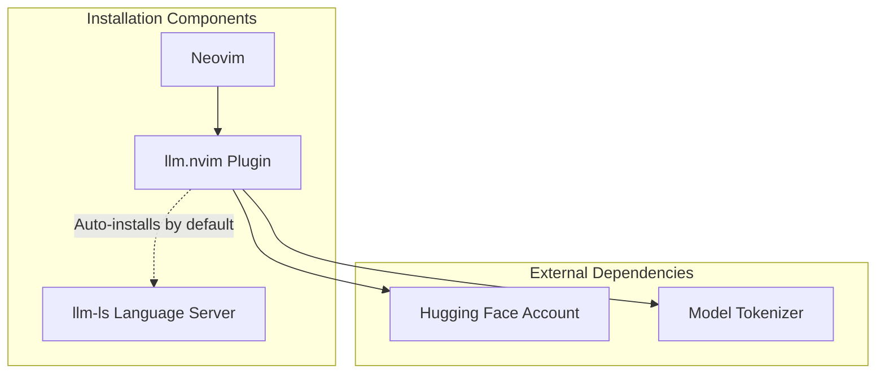
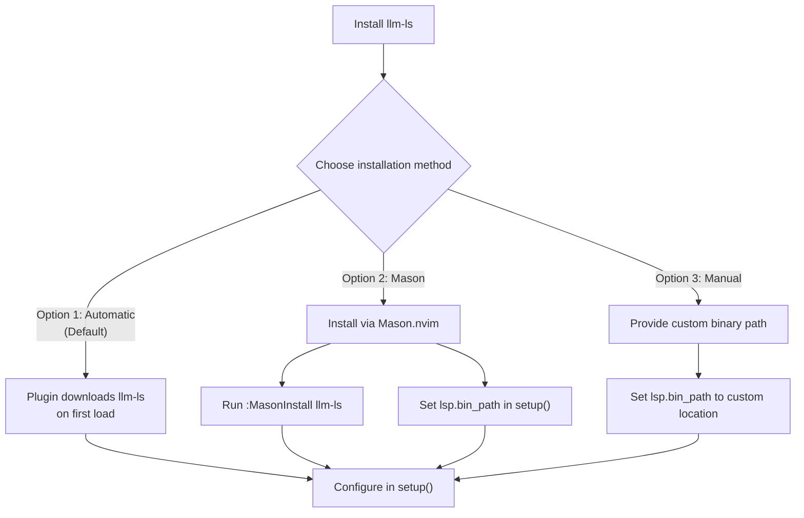
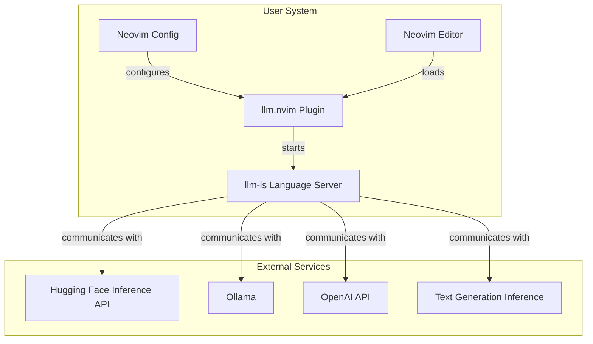

<!-- source: DeepWiki mcp.deepwiki.com · repo huggingface/llm.nvim · page 1.1 Installation · fetched 2026-10-26 -->

# Installation

<details>
<summary>Relevant source files</summary>

The following files were used as context for generating this wiki page:

- [README.md](README.md)

</details>


This page explains how to install and set up **llm.nvim**, a Neovim plugin for LLM-powered code completion. For information about configuring the plugin after installation, see [Configuration](#2) and specifically [Backend Configuration](#2.1).

## Installation Overview

**llm.nvim** consists of two main components:
1. The Neovim plugin itself
2. The **llm-ls** language server which handles communication with LLM providers

The following diagram illustrates the components that need to be installed:



Sources: [README.md:177-189]()

## Prerequisites

Before installing **llm.nvim**, ensure you have:

1. **Neovim** (version 0.8.0 or later recommended)
2. A package manager for Neovim (packer, lazy.nvim, or vim-plug)
3. For Hugging Face backend: A Hugging Face account with an API token

Sources: [README.md:1-15](), [README.md:45-56]()

## Plugin Installation

You can install **llm.nvim** using any common Neovim package manager. Choose one of the following methods:

### Using packer

```lua
require("packer").startup(function(use)
  use {
    'huggingface/llm.nvim',
    config = function()
      require('llm').setup({
        -- configuration options will go here
      })
    end
  }
end)
```

Sources: [README.md:267-280]()

### Using lazy.nvim

```lua
require("lazy").setup({
  {
    'huggingface/llm.nvim',
    opts = {
      -- configuration options will go here
    }
  },
})
```

Sources: [README.md:282-293]()

### Using vim-plug

Add to your Neovim configuration file:

```vim
Plug 'huggingface/llm.nvim'
```

Then configure the plugin:

```lua
require('llm').setup({
  -- configuration options will go here
})
```

Sources: [README.md:295-304]()

## Language Server Installation

**llm.nvim** uses **llm-ls** as its backend language server. There are three ways to set up the language server:



### Automatic Installation (Default)

By default, **llm-ls** is automatically installed by the plugin when first loaded. The binary is downloaded from the [GitHub release page](https://github.com/huggingface/llm-ls/releases) and stored in:

```
stdpath("data") .. "/llm_nvim/bin"
```

This requires no additional configuration.

Sources: [README.md:177-184]()

### Mason Installation

To install via [mason.nvim](https://github.com/williamboman/mason.nvim):

1. Run the following command in Neovim:
   ```vim
   :MasonInstall llm-ls
   ```

2. Reference the Mason binary path in your configuration:
   ```lua
   require('llm').setup({
     -- other options...
     lsp = {
       bin_path = vim.api.nvim_call_function("stdpath", { "data" }) .. "/mason/bin/llm-ls",
     },
     -- other options...
   })
   ```

Sources: [README.md:190-207]()

### Manual Installation

For custom builds or unsupported platforms, you can:

1. Build or download **llm-ls** manually
2. Set the binary path in your configuration:
   ```lua
   require('llm').setup({
     -- other options...
     lsp = {
       bin_path = "/path/to/your/llm-ls",
     },
     -- other options...
   })
   ```

You can also run **llm-ls** via TCP by specifying host and port instead:

```lua
require('llm').setup({
  -- other options...
  lsp = {
    host = "127.0.0.1",
    port = 9988,
  },
  -- other options...
})
```

Sources: [README.md:177-188]()

## API Token Setup

When using the Hugging Face Inference API as a backend, you'll need to set up your API token. You have several options, in order of precedence:

1. Pass token directly in config (not recommended if using version control):
   ```lua
   require('llm').setup({
     api_token = "your-hf-api-token",
     -- other options...
   })
   ```

2. Set the `LLM_NVIM_HF_API_TOKEN` environment variable

3. Define your `HF_HOME` environment variable and create a file with your token at `$HF_HOME/token`

4. Install the [huggingface-cli](https://huggingface.co/docs/huggingface_hub/quick-start) and run `huggingface-cli login`

Sources: [README.md:45-56]()

## Basic Configuration

After installation, you need to configure the plugin. Here's a minimal configuration example:

```lua
require('llm').setup({
  model = "bigcode/starcoder2-15b", -- the model to use
  backend = "huggingface", -- backend provider (huggingface, ollama, openai, tgi)
  context_window = 1024, -- token context window
  tokenizer = {
    repository = "bigcode/starcoder2-15b", -- tokenizer to use
  },
  -- Add other options as needed
})
```

For detailed configuration, see the [Configuration](#2) page.

Sources: [README.md:307-351]()

## Installation Verification

To verify your installation is working properly:

1. Start Neovim
2. Open a code file and start typing
3. The plugin should display ghost text suggestions as you type
4. If no suggestions appear, you can manually trigger them with the `:LLMSuggestion` command

If the plugin isn't working, check the following:
- Language server installation status
- API token configuration
- Network connectivity to the LLM backend
- Log output using `LLM_LOG_LEVEL = "DEBUG"` in `lsp.cmd_env`

Sources: [README.md:258-264](), [README.md:336-343]()

## Installation Architecture

This diagram shows the relationships between the components after installation:



This illustrates how the components interact after successful installation, with **llm.nvim** integrating with Neovim and communicating with LLM providers through the **llm-ls** language server.

Sources: [README.md:34-129]()

---

