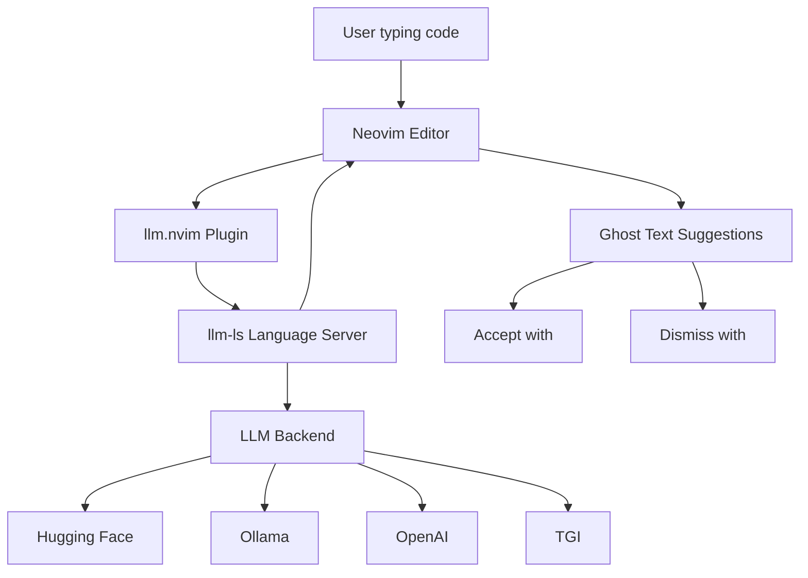
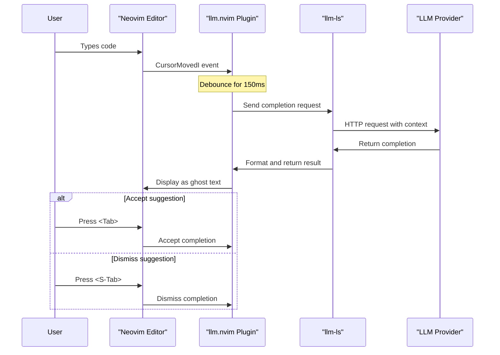
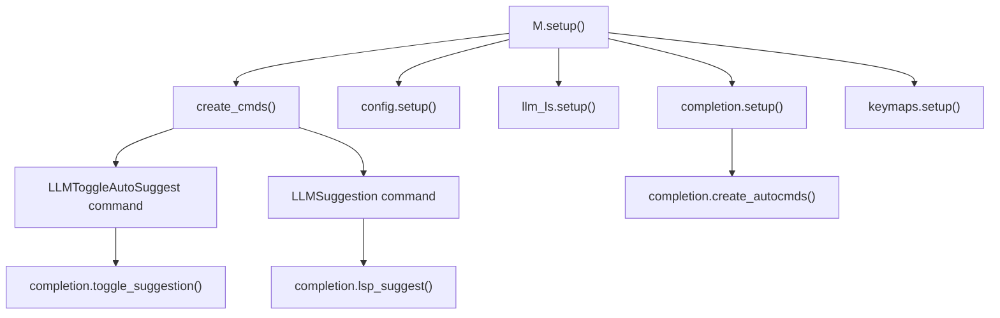

<!-- source: DeepWiki mcp.deepwiki.com · repo huggingface/llm.nvim · page 1.2 Quick Start · fetched 2026-10-26 -->

# Quick Start

<details>
<summary>Relevant source files</summary>

The following files were used as context for generating this wiki page:

- [README.md](README.md)
- [lua/llm/init.lua](lua/llm/init.lua)

</details>


This page provides a concise guide to help you get started with llm.nvim quickly. For detailed installation instructions, see [Installation](#1.1), and for comprehensive configuration options, see [Configuration](#2).

## What is llm.nvim?

llm.nvim is a Neovim plugin that provides LLM-powered code completion with "ghost text" suggestions similar to GitHub Copilot. It uses [llm-ls](https://github.com/huggingface/llm-ls) as a backend and can connect to various LLM providers including Hugging Face Inference API, Ollama, OpenAI, and Text Generation Inference (TGI).



Sources: [README.md:1-9](), [README.md:16-26]()

## Installation

Choose one of the following package managers to install llm.nvim:

### Using Packer

```lua
require("packer").startup(function(use)
  use {
    'huggingface/llm.nvim',
    config = function()
      require('llm').setup({
        -- Configuration will be covered in the next section
      })
    end
  }
end)
```

### Using lazy.nvim

```lua
require("lazy").setup({
  {
    'huggingface/llm.nvim',
    opts = {
      -- Configuration will be covered in the next section
    }
  },
})
```

### Using vim-plug

In your vim configuration:
```vim
Plug 'huggingface/llm.nvim'
```

Then in your lua configuration:
```lua
require('llm').setup({
  -- Configuration will be covered in the next section
})
```

Sources: [README.md:265-304]()

## Minimal Configuration

Here's a basic configuration to get started with the Hugging Face Inference API:

```lua
require('llm').setup({
  model = "bigcode/starcoder2-15b",  -- Model ID
  backend = "huggingface",           -- LLM backend provider
  context_window = 1024,             -- Maximum context window size
  request_body = {                   -- Parameters for generation
    parameters = {
      max_new_tokens = 60,           -- Maximum tokens to generate
      temperature = 0.2,             -- Lower = more deterministic
      top_p = 0.95,                  -- Nucleus sampling parameter
    },
  },
})
```

Sources: [README.md:308-350]()

### Setting Up Your API Token

For Hugging Face Inference API, you need an API token. You have several options to provide it (in order of precedence):

1. Pass it directly in the configuration (not recommended for versioned configs):
   ```lua
   require('llm').setup({
     api_token = "YOUR_TOKEN_HERE",
     -- other configuration options
   })
   ```

2. Set the `LLM_NVIM_HF_API_TOKEN` environment variable

3. Set the `HF_HOME` environment variable and create a file at `$HF_HOME/token`

4. Use the huggingface-cli: `huggingface-cli login`

Sources: [README.md:50-56]()

## Basic Usage Workflow

Once configured, llm.nvim will automatically provide code completion suggestions as you type:



Sources: [README.md:247-263](), [lua/llm/init.lua:1-37]()

### Keyboard Shortcuts

| Action | Default Key | Configuration Option |
|--------|-------------|----------------------|
| Accept suggestion | `<Tab>` | `accept_keymap` |
| Dismiss suggestion | `<S-Tab>` | `dismiss_keymap` |

Sources: [README.md:333-334]()

### Commands

The plugin provides two commands:

- `:LLMToggleAutoSuggest` - Toggle automatic suggestions on/off
- `:LLMSuggestion` - Manually request a suggestion

Sources: [README.md:257-263](), [lua/llm/init.lua:8-16]()

## Quick Backend Configuration

llm.nvim supports multiple backends. Here are minimal configurations for each:

### Hugging Face Inference API (Default)

```lua
{
  backend = "huggingface",
  model = "bigcode/starcoder2-15b",
  -- api_token set via environment variables
}
```

### Ollama

```lua
{
  backend = "ollama",
  model = "codellama:7b",
  url = "http://localhost:11434",
  request_body = {
    options = {
      temperature = 0.2,
      top_p = 0.95,
    }
  }
}
```

### OpenAI

```lua
{
  backend = "openai",
  model = "codellama",
  url = "http://localhost:8000",
  request_body = {
    temperature = 0.2,
    top_p = 0.95,
  }
}
```

### TGI (Text Generation Inference)

```lua
{
  backend = "tgi",
  model = "bigcode/starcoder",
  url = "http://localhost:8080",
  request_body = {
    parameters = {
      temperature = 0.2,
      top_p = 0.95,
    }
  }
}
```

Sources: [README.md:34-129]()

## System Components and Interactions

This diagram shows how llm.nvim's components interact during initialization:



Sources: [lua/llm/init.lua:18-35]()

## Next Steps

After getting your basic setup working, you may want to explore:

- [Backend Configuration](#2.1) for detailed setup of different LLM providers
- [Tokenizer Configuration](#2.2) for optimizing context handling
- [Behavior and Interface Settings](#2.3) for customizing the plugin's behavior
- [Model-Specific Configuration](#4.2) for model-specific optimizations

---

