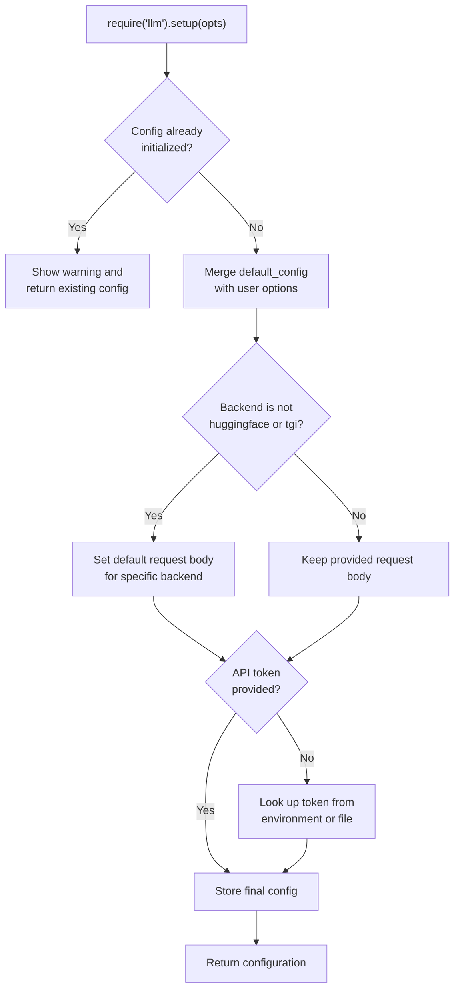
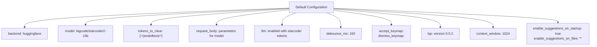
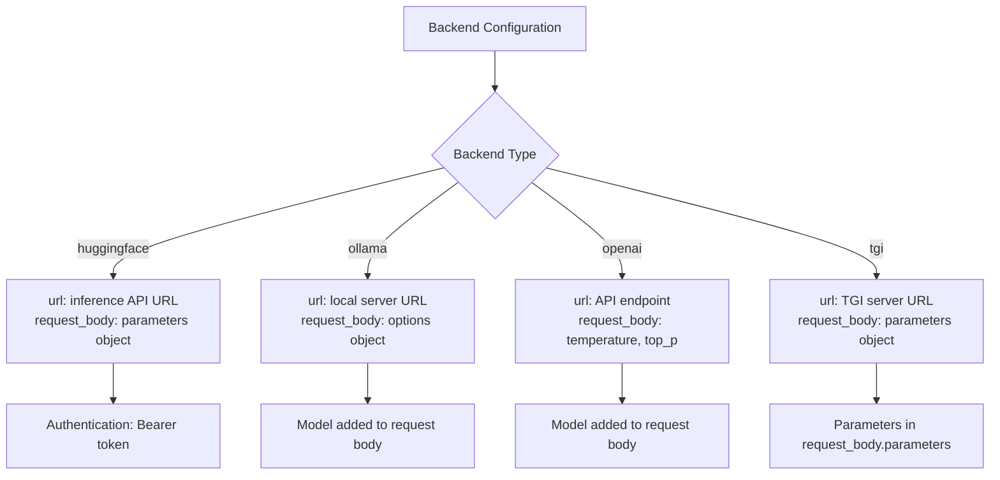
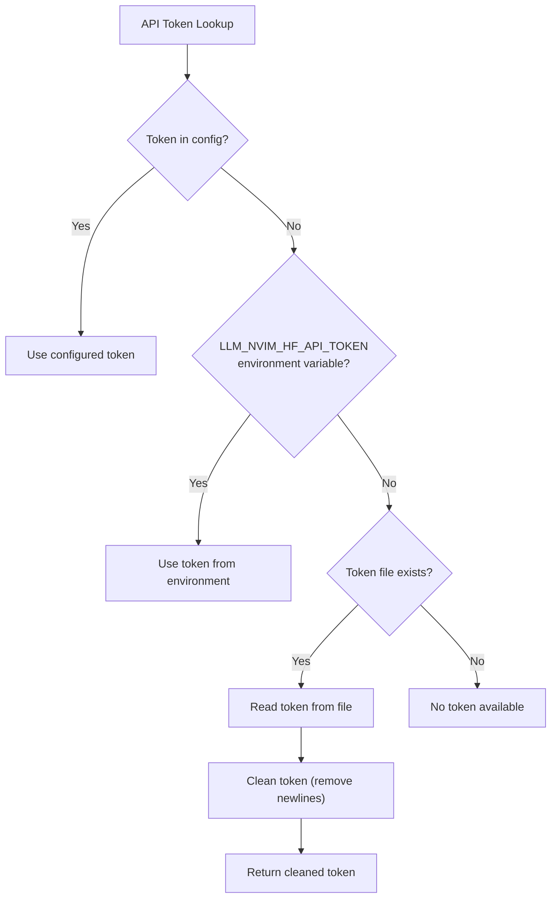
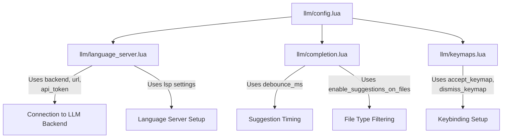

<!-- source: DeepWiki mcp.deepwiki.com · repo huggingface/llm.nvim · page 2 Configuration · fetched 2026-10-26 -->

# Configuration

<details>
<summary>Relevant source files</summary>

The following files were used as context for generating this wiki page:

- [README.md](README.md)
- [lua/llm/config.lua](lua/llm/config.lua)

</details>


This page provides an overview of the configuration system used in `llm.nvim`, including the core configuration options, configuration methods, and default settings. It explains how to properly configure the plugin to work with different LLM backends and customize its behavior according to your preferences.

For detailed information about specific configuration areas, see:
- Backend Configuration [Backend Configuration](#2.1)
- Tokenizer Configuration [Tokenizer Configuration](#2.2)
- Behavior and Interface Settings [Behavior and Interface Settings](#2.3)

## Configuration System Overview

The `llm.nvim` plugin uses a centralized configuration system defined in the `config.lua` file. This system manages settings for connecting to LLM backends, controlling tokenization, customizing behavior, and integrating with the language server.

### Configuration Structure

The configuration is organized into several logical categories:

```mermaid
graph TD
    A["llm.nvim Configuration"] --> B["Backend Configuration"]
    A --> C["Tokenizer Settings"]
    A --> D["Behavior Settings"]
    A --> E["Language Server Settings"]
    A --> F["Fill-in-the-Middle Configuration"]
    
    B --> B1["backend"]
    B --> B2["model"]
    B --> B3["url"]
    B --> B4["api_token"]
    B --> B5["request_body"]
    B --> B6["disable_url_path_completion"]
    
    C --> C1["tokenizer"]
    C --> C2["context_window"]
    C --> C3["tokens_to_clear"]
    
    D --> D1["debounce_ms"]
    D --> D2["accept_keymap"]
    D --> D3["dismiss_keymap"]
    D --> D4["enable_suggestions_on_startup"]
    D --> D5["enable_suggestions_on_files"]
    
    E --> E1["bin_path"]
    E --> E2["host"]
    E --> E3["port"]
    E --> E4["cmd_env"]
    E --> E5["version"]
    
    F --> F1["enabled"]
    F --> F2["prefix"]
    F --> F3["middle"]
    F --> F4["suffix"]
```



Sources: [lua/llm/config.lua:1-41](). [README.md:305-349]()

## Configuration Setup

The configuration is initialized by calling the `setup` function from the `llm` module. This function merges the provided options with the default configuration values.

### Basic Setup Example

```lua
require('llm').setup({
  model = "bigcode/starcoder2-15b",
  backend = "huggingface",
  api_token = nil, -- Will be obtained automatically if available
  debounce_ms = 150,
  accept_keymap = "<Tab>",
  dismiss_keymap = "<S-Tab>",
})
```

Sources: [README.md:308-349]()

### Configuration Loading Process



Sources: [lua/llm/config.lua:81-105]()

## Core Configuration Options

The following table outlines the core configuration options available in `llm.nvim`:

| Option | Type | Default | Description |
|--------|------|---------|-------------|
| `backend` | string | "huggingface" | The LLM backend to use; can be "huggingface", "ollama", "openai", or "tgi" |
| `model` | string | "bigcode/starcoder2-15b" | The model identifier to use; behavior depends on the backend |
| `url` | string or nil | nil | The HTTP URL of the backend; if nil, uses backend-specific default |
| `api_token` | string or nil | nil | The API token for authenticated requests |
| `context_window` | number | 1024 | Maximum number of tokens for the context window |
| `debounce_ms` | number | 150 | Debounce time in milliseconds for suggestion requests |
| `accept_keymap` | string | "\<Tab>" | Keymap to accept a suggestion |
| `dismiss_keymap` | string | "\<S-Tab>" | Keymap to dismiss a suggestion |
| `enable_suggestions_on_startup` | boolean | true | Whether to enable automatic suggestions on startup |
| `enable_suggestions_on_files` | string or table | "*" | Pattern(s) to determine which files get suggestions |

Sources: [lua/llm/config.lua:1-41](), [README.md:308-349]()

## Default Configuration

The default configuration is defined in `config.lua` and provides reasonable defaults for most options:



Sources: [lua/llm/config.lua:1-41]()

## Environment Variables

Several environment variables can be used to override configuration settings:

| Environment Variable | Affects |
|----------------------|---------|
| `LLM_NVIM_URL` | Overrides the `url` configuration |
| `LLM_NVIM_HF_API_TOKEN` | Primary source for Hugging Face API token |
| `LLM_NVIM_MODEL` | Overrides the model configuration |
| `HF_HOME` | Used to locate the token file if not specified directly |

Sources: [README.md:38-38](), [README.md:55-56](), [lua/llm/config.lua:60-79]()

## Backend-Specific Configuration

Each backend type has specific configuration requirements and defaults. The configuration system automatically applies the right defaults based on the selected backend.



Sources: [README.md:34-129](), [lua/llm/config.lua:43-54](), [lua/llm/config.lua:89-96]()

## API Token Lookup Process

When an API token is needed but not explicitly provided, the system follows a lookup sequence:



Sources: [lua/llm/config.lua:60-79](), [README.md:50-56]()

## Configuration Retrieval

Once initialized, the configuration can be accessed using the `get` function from the `llm.config` module:

```lua
local config = require('llm.config').get()
```

This function checks if the configuration has been initialized and returns the current configuration. If the configuration has not been initialized, it throws an error.

Sources: [lua/llm/config.lua:107-113]()

## Configuration Interaction with Other Components

The configuration system interacts with multiple other components of the plugin:



Sources: [README.md:16-31]()

## Related Pages

For more detailed information on specific aspects of configuration, see:
- [Backend Configuration](#2.1) - Detailed configuration of different LLM providers
- [Tokenizer Configuration](#2.2) - Configuration of tokenizers for context window management
- [Behavior and Interface Settings](#2.3) - Settings for user interface and plugin behavior

---

